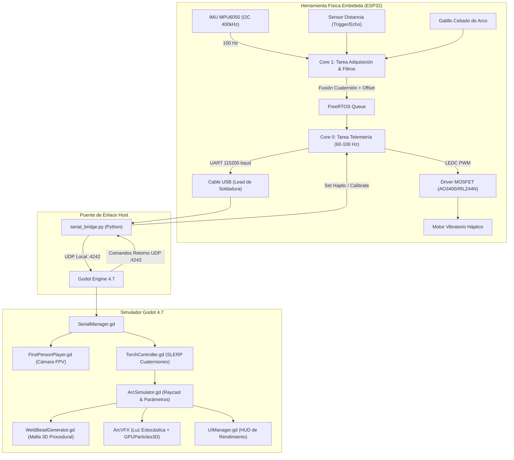

# ArcSim_VR: Sistema VR de Soldadura SMAW para Capacitación de Operarios

> **Simulador Interactivo 3D y Herramienta Háptica Sensorizada con ESP32 para Entrenamiento Profesional de Soldadura por Arco Manual con Electrodo Revestido (SMAW)**

---

## 1. Resumen del Proyecto

**ArcSim_VR** es una plataforma integral de entrenamiento y simulación diseñada para acelerar la curva de aprendizaje de operarios en procesos de soldadura por arco eléctrico (SMAW - Shielded Metal Arc Welding).

El sistema combina:
1. **Herramienta Física Sensorizada (Pinza Porta-Electrodo):** Basada en un microcontrolador **ESP32**, equipada con:
   - Unidad Inercial **MPU6050** de 6 DoF (orientación espacial sin derivación mediante filtro complementario y cuaterniones).
   - Sensor de distancia acústico de alta velocidad con compensación de offset mecánico (y arquitectura extensible para sensores ToF láser por I2C).
   - Actuador háptico con modulación **PWM gobernado por MOSFET** para emular físicamente el cebado, distancia de arco óptima, advertencia de arco largo y el pegado de electrodo (*sticking*).
   - Conexión por cable USB hacia la estación de trabajo (emulando la masa y el cable de corriente real de soldadura) con transmisión a **100 Hz** y latencia menor a **15 ms**.
2. **Simulador 3D en Godot Engine 4.7:**
   - Visualización en **Primera Persona (FPV)** que sitúa al alumno frente a la mesa de trabajo con visor fotosensible de careta de soldadura (filtro DIN 11).
   - Evaluación técnica en tiempo real de los cuatro parámetros fundamentales de soldadura según normas internacionales:
     - **Longitud de arco** ($1.5$ a $3.5\text{ mm}$).
     - **Ángulo de avance / arrastre** ($15^\circ$ a $20^\circ$).
     - **Ángulo de trabajo** ($90^\circ$ en junta a tope).
     - **Velocidad de desplazamiento** ($3$ a $6\text{ mm/s}$).
   - **Generación procedimental 3D del cordón de soldadura** en tiempo real con modelado térmico de baño de fusión incandescente y enfriamiento progresivo a escoria.
   - Efectos visuales de plasma (VFX, luz estocástica y partículas de chispas de tungsteno/escoria).

---

## 2. Arquitectura del Sistema



---

## 3. Estructura del Repositorio

```text
ArcSim_VR/
├── hardware/
│   ├── schematics/
│   │   └── WIRING_DIAGRAM.md      # Pinout completo y esquemático con protección flyback
│   ├── bom/
│   │   └── BOM.md                 # Lista de materiales detallada
│   └── 3d_models/                 # Modelos STL para soporte de sensores en la pinza
├── firmware/
│   ├── platformio.ini             # Archivo de configuración PlatformIO
│   ├── include/
│   │   ├── Config.h               # Configuración de pines, offsets y constantes
│   │   ├── IDistanceSensor.h      # Interfaz polimórfica para sensores de distancia
│   │   ├── DistanceSensor.h       # Implementación Ultrasónico, ToF y Simulado
│   │   ├── IMUManager.h           # Gestor MPU6050, calibración y cuaterniones
│   │   ├── HapticFeedback.h       # Driver PWM para el motor háptico
│   │   └── TelemetryStream.h      # Serializador de telemetría y comandos
│   └── src/
│       ├── DistanceSensor.cpp
│       ├── IMUManager.cpp
│       ├── HapticFeedback.cpp
│       ├── TelemetryStream.cpp
│       └── main.cpp               # FreeRTOS Dual-Core (Adquisición y Comunicación)
├── simulation_godot/
│   ├── project.godot              # Configuración del proyecto Godot 4.7
│   ├── tools/
│   │   └── serial_bridge.py       # Puente transparente USB-Serial a UDP
│   ├── scripts/
│   │   ├── SerialManager.gd       # Receptor de telemetría y watchdog
│   │   ├── FirstPersonPlayer.gd   # Controlador de operario en primera persona
│   │   ├── TorchController.gd     # Mapeo espacial de la pinza y consumo de electrodo
│   │   ├── ArcSimulator.gd        # Raycast físico, evaluación AWS y disparo VFX
│   │   ├── WeldBeadGenerator.gd   # Esculpido procedural del cordón de soldadura
│   │   └── UIManager.gd           # HUD con métricas en tiempo real
│   ├── scenes/
│   │   ├── MainSimulation.tscn    # Escena principal con cabina y mesa
│   │   ├── Torch.tscn             # Modelo 3D de pinza y electrodo
│   │   └── ArcVFX.tscn            # Sistema de partículas, luz y plasma
│   └── assets/
│       └── shaders/
│           ├── molten_metal.gdshader # Shader de baño de fusión incandescente
│           └── welding_mask.gdshader # Filtro fotosensible DIN 11 de la careta
└── docs/
    ├── CALIBRATION_GUIDE.md       # Guía de calibración de MPU6050 y offset mecánico
    └── README.md                  # Este documento
```

---

## 4. Requisitos Previos

- **Entorno Embebido:** [Visual Studio Code](https://code.visualstudio.com/) con extensión **PlatformIO IDE** (o Arduino IDE con soporte ESP32).
- **Motor Gráfico:** **Godot Engine 4.7** (Standard Edition, 64-bit).
- **Entorno Python (Host):** Python 3.10+ y librería `pyserial`:
  ```bash
  pip install pyserial
  ```
- **Hardware:** ESP32 DevKit v1, IMU MPU6050, Sensor HC-SR04 / RCWL-1601 (o ToF VL53L0X), motor vibrador DC con transistor MOSFET AO3400/IRLZ44N y diodo flyback 1N4007.

---

## 5. Instrucciones de Compilación y Carga del Firmware

### Con PlatformIO (Recomendado)
1. Abrir la carpeta `firmware/` en VS Code con PlatformIO.
2. Conectar el ESP32 mediante el cable USB.
3. Compilar y cargar el firmware:
   ```bash
   pio run --target upload
   ```
4. Monitorear la salida serie:
   ```bash
   pio device monitor -b 115200
   ```
   *Deberás observar las tramas de telemetría JSON emitidas a 60-100 Hz.*

---

## 6. Puesta en Marcha del Sistema Completo

1. **Conectar el ESP32 a la PC** mediante el cable USB.
2. **Iniciar el puente de comunicación:**
   ```bash
   cd simulation_godot/tools
   python serial_bridge.py
   ```
   *El script autodetectará el puerto COM correspondiente al ESP32 y comenzará la retransmisión local por UDP.*
3. **Abrir Godot 4.7:**
   - Importar el proyecto ubicado en `simulation_godot/project.godot`.
   - Ejecutar la escena principal (`F5` o ejecutar `MainSimulation.tscn`).
4. **Comprobación:**
   - El HUD superior izquierdo cambiará de estado a **"HARDWARE CONECTADO (100 Hz)"** en color verde.
   - Al rotar la pinza física, la herramienta virtual en pantalla copiará el movimiento con suavidad y precisión.

---

## 7. Controles del Simulador

| Tecla / Control | Acción |
| :--- | :--- |
| **Ratón** | Orientar la cabeza del soldador para mirar hacia la chapa y la junta |
| **W, A, S, D** | Desplazarse por la cabina de soldadura |
| **F** | Alternar la careta de soldador (Activar/Desactivar filtro fotosensible DIN 11) |
| **C** | Iniciar calibración de cero en reposo de la IMU MPU6050 |
| **R** | Recentrar ángulo de azimut (Yaw) alineado con la junta de soldadura |
| **ESPACIO** | Limpiar el cordón de soldadura depositado en la probeta para reiniciar práctica |
| **ESC** | Liberar o recapturar el cursor del ratón |

---

## 8. Protocolo de Telemetría (JSON)

### Trama de Telemetría (ESP32 $\rightarrow$ Godot)
```json
{
  "r": -12.45,
  "p": 18.20,
  "y": 85.10,
  "qw": 0.7214,
  "qx": -0.1523,
  "qy": 0.6721,
  "qz": -0.0712,
  "d": 2.4,
  "b": 1,
  "h": 75,
  "t": 14205,
  "st": 1
}
```
* **`r`, `p`, `y`:** Ángulos de Euler (Roll, Pitch, Yaw) en grados.
* **`qw`, `qx`, `qy`, `qz`:** Cuaternión de rotación 3D normalizado.
* **`d`:** Distancia calculada punta-chapa en milímetros (con corrección de offset).
* **`b`:** Estado del pulsador/gatillo de cebado (1: pulsado, 0: libre).
* **`h`:** Ciclo de trabajo del motor háptico actual (0 a 255).
* **`t`:** Marca de tiempo (*timestamp*) en milisegundos.
* **`st`:** Tipo de sensor (1: Ultrasónico, 2: ToF Láser, 3: Simulado).

### Comandos de Control (Godot $\rightarrow$ ESP32)
* `{"cmd":"CALIBRATE"}`: Ejecuta calibración de offsets estáticos en reposo.
* `{"cmd":"RESET_YAW"}`: Ajusta el ángulo Yaw a $0.0^\circ$.
* `{"cmd":"SET_HAPTIC","val":255}`: Fuerza vibración háptica al 100% (electrodo pegado).
