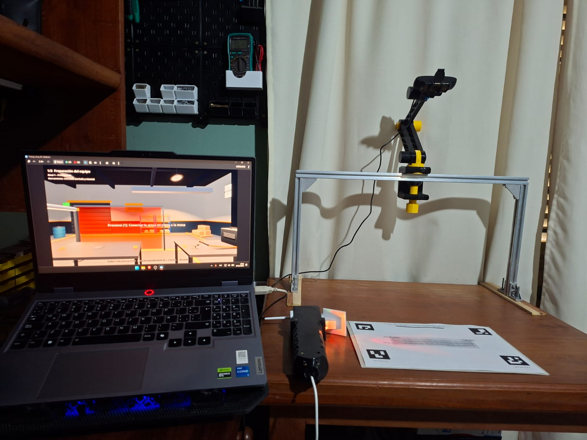
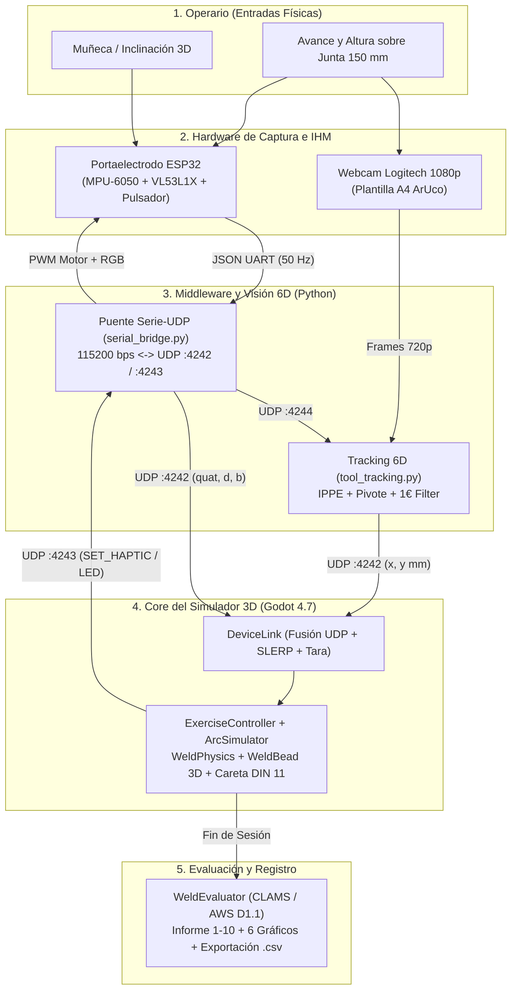
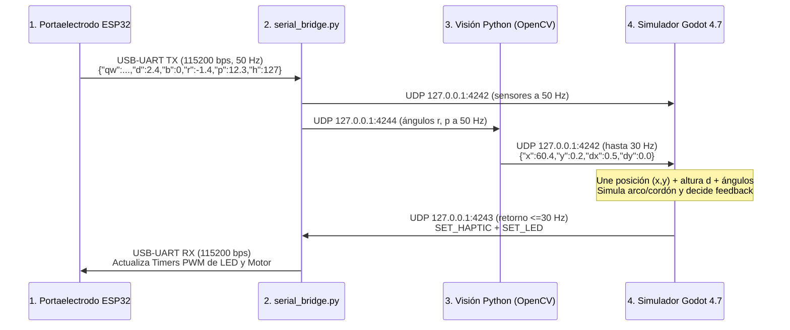
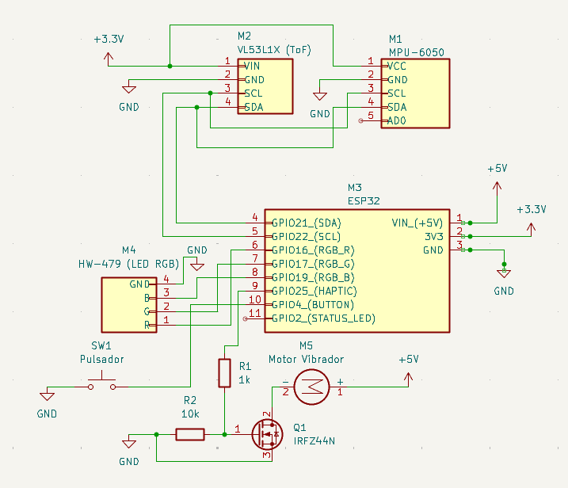
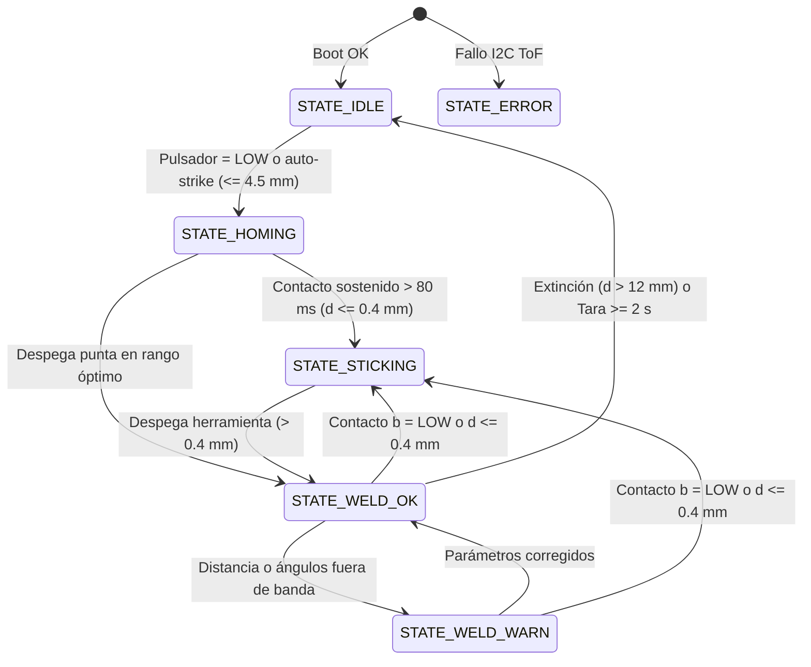
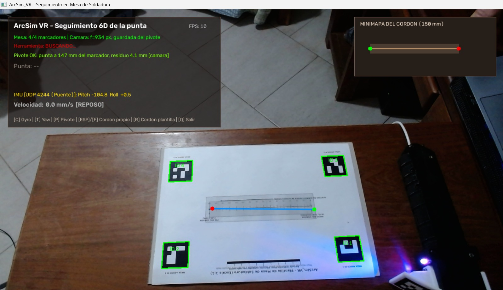
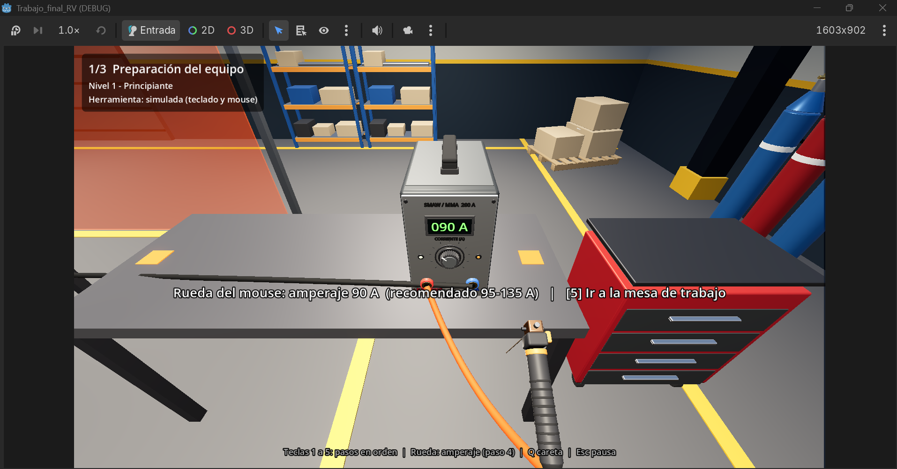
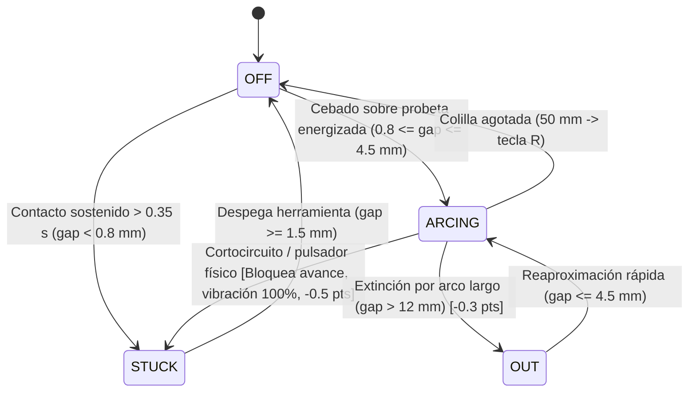
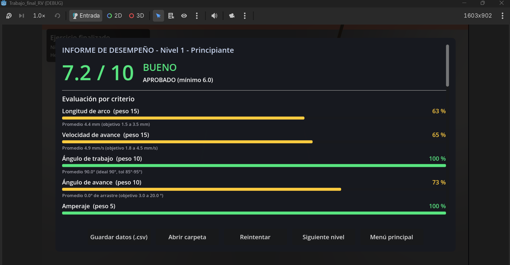
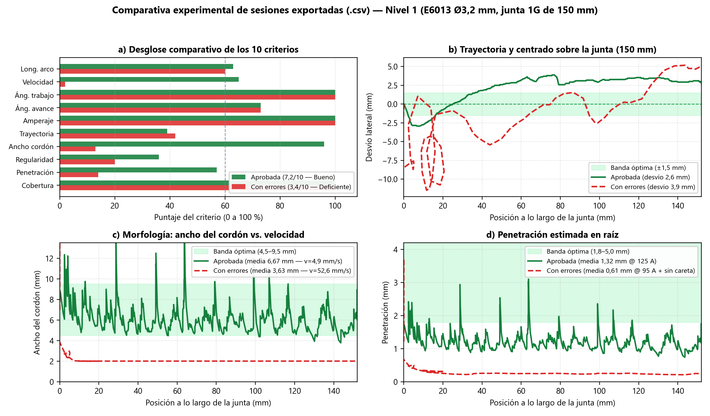

<!-- PORTADA -->
# Simulador de Realidad Mixta para Capacitación y Evaluación en Soldadura SMAW (*ArcSim_VR*)

**Proyecto Integrador — Realidad Virtual**  
Ingeniería en Mecatrónica · Facultad de Ingeniería · Universidad Nacional de Cuyo

**Profesores**  
Profesor Titular: Javier Rosenstein  
JTP: Carlos Tomba

**Alumnos**  
Albanez, Luciano | Legajo N°: 13185
García, Ezequiel | Legajo N°: 13239  

---

<!-- INDICE -->

## Introducción

En la formación técnica de operarios para **soldadura por arco eléctrico manual con electrodo revestido (SMAW — *Shielded Metal Arc Welding*)**, las primeras etapas de práctica en taller presentan importantes barreras operativas, económicas y de seguridad. El estudiante que aún no ha desarrollado memoria muscular debe enfrentarse simultáneamente a radiación ultravioleta e infrarroja intensa, proyección de partículas incandescentes, humos metálicos y riesgo eléctrico, al mismo tiempo que consume de forma continua electrodos, energía y chapas de acero que quedan inutilizadas tras pocas pasadas defectuosas. A ello se suma la dificultad pedagógica de observar en vivo magnitudes milimétricas —como mantener una longitud de arco de $1{,}5\text{ a }3{,}5\text{ mm}$— debido al deslumbramiento del propio plasma. Si bien en la industria existen entrenadores comerciales basados en Realidad Virtual y Aumentada (*SOLDAMATIC*, *Lincoln VRTEX 360*), su elevado costo económico limita su adopción en talleres educativos públicos y laboratorios universitarios.

En este contexto se enmarca **ArcSim_VR**, una plataforma interactiva de **Realidad Mixta no inmersiva** de bajo costo diseñada para entrenar la destreza psicomotriz y evaluar objetivamente la ejecución de una junta a tope en posición plana (**1G**) de **$150\text{ mm}$ de longitud** sobre chapa de acero de **$10\text{ mm}$**, empleando un electrodo rutílico **AWS E6013 de $\varnothing 3{,}2\text{ mm}$**. El sistema acopla en lazo cerrado un **portaelectrodo físico sensorizado** impreso en 3D (con medición inercial, distancia láser milimétrica, detección mecánica de contacto y retroalimentación háptica/luminosa), un **sistema de seguimiento óptico 6D** mediante marcadores ArUco y un **entorno virtual 3D en Godot Engine 4.7** que simula el taller, la física del baño fundido y la evaluación cuantitativa bajo lineamientos **CLAMS** y **AWS D1.1**. La totalidad de la electrónica y óptica empleada provino de componentes ya disponibles en el equipo, logrando costo cero de inversión electrónica adicional.


*Figura 1 — Puesto completo en operación: pórtico de aluminio 20×20 mm con brazo articulado y cámara web, plantilla A4 con marcadores ArUco, portaelectrodo impreso en PLA y taller 3D ejecutándose en pantalla.*

## Objetivos del proyecto

### Objetivo general

Diseñar, construir y validar un sistema interactivo de Realidad Mixta de bajo costo para el entrenamiento motriz y la evaluación objetiva de operarios en soldadura por arco manual (SMAW), integrando una herramienta física sensorizada con retroalimentación háptica y un gemelo digital 3D en tiempo real.

### Objetivos específicos

* Desarrollar un dispositivo IHM físico específico impreso en PLA que integre medición de orientación 3D (`MPU-6050`), medición láser milimétrica de longitud de arco (`VL53L1X`), detección axial de contacto físico y actuadores de feedback cromático (`LED RGB`) y táctil (motor vibrador PWM).
* Implementar un subsistema de visión por computadora 6D basado en marcadores `ArUco` y calibración geométrica de pivote para determinar en tiempo real la posición absoluta $(x, y)$ de la punta del electrodo sobre la junta de $150\text{ mm}$ sin errores por inclinación de muñeca.
* Construir un entorno virtual 3D interactivo en **Godot Engine 4.7** que reproduzca la puesta en marcha guiada del puesto de soldadura, el comportamiento físico-geométrico del cordón con enfriamiento térmico, audio procedural reactivo y simulación de careta fotosensible (DIN 4 / DIN 11).
* Integrar una arquitectura modular bidireccional en tiempo real (USB-Serie y sockets UDP) acompañada de un Centro de Control de escritorio para ajustar actuadores y tolerancias sin recompilar código.
* Incorporar un sistema pedagógico progresivo en **tres niveles de dificultad** con calificación automática de 1 a 10 basada en el método **CLAMS** y la norma **AWS D1.1**, diagnóstico de defectos y exportación de series temporales a `.csv`.

## Arquitectura del sistema

La arquitectura general de **ArcSim_VR** se estructura en cinco capas desacopladas que cierran un lazo sensor-simulación-actuador en tiempo real, tal como resume el siguiente diagrama de flujo:


*Figura 1 (esquema) — Diagrama de flujo del sistema en capas.*

* **1. Capa de Operario:** El estudiante manipula una pinza portaelectrodo física real sobre la mesa provista de la plantilla impresa A4. A diferencia de periféricos estándar (mouse o gamepad), el dispositivo específico reproduce el diámetro de agarre real ($\varnothing 54\text{ mm}$), brinda tope mecánico pasivo contra la superficie ($d = 0{,}0\text{ mm}$) y entrega vibración colocalizada en la palma.
* **2. Capa de Hardware de Captura e IHM:** El microcontrolador `ESP32` adquiere por bus I²C de alta velocidad (**$400\text{ kHz}$**) la orientación espacial del `MPU-6050` y la distancia punta-pieza del láser ToF `VL53L1X`, junto con el estado del microswitch axial de contacto, transmitiendo telemetría JSON a **$50\text{ Hz}$** (un paquete cada $20\text{ ms}$) por cable USB-UART a **$115200\text{ bps}$**. En paralelo, la cámara web captura video a **`1280×720 @ 30 FPS`** desde el pórtico superior.
* **3. Capa de Middleware y Visión 6D (Python):** Actúa como *"software intermediario"* traductor entre los periféricos físicos y el motor gráfico. Allí se ejecutan `serial_bridge.py` (administrador exclusivo del puerto USB `COM`), `test_vision_table.py` (que convierte los fotogramas de la cámara en coordenadas milimétricas $(x, y)$ de la punta hasta a **$30\text{ Hz}$**) y `arcsim_gui.py` (Centro de Control para ajustar umbrales y actuadores en ejecución).
* **4. Capa de Core del Simulador 3D (Godot 4.7):** Constituye el cerebro físico y visual del entrenamiento. El módulo `DeviceLink` reúne los datos entrantes, suaviza el movimiento y alimenta a `ExerciseController`, que resuelve el encendido, corte o pegado del arco, esculpe en vivo el cordón 3D incandescente, sintetiza el sonido del plasma y devuelve órdenes hacia los actuadores físicos del mango (`SET_HAPTIC` a **$\le 30\text{ Hz}$** y `SET_LED` a **$\le 20\text{ Hz}$**).
* **5. Capa de Evaluación y Almacenamiento:** Opera como un evaluador docente automatizado. Mientras el alumno suelda, `WeldEvaluator` registra silenciosamente el desempeño temporal en cada parámetro; al finalizar, contrasta la pasada contra el método **CLAMS** y la norma **AWS D1.1**, calcula la nota de 1 a 10, dibuja 6 curvas comparativas y exporta la serie completa muestreada a **$20\text{ Hz}$** en formato `.csv`.

### Flujo de comunicación bidireccional (USB-UART $\leftrightarrow$ Puente $\leftrightarrow$ Sockets UDP)

En Windows, un puerto serie físico (`COM`) es un recurso de acceso exclusivo: solo **un programa a la vez** puede abrirlo. Si Godot abriera directamente el puerto `COM` del `ESP32`, ni el programa de visión ni el Centro de Control podrían comunicarse con la herramienta al mismo tiempo. Para resolverlo sin latencia, la comunicación se dividió en **dos tramos separados** unidos en el medio por `serial_bridge.py`:

1. **Tramo 1 — Enlace físico por cable USB (UART `115200 bps`, 8N1, *full-duplex*):** Vincula únicamente al `ESP32` con `serial_bridge.py` mediante sus líneas serie `TX` y `RX`. Cada trama JSON completa ocupa $\sim 115\text{ B}$, lo que a **$50\text{ Hz}$** representa apenas $5{,}75\text{ kB/s}$ ($\approx 50\text{ \%}$ de la capacidad máxima de un enlace serie a $115200\text{ bps}$), dejando holgado margen para comandos de retorno sin cuellos de botella.
2. **Tramo 2 — Red interna en memoria RAM (Sockets UDP sobre `127.0.0.1` *localhost*):** Dentro de la misma PC (sin usar Wi-Fi ni internet), los programas intercambian mensajes mediante **UDP (*User Datagram Protocol*)**, un protocolo liviano que entrega cada paquete al instante sin quedarse esperando acuses de recibo (en simulación interactiva siempre importa el dato más nuevo, nunca uno atrasado). Se emplean tres puertos UDP como "casillas de correo" internas:
   * **`UDP :4242` (Casilla de entrada de Godot):** Allí convergen tanto los sensores del `ESP32` reenviados por el puente (**$50\text{ Hz}$**) como la posición $(x, y, dx, dy)$ en milímetros calculada por la cámara (**hasta $30\text{ Hz}$**).
   * **`UDP :4244` (Espejo hacia la Cámara):** Recibe una copia a **$50\text{ Hz}$** de los ángulos del IMU (`roll`, `pitch`) para estabilizar la inclinación óptica de la herramienta.
   * **`UDP :4243` (Camino inverso PC $\rightarrow$ ESP32):** La comunicación es bidireccional porque la herramienta posee sensores (hacia la PC) y actuadores (LED RGB y motor vibrador, gobernados desde la PC). El `ESP32` por sí solo está "ciego" respecto de la simulación: desconoce el nivel elegido, la velocidad de avance, el desvío lateral o el amperaje configurado en la máquina virtual. Quien conoce y evalúa esas variables es **Godot**, que envía las órdenes de color (`SET_LED`, **$\le 20\text{ Hz}$**) y vibración (`SET_HAPTIC`, **$\le 30\text{ Hz}$**) a la casilla `:4243` para que `serial_bridge.py` las baje por el cable USB hacia el pin `RX` del `ESP32`.


*Figura 1b (esquema) — Ciclo completo de ida y vuelta de datos en tiempo real (< 20 ms).*

## Diseño del hardware (IHM)

Como interfaz tangible de Realidad Mixta se diseñó y fabricó un portaelectrodo ergonómico instrumentado que concentra los sensores de proximidad, contacto e inclinación junto con los actuadores háptico y luminoso, complementado por una estación externa de seguimiento óptico sobre el banco de trabajo.

### Componentes electrónicos

La selección electrónica priorizó precisión milimétrica en el rango del arco eléctrico, inmunidad a perturbaciones magnéticas de taller, procesamiento en coma flotante en tiempo real y reutilización íntegra de módulos disponibles:

* **ESP32 DevKit v1 (30 pines):** Microcontrolador dual-core de 32 bits a $240\text{ MHz}$ con FPU por hardware. Se eligió frente a placas AVR de 8 bits por su holgura para resolver trigonometría, cuaterniones y filtrado a $>300\text{ Hz}$, su buffer UART ampliable en RAM a $2048\text{ B}$ y sus temporizadores PWM `LEDC` independientes que permiten excitar el LED RGB a $5\text{ kHz}$ y el motor a $1\text{ kHz}$ sin interferencia mutua.
* **Unidad inercial MPU-6050 (GY-521):** Acelerómetro ($\pm 2g$) y giroscopio ($\pm 250^{\circ}/\text{s}$) de 6 grados de libertad por I²C (`0x68`). La inclinación se resuelve combinando giroscopio y gravedad mediante un filtro complementario.
* **Sensor láser ToF VL53L1X:** Medidor óptico por tiempo de vuelo fotónico ($940\text{ nm}$ Clase 1, I²C `0x29`). Sustituyó al sensor ultrasónico `HC-SR04` evaluado inicialmente, cuyo cono acústico ancho generaba rebotes falsos contra la varilla y carecía de resolución debajo de $20\text{ mm}$. En modo corto (*Short Mode*, presupuesto de $40\text{ ms}$) brinda lectura milimétrica estable entre $0$ y $12\text{ mm}$ netos.
* **Pulsador mecánico axial ($12\times 12\times 4\text{ mm}$):** Microswitch normalmente abierto accionado por el desplazamiento longitudinal de la varilla al apoyar la punta en la mesa. Provee detección física exacta de contacto ($d = 0{,}0\text{ mm}$), habilita el cebado por toque (*homing*), recalibra automáticamente el cero del láser y ejecuta tara general con pulsación $\ge 2\text{ s}$.
* **Módulo LED RGB HW-479:** Indicador tricolor de cátodo común montado en la guarda superior para señalizar en visión periférica los estados operativos (reposo, *homing*, arco óptimo, precaución, alerta, pegado o error de sensor).
* **Motor vibrador DC ($\varnothing 27\times 23\text{ mm}$) y etapa MOSFET IRFZ44N:** Actuador de masa excéntrica reciclado de un mando Logitech que reproduce el golpe de cebado, el ronroneo continuo del arco estable y la vibración intensa de cortocircuito. Como demanda corriente muy superior a los $40\text{ mA}$ admisibles por un pin lógico, se conmuta en configuración *low-side* mediante un MOSFET Canal N `IRFZ44N` alimentado directo desde los $+5\text{ V}$ del puerto USB (`VIN`), con resistencia serie de compuerta de $1\text{ k}\Omega$ y *pull-down* de $10\text{ k}\Omega$ a `GND`.
* **Estación óptica externa (Webcam Logitech 1080p + Plantillas ArUco):** Cámara USB configurada a `1280×720 @ 30 FPS` enfocando cuatro marcadores de referencia `DICT_4X4_50` (IDs 1 a 4, $36\text{ mm}$) impresos en papel A4 mate y un quinto marcador (ID 0, cuadrado negro de $40\text{ mm}$ y borde blanco de $3\text{ mm}$) fijado sobre el cabezal de la herramienta.

#### Esquema de interconexión

En la Figura 2 se presenta el plano eléctrico completo desarrollado en KiCad, seguido por la Tabla 1 con la asignación exacta de pines implementada en el firmware definitivo.


*Figura 2 — Esquema eléctrico de interconexión del dispositivo IHM (ESP32, bus I²C compartido, HW-479, pulsador y etapa MOSFET).*

| Pin ESP32 | Constante en `main.cpp` | Periférico / Configuración | Destino Físico y Función |
| :--- | :--- | :--- | :--- |
| `GPIO 21` / `22` | `PIN_I2C_SDA` / `SCL` | Bus `Wire` I²C ($400\text{ kHz}$) | Líneas `SDA` y `SCL` en paralelo a `MPU-6050` (`0x68`) y `VL53L1X` (`0x29`) |
| `GPIO 16, 17, 19` | `PIN_RGB_R, G, B` | PWM `LEDC` Canales 0, 1, 2 ($5\text{ kHz}$) | Canales Rojo, Verde y Azul del módulo `HW-479` (cátodo a `GND`) |
| `GPIO 25` | `PIN_HAPTIC` | PWM `LEDC` Canal 4 ($1\text{ kHz}$) | Resistor $1\text{ k}\Omega \rightarrow$ *Gate* del `IRFZ44N` (con *pull-down* $10\text{ k}\Omega$ a `GND`) |
| `GPIO 4` | `PIN_BUTTON` | Digital `INPUT_PULLUP` (activo `LOW`) | Microswitch axial de contacto punta-mesa (retorno a `GND`) |
| `GPIO 2` | `PIN_STATUS_LED` | Salida Digital | LED azul integrado en DevKit (testigo de calibración y contacto) |
| `3V3` / `VIN` / `GND` | — | Alimentación $+3{,}3\text{ V}$, $+5\text{ V}$ y $0\text{ V}$ | `+3V3` a sensores I²C; `VIN (+5V)` al positivo del motor; `GND` común general |

#### Montaje electrónico e integración interna

El cableado interno se estructuró canalizando por separado la potencia de $+5\text{ V}$ del motor respecto del bus lógico I²C de $+3{,}3\text{ V}$ para evitar caídas de tensión en el regulador lineal del DevKit durante transitorios de vibración. Ambos sensores I²C comparten las resistencias *pull-up* integradas en sus respectivos módulos comerciales sin requerir resistores adicionales, mientras que la etapa MOSFET con sus dos resistencias pasivas se ensambló de forma compacta aislada con termocontraíble para alojarse en el ducto frontal del cabezal. El módulo `MPU-6050` se montó en posición vertical rígida dentro del cabezal ($a_y \approx -1g$ en reposo) alineado con el eje longitudinal de la herramienta.

### Diseño y fabricación del portaelectrodo y banco óptico

La carcasa completa fue modelada mediante **CAD paramétrico en Python** utilizando **CadQuery / OpenCASCADE** (`hardware/3d_models/generate_holder_cad.py`), evolucionando hasta su revisión v3.14 con verificación booleana automática de cero interferencias (`verify_clearances()`) frente a todos los componentes internos.

El conjunto mide **$250{,}0\text{ mm}$ de largo total**, conformado por un mango cilíndrico ergonómico de $\varnothing 54\text{ mm}$ con 7 estrías longitudinales y cono prensacable trasero, guarda protectora de $17\text{ mm}$ (con salida frontal $\varnothing 6{,}4\text{ mm}$ para el LED RGB) y cabezal prismático. Para facilitar su fabricación por impresión 3D FDM en **PLA** sin soportes internos complejos, el cuerpo se dividió longitudinalmente por su plano de simetría ($X=0$) en dos semicoquillas (`01_carcasa_derecha.stl` y `02_carcasa_izquierda.stl`) que caben rotadas a $45^\circ$ en camas estándar de $220\times 220\text{ mm}$, uniéndose mediante **11 tornillos M3** con tuercas cautivas y 13 pines guía. En la sección media, una plataforma maciza aloja el motor $\varnothing 27\text{ mm}$ dejando una cámara libre de $\varnothing 29\times 11{,}3\text{ mm}$ para el giro sin roce del contrapeso excéntrico.

En la parte inferior del cabezal se encastra el pod del sensor `VL53L1X` (`03a_modulo_sensor_ToF.stl`) separado $24\text{ mm}$ entre ejes respecto de la varilla deslizante `04a_electrodo_60mm.stl`. Se adoptó específicamente una longitud de varilla de **$60\text{ mm}$** para no invadir el cono óptico de $25^\circ$ del láser ToF, dotándola de una espiga superior $\varnothing 8\text{ mm}$ con colisa y **$2{,}5\text{ mm}$ de carrera axial** regulable con tornillo M3 sobre el microswitch. Finalmente, sobre el lomo del cabezal se incorporó un **soporte plano inclinado a $\sim 30^\circ$ de $48\times 48\text{ mm}$** que orienta el marcador **ArUco ID 0** ($46\times 46\text{ mm}$ exteriores) de frente hacia la cámara web, la cual se sujeta mediante un brazo articulado con prensa sobre una estructura rígida de **perfiles de aluminio $20\times 20\text{ mm}$** a $\sim 45\text{ cm}$ de altura y $\sim 50^\circ$ de inclinación enfocando la plantilla A4 de mesa.


*Figura 3a — Render 3D del ensamble exterior del portaelectrodo (cuerpo acanalado, guarda, pod ToF, varilla de 60 mm y soporte superior).*


*Figura 3b — Seis vistas en corte generadas en CadQuery verificando el calce interno de ESP32, motor Ø27 mm, MOSFET, LED, IMU y ToF.*


*Figura 3c — Plantilla A4 escala 1:1 adherida a la mesa (marcadores IDs 1–4 de 36 mm, junta graduada de 150 mm y regla testigo de 100 mm).*


*Figura 4 — Prototipo físico real impreso en PLA ensamblado con tornillería M3: mango acanalado, LED RGB encendido en guarda-mano, pod del láser ToF, varilla deslizante de 60 mm y soporte inclinado a ~30° para el marcador ArUco ID 0.*

## Desarrollo e implementación del software

### Programación del firmware

El software embebido del `ESP32` se desarrolló en C++ bajo PlatformIO y el entorno `Arduino-ESP32` (`firmware/src/main.cpp`, versión `2026-11-25a`, con librería `pololu/VL53L1X ^1.3.1`), ejecutando un bucle cooperativo no bloqueante a $\sim 300\text{–}450\text{ Hz}$. Sus funciones principales son:

* **Inicialización segura, buffer ampliado y aislamiento de Timers PWM:** Amplía el buffer de recepción serie a $2048\text{ B}$ para admitir tramas `CONFIG` completas ($\sim 700\text{ B}$, que desbordarían los $256\text{ B}$ por defecto) y ejecuta un autotest luminoso/táctil al encender. Para regular tanto el brillo RGB como la potencia del motor sin ocupar a la CPU, se emplean los temporizadores por hardware del periférico `LEDC`. El LED RGB requiere conmutar rápido a **$5\text{ kHz}$** para que el ojo humano no perciba parpadeo, mientras que el motor DC con bobina e inercia mecánica responde de forma óptima a **$1\text{ kHz}$**. Dado que en el `ESP32` los canales `LEDC` comparten el mismo *Timer* hardware de a pares (`0–1` en Timer 0, `2–3` en Timer 1, `4–5` en Timer 2) y el LED ocupa los canales `0, 1 y 2`, conectar el motor en el canal correlativo `3` habría sobrescrito la frecuencia del Timer 1 compartido con el LED azul; por ello se saltó deliberadamente al **canal `4` (Timer 2 exclusivo a $1\text{ kHz}$)**, logrando aislamiento total entre ambos actuadores. Asimismo, antes de calibrar el giroscopio (promedio de 150 muestras con filtro interno `DLPF` en $44\text{ Hz}$), se detiene el motor y se aguardan $150\text{ ms}$ para evitar que la vibración contamine el cero inercial.
* **Fusión inercial en montaje vertical (`update_imu`):** Mide las inclinaciones de avance (*pitch*) y trabajo (*roll*) respecto de la gravedad ($a_y \approx -1g$) y las combina con un **filtro complementario ($96\text{ \%}$ giroscopio / $4\text{ \%}$ acelerómetro)**: el giroscopio aporta respuesta rápida e inmune a aceleraciones de la mano, mientras ese $4\text{ \%}$ gravitatorio corrige continuamente la deriva lenta del giroscopio.
* **Filtrado láser ToF en tres etapas y auto-cero dinámico (`update_tof`, `update_button`):** Cuando el microswitch axial detecta apoyo físico contra la mesa (antirrebote de $25\text{ ms}$), fija distancia exacta $0{,}0\text{ mm}$ y actualiza `dynamic_offset_mm` con la distancia interna real medida hasta el sensor ($75{,}5\text{ mm}$ nominales), compensando cualquier desgaste o variación de montaje. En el aire, limpia la señal en tres pasos: **mediana de 5 muestras** (descarta rebotes ópticos aislados), **media exponencial (`EMA` $0{,}70/0{,}30$)** (suaviza escalones) y **banda muerta de $0{,}25\text{ mm}$** (evita micro-oscilaciones con la mano quieta).
* **Máquina de estados, reflejo local de pegado y *Watchdog* de seguridad de $500\text{ ms}$ (`evaluate_fsm`, `apply_motor`):** Administra 6 estados (`IDLE`, `HOMING`, `WELD_OK`, `WELD_WARN`, `STICKING`, `ERROR`). Para impedir que la herramienta quede **vibrando sola indefinidamente sobre la mesa** si el usuario pausa la práctica, cierra Godot abruptamente o se congela la PC, cada orden `SET_HAPTIC` recibida desde Godot tiene una validez máxima de **$500\text{ ms}$** (*watchdog* `HOST_CONTROL_WINDOW_MS`): mientras la soldadura sigue activa Godot renueva el permiso varias veces por segundo, pero ante medio segundo de silencio el temporizador expira y el `ESP32` apaga el motor por sí mismo. Adicionalmente, mientras el arco está armado (`"arm":1`), si el propio `ESP32` detecta contacto físico (`STATE_STICKING`), dispara localmente el PWM al **$100\text{ \%}$ en $< 2\text{ ms}$** sin esperar el viaje de ida y vuelta a la PC:

```cpp
// Extracto crítico de firmware/src/main.cpp: filtrado ToF 3-etapas + arbitraje háptico local
float net_gap = max(0.0f, (float)dist - dynamic_offset_mm);      // Auto-tarado en contacto físico
smoothed_tof_mm = 0.70f * smoothed_tof_mm + 0.30f * median_gap;  // Mediana(5) + EMA 70/30
if (fabs(smoothed_tof_mm - current_distance_mm) >= 0.25f)        // Deadband de 0.25 mm
    current_distance_mm = smoothed_tof_mm;

void apply_motor() {
    unsigned long now = millis();
    uint8_t duty = 0;
    if (now < test_override_haptic_until_ms)      duty = test_haptic_duty;
    else if (now < haptic_mute_until_ms)          duty = 0; // Silencio en calibración gyro/pivote
    else if (now < host_armed_until_ms)           // Arco armado en Godot: reflejo 100% local ante sticking
        duty = (current_state == STATE_STICKING) ? max(g_cfg.duty_sticking, host_haptic_duty) : host_haptic_duty;
    else if (now < host_haptic_until_ms)          duty = host_haptic_duty;
    if (duty != motor_out) set_motor_duty(duty);
}
```



* **Telemetría a $50\text{ Hz}$ y comandos dinámicos:** Exactamente cada **$20\text{ ms}$** ($50$ envíos/s) emite una línea JSON compacta con el estado completo de sensores y PWM (`{"qw":...,"d":2.4,"b":0,"r":-1.4,"p":12.3,"y":4.5,"st":2,"dlpf":3,"h":127}`). En los intervalos libres del bucle principal ($300\text{–}450\text{ Hz}$) lee de forma no bloqueante los comandos enviados desde la PC (`SET_HAPTIC`, `SET_LED`, `CALIBRATE`, `RESET_YAW`, `HAPTIC_MUTE`, `SET_HOMING`, `RESET` y `CONFIG`), permitiendo modificar colores, potencias y umbrales milimétricos en vivo sin recompilar ni volver a grabar el microcontrolador.

### Middleware, seguimiento óptico 6D y Centro de Control

Tres herramientas desarrolladas en **Python 3.12** (`OpenCV 4.11`, `NumPy 2.0`, `PySerial 3.5` y `Tkinter`) articulan la comunicación, el posicionamiento espacial y la configuración del banco:

* **1. Puente bidireccional USB-Serie $\leftrightarrow$ UDP (`serial_bridge.py`):** Autodetecta el `ESP32` por identificador USB (`VID`), abre `UDP :4243` con bloqueo exclusivo `SO_EXCLUSIVEADDRUSE` (impidiendo procesos duplicados en segundo plano), inyecta `tool_config.json` al iniciar, reparte cada línea recibida a `115200 bps` hacia Godot (`:4242`) y cámara (`:4244`), y reintenta reconexión automática cada **$1{,}5\text{ s}$** si se desconecta accidentalmente el cable USB.
* **2. Seguimiento óptico 6D y matemática de la Calibración de Pivote (`test_vision_table.py` + `tool_tracking.py`):** Al observar los marcadores cuadrados `ArUco` de tamaño conocido, OpenCV determina su **pose 6D** completa en el espacio: **3 coordenadas de posición** $(x, y, z)$ y **3 ángulos de rotación** expresados como una matriz $R \in \mathbb{R}^{3\times 3}$. Primero fija un sistema de coordenadas milimetrado sobre la mesa usando los 4 marcadores de las esquinas de la hoja A4 (`SOLVEPNP_IPPE` + refinamiento Levenberg-Marquardt). Sin embargo, existe un desafío geométrico clave: la cámara ve el marcador **ID 0 arriba del cabezal**, pero la soldadura ocurre en **la punta del electrodo situada $\sim 147\text{ mm}$ más abajo**; si el operario deja la punta quieta sobre la junta pero inclina la muñeca, el marcador superior se desplaza varios centímetros lateralmente.
  * **Ecuación de calibración de pivote (`[P]`, 100 % óptica):** Como la carcasa de PLA es un sólido rígido, el vector $\mathbf{p}_{\text{tip}} \in \mathbb{R}^3$ que baja desde el centro del marcador ID 0 hasta la punta del electrodo es constante. Durante la rutina `[P]`, el usuario apoya la punta fija en un punto inmóvil $\mathbf{q} \in \mathbb{R}^3$ de la mesa e inclina el mango en dos ejes capturando $N \ge 30$ fotogramas (sin requerir datos del acelerómetro). En cada cuadro $i$, la posición medida del marcador $\mathbf{t}_i$ y su rotación $R_i$ deben satisfacer la condición cinemática de punto fijo:
    $$R_i \, \mathbf{p}_{\text{tip}} + \mathbf{t}_i = \mathbf{q} \quad \Longrightarrow \quad R_i \, \mathbf{p}_{\text{tip}} - I \, \mathbf{q} = -\mathbf{t}_i$$
    Apilando las $N$ muestras se forma un sistema lineal sobredeterminado $A\mathbf{x} = \mathbf{b}$ de $3N$ ecuaciones con solo 6 incógnitas ($\mathbf{p}_{\text{tip}}$ y $\mathbf{q}$), que Python resuelve por mínimos cuadrados (`np.linalg.lstsq`) descartando muestras atípicas por desvío mediano absoluto (MAD) y ajustando la escala proyectiva sobre el plano $z = 0$ (obteniendo en el prototipo $\|\mathbf{p}_{\text{tip}}\| = 147{,}08\text{ mm}$ con error $\text{RMS} = 4{,}102\text{ mm} \le 5{,}0\text{ mm}$).
  * **¿Por qué se envían los ángulos del IMU a la cámara por `UDP :4244`? (Fusión Cámara + IMU):** Durante la soldadura en vivo, la punta se proyecta en cada cuadro mediante $\mathbf{x}_{\text{punta}} = R\,\mathbf{p}_{\text{tip}} + \mathbf{t}$. La cámara web mide con gran exactitud el centro del marcador ($\mathbf{t}$), pero como el cuadrado mide solo $40\text{ mm}$ visto a $45\text{ cm}$, el ruido de 1 píxel en sus bordes hace temblar la inclinación óptica $R$ en $\pm 2^\circ$ —e incluso puede sufrir inversión espejo ($\pm 5^\circ$, *ambigüedad planar* o *pose flip*) cuando mira de frente a la lente—. Multiplicado por el brazo de palanca de $147\text{ mm}$, un temblor óptico de $2^\circ$ produciría abajo un salto falso de $147\sin(2^\circ) \approx 5\text{ mm}$ (y hasta $25\text{ mm}$ ante un *pose flip*). Al recibir en `:4244` los ángulos `roll` y `pitch` del `MPU-6050` a **$50\text{ Hz}$** —que siente la gravedad real con $\sim 0{,}1^\circ$ de estabilidad y sin ambigüedad de signo—, el algoritmo combina lo mejor de ambos sensores: **posición absoluta $(x, y)$ sin deriva desde la cámara** e **inclinación firme desde el IMU** (`correct_tilt`), filtrando finalmente la coordenada con mediana de 5 cuadros y un **`OneEuroFilter`** adaptativo (que suaviza fuerte cuando la mano va lento y abre el ancho de banda al moverse rápido para no introducir retardo) antes de enviarla a Godot por `UDP :4242` hasta a **$30\text{ Hz}$**:

```python
# Extracto de tools/tool_tracking.py: selección coherente de pose 6D y filtrado adaptativo 1€
idx = self.select(cands_table, n_imu if use_imu else None)
R, t, _ = cands_table[idx]
if not use_imu and self.tip is not None and self.is_ambiguous(cands_table):
    if self.ambiguous_run <= self.max_ambiguous_frames:
        return self.tip.copy(), None, idx          # Descarta inversión planar ambigua (pose flip)
raw = (correct_tilt(R, n_imu) @ self.p_fused + t) if use_imu else (R @ self.p + t)
med = np.median(np.array(self.recent[-5:]), axis=0)
self.tip = self.filter(med, t_now)                 # OneEuroFilter: cutoff = min_cutoff + beta*|dx|
```


*Figura 7 — Entorno de visión OpenCV (test_vision_table.py): detección 4/4 de la plantilla A4, eje proyectado del cordón de 150 mm, estado PIVOTE OK (brazo de 147 mm, residuo 4,1 mm) y recepción del IMU en vivo por UDP :4244.*

* **3. Centro de Control SMAW (`tools/arcsim_gui.py`):** Interfaz gráfica de escritorio dividida en tres pestañas que permite personalizar en tiempo real los colores RGB e intensidades vibratorias de cada estado, ajustar los límites milimétricos del láser ToF, alternar entre inicio por pulsador (*homing*) o inicio automático (*auto-strike*), ensayar actuadores y lanzar de forma integrada la calibración, el puente y el simulador 3D.


*Figura 6a — Pestaña 1 del Centro de Control: colores RGB e intensidades PWM hápticas por estado.*


*Figura 6b — Pestaña 2 del Centro de Control: límites críticos del sensor láser VL53L1X y tolerancias.*


*Figura 6c — Pestaña 3 del Centro de Control: selector de modo Homing/Auto-strike y lanzadores integrados.*

### Programación de la aplicación principal (Godot Engine 4.7)

#### Estructura del código, autoría y modelado 3D

El entorno virtual 3D fue desarrollado íntegramente en **Godot Engine 4.7** (licencia MIT, renderizador *Forward+* sobre Direct3D 12 y motor **Jolt Physics**), empleando **GDScript** y shaders propios sin activos 3D comerciales ni plantillas externas: la nave industrial (`Workshop.tscn`, $14\times 12\times 5\text{ m}$) y los **14 modelos PBR `.glb`** (máquina soldadora, perillas, pinza de masa, portaelectrodo, luminarias, extractor, tubos y utilería) fueron generados 100 % por código mediante scripts propios en Python/Blender (`make_workshop.py` y `make_models.py`). La organización modular del proyecto es la siguiente:

```text
simulacion_godot/trabajo-final-rv/
├── Assets/models/                 # 14 modelos 3D PBR (.glb) generados proceduralmente en Blender
├── Scenes/                        # 11 escenas (.tscn): MainMenu, Main_scene, Workshop, Player, Table, Coupon...
├── Shaders/ & materials/          # weld_bead.gdshader, welding_mask.gdshader y outline.gdshader (Fresnel)
├── Scripts/
│   ├── autoload/                  # game.gd (estado global) y device_link.gd (enlace UDP, SLERP, tara, watchdog)
│   ├── core/ & interaction/       # events.gd (bus de señales), setup_sequence.gd (pasos 1..5), interactable.gd
│   ├── player/ & tools/           # player.gd (cámara GUIDED/STATION), welding_machine.gd, electrode_holder.gd
│   ├── world/                     # coupon.gd (probeta 150 mm) y welding_cable.gd (cables Bézier dinámicos)
│   ├── welding/                   # exercise_controller.gd, arc_simulator.gd, weld_physics.gd, weld_bead.gd,
│   │                              # arc_vfx.gd (luz/partículas/audio WAV), haptic_controller.gd, level_config.gd,
│   │                              # weld_evaluator.gd (CLAMS/AWS D1.1) y session_recorder.gd (exportación CSV)
│   └── ui/                        # main_menu.gd, hud.gd, mask_hud.gd, gauge_bar.gd, report_window.gd, series_chart.gd
└── tests/                         # test_runner.gd (suite automatizada determinista --headless)
```

* **`DeviceLink` (`autoload/device_link.gd`):** Centraliza la lectura no bloqueante del puerto `UDP :4242` (validando formato ASCII $\le 1024\text{ B}$ y cuaterniones unitarios), transforma los ejes del IMU al sistema de la chapa aplicando interpolación esférica exponencial (**SLERP**, para que el giro del portaelectrodo a $60\text{ FPS}$ luzca fluido entre paquetes de $50\text{ Hz}$) e incorpora el **segundo *watchdog* de $0{,}5\text{ s}$** del lado de la PC: si pasa medio segundo sin recibir datos del `ESP32` (por ejemplo, ante un tirón del cable USB), no interrumpe la práctica, sino que avisa en pantalla y conmuta limpiamente a control por teclado y mouse. Al pausar o cerrar Godot, ejecuta `stop_haptics()` para garantizar motor en cero.
* **`WeldBead` + `weld_bead.gdshader`:** Esculpe en tiempo real la malla triangular del cordón mediante `SurfaceTool` discretizando los $150\text{ mm}$ en **151 anillos transversales** parabólicos de 9 vértices con ondulación sinusoidal de escamas y decaimiento térmico de $2{,}5\text{ s}$ codificado en los atributos de color por vértice, cambiando suavemente desde amarillo incandescente hasta acero frío.
* **`ElectrodeHolder`, `WeldingCable` y `ArcVFX`:** La varilla `CylinderMesh` ($\varnothing 3{,}2\times 350\text{ mm}$) se acorta dinámicamente conforme se consume hasta la colilla mínima de $50\text{ mm}$, mientras la carcasa de la pinza adopta $85\text{ \%}$ de transparencia al soldar para no tapar el baño fundido. Los cables de masa y portaelectrodo se regeneran con `ImmediateMesh` sobre curvas de Bézier con colisión contra piso/mesas, y `ArcVFX` sintetiza **audio 100 % por código** (`AudioStreamWAV` a $22050\text{ Hz}$ con armónicos de red de $100/200\text{ Hz}$ y crepitar modulado en tono según la longitud de arco).

```gdscript
# Transformación ortonormal IMU -> probeta con suavizado SLERP (device_link.gd) y perfil de cordón (weld_bead.gd)
_hw_basis = imu_to_probe * Basis(q.normalized()) * imu_to_probe.inverse()
var target := ((_hw_basis * _hw_ref_basis.inverse()) * Vector3.UP).normalized()
_hw_up = _hw_up.slerp(target, 1.0 - exp(-orientation_smoothing * delta)).normalized()

# Generación de cada anillo transversal con escamas de solidificación y temperatura en vértice
var ripple := 1.0 + 0.08 * sin(float(i) * 1.9)
var y := BASE_LIFT_M + (_height[i] / 1000.0) * ripple * pow(maxf(1.0 - u * u, 0.0), 0.7)
st.set_color(Color(_temp[i], 0.0, float(_flag[i]), 1.0)) # R = Temperatura [0..1], B = Defecto
```

Para garantizar estabilidad continua ante desconexiones físicas, paquetes corruptos o cierres abruptos, las tres capas implementan los siguientes mecanismos defensivos:

| Capa | Falla Prevenida | Mecanismo Implementado |
| :--- | :--- | :--- |
| **Firmware ESP32** | Vibración indefinida al cerrar Godot o ruido en giroscopio | Ventana *watchdog* `HOST_CONTROL_WINDOW_MS = 500 ms` (apaga PWM al expirar) y parada previa de $150\text{ ms}$ antes de calibrar IMU |
| **Puente y GUI Python** | Doble puente robando comandos o reinicio accidental por DTR/RTS | Socket `:4243` con `SO_EXCLUSIVEADDRUSE`, reconexión USB automática ($1{,}5\text{ s}$) y apertura serie en GUI con `dtr=False, rts=False` |
| **Visión 6D** | Disputa de puerto `COM` o inversión planar (*pose flip*) | Escucha híbrida en espejo `UDP :4244` (libera `COM` automáticamente), filtro `is_ambiguous()` y umbrales MAD en pivote |
| **Godot 4.7** | Paquetes corruptos, `NaN`, desconexión en vuelo o motor encendido al salir | Validador ASCII ($\le 1024\text{ B}$), límite de 200 paq/frame, *watchdog* `0.5 s` con *fallback* a modo simulado y `stop_haptics()` en `WM_CLOSE_REQUEST` |

#### Flujo general de interacción y escenarios 3D

El usuario atraviesa un flujo lineal y guiado estructurado en etapas interactivas claramente diferenciadas dentro del taller virtual:

* **1. Inicio, selección de modo y nivel (`MainMenu.tscn`):** Al iniciar el simulador se presenta el Menú Principal indicando en tiempo real el estado del enlace físico (`Herramienta: CONECTADA (49 Hz)` o modo simulado), permitiendo elegir el modo de entrada (`automática`, `herramienta física` o `teclado y mouse`) y el nivel de dificultad (1, 2 o 3).


*Figura 5a — Menú Principal de Godot Engine 4.7 mostrando los tres niveles disponibles y el estado Herramienta: CONECTADA (48 Hz).*

* **2. Escenario 1 — Preparación guiada e interactiva del puesto de taller (`SetupSequence`):** Antes de habilitar el arco, el operario debe ejecutar en orden estricto los **5 pasos operativos de seguridad** accionando las teclas `[1]` a `[5]` (con caminata interpolada de cámara a FOV $75^\circ$ y resaltado Fresnel de objetos): **`[1]`** recoger y fijar la pinza de masa `GroundClamp` al borne de la mesa; **`[2]`** tomar el portaelectrodo hacia la mano; **`[3]`** accionar el interruptor de encendido de `WeldingMachine` (encendiendo el LED verde y el display digital); **`[4]`** regular con la rueda del mouse el amperaje entre $40\text{ A}$ y $200\text{ A}$ en pasos de $5\text{ A}$ (en Nivel 1 exige situarlo dentro de $95\text{–}135\text{ A}$ para avanzar); y **`[5]`** posicionarse frente a la probeta en `WeldingSpot`.


*Figura 5b — Escenario 1 de preparación guiada en el taller 3D: conexión del puesto y regulación de amperaje en la soldadora.*

* **3. Escenario 2 — Calibración ergonómica y tara de pose neutra (`State.CALIBRATING`):** La cámara transiciona suavemente a la vista de estación (FOV $55^\circ$) y el sistema verifica que el operario sostenga la herramienta física quieta ($< 12^{\circ}/\text{s}$ durante $0{,}8\text{ s}$) cerca de la pose neutra registrada en `user://pose_neutra.json` (o permite tarar al instante con `[T]`, con *timeout* de seguridad de $10\text{ s}$), estableciendo la referencia angular cero respecto del cupón.

* **4. Escenario 3 — Ejecución interactiva de la pasada de soldadura (`State.WELDING`):** El alumno baja la careta fotosensible con **`[Q]`** (pasando a filtro **DIN 4** y oscureciendo automáticamente a **DIN 11** cuando enciende el arco), ceba el arco sobre el inicio verde de la junta y avanza a lo largo de los $150\text{ mm}$. En cada paso físico ($60\text{ Hz}$), `ArcSimulator` evalúa el estado del plasma (`OFF`, `ARCING` en zona corta/óptima/larga, `STUCK` o `OUT`), bloqueando el avance en pantalla si el electrodo queda pegado y exigiendo cambio de varilla con **`[R]`** si se consume hasta la colilla de $50\text{ mm}$.




*Figura 5c — Escenario 3 en plena soldadura con careta fotosensible activa (DIN 11), arco encendido y deposición del cordón 3D sobre la junta.*

* **5. Finalización y generación de reporte (`State.FINISHED`):** Al pulsar **`[Enter]`**, se detienen todos los actuadores, se procesan las métricas acumuladas y se despliega la ventana de Informe Final con opción de exportar a `.csv`, reintentar o avanzar al siguiente nivel.

#### Niveles de entrenamiento SMAW

Sobre el escenario de soldadura se implementó un modelo físico ingenieril calibrado (`weld_physics.gd`) donde la tensión de arco $V_a = 18 + 0{,}04\,I + 1{,}2\,L_a$, el aporte térmico $H = 0{,}8\,V_a\,I / v$ y la corriente $I$ determinan dinámicamente el ancho del cordón ($w \propto \sqrt{H}$), su sobremonta ($h$), la penetración ($p$, favorecida por el ángulo de arrastre) y la profundidad de mordedura ($u$, creciente cuando $v > 4{,}5\text{ mm/s}$ o $I > 135\text{ A}$). A partir de este núcleo se diseñaron **tres niveles de dificultad progresiva** (`level_config.gd`) orientados a retirar gradualmente las muletas visuales hasta alcanzar condiciones de examen real:

* **Nivel 1 — Principiante (Práctica guiada completa):** Pensado para que el aprendiz comprenda la relación causa-efecto entre postura de mano y geometría del cordón. Habilita todas las asistencias en pantalla (pista e imposición de rango de amperaje en la máquina, 4 barras `GaugeBar`, semáforo lateral de 6 parámetros con consejos correctivos, marco perimetral de color y línea guía amarilla sobre la probeta), aplica tolerancias amplias y reduce el consumo de varilla ($0{,}6\times$).
* **Nivel 2 — Intermedio (Transición autónoma):** Suprime la ayuda de selección de corriente en la máquina y oculta los medidores explícitos de ángulos de trabajo y avance, conservando únicamente las referencias de longitud de arco, velocidad y guía central, con consumo nominal de electrodo ($1{,}0\times$) y bandas más exigentes.
* **Nivel 3 — Avanzado / Examen (Inmersión sensorial pura):** Elimina la totalidad de los indicadores numéricos, barras, semáforos y la línea guía sobre la chapa, acelerando el consumo del electrodo ($1{,}4\times$) para forzar al menos un recambio y empalme limpio de cordón con `[R]`. El operario debe autorregularse exclusivamente observando el ancho y brillo del baño fundido, escuchando la frecuencia del arco sintetizado y sintiendo la respuesta háptica en el mango.

| Parámetro Evaluado (Óptimo / Límite) | Nivel 1: Principiante | Nivel 2: Intermedio | Nivel 3: Examen |
| :--- | :---: | :---: | :---: |
| **Asistencias en HUD y guía en chapa** | Completas (todas activas) | Parciales (sin pista A ni ángulos) | **Ninguna** (solo física, audio y háptica) |
| **Factor de consumo de electrodo** | $0{,}6\times$ | $1{,}0\times$ | $1{,}4\times$ (exige recambio `[R]`) |
| **Longitud de arco $L_a$ (mm)** | $1{,}5\text{–}3{,}5$ / $0{,}5\text{–}6{,}0$ | $1{,}5\text{–}3{,}5$ / $0{,}8\text{–}5{,}0$ | $2{,}0\text{–}3{,}2$ / $1{,}0\text{–}4{,}5$ |
| **Velocidad de avance $v$ (mm/s)** | $1{,}8\text{–}4{,}5$ / $0{,}6\text{–}7{,}0$ | $2{,}0\text{–}4{,}0$ / $1{,}0\text{–}5{,}5$ | $2{,}3\text{–}3{,}7$ / $1{,}5\text{–}4{,}8$ |
| **Ángulo de trabajo $\theta_w$ ($^{\circ}$)** | $88\text{–}92$ / $85\text{–}95$ | $88{,}5\text{–}91{,}5$ / $86\text{–}94$ | $89\text{–}91$ / $87\text{–}93$ |
| **Ángulo de avance / arrastre $\theta_t$ ($^{\circ}$)** | $3\text{–}20$ / $-8\text{..}35$ | $5\text{–}15$ / $-3\text{..}26$ | $8\text{–}14$ / $0\text{..}21$ |
| **Corriente configurada $I$ (A)** | $95\text{–}135$ / $70\text{–}160$ | $100\text{–}130$ / $80\text{–}145$ | $100\text{–}125$ / $88\text{–}138$ |
| **Desvío lateral al eje (mm)** | $0\text{–}1{,}5$ / $0\text{–}3{,}5$ | $0\text{–}1{,}0$ / $0\text{–}2{,}5$ | $0\text{–}0{,}5$ / $0\text{–}1{,}5$ |
| **Ancho / Penetración óptimos (mm)** | $4{,}5\text{–}9{,}5$ / $1{,}8\text{–}5{,}0$ | $5{,}0\text{–}8{,}5$ / $2{,}0\text{–}4{,}5$ | $5{,}5\text{–}8{,}0$ / $2{,}2\text{–}4{,}0$ |

#### Pantallas de información, seguridad e indicadores visuales

Además del HUD de ejercicio, la capa `MaskHud` (`welding_mask.gdshader`) simula el comportamiento real de una careta fotosensible: atenúa la exposición del entorno a $0{,}7\times$ al bajarla en reposo (**DIN 4**) y a $0{,}3\times$ con tinte verdoso inactínico al cebar el arco (**DIN 11**). Si el alumno enciende el arco olvidando bajar la careta (`[Q]`), la pantalla dispara un **destello blanco cegador** acompañado de la alerta roja `¡Soldando sin careta! Bajá la careta (Q)` y acumula una penalización de seguridad en la nota final. En cualquier momento `[Esc]` despliega el menú de pausa silenciando instantáneamente la vibración de la herramienta.

#### Registro, evaluación objetiva (CLAMS / AWS D1.1) y resultados verificados

Durante el tiempo efectivo de arco, `WeldEvaluator` calcula en tiempo real el promedio y la dispersión (regularidad del pulso) ponderados por cada paso $\Delta t$ mediante el algoritmo incremental de West (que actualiza media y desviación estándar al vuelo sin acumular arreglos pesados en memoria) sobre **10 criterios ponderados**: Longitud de arco (**15 %**), Velocidad de avance (**15 %**), Ángulo de trabajo (**10 %**), Ángulo de avance (**10 %**), Centrado en la junta (**10 %**), Ancho del cordón (**10 %**), Regularidad morfológica (**10 %**), Penetración (**10 %**), Selección de amperaje (**5 %**) y Continuidad/cobertura (**5 %**). Con ellos calcula una **calificación de 1,0 a 10,0** (aprobación $\ge 6{,}0$; tope de $4{,}0$ si cubre $<50\text{ \%}$ de la junta), descontando penalizaciones por eventos de electrodo pegado ($-0{,}5\text{ pts}$), cortes de arco ($-0{,}3\text{ pts}$) y exposición sin careta ($-0{,}4\text{ pts/s}$), y genera una matriz diagnóstica automática que vincula cada desvío con su defecto metalúrgico según **AWS D1.1** (porosidad, inclusiones de escoria, falta de fusión, perforación o mordedura $> 1{,}0\text{ mm}$).

En `ReportWindow` se presentan el desglose porcentual, **seis gráficos vectoriales de series temporales** (`SeriesChart`: trayectoria, velocidad, ángulo de avance, ángulo de trabajo, longitud de arco y amperaje contrastados contra sus bandas verdes ideales) y la exportación con un clic a un archivo `.csv` UTF-8 (`Documentos/SimuladorSoldadura/`) muestreado cada $0{,}05\text{ s}$ ($20\text{ Hz}$).


*Figura 5d (parte superior) — Ventana de Informe de Desempeño: calificación global (7,2 / 10 — Bueno, Aprobado) y evaluación ponderada por criterio.*


*Figura 5d (parte inferior) — Gráficos vectoriales comparando la pasada del operario contra las bandas verdes ideales (trayectoria, velocidad y ángulos).*

La lógica matemática y el flujo completo se validaron sin fallos mediante dos suites automatizadas sin hardware (`godot --headless --fixed-fps 60 res://tests/test_runner.tscn` y `py -3 tools/test_tool_tracking.py`) y mediante ensayos de banco real registrados en `tools/mesa_calibration.json` y `tools/puente_log.txt`:

| Ensayo / Magnitud Verificada | Resultado Medido en Banco / Sistema | Estado / Criterio |
| :--- | :--- | :---: |
| **Calibración geométrica 6D y pivote (`1280×720`)** | Focal $933{,}5\text{ px}$; largo medido $149{,}42\text{ mm}$ vs. $150{,}0\text{ mm}$ (`scale = 1.0039`); brazo $\|\mathbf{p}_{\text{tip}}\| = 147{,}08\text{ mm}$; residuo **`pivot_rms_mm = 4,102 mm`** | **Aprobado** ($\le 5{,}0\text{ mm}$) |
| **Estabilidad del enlace Serie-UDP (`COM5`)** | **$48\text{–}49\text{ paquetes/s}$** en reposo y **$47\text{–}48\text{ paquetes/s}$** soldando (*jitter* $\le \pm 2\text{ Hz}$), con $15\text{–}17$ `SET_HAPTIC/s` y reconexión USB $< 0{,}5\text{ s}$ | **Verificado** ($50\text{ Hz}$ nom.) |
| **Respuesta PWM háptica y reflejo de *sticking*** | Salida real en `GPIO 25`: `121–134/255` ($\approx 50\text{ \%}$) en arco óptimo, `184/255` ($\approx 72\text{ \%}$) en precaución y salto local instantáneo a `255/255` ($100\text{ \%}$) al pegar | **Verificado** |
| **Rendimiento fluido Visión + Motor 3D** | Seguimiento óptico a **$10\text{–}30\text{ FPS}$** en OpenCV (según exposición por iluminación ambiente) y simulación 3D a **$60\text{ FPS}$ estables** (VSync) con reconstrucción térmica a $20\text{ Hz}$ | **Verificado** |
| **Pruebas de pasadas comparativas (`.csv`)** | Pasada aprobada (**`7,2/10` — *Bueno***, $125\text{ A}$, $v = 4{,}92\text{ mm/s}$, ancho $6{,}67\text{ mm}$, $0$ penalizaciones) vs. pasada con errores (**`3,4/10` — *Deficiente***, $v = 52{,}6\text{ mm/s}$, ancho $3{,}63\text{ mm}$, penetración $0{,}61\text{ mm}$ y $-1{,}7\text{ pts}$ sin careta) | **Verificado** |


*Figura 8 — Comparativa experimental generada a partir de las dos sesiones exportadas (.csv): pasada aprobada (7,2/10) frente a pasada con exceso de velocidad y omisión de careta (3,4/10).*

## Futuras actualizaciones

El prototipo desarrollado constituye una primera versión funcional completa y validada; no obstante, su arquitectura modular habilita diversas mejoras para futuras iteraciones:

* **Diseño de una placa PCB dedicada con protección inductiva:** Reemplazar el cableado interno punto a punto por un circuito impreso compacto a medida que aloje el microcontrolador y sume un diodo Schottky de rueda libre (*flyback*, ej. `1N5819`) en antiparalelo con el motor más capacitores cerámicos de $100\text{ nF}$ para filtrar ruido electromagnético de conmutación.
* **Migración a versión 100 % inalámbrica:** Aprovechar el módulo Wi-Fi integrado del `ESP32` junto con una batería Li-Ion `18650` y cargador USB-C dentro del mango para enviar y recibir los datagramas JSON directamente por UDP hacia Godot, eliminando el cable físico hacia la PC.
* **Nuevas juntas, posiciones espaciales AWS y electrodos:** Incorporar un soporte diedro rebatible con plantillas ópticas para entrenar soldadura de filete horizontal (**2F**) y vertical ascendente (**3G/3F**, movimiento de oscilación *weaving* y técnica de empuje), sumando curvas físicas para electrodos celulósicos (**AWS E6010**) y básicos de bajo hidrógeno (**AWS E7018**).
* **Compensación física motorizada del consumo de varilla:** Integrar un micro-actuador lineal en el cabezal que retraiga gradualmente el electrodo físico a medida que se funde en el entorno virtual, entrenando simultáneamente el descenso progresivo del brazo.

## Conclusiones

El desarrollo de **ArcSim_VR** demuestra la viabilidad técnica y pedagógica de construir un entrenador de Realidad Mixta para soldadura manual SMAW combinando sensado inercial, telemetría láser milimétrica, visión por computadora 6D y simulación 3D abierta a una fracción mínima del costo de los simuladores comerciales y reutilizando componentes electrónicos accesibles.

La estrategia de fusión sensorial híbrida permitió superar las limitaciones individuales de cada transductor: el `MPU-6050` aportó orientación fluida inmune a campos magnéticos, el láser `VL53L1X` filtrado en tres etapas y asistido por el microswitch axial brindó resolución milimétrica confiable con auto-cero en cada toque, y la calibración matemática de pivote sobre marcadores `ArUco` resolvió la traslación real de la punta ($\text{RMS} = 4{,}102\text{ mm}$) independizándola de la inclinación de la muñeca.

Finalmente, la arquitectura desacoplada por UDP junto con el lazo reflejo local en el firmware aseguraron una experiencia robusta frente a desconexiones y una respuesta táctil instantánea ante cortocircuitos. La progresión en tres niveles dentro de **Godot Engine 4.7** y el reporte automático basado en **CLAMS** y **AWS D1.1** convierten la práctica inicial de soldadura en un proceso medible, repetible, libre de consumibles y completamente seguro para el estudiante.

## Referencias

* American Welding Society. (2020). *AWS D1.1/D1.1M:2020 — Structural Welding Code — Steel*. AWS.
* American Welding Society. (2012). *AWS A5.1/A5.1M:2012 — Specification for Carbon Steel Electrodes for Shielded Metal Arc Welding*. AWS.
* Casiez, G., Roussel, N., & Vogel, D. (2012). 1€ Filter: A simple speed-based low-pass filter for noisy input in interactive systems. *Proceedings of the SIGCHI Conference on Human Factors in Computing Systems*, 2527–2530.
* Collins, T., & Bartoli, A. (2014). Infinitesimal plane-based pose estimation. *International Journal of Computer Vision*, 109(3), 252–286.
* ESAB University. (s.f.). *The art and science of stick electrode angle control*. Recuperado de https://esab.com/sc/mea_en/esab-university/articles/the-art-and-science-of-stick-electrode-angle-control/
* Espressif Systems. (2024). *ESP32 Series Datasheet & Arduino Core for ESP32 Documentation*. Recuperado de https://docs.espressif.com/
* Garrido-Jurado, S., Muñoz-Salinas, R., Madrid-Cuevas, F. J., & Marín-Jiménez, M. J. (2014). Automatic generation and detection of highly reliable fiducial markers under occlusion. *Pattern Recognition*, 47(6), 2280–2292.
* Godot Engine Contributors. (2026). *Godot Engine 4.7 Official Documentation*. Recuperado de https://docs.godotengine.org/
* Miller Electric Mfg. LLC. (s.f.). *Stick welding for equipment repair: Electrodes, equipment and technique (CLAMS method)*. Recuperado de https://www.millerwelds.com/resources/article-library/stick-welding-for-equipment-repair-electrodes-equipment-and-technique
* Milgram, P., & Kishino, F. (1994). A taxonomy of mixed reality visual displays. *IEICE Transactions on Information and Systems*, E77-D(12), 1321–1329.
* Oberg, E., Jones, F. D., Horton, H. L., & Ryffel, H. H. (2020). *Machinery's Handbook* (31st ed.). Industrial Press.
* OpenCV Team. (2025). *Open Source Computer Vision Library (`opencv-contrib-python` v4.11)*. Recuperado de https://docs.opencv.org/
* STMicroelectronics & Pololu. (2018). *VL53L1X Time-of-Flight Laser-Ranging Sensor Datasheet & Pololu VL53L1X Arduino Library*. Recuperado de https://github.com/pololu/vl53l1x-arduino
* West, D. H. D. (1979). Updating mean and variance estimates: An improved method. *Communications of the ACM*, 22(9), 532–535.

## Anexos

### Recursos digitales y repositorio oficial del proyecto
* **Repositorio remoto oficial en GitHub (código fuente, CAD, plantillas y simulador completo):** https://github.com/lucho-albanez/Trabajo_integrador_RV.git *(todas las rutas indicadas en este informe y en la guía de puesta en marcha son relativas a la raíz de dicho repositorio)*.
* **Videos demostrativos del sistema en funcionamiento:** https://drive.google.com/drive/folders/1KeGJy6aX9GoWD6JBu6ao5sBnbr2Ta8a4?usp=sharing
* **Firmware embebido ESP32 (`v2026-11-25a`):** `firmware/src/main.cpp` y `firmware/platformio.ini`
* **Modelos CAD paramétricos, `.stl` y plantillas A4 ArUco:** `hardware/3d_models/` y `hardware/aruco/`
* **Subsistema de visión 6D, puente UDP y Centro de Control:** `tools/` y `simulacion_godot/trabajo-final-rv/tools/serial_bridge.py`
* **Proyecto completo del simulador 3D (Godot 4.7):** `simulacion_godot/trabajo-final-rv/`

### Guía rápida paso a paso de reproducción y puesta en marcha

1. **Descarga del repositorio, fabricación e impresión 1:1:** Clonar el repositorio oficial ejecutando `git clone https://github.com/lucho-albanez/Trabajo_integrador_RV.git` y acceder a la carpeta `Trabajo_integrador_RV`. Imprimir en PLA las piezas `01_carcasa_derecha.stl`, `02_carcasa_izquierda.stl` (rotadas $45^{\circ}$), `03a_modulo_sensor_ToF.stl`, `04a_electrodo_60mm.stl` y el soporte ArUco plano ($48\times 48\text{ mm}$ a $\sim 30^{\circ}$). Imprimir sin escalado (`100 %` real) `hardware/aruco/plantilla_mesa_soldadura_A4.pdf` y `hoja_impresion_A4_aruco.pdf` en papel mate, verificando con regla los $100{,}0\text{ mm}$ del testigo superior. Montar la electrónica según Figura 2 / Tabla 1 y fijar la webcam a $\sim 45\text{ cm}$ de altura y $\sim 50^{\circ}$ sobre la hoja A4.
2. **Carga del firmware en ESP32:** Con VS Code + PlatformIO ejecutar en `firmware/`: `pio run --target upload` y comprobar en `pio device monitor -b 115200` el autotest RGB/motor, el mensaje `{"ack":"BOOT","fw":"2026-11-25a","pwm_ok":1}` y la trama JSON a $50\text{ Hz}$ (cerrar luego el monitor serie).
3. **Dependencias Python y calibración óptica 6D:** Instalar paquetes con `py -3 -m pip install opencv-contrib-python numpy pyserial`. Ejecutar `probar_mesa.bat`, verificar `4/4 marcadores`, pulsar `[C]` (giroscopio quieto), `[T]` (tara yaw) y **`[P]`** inclinando la herramienta $5\text{–}10\text{ s}$ con la punta apoyada fija en la hoja hasta obtener **`PIVOTE OK` (`RMS < 5.0 mm`)**; salir con `[Q]` para guardar `tools/mesa_calibration.json`.
4. **Configuración opcional (`panel_control.bat`):** Ajustar colores LED, intensidades hápticas, límites ToF o modo de inicio (*Homing* vs. *Auto-strike*) y pulsar *Guardar y Aplicar*.
5. **Ejecución integrada:** Lanzar **`iniciar_simulador.bat`** (abre `serial_bridge.py` + `test_vision_table.py`), abrir `simulacion_godot/trabajo-final-rv/project.godot` en **Godot Engine 4.7** y pulsar **`F5`**. Confirmar `CONECTADA`, elegir Nivel 1–3, completar pasos `[1]` a `[5]`, calibrar pose neutra, bajar careta (`[Q]`), soldar los $150\text{ mm}$ (`[R]` para cambiar electrodo) y pulsar `[Enter]` para ver el informe y exportar el `.csv`. *(Para probar sin hardware físico, ejecutar directamente `F5` en Godot usando teclado y mouse, o correr `godot --headless --fixed-fps 60 res://tests/test_runner.tscn`).*
