# Informe Técnico — Trabajo Práctico Integrador

<div align="center">

**UNIVERSIDAD NACIONAL DE CUYO**
**FACULTAD DE INGENIERÍA**
**Ingeniería en Mecatrónica**

**Asignatura: Realidad Virtual** (5.º año, 10.º semestre)

## ArcSim_VR
### Sistema de Realidad Mixta para la capacitación en soldadura por arco manual con electrodo revestido (SMAW)

**Autores:** Ezequiel García · Luciano Albanez
**Docentes:** Prof. Titular Javier Rosenstein · Prof. JTP Carlos Tomba
**Fecha:** noviembre de 2026

</div>

> **[INSERTAR FIGURA 1: Fotografía del sistema completo en uso: portaelectrodo impreso sobre la plantilla A4, webcam montada en la estructura de perfiles de aluminio y monitor con el taller 3D y el arco encendido.]**

### Ficha técnica

| Ítem | Descripción |
| :--- | :--- |
| Proyecto | ArcSim_VR (nombre interno del proyecto Godot: `Trabajo_final_RV`) |
| Proceso simulado | SMAW, electrodo rutílico AWS E6013 Ø3,2 mm, junta a tope en chapa de acero de 10 mm, cordón de 150 mm |
| Dispositivo IHM | Portaelectrodo impreso en PLA (250 mm) con ESP32 DevKit v1, MPU-6050, VL53L1X, pulsador axial, LED RGB HW-479 y motor vibrador con MOSFET IRFZ44N |
| Seguimiento óptico | Webcam Logitech 1080p (captura 1280×720 a 30 FPS), marcadores ArUco `DICT_4X4_50` (IDs 1–4 en mesa, ID 0 en herramienta) |
| Motor gráfico | Godot Engine 4.7 (Forward Plus, Jolt Physics, D3D12 en Windows) |
| Lenguajes | C++ (Arduino/ESP32), Python 3, GDScript, Godot Shading Language |
| Comunicación | USB-Serie 115200 bps (JSON ASCII, telemetría programada a 50 Hz) y UDP local (puertos 4242, 4243 y 4244) |
| Versión de firmware | `2026-11-25a` |
| Plataforma de ejecución | Windows 10/11 de 64 bits |

### Resumen ejecutivo

ArcSim_VR es un sistema de entrenamiento y evaluación para soldadura SMAW. El alumno manipula un portaelectrodo físico instrumentado que mide su orientación, la distancia entre la punta y la chapa y el contacto axial, mientras una cámara web determina la posición de la punta sobre una plantilla impresa. Un gemelo digital en Godot simula el arco, deposita el cordón en 3D, emula una careta fotosensible y devuelve vibración y color a la herramienta. La práctica consta de una preparación guiada del puesto, una calibración de pose neutra y una pasada de soldadura en tres niveles de dificultad, y finaliza con una nota de 1 a 10 sobre diez criterios inspirados en la técnica CLAMS y en la inspección visual de AWS D1.1, con exportación a CSV.

---

## Índice

1. Portada y ficha técnica
2. [Introducción y planteamiento del problema](#2-introducción-y-planteamiento-del-problema)
3. [Marco teórico y fundamentos aplicados](#3-marco-teórico-y-fundamentos-aplicados)
4. [Arquitectura general del sistema](#4-arquitectura-general-del-sistema)
5. [Desarrollo de la capa hardware (dispositivo IHM)](#5-desarrollo-de-la-capa-hardware-dispositivo-ihm)
6. [Desarrollo de la capa software (mundo virtual 3D e interfaz)](#6-desarrollo-de-la-capa-software-mundo-virtual-3d-e-interfaz)
7. [Análisis de partes críticas del código](#7-análisis-de-partes-críticas-del-código)
8. [Manual paso a paso de reproducción e instalación](#8-manual-paso-a-paso-de-reproducción-e-instalación)
9. [Pruebas, resultados y conclusiones](#9-pruebas-resultados-y-conclusiones)
10. [Referencias bibliográficas y fuentes utilizadas](#10-referencias-bibliográficas-y-fuentes-utilizadas)

---

## 2. Introducción y planteamiento del problema

### 2.1 Contexto

La soldadura SMAW exige coordinar a la vez una longitud de arco de pocos milímetros, los ángulos de la herramienta, una velocidad de avance uniforme y el centrado sobre la junta, mientras el electrodo se consume y la visión está limitada por la careta. La práctica inicial en taller expone al alumno a radiación UV/IR, quemaduras, humos metálicos y choque eléctrico, consume electrodos y chapas, y suele evaluarse mediante la observación del instructor y del cordón terminado.

La Realidad Mixta permite conservar la manipulación de una herramienta física y sustituir el fenómeno peligroso por su representación virtual. Al estar instrumentada la herramienta, además, las variables de la técnica pueden registrarse y calificarse. Existen referentes industriales con este enfoque (Seabery *Soldamatic*, Lincoln Electric *VRTEX*). ArcSim_VR plantea una solución educativa de bajo costo sobre el mismo principio.

### 2.2 Objetivos

**Objetivo general.** Diseñar, construir y validar un sistema de Realidad Mixta de bajo costo para el entrenamiento y la evaluación objetiva de operarios en soldadura por arco manual con electrodo revestido (SMAW), integrando una herramienta física sensorizada con retroalimentación háptica y un gemelo digital 3D interactivo.

**Objetivos específicos.**

1. Desarrollar un portaelectrodo impreso en PLA con adquisición inercial (MPU-6050), medición láser de la longitud de arco (VL53L1X), detección mecánica de contacto y retroalimentación háptica y luminosa gobernada por un ESP32.
2. Implementar un subsistema de visión 6D basado en marcadores ArUco y calibración de pivote para determinar la posición de la punta del electrodo sobre una junta de 150 mm.
3. Desarrollar un entorno virtual 3D en Godot 4.7 con preparación guiada del taller, simulación física simplificada del arco, deposición procedural del cordón con enfriamiento térmico y careta fotosensible (DIN 4 / DIN 11).
4. Integrar una arquitectura modular bidireccional en tiempo real (USB-Serie y UDP) con un centro de control de escritorio configurable sin recompilar.
5. Incorporar una evaluación pedagógica progresiva en tres niveles basada en el método CLAMS y en criterios de inspección visual AWS D1.1, con diagnóstico de defectos, gráficos temporales y exportación a CSV.

### 2.3 Análisis de viabilidad y selección de la propuesta

Se evaluaron tres entrenadores industriales:

| Criterio | A. Pintura / aerografía en cabina | B. Arenado / granallado | C. Soldadura SMAW (elegida) |
| :--- | :--- | :--- | :--- |
| Interacción por contacto | No existe | Proceso de barrido sin contacto | Cebado, cortocircuito y pegado |
| Tolerancia de distancia | Evaluación centrada en distancia y cobertura visual | Del orden de centímetros | Longitud de arco óptima de 1,5–3,5 mm |
| Eventos discretos para háptica | Limitados | No presenta | Cebado, pegado y extinción del arco |
| Criterios de evaluación | Principalmente distancia y cobertura | Menos estrictos que una junta soldada | CLAMS e inspección visual AWS D1.1 |
| Resultado | Descartada | Descartada | **Seleccionada** |

La propuesta SMAW se eligió por tres motivos:

1. **Seguridad y ahorro de consumibles:** elimina los riesgos de la práctica inicial y el consumo de electrodos y chapas.
2. **Integración mecatrónica completa:** utiliza de forma natural orientación 3D, distancia milimétrica, contacto axial, trayectoria sobre un plano y retroalimentación multimodal.
3. **Evaluación cuantitativa:** dispone de criterios de referencia reconocidos y de un antecedente industrial consolidado.

**Viabilidad económica y técnica.** El ESP32, el MPU-6050, el VL53L1X, el LED HW-479, el IRFZ44N, las resistencias, la webcam, los perfiles de aluminio y el motor vibrador (recuperado de un mando Logitech) ya estaban en poder del equipo. El gasto adicional se redujo al filamento PLA y a la impresión en papel A4. Las herramientas de desarrollo y las bibliotecas utilizadas son de uso gratuito (no se incluye el sistema operativo).

### 2.4 Alcance

**Incluido:**

- Un portaelectrodo físico con adquisición, filtrado, máquina de estados y actuadores.
- Seguimiento óptico de la punta sobre una junta recta de 150 mm.
- Simulador 3D en primera persona sobre monitor, con tres niveles, evaluación e informe CSV.
- Centro de control de escritorio y herramientas de calibración.
- Modo simulado con teclado y mouse, sin hardware.

**Excluido:**

- Visor inmersivo (HMD). La visualización es en monitor.
- Modelo metalúrgico o térmico de precisión. La física del cordón es una aproximación de ingeniería.
- Otros procesos (GMAW, GTAW), otras posiciones de soldadura, otras juntas o múltiples pasadas.
- Certificación de operarios o validación normativa de la calificación.

---

## 3. Marco teórico y fundamentos aplicados

### 3.1 Realidad Virtual, Aumentada y Mixta

Milgram y Kishino (1994) describen un continuo entre el entorno real y el entorno virtual, en el que la **Realidad Mixta** abarca las combinaciones intermedias, entre ellas la Realidad Aumentada (el mundo real enriquecido con elementos virtuales) y la Virtualidad Aumentada (un mundo virtual enriquecido con información del mundo real).

| Concepto | Aplicación en ArcSim_VR |
| :--- | :--- |
| Realidad Virtual | Taller, probeta, arco y cordón generados íntegramente en Godot. Es no inmersiva (monitor). |
| Virtualidad Aumentada | La pose, la posición y el contacto de una herramienta real gobiernan el objeto virtual. Es el modo principal de la simulación. |
| Realidad Aumentada | La herramienta de calibración superpone contornos, ejes 3D, cordón y retícula sobre el video de la cámara (Escenario 4). |
| Interfaz tangible | El portaelectrodo físico aporta empuñadura, forma y vibración. |

En conjunto, el sistema se encuadra como Realidad Mixta: la acción ocurre sobre objetos físicos (herramienta y plantilla) y su efecto se representa en un entorno virtual que, además, actúa de vuelta sobre la herramienta.

### 3.2 Dispositivos IHM específicos frente a dispositivos estándar

| Magnitud o canal | Mouse / teclado | Dispositivo específico ArcSim_VR |
| :--- | :--- | :--- |
| Orientación de la herramienta | Emulada con teclas A/D y W/S | MPU-6050 (roll, pitch, yaw) |
| Longitud de arco | Rueda del mouse en pasos | VL53L1X, continua en mm |
| Avance sobre la junta | Desplazamiento del mouse | Cámara + ArUco, posición absoluta en mm |
| Cebado y contacto | Clic izquierdo | Pulsador axial en la punta |
| Retorno al usuario | Pantalla y audio | Además, vibración y LED en la mano |
| Transferencia a la tarea real | Baja: gesto distinto | Se ejercita el gesto de soldar con una herramienta de forma similar |

El modo estándar se conserva como respaldo de desarrollo y demostración, no como medio de entrenamiento.

Se descartaron cascos de RV y *trackers* comerciales para evitar hardware propietario costoso. En su lugar se asignó a cada sensor la magnitud para la que está mejor dotado: el ToF mide la distancia crítica, el IMU la inclinación (sin magnetómetro, por lo que no lo afectan campos magnéticos de taller) y la cámara la traslación absoluta.

### 3.3 Fundamentos de adquisición y seguimiento

- **Filtro complementario.** Combina la integral del giroscopio (buena a corto plazo, con deriva) con el ángulo del acelerómetro (estable a largo plazo, ruidoso). El *yaw* no tiene referencia de gravedad, por lo que se integra solo y requiere tara.
- **Cuaterniones.** Representan la orientación sin las singularidades de los ángulos de Euler al interpolar. Se usa SLERP para suavizar la dirección de la herramienta en Godot.
- **Marcadores fiduciales y pose plana.** Un marcador ArUco aporta cuatro esquinas de geometría conocida; el método IPPE resuelve la pose de un plano y entrega hasta dos soluciones, que deben desambiguarse.
- **Calibración de pivote.** Si la punta permanece fija mientras la herramienta rota, existe un único vector rígido marcador→punta compatible con todas las poses, estimable por mínimos cuadrados.
- **Filtro One Euro.** Pasa-bajos cuya frecuencia de corte crece con la velocidad: filtra el temblor en reposo y reduce el retardo en movimiento.

### 3.4 Primitivas 3D y modelado aplicado

El sistema combina tres técnicas según la función de cada objeto:

| Técnica | Uso | Justificación |
| :--- | :--- | :--- |
| Primitivas (`BoxMesh`, `CylinderMesh`, `SphereMesh`) | Taller, mesas, probeta, electrodo, núcleo del arco | Geometría simple, dimensiones exactas y modificables por código |
| Modelos `.glb` | Máquina, pinza, portaelectrodo y utilería | Mayor detalle donde el objeto es protagonista |
| Mallas procedurales (`SurfaceTool`, `ImmediateMesh`) | Cordón de soldadura y cables | Su forma depende de la acción del usuario o de la posición de otros objetos |

### 3.5 Arquitectura por capas

La separación en capas (dispositivo, middleware y visión, simulación, presentación) permite desarrollar y probar cada parte por separado: Godot funciona sin hardware, el puente tiene un modo sintético (`--mock`) y el núcleo de visión se prueba con datos sintéticos. La frontera entre capas es un protocolo de texto, de modo que puede reemplazarse un módulo sin modificar los demás.

### 3.6 Fundamentos del proceso SMAW usados en la evaluación

El método **CLAMS** (corriente, longitud de arco, ángulo, manipulación y velocidad) organiza las variables que controla el soldador. La inspección visual de **AWS D1.1** aporta criterios sobre defectos del cordón; el simulador usa como referencia una mordedura admisible de hasta 1 mm.

---

## 4. Arquitectura general del sistema

### 4.1 Visión global

**Diagrama 1. Arquitectura general hardware–software.**

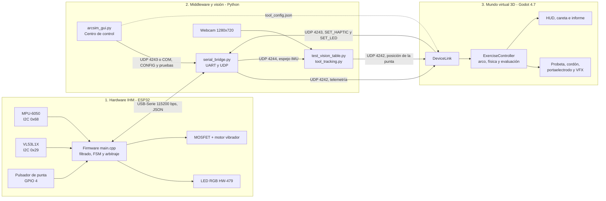

### 4.2 Capas de software

**Diagrama 2. Capas de software y dependencias.**

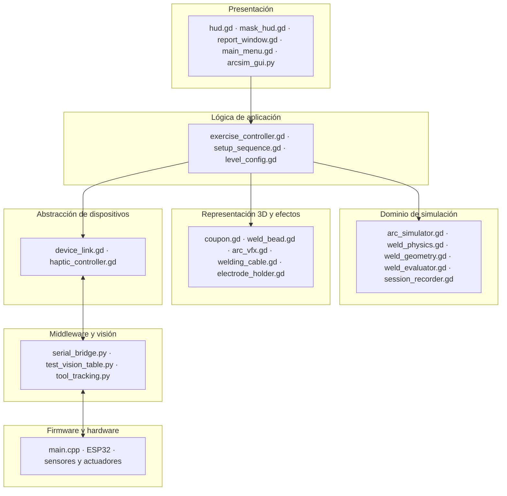

### 4.3 Protocolo y parámetros de comunicación

#### 4.3.1 Justificación

| Decisión | Motivo técnico |
| :--- | :--- |
| USB-Serie en lugar de Wi-Fi o Bluetooth | Alimenta la herramienta por el mismo cable, no requiere emparejamiento y evita la variabilidad de la radio. El Wi-Fi/BT del ESP32 queda para una ampliación. |
| 115200 bps | Una trama típica de 115 bytes a 50 Hz ocupa unos 5,8 kB/s, aproximadamente la mitad de los 11,5 kB/s disponibles en 8N1 (cálculo). |
| JSON ASCII por líneas | Legible desde un monitor serie, tolera campos adicionales y se resincroniza en cada salto de línea. |
| Puente separado del motor gráfico | Un único proceso posee el puerto COM y distribuye los datos a Godot y a visión. |
| UDP en `127.0.0.1` | Sin conexión ni retransmisiones: ante una pérdida interesa la muestra siguiente, no la anterior. Godot lo soporta de forma nativa (`PacketPeerUDP`). |

#### 4.3.2 Enlaces

| Enlace | Transporte | Contenido | Frecuencia |
| :--- | :--- | :--- | :--- |
| ESP32 ↔ puente | USB-Serie 115200 bps, 8N1 | Telemetría y comandos JSON | 50 Hz de subida; bajada asíncrona |
| Puente → Godot | UDP `127.0.0.1:4242` | Cada línea del ESP32 | 50 Hz (60 Hz en `--mock`) |
| Visión → Godot | UDP `127.0.0.1:4242` | `{"dx","dy","x","y"}` en mm | Envía si el cambio es ≥ 0,15 mm o cada 40 ms; limitada por la cámara a 30 FPS |
| Godot, GUI y visión → puente | UDP, puerto 4243 (el puente escucha en `0.0.0.0`) | Comandos | `SET_HAPTIC` ≤ 30 Hz; `SET_LED` ≤ 20 Hz |
| Puente → visión | UDP `127.0.0.1:4244` | Espejo de telemetría | 50 Hz |

#### 4.3.3 Formato de tramas

**ESP32 → PC (telemetría):**

```json
{"qw":0.9981,"qx":-0.0124,"qy":0.0452,"qz":0.0398,"d":2.4,"b":0,"r":-1.4,"p":12.3,"y":4.5,"st":2,"dlpf":3,"h":127}
```

| Campo | Significado |
| :--- | :--- |
| `qw, qx, qy, qz` | Cuaternión de orientación |
| `d` | Distancia punta-chapa compensada y filtrada (mm) |
| `b` | Pulsador de punta (1 = presionado) |
| `r, p, y` | Roll, pitch y yaw (°) |
| `st` | Estado de la FSM: 0 IDLE, 1 HOMING, 2 WELD_OK, 3 WELD_WARN, 4 STICKING, 5 ERROR |
| `dlpf` | Modo del filtro digital interno del MPU-6050 |
| `h` | Ciclo de trabajo PWM aplicado al motor (0–255) |

**ESP32 → PC (acuses):** `{"ack":"BOOT","fw":"2026-11-25a","pwm_ok":1}`, además de `PONG`, `CONFIG_APPLIED`, `TEST_ACTUATOR`, `SET_HAPTIC`, `SET_HOMING` y `SESSION_RESET`.

**PC → ESP32 (comandos, uno por línea):**

| Comando | Efecto |
| :--- | :--- |
| `CALIBRATE` (o `c`) | Calibra el giroscopio (150 muestras) |
| `RESET_YAW` (o `t`) | Pone el yaw en cero |
| `0` … `6` (texto) | Cambia el filtro digital (DLPF) del MPU-6050 |
| `PING` | Devuelve versión y estado |
| `SET_HAPTIC` | Intensidad del motor; `arm:1` indica arco en curso; con `ms` es una prueba manual |
| `SET_LED` | Color RGB impuesto por el simulador |
| `TEST_ACTUATOR` | Prueba temporizada del LED |
| `HAPTIC_MUTE` | Silencia el motor hasta 30000 ms |
| `SET_HOMING` | Exige o no el pulsador para iniciar el arco |
| `RESET` / `END_SESSION` | Reinicia la sesión y apaga el motor |
| `CONFIG` | Actualiza colores, límites ToF, intensidades y modo de homing |

### 4.4 Flujo de punta a punta

**Diagrama 3. Secuencia de una interacción de soldadura.**

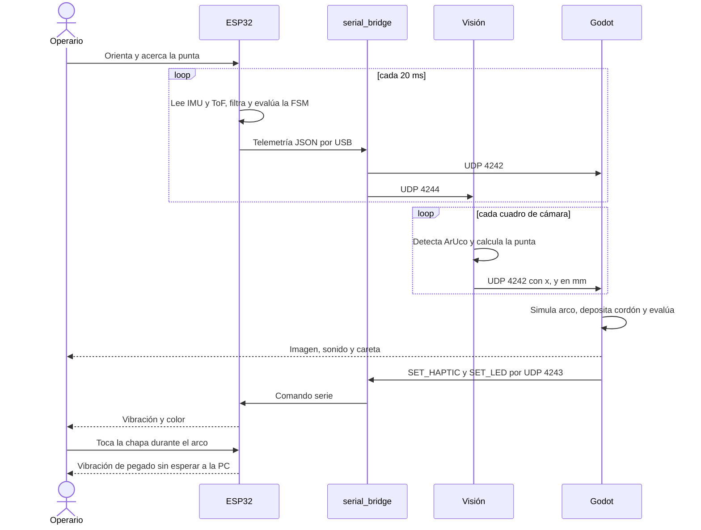

**Ejemplo de recorrido** (valores del modelo de simulación, no mediciones experimentales):

1. El operario baja la careta (`Q`), mantiene la punta a 2,5 mm con 12° de arrastre y avanza a unos 3 mm/s.
2. El firmware genera el cuaternión, filtra la distancia y pasa a `STATE_WELD_OK`.
3. El puente reenvía la línea a Godot y a visión; visión calcula `(x, y)` de la punta.
4. `ExerciseController` actualiza posición, velocidad y ángulos, avanza la máquina de estados del arco y llama a la física del cordón. Con 110 A, el modelo produce unos 25,4 V, 745 J/mm, 7,0 mm de ancho, 2,3 mm de altura y 2,0 mm de penetración.
5. Se deposita la malla, se actualizan luz, partículas, audio y HUD, y se envían color y vibración a la herramienta.

---

## 5. Desarrollo de la capa hardware (dispositivo IHM)

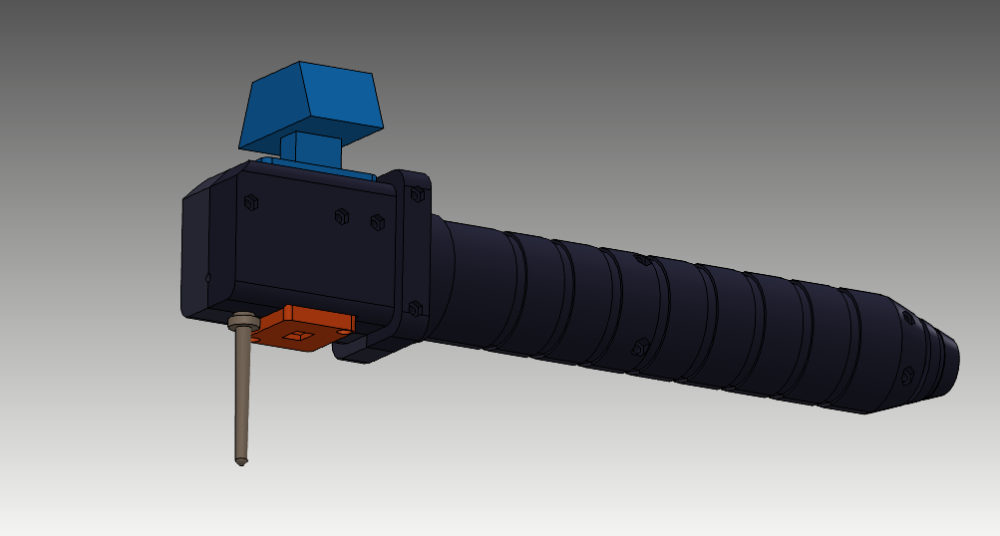

**Figura 2.** Render CAD del ensamble. El soporte azul superior del render corresponde al diseño de marcador de tres caras; en el prototipo físico se reemplazó por un soporte plano inclinado (~30°).

### 5.1 Selección y justificación de componentes

#### 5.1.1 Lista de materiales (BOM)

| # | Componente | Especificación | Cant. | Función |
| :-: | :--- | :--- | :-: | :--- |
| 1 | Microcontrolador | ESP32 DevKit v1, 30 pines | 1 | Adquisición, filtrado, FSM, actuadores y telemetría |
| 2 | IMU | MPU-6050 (módulo GY-521), `0x68` | 1 | Orientación de la herramienta |
| 3 | Sensor de distancia | VL53L1X, `0x29` | 1 | Distancia punta-chapa |
| 4 | Pulsador | Microswitch táctil NA, alojamiento CAD 12×12×4 mm | 1 | Contacto, cebado, cero del ToF y tara |
| 5 | LED RGB | Módulo HW-479 | 1 | Estado en la herramienta |
| 6 | Motor vibrador | DC con masa excéntrica, Ø27 × 23 mm (de mando Logitech) | 1 | Retroalimentación háptica |
| 7 | MOSFET | IRFZ44N, canal N | 1 | Conmutación *low-side* del motor |
| 8 | Resistencia de gate | 1 kΩ | 1 | Limita la corriente del GPIO hacia el gate |
| 9 | Resistencia pull-down | 10 kΩ | 1 | Mantiene el MOSFET apagado en el arranque |
| 10 | LED embebido | GPIO 2 del DevKit | — | Calibración y pulsación |
| 11 | Cable USB de datos | 2–3 m | 1 | Alimentación y comunicación |
| 12 | Cámara web | Logitech 1080p | 1 | Seguimiento óptico |
| 13 | Estructura | Perfiles de aluminio 20×20 mm. [COMPLETAR: cantidad y longitudes] | — | Soporte de la cámara |
| 14 | Plantilla de mesa | A4, cuatro ArUco de 36 mm (IDs 1–4) | 1 | Referencia espacial |
| 15 | Marcador de herramienta | ArUco ID 0, 46×46 mm (negro de 40 mm + borde de 3 mm) | 1 | Pose de la herramienta |
| 16 | Piezas impresas | PLA: dos mitades de carcasa, módulo ToF, varilla de 60 mm y soporte de marcador | 1 juego | Estructura y ergonomía |
| 17 | Tornillería | 11 tornillos M3 con tuercas, perno guía M3 y tornillo M3 de regulación. [COMPLETAR: largos de cada tornillo] | — | Cierre y regulación |
| 18 | Cableado | [COMPLETAR: tipo y sección de cable] | — | Interconexión |

#### 5.1.2 Justificación de cada elección

| Componente | Por qué | Alternativa y motivo para no usarla |
| :--- | :--- | :--- |
| ESP32 | Disponible; 32 bits a 240 MHz con FPU para trigonometría, filtrado y JSON a 50 Hz; PWM LEDC con temporizadores independientes; buffer UART ampliable; Wi-Fi/BT para el futuro | Arduino AVR: 8 bits, sin FPU y con menos memoria |
| MPU-6050 | Disponible; 6 grados de libertad en I²C; sin magnetómetro, inmune a campos del taller | Una IMU de 9 ejes corregiría la deriva de yaw, pero dependería del campo magnético local |
| VL53L1X | Medición óptica milimétrica, compacta, sin contacto; permite integrar 40 ms en modo corto para reducir ruido | Ultrasonido (HC-SR04, contemplado en la iteración v1): haz ancho, mayor tamaño y resolución insuficiente para variaciones de 1–2 mm |
| Pulsador axial | Evento de contacto inequívoco, independiente del ruido óptico | Detectar contacto solo con ToF sería menos fiable cerca de cero |
| LED RGB | Estado visible en la propia herramienta | Solo HUD: obliga a mirar fuera de la junta |
| Motor excéntrico | Disponible y suficiente para patrones distinguibles por intensidad y cadencia | Un actuador lineal (LRA) respondería más rápido, pero habría que adquirirlo |
| IRFZ44N | Disponible; el GPIO no puede entregar la corriente del motor | Un MOSFET de nivel lógico es técnicamente preferible (ver §9.4) |
| Webcam + ArUco | Sin hardware propietario; posición absoluta sin deriva | *Trackers* de RV: mayor costo |

### 5.2 Conexiones, pines y diseño físico

#### 5.2.1 Mapeo de pines (`firmware/src/main.cpp`)

| Pin ESP32 | Constante | Modo | Conexión |
| :--- | :--- | :--- | :--- |
| GPIO 21 | `PIN_I2C_SDA` | I²C a 400 kHz | SDA del MPU-6050 y del VL53L1X |
| GPIO 22 | `PIN_I2C_SCL` | I²C a 400 kHz | SCL del MPU-6050 y del VL53L1X |
| GPIO 16 | `PIN_RGB_R` | PWM, canal LEDC 0, 5 kHz, 8 bits | R del HW-479 |
| GPIO 17 | `PIN_RGB_G` | PWM, canal LEDC 1, 5 kHz, 8 bits | G del HW-479 |
| GPIO 19 | `PIN_RGB_B` | PWM, canal LEDC 2, 5 kHz, 8 bits | B del HW-479 |
| GPIO 25 | `PIN_HAPTIC` | PWM, canal LEDC 4, 1 kHz, 8 bits | 1 kΩ → gate del IRFZ44N |
| GPIO 4 | `PIN_BUTTON` | `INPUT_PULLUP`, activo en bajo | Pulsador (el otro terminal a GND) |
| GPIO 2 | `PIN_STATUS_LED` | Salida digital | LED del DevKit |
| 3V3 | — | +3,3 V | VCC del MPU-6050 y VIN del VL53L1X |
| VIN | — | +5 V de USB | Positivo del motor |
| GND | — | Referencia común | Sensores, pulsador, LED (−), *source* y pull-down |
| AD0 (MPU) | — | A GND | Fija la dirección `0x68` |

Los dos sensores comparten el bus I²C. No se montaron resistencias pull-up externas adicionales.

#### 5.2.2 Diagrama en bloques de interconexiones

**Diagrama 4. Interconexiones eléctricas.**

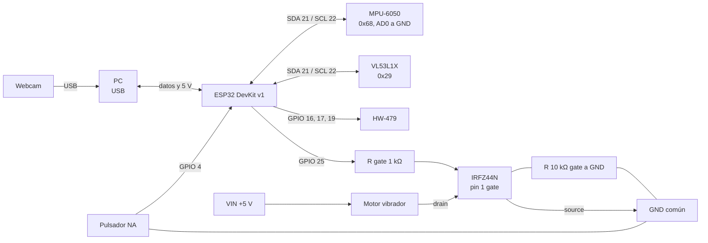

> **[INSERTAR FIGURA 3: Esquemático eléctrico definitivo (ESP32, MPU-6050, VL53L1X, HW-479 en GPIO 16/17/19, IRFZ44N con 1 kΩ y 10 kΩ, motor y pulsador en GPIO 4). No usar `hardware/schematics/WIRING_DIAGRAM.md`, que corresponde a la versión v1.]**

> **[INSERTAR FIGURA 4: Fotografía de los componentes electrónicos antes del montaje, rotulados.]**

> **[INSERTAR FIGURA 5: Fotografía en primer plano del circuito MOSFET armado y del motor vibrador.]**

**Advertencia de diseño.** El prototipo no incluye diodo de rueda libre ni capacitores externos en la etapa del motor. Al ser una carga inductiva, se recomienda agregar el diodo en antiparalelo con el motor antes de replicar el circuito.

#### 5.2.3 Diseño físico y mecánico

El CAD está parametrizado en Python con CadQuery/OpenCASCADE (`hardware/3d_models/generate_holder_cad.py`), evolucionó de la versión v2.2 a la v3.14 (`hardware/CAMBIOS_v3.md`) e incluye una verificación automática de interferencias (`verify_clearances()`), con 0 interferencias contra envolventes conservadoras de los componentes.

| Característica | Valor |
| :--- | :--- |
| Largo total | 250 mm (Z = −108 a +142 mm) |
| Mango | Ø54 mm con 7 estrías de 1,2 mm; collarín Ø56 mm |
| Guarda-mano | 17 mm de espesor, 56 × 66 mm |
| Cabezal | 42 × 56 × 70 mm |
| Partición | Dos mitades en el plano X = 0; cama de 220 × 220 mm (Ender 3 V2), rotadas 45° |
| Fijación | 11 tornillos M3 con tuercas en nidos hexagonales y 13 pines guía |
| ESP32 | Invertido sobre 4 machos Ø2,8 mm, bahía de 56 × 32 mm |
| MPU-6050 | 2 machos Ø2,9 mm separados 16 mm |
| Motor | Bolsillo Ø27,75 × 13 mm y cámara de desbalance Ø29 × 11,3 mm sobre plataforma maciza de 8 mm |
| LED | En el guarda-mano (Z = 65,5), salida Ø6,4 mm |
| MOSFET | Ducto delantero de 14 × 20 × 37,5 mm |
| Varilla de electrodo | Desmontable, 60 mm; espiga Ø8 mm, perno guía M3, recorrido de 2,5 mm con regulación M3 contra el pulsador |
| Distancia entre ejes ToF-varilla | 24 mm; la varilla de 60 mm evita invadir el cono óptico de 25° |

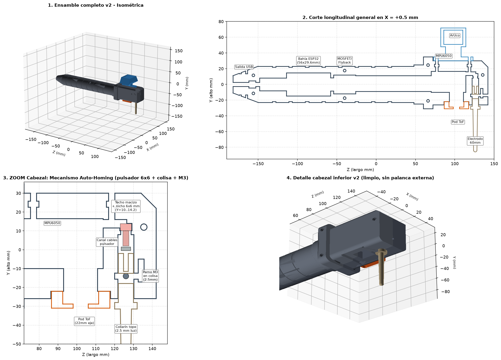

**Figura 6.** Cortes ortogonales del CAD con envolventes de componentes (`preview_cad.py`). Los rótulos internos de la imagen conservan textos de una iteración anterior («v3.1», «220 mm», «KY-016»); las cotas vigentes son las de la tabla.

> **[INSERTAR FIGURA 7: Fotografía de la carcasa abierta con ESP32, motor, MPU-6050, MOSFET, LED, sensor ToF y recorrido de cables.]**

**Orientación obligatoria del MPU-6050.** El firmware supone montaje vertical: eje Z a lo largo de la herramienta, eje Y vertical (lectura de −1 g en reposo) y eje X transversal. Un montaje distinto invalida el cálculo de pitch y roll.

#### 5.2.4 Banco óptico y plantilla

La cámara se monta a unos 45 cm de altura y 50° de inclinación sobre una estructura de perfiles 20×20. La plantilla tiene los marcadores en (−45, +65), (+195, +65), (−45, −65) y (+195, −65) mm, la junta graduada de 150 mm y una barra de verificación de 100 mm.


**Figura 8.** Plantilla A4 de mesa. Imprimir desde el PDF a escala 100 %.

> **[INSERTAR FIGURA 9: Fotografía del banco óptico completo, indicando altura (~45 cm) e inclinación (~50°) de la cámara.]**

> **[INSERTAR FIGURA 10: Fotografía del soporte plano inclinado de 48 × 48 mm con el marcador ID 0 adherido.]**

### 5.3 Software de bajo nivel (firmware)

#### 5.3.1 Entorno

| Elemento | Valor |
| :--- | :--- |
| Archivo activo | `firmware/src/main.cpp` (monolítico, 895 líneas) |
| Herramientas | PlatformIO Core 6.2.0, `framework-arduinoespressif32` 4.30312.261116 (Arduino Core 3.x sobre ESP-IDF 5.5.5) |
| Placa | `esp32dev`, `CONFIG_FREERTOS_HZ=1000` |
| Velocidades | Carga 921600; monitor 115200 |
| Librerías | `pololu/VL53L1X @ ^1.3.1`, `Arduino.h`, `Wire.h`, `math.h` |

Las carpetas `firmware/include/` y `firmware/legacy/` pertenecen a iteraciones anteriores y no son incluidas por `main.cpp`.

#### 5.3.2 Inicialización (`setup()`)

1. Buffer RX serie de 2048 bytes, 115200 bps y *timeout* de 20 ms.
2. Canales LEDC fijos (0–2 para el LED a 5 kHz; 4 para el motor a 1 kHz), con `ledcAttach()` como respaldo para el motor.
3. Autotest: rojo, verde y azul (150 ms cada uno) y pulso de motor con *duty* 220 durante 250 ms.
4. I²C a 400 kHz. Se despierta el MPU-6050, se configura el DLPF en modo 3 (44 Hz) y se calibra el giroscopio con 150 muestras separadas 2 ms, con el motor apagado.
5. VL53L1X en modo corto, presupuesto de 40 ms y medición continua cada 40 ms (25 Hz).
6. Envío del acuse `BOOT`.

#### 5.3.3 Bucle principal (`loop()`)

Es un ciclo cooperativo con `delay(2)` final (frecuencia interna estimada de 300–450 Hz): comandos → IMU → ToF → pulsador → FSM → actuadores → telemetría cada 20 ms.

**Adquisición inercial.** Lectura en ráfaga de 14 bytes desde `0x3B`; escalas de 16384 LSB/g (±2 g) y 131 LSB/(°/s) (±250 °/s). Con `dt` acotado (si supera 0,1 s se usa 0,02 s):

$$\theta_{acc} = \operatorname{atan2}(a_z, -a_y), \qquad \phi_{acc} = \operatorname{atan2}\left(a_x, \sqrt{a_z^2 + a_y^2}\right)$$

$$\theta = 0{,}96\,(\theta + g_x\,dt) + 0{,}04\,\theta_{acc}, \qquad \phi = 0{,}96\,(\phi + g_z\,dt) + 0{,}04\,\phi_{acc}, \qquad \psi = \psi + g_y\,dt$$

donde θ es el *pitch*, φ el *roll* y ψ el *yaw*. Los ángulos se convierten a cuaternión unitario.

**Distancia.** Solo se aceptan lecturas con `10 < dist < 1200 mm` y estado 0 o 7. Se resta el *offset* (inicial 75,5 mm; se recalibra al tocar la chapa si la lectura cruda está entre 45 y 300 mm), se limita a cero y se filtra con mediana de 5, EMA 0,70/0,30 y banda muerta de 0,25 mm. Con el pulsador presionado la distancia es 0.

**Pulsador.** Antirrebote de 25 ms. El flanco de contacto fija el cero y, si no había sesión, inicia el cebado. Una pulsación de 2 s o más pone el yaw en cero, reinicia la sesión y emite un destello azul.

#### 5.3.4 Máquina de estados del firmware (`evaluate_fsm()`)

**Diagrama 5. Estados del firmware.**

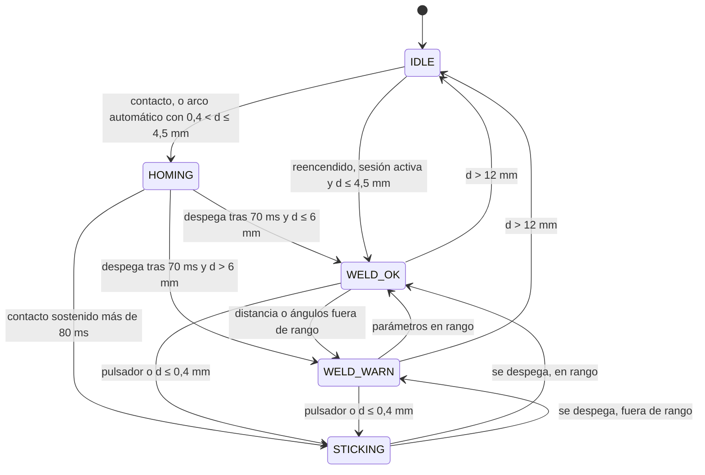

Además, desde cualquier estado, una pulsación de 2 s o el comando `RESET` regresan a `IDLE`. El criterio de `WELD_OK` es distancia entre 1,0 y 6,0 mm, |roll| < 25° y −5° ≤ pitch ≤ 35°. Los umbrales de distancia son configurables; los angulares están fijos en el código.

Por defecto `homing_required = false` (arco automático). Con `true`, la primera activación exige tocar la chapa.

#### 5.3.5 Arbitraje del motor (`apply_motor()`)

| Prioridad | Condición | *Duty* aplicado |
| :-: | :--- | :--- |
| 1 | Prueba manual activa | Valor de la prueba |
| 2 | Silencio por calibración | 0 |
| 3 | Arco armado en Godot (ventana de 500 ms) | Valor de Godot; si hay `STATE_STICKING`, el máximo entre el configurado de pegado y el de Godot |
| 4 | Godot conectado sin arco | Valor de Godot (normalmente 0) |
| 5 | Sin host | 0 |

#### 5.3.6 Manejo de errores en el firmware

| Mecanismo | Falla que previene |
| :--- | :--- |
| Buffer RX de 2048 bytes | Truncamiento de `CONFIG` (~700 bytes) |
| *Timeout* serie de 20 ms y máximo 8 líneas por ciclo | Bloqueo del bucle ante ráfagas |
| Descarte de lecturas I²C incompletas del IMU | Cálculo con datos parciales |
| Acotación de `dt` | Saltos angulares tras pausas |
| Validación de rango y estado del ToF; *timeout* de 500 ms | Lecturas aberrantes y esperas indefinidas |
| `constrain()` en intensidades y tiempos | Desbordes de PWM |
| `extract_section()` con llaves balanceadas | Confusión de claves repetidas en `CONFIG` |
| Ventana de control del host de 500 ms | Motor vibrando si Godot se cierra |
| Motor apagado durante la calibración | Sesgo del giroscopio contaminado por vibración |

**Limitación detectada.** Si `distanceSensor.init()` falla, `setup()` asigna `STATE_ERROR`, pero unas líneas después ejecuta `set_state(STATE_IDLE)` de forma incondicional y ningún otro punto vuelve a asignar el error. En la versión `2026-11-25a` el parpadeo rojo de falla **no llega a mostrarse**: el programa continúa en `IDLE` con `tof_online = false`, que solo deshabilita el arco automático. Tampoco se verifica la presencia del MPU-6050 ni la antigüedad de la última lectura del ToF. La corrección se propone en §9.4.

---

## 6. Desarrollo de la capa software (mundo virtual 3D e interfaz)

### 6.1 Stack tecnológico y arquitectura de módulos

#### 6.1.1 Stack y librerías de terceros

| Herramienta | Versión verificada | Uso |
| :--- | :--- | :--- |
| Godot Engine (estándar, 64 bits) | 4.7 | Escenas, física, render, audio e interfaz |
| Jolt Physics | Integrada en Godot | Motor de física |
| Python | 3.12.5 | Puente, visión y GUI |
| OpenCV (`opencv-contrib-python`) | 4.11.0 | ArUco, `solvePnP` y calibración |
| NumPy | 2.0.2 | Álgebra lineal |
| PySerial | 3.5 | Puerto serie |
| Tkinter / ttk | Biblioteca estándar | Centro de control |
| Matplotlib | 3.9.2 | Cortes y plantillas |
| CadQuery, Trimesh, Blender `bpy` | [COMPLETAR: versiones] | Generación offline de CAD y modelos |

#### 6.1.2 Justificación del motor gráfico

Godot 4.7 se prefirió frente a Unity y Unreal por ser software libre (licencia MIT), liviano, sin cuentas ni restricciones comerciales, y porque cubre de forma nativa lo que el proyecto necesita: `PacketPeerUDP`, mallas procedurales, shaders propios, audio generado por código, Jolt Physics, pruebas `--headless` y GDScript, afín a Python. No se utiliza C#.

#### 6.1.3 Carpetas y módulos

```text
Trabajo_integrador_RV/
├── firmware/                  # platformio.ini, src/main.cpp
├── hardware/                  # CAD (3d_models/), plantillas (aruco/)
├── tools/                     # arcsim_gui.py, test_vision_table.py, tool_tracking.py,
│                              # calibrar_camara.py, test_*.py, *.json
├── simulacion_godot/trabajo-final-rv/
│   ├── project.godot, tool_config.json
│   ├── Assets/models/         # 14 modelos .glb
│   ├── Scenes/                # 11 escenas .tscn
│   ├── Scripts/               # autoload/ core/ interaction/ player/ tools/ ui/ welding/ world/
│   ├── Shaders/, materials/
│   ├── tests/                 # test_runner.tscn y .gd
│   └── tools/                 # serial_bridge.py, make_workshop.py, blender/make_models.py
└── *.bat                      # Lanzadores de Windows
```

Existen tres *autoloads* (singletons): `Events` (señales globales), `DeviceLink` (única puerta de entrada y salida del dispositivo) y `Game` (nivel, informe y cambios de escena).

### 6.2 Modelado del entorno

#### 6.2.1 Primitivas y mallas procedurales

| Objeto | Construcción |
| :--- | :--- |
| Taller (`Workshop.tscn`, generado por `make_workshop.py`) | Recinto de 14 × 12 × 5 m con `BoxMesh` y colisiones `BoxShape3D`: piso, paredes, techo, columnas, ducto, demarcaciones, portón, ventanas, cortina translúcida y 5 carteles |
| Mesas (`Table.tscn`, ×2) | Tapa de 2,0 × 0,06 × 0,8 m, 4 patas y anclajes `Area3D` para la pinza |
| Probeta (`Coupon.tscn`) | Dos chapas `BoxMesh` de 0,18 × 0,01 × 0,07375 m, marcas de inicio (verde) y fin (rojo) y guía amarilla |
| Electrodo | `CylinderMesh` de radio 1,6 mm y 350 mm, que se acorta hasta una colilla de 50 mm |
| Cordón (`weld_bead.gd`) | 151 secciones a 1 mm, perfil parabólico de 9 puntos con ondulación; reconstrucción a 20 Hz con `SurfaceTool` |
| Cables (`welding_cable.gd`) | Tubos hexagonales de 18 segmentos sobre una curva Bézier con flecha (`ImmediateMesh`) y *raycast* para no atravesar mesas ni piso |

**Por qué un cordón procedural.** La forma depende de la trayectoria, la velocidad, la corriente y la distancia en cada instante, por lo que no puede pregenerarse. Cada sección guarda ancho, altura, desvío, defecto y temperatura. La temperatura decae en 2,5 s y viaja al shader en `COLOR.r`; la bandera de defecto, en `COLOR.b`. Repasar una sección la ensancha y acumula altura (máximo 6 mm).

#### 6.2.2 Modelos importados

Los 14 archivos `.glb` se generan con el script propio `tools/blender/make_models.py`, sin texturas externas (25 materiales *Principled BSDF*):

- **Interactivos:** `machine_body`, `machine_knob`, `machine_rocker`, `electrode_holder`, `ground_clamp`.
- **Utilería:** `ceiling_lamp`, `gas_cylinder_blue`, `gas_cylinder_red`, `shelf`, `extractor_arm`, `fire_extinguisher`, `toolbox`, `drum`, `pallet_boxes`.

#### 6.2.3 Materiales, shaders y efectos

| Recurso | Función |
| :--- | :--- |
| `weld_bead.gdshader` | Transición de metal incandescente a acero frío con escamas |
| `welding_mask.gdshader` | Visor de la careta |
| `outline.gdshader` | Resaltado Fresnel amarillo del objeto apuntado |
| `arc_vfx.gd` | Núcleo luminoso, 10 chispas, 3 salpicaduras (solo con arco largo), luz parpadeante y audio sintetizado a 22050 Hz: zumbido de 100 y 200 Hz (red de 50 Hz), crepitar y pulso de cebado |

El tono del audio sigue la longitud de arco (`0.85 + 0.07·gap`) y baja a 0,55 con electrodo pegado, de modo que el oído aporta información sobre la técnica.

#### 6.2.4 Iluminación y cámara

- `WorldEnvironment` con cielo procedural, mapeo de tonos ACES, *glow* de 0,12 y luz ambiente 0,55.
- Una luz direccional tenue (0,25, sin sombras), cuatro `SpotLight3D` colgantes (energía 5,0; alcance 9 m; 62°) y una `OmniLight3D` del arco (alcance 0,5 m).
- Careta: la exposición se multiplica por 0,7 en reposo (DIN 4) y por 0,3 con arco (DIN 11).
- Cámara en primera persona (`near` 0,02 m), FOV de 75° en la preparación y transición de 0,8 s a la estación de soldadura con FOV de 55°.

Capas de física: `world`, `interactable`, `props` y `player`.

> **[INSERTAR FIGURA 11: Captura general del taller 3D (mesas, máquina, cortina, utilería e iluminación).]**

#### 6.2.5 Interfaz gráfica (UI/HUD)

**Menú principal.** Selección de nivel, fuente de entrada (automática, teclado y mouse, herramienta física) y estado del enlace.

**HUD del ejercicio** (capa 25): fase, nivel y frecuencia de telemetría; lista de pasos; estado del arco; cuatro indicadores analógicos (longitud de arco, velocidad, ángulo de trabajo y de avance) con bandas; amperaje, electrodo restante y cobertura; semáforo de seis parámetros y marco de color; lectura en vivo; mensajes y menú de pausa.

**Careta** (`mask_hud.gd`, capa 20): descenso animado en 0,25 s y destello blanco con la alerta «¡BAJÁ LA CARETA! (Q)» si se suelda sin protección.

**Informe final** (`report_window.gd`, capa 30): nota, desglose de 10 criterios, seis gráficos temporales, penalizaciones, diagnóstico y botones de exportar, reintentar, siguiente nivel y menú.

> **[INSERTAR FIGURA 12: Captura del menú principal con el estado «CONECTADA».]**

> **[INSERTAR FIGURA 13: Captura del HUD durante la soldadura en Nivel 1, con cordón caliente e indicadores visibles.]**

> **[INSERTAR FIGURA 14: Dos capturas: careta oscurecida con arco encendido y destello por soldar sin careta.]**

> **[INSERTAR FIGURA 15: Ventana de informe final con nota, criterios, gráficos y diagnóstico.]**

**Centro de control** (`tools/arcsim_gui.py`):


**Figura 16.** Estados y actuadores: color del LED e intensidad háptica por estado, con botones de prueba.


**Figura 17.** Límites del ToF: extinción, pegado y reencendido.

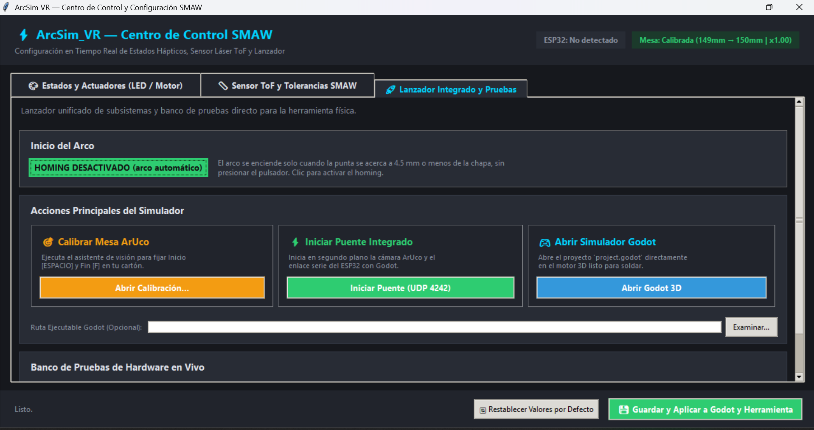

**Figura 18.** Modo de inicio del arco y lanzadores de calibración, puente y simulador.

| Ajuste | Rango (valor por defecto) | Consumidor |
| :--- | :--- | :--- |
| Extinción | 6–25 mm (12,0) | Firmware y Godot |
| Pegado | 0,1–2,5 mm (0,4) | Firmware y Godot |
| Reencendido | 2–8 mm (4,5) | Firmware y Godot |
| Rango óptimo | 1,0–6,0 mm | Firmware y Godot |
| Colores e intensidades | Por estado | Firmware y Godot |
| Roll máximo y velocidades | 25°; 1,8–4,5 mm/s | Se guardan en `tool_config.json`, pero la versión actual del firmware y del simulador **no los lee** |

La GUI guarda ambos `tool_config.json` y transmite `CONFIG`. Godot relee su copia cada 1 s. La evaluación usa las bandas de `level_config.gd`, no los límites de la GUI.

### 6.3 Lógica de interacción y escenarios

#### 6.3.1 Mecanismos comunes entre objetos 3D

| Clase | Rol |
| :--- | :--- |
| `Interactable` (`Area3D`) | Zona apuntable; declara texto, objeto a resaltar y si se puede recoger |
| `Pickable` (`RigidBody3D`) | Al tomarlo se congela, pierde colisiones y pasa a la mano (`reparent`) |
| `ClampAnchor` | Solo interactuable si se sostiene la pinza |
| `GroundClamp` | Emite `clamped_changed`; cierra el circuito de soldadura |
| `PlayerInteractor` | *Raycast*, resaltado, tomar y soltar |

El circuito está energizado solo si la máquina está encendida **y** la pinza está enganchada. El ejercicio recorre cuatro estados: `SETUP → CALIBRATING → WELDING → FINISHED`.

**Por qué esta estructura de escenarios.** Reproduce el orden de un puesto real (preparar, posicionarse, soldar, evaluar), impide saltear condiciones de seguridad y aísla cada fase para probarla.

**Diagrama 6. Flujo global del ejercicio.**

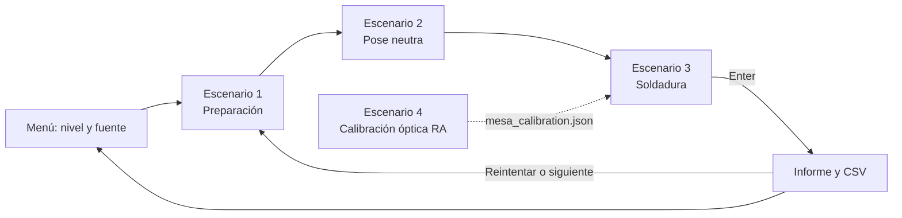

#### 6.3.2 Escenario 1 — Preparación guiada del puesto (`State.SETUP`)

**Objetos:** operario, pinza de masa, anclaje de la mesa, portaelectrodo, interruptor, perilla, pantalla de la máquina y punto de soldadura.

El usuario no camina libremente: cada tecla ejecuta una tarea y el personaje se desplaza solo.

| Tecla | Interacción | Respuesta del entorno | Condición |
| :-: | :--- | :--- | :--- |
| 1 | Tomar la pinza y engancharla en la mesa | `is_clamped = true`, el cable se reconfigura y aparece la marca de piso | Primer paso |
| 2 | Tomar el portaelectrodo | Pasa a la mano y se actualiza su cable | Paso 1 hecho |
| 3 | Accionar el interruptor | La tecla rota, el LED se pone verde y la pantalla pasa de `OFF` a `090 A` | Paso 2 hecho |
| 4 | Regular el amperaje con la rueda | 40–200 A en pasos de 5 A; giran la perilla y cambia la pantalla | Paso 3 hecho |
| 5 | Ir a la mesa | Inicia la calibración | Máquina encendida, masa conectada y portaelectrodo tomado; en Nivel 1, amperaje entre 95 y 135 A |

**Diagrama 7. Escenario 1.**

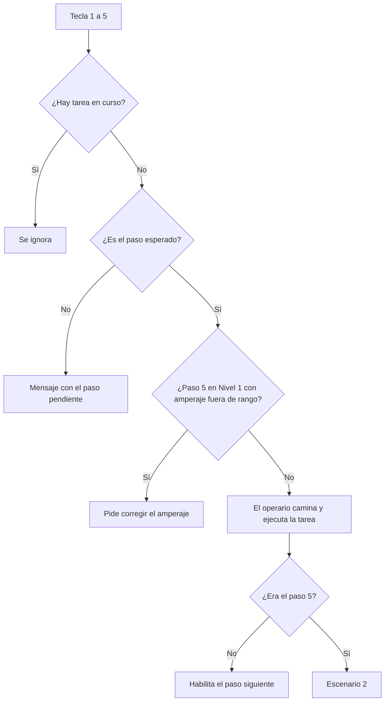

El paso 4 puede repetirse antes del 5. En los niveles 2 y 3 el amperaje es libre y se califica al final.

> **[INSERTAR FIGURA 19: Capturas de la preparación: pinza enganchada con resaltado, máquina encendida con el amperaje y lista de pasos.]**

#### 6.3.3 Escenario 2 — Calibración de pose neutra (`State.CALIBRATING`)

La cámara pasa a la postura de soldadura, se oculta el cable del portaelectrodo y su cuerpo se vuelve 85 % transparente (el electrodo queda sólido) para no tapar la junta.

- **Con hardware:** se compara la inclinación con la pose guardada en `user://pose_neutra.json` (tolerancia 25°) y se exige quietud (< 12 °/s) durante 0,8 s. La primera vez se pide haberla levantado más de 20°, o se acepta quieta pasados 4 s. `T` tara manualmente. A los 10 s se toma la pose actual, de modo que nunca queda bloqueado. Si la herramienta se desconecta, se tara y se continúa.
- **Simulado:** espera de 3 s y tara.

**Diagrama 8. Escenario 2.**

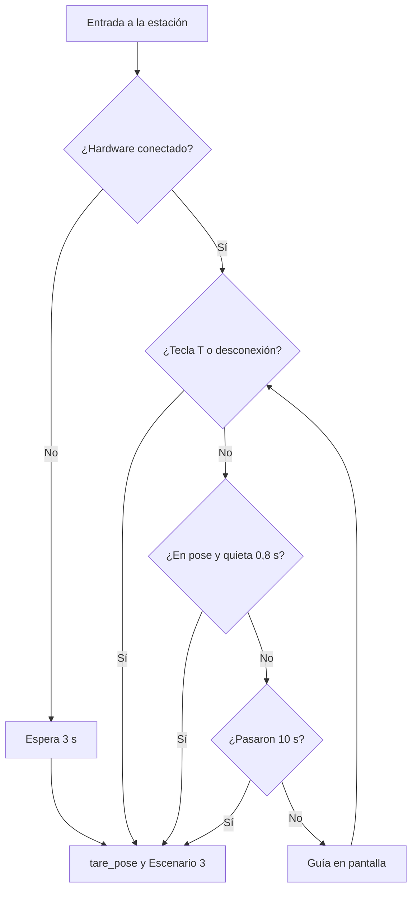

> **[INSERTAR FIGURA 20: Captura de la pantalla de calibración con el mensaje de guía y la herramienta transparente.]**

#### 6.3.4 Escenario 3 — Soldadura interactiva (`State.WELDING`)

**Objetos:** portaelectrodo y electrodo, probeta, cordón, efectos del arco, careta, máquina y pinza.

| Entrada física | Efecto sobre los objetos 3D |
| :--- | :--- |
| Orientación (IMU) | Cambio de base al marco de la probeta, tara y SLERP; orienta el portaelectrodo y define los ángulos |
| Distancia (ToF) | Altura de la punta (visualmente hasta 30 mm) y estado del arco |
| Posición (cámara) | Avance y desvío sobre la junta, interpolados con factor 0,45; se congelan si está pegado |
| Pulsador | Homing o pegado |
| Tecla `Q` | Sube o baja la careta |
| Tecla `R` | Coloca un electrodo nuevo |
| `Enter` / `Esc` | Finaliza / pausa |

Interacciones entre objetos:

- **Electrodo ↔ probeta:** según la distancia, cebado, arco, pegado o extinción; fuera de la chapa no hay arco.
- **Arco ↔ cordón:** deposita secciones entre la posición anterior y la actual.
- **Arco ↔ electrodo:** lo consume según la corriente y el factor del nivel.
- **Arco ↔ careta:** oscurece el visor o, sin careta, penaliza.
- **Máquina y pinza ↔ arco:** sin circuito completo no se enciende.

**Diagrama 9. Máquina de estados del arco en Godot (`arc_simulator.gd`).**

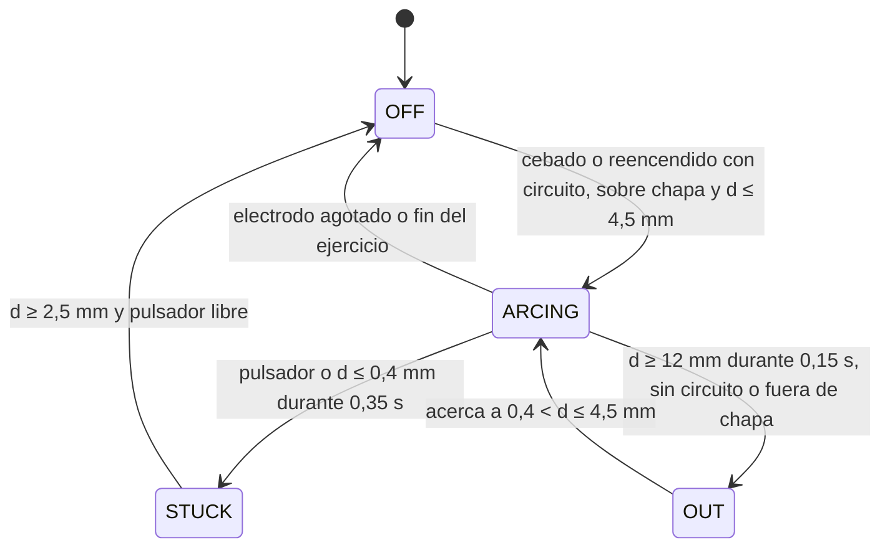

Durante `ARCING` la zona es `SHORT`, `OPTIMAL` o `LONG`. Las temporizaciones de Godot (0,35 s y 0,15 s) evitan transiciones por ruido; el firmware, en cambio, eleva la vibración de pegado de inmediato.

**Modelo físico** (`weld_physics.gd`; I en A, L en mm, v en mm/s con mínimo 0,3):

| Magnitud | Expresión base |
| :--- | :--- |
| Tensión de arco (V) | 18 + 0,04·I + 1,2·L |
| Aporte térmico H (J/mm) | 0,8·V·I / v |
| Deposición (mm³/s) | 0,29·I |
| Consumo de varilla (mm/s) | deposición / área del alma Ø3,2 mm |
| Ancho w (mm) | 0,2565·√H, ampliado con arco largo, entre 2 y 16 |
| Altura (mm) | (deposición / v) / (0,667·w), entre 0,3 y 6 |
| Penetración (mm) | 2·(I/110)·√(3/v), corregida por longitud de arco y arrastre |
| Mordedura (mm) | 0,3·máx(v − 4,5; 0) + 0,015·máx(I − 135; 0), hasta 2 |

Son aproximaciones calibradas para obtener valores típicos con parámetros nominales; no constituyen un modelo metalúrgico.

**Retroalimentación en la herramienta:**

| Situación | Vibración | LED |
| :--- | :--- | :--- |
| Cebado (primeros 0,06 s) | Golpe seco | Según tolerancias |
| Arco óptimo | Continua con pequeña variación aleatoria | Verde |
| Arco corto o largo | Pulsos con cadencias distintas | Amarillo o rojo según el peor parámetro |
| Pegado | Intensidad de pegado (100 %) | Color de pegado (rojo) |
| Arco cortado | Aviso de 0,15 s | Según tolerancias |

El LED toma el peor estado de distancia, ángulos y velocidad. Los valores y colores citados son los configurados en `tool_config.json`.

**Los tres niveles** (`level_config.gd`). En cada celda: óptimo / límite.

| Parámetro | 1. Principiante | 2. Intermedio | 3. Examen |
| :--- | :--- | :--- | :--- |
| Ayudas visuales | Lista, pista de amperaje, 4 indicadores, semáforo y guía | Sin pista de amperaje ni indicadores de ángulos | Ninguna visual; solo señales físicas, sonoras y hápticas |
| Consumo de electrodo | 0,6× | 1,0× | 1,4× |
| Longitud de arco (mm) | 1,5–3,5 / 0,5–6,0 | 1,5–3,5 / 0,8–5,0 | 2,0–3,2 / 1,0–4,5 |
| Velocidad (mm/s) | 1,8–4,5 / 0,6–7,0 | 2,0–4,0 / 1,0–5,5 | 2,3–3,7 / 1,5–4,8 |
| Ángulo de trabajo (°) | 88–92 / 85–95 | 88,5–91,5 / 86–94 | 89–91 / 87–93 |
| Ángulo de avance (°) | 3–20 / −8–35 | 5–15 / −3–26 | 8–14 / 0–21 |
| Corriente (A) | 95–135 / 70–160 | 100–130 / 80–145 | 100–125 / 88–138 |
| Desvío lateral (mm) | 0–1,5 / 0–3,5 | 0–1,0 / 0–2,5 | 0–0,5 / 0–1,5 |
| Ancho (mm) | 4,5–9,5 / 2,5–13,0 | 5,0–8,5 / 3,0–11,0 | 5,5–8,0 / 3,5–10,0 |
| Penetración (mm) | 1,8–5,0 / 0,6–8,0 | 2,0–4,5 / 0,8–7,0 | 2,2–4,0 / 1,0–6,5 |

**Evaluación** (`weld_evaluator.gd`):

| Criterio | Peso | Criterio | Peso |
| :--- | :-: | :--- | :-: |
| Longitud de arco | 15 % | Trayectoria | 10 % |
| Velocidad de avance | 15 % | Ancho del cordón | 10 % |
| Ángulo de trabajo | 10 % | Regularidad | 10 % |
| Ángulo de avance | 10 % | Penetración | 10 % |
| Amperaje | 5 % | Continuidad y cobertura | 5 % |

$$\text{Nota} = 1 + 9\cdot\sum_i \text{peso}_i\,\text{puntaje}_i - \text{penalizaciones}$$

con los pesos en fracción y el resultado acotado entre 1 y 10. Penalizaciones: 0,5 por pegado (máx. 2,0), 0,3 por arco cortado (máx. 1,2) y 0,4 por segundo sin careta (máx. 2,5). Con cobertura menor al 50 % la nota no supera 4,0; con menos de 2 s de arco es 1,0. Se aprueba con 6,0. Las estadísticas ponderadas se acumulan con el algoritmo de West.

#### 6.3.5 Escenario 4 — Calibración y seguimiento en Realidad Aumentada (`test_vision_table.py`)

Sobre el video de la cámara se superponen contornos de marcadores (verde: mesa; cian: herramienta), ejes 3D, cordón, retícula `PUNTA` con altura, minimapa y asistente de calibración. El panel indica FPS, marcadores visibles, focal, estado del pivote, posición, desvío, ángulos y velocidad clasificada.

| Tecla | Acción |
| :-: | :--- |
| `C` | Calibrar giroscopio |
| `T` | Tarar yaw |
| `P` | Iniciar y finalizar el pivote |
| `ESPACIO` / `F` | Marcar inicio y fin de un cordón propio |
| `R` | Restablecer el cordón |
| `Q` | Salir |

**Diagrama 10. Calibración de pivote.**

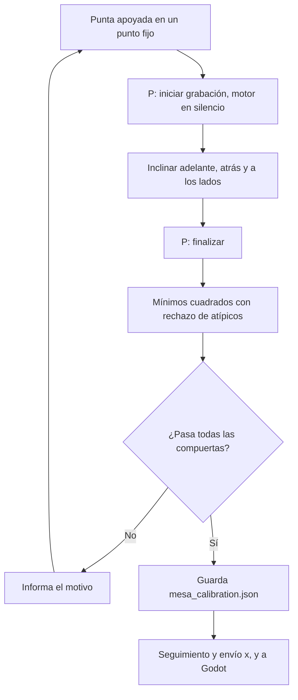

> **[INSERTAR FIGURA 21: Captura de la ventana de visión con 4/4 marcadores, herramienta detectada, pivote correcto y retícula de punta.]**

### 6.4 Robustez y prevención de fallas

| Riesgo | Mecanismo | Capa |
| :--- | :--- | :--- |
| Desconexión del USB | Bucle de reconexión del puente (1,5–2,0 s) | Puente |
| Basura serie sin salto de línea | Se descarta el buffer si supera 2048 bytes; solo se reenvían líneas `{...}` | Puente |
| Dos puentes simultáneos | Puerto 4243 exclusivo (`SO_EXCLUSIVEADDRUSE`) y aviso | Puente |
| Reinicio del ESP32 desde la GUI y COM retenido | Apertura con `dtr=False, rts=False` y cierre inmediato | GUI |
| Conflicto de COM entre visión y puente | Visión usa UDP 4244; solo abre el COM si no recibe datos y lo libera al llegar | Visión |
| Pose ambigua o salto óptico | Descarte de hasta 15 cuadros ambiguos; confirmación de 3 cuadros para saltos de 35 mm | Visión |
| Calibración defectuosa | Compuertas de muestras, inliers, dispersión, RMS, escala y brazo | Visión |
| Calibración de formato antiguo | Respaldo `.v<n>.bak` y nueva calibración | Visión |
| Puerto 4242 ocupado | Reintento cada 3 s; funciona en modo simulado | Godot |
| Inundación o paquetes inválidos | Máx. 200 paquetes por cuadro; solo ASCII ≤ 1024 bytes y JSON con diccionario | Godot |
| Cuaternión degenerado o `NaN` | Se descarta y se normaliza | Godot |
| Pérdida de telemetría | *Watchdog* de 0,5 s: apaga gatillo y seguimiento y avisa; en modo automático vuelve a teclado y mouse | Godot |
| Motor vibrando al salir | `stop_haptics()` al pausar, finalizar, ir al menú o cerrar; además el firmware corta a los 500 ms | Godot y firmware |
| Bloqueo en calibración | *Timeout* de 10 s | Godot |
| División por cero | Velocidad mínima de 0,3 mm/s y `clampf` | Godot |
| No se puede escribir el CSV | Alternativa a `user://`; si falla el archivo devuelve vacío con advertencia | Godot |

La principal propiedad de diseño es la **degradación controlada**: la falta de hardware o de cámara no impide ejecutar el simulador. Las limitaciones conocidas se declaran en §5.3.6 y §9.4. En particular, el *watchdog* de Godot detecta la falta de paquetes, pero no un sensor que deje de actualizarse mientras el ESP32 sigue transmitiendo.

---

## 7. Análisis de partes críticas del código

Los fragmentos están abreviados; `...` indica líneas omitidas. Las referencias de línea corresponden a la versión relevada.

### 7.1 Filtrado del ToF en tres etapas

**Archivo:** `firmware/src/main.cpp`, `update_tof()` (L380–433).

```cpp
if (dist > 10 && dist < 1200 && (status == 0 || status == 7)) {   // validación
    ...
    float net_gap = (float)dist - dynamic_offset_mm;              // cero en la punta
    if (net_gap < 0.0f) net_gap = 0.0f;
    tof_buf[tof_buf_idx] = net_gap;                               // 1) mediana de 5
    ...
    median_gap = s[TOF_MEDIAN_SIZE / 2];
    ...
    smoothed_tof_mm = 0.70f * smoothed_tof_mm + 0.30f * median_gap; // 2) EMA
    if (fabs(smoothed_tof_mm - current_distance_mm) >= 0.25f) {     // 3) banda muerta
        current_distance_mm = smoothed_tof_mm;
    }
}
```

**Explicación.** La mediana elimina picos aislados sin promediarlos; la EMA atenúa el ruido restante; la banda muerta evita que el valor oscile. El costo es retardo y una resolución efectiva limitada por la banda de 0,25 mm. La lectura es no bloqueante (`dataReady()`), por lo que no frena el bucle.

**Para la demostración:** acercar lentamente la punta y mostrar la distancia estable y su salto a 0 al pulsar.

### 7.2 Arbitraje háptico con reflejo local

**Archivo:** `firmware/src/main.cpp`, `apply_motor()` (L229–248).

```cpp
if (now < test_override_haptic_until_ms) {
    duty = test_haptic_duty;                  // prueba manual
} else if (now < haptic_mute_until_ms) {
    duty = 0;                                 // calibración en curso
} else if (now < host_armed_until_ms) {       // arco encendido en Godot
    duty = (current_state == STATE_STICKING)
         ? max(g_cfg.duty_sticking, host_haptic_duty)
         : host_haptic_duty;
} else if (now < host_haptic_until_ms) {
    duty = host_haptic_duty;
} else {
    duty = 0;                                 // sin simulación activa
}
```

**Explicación.** Las marcas de tiempo funcionan como *watchdogs*: si Godot deja de enviar, el permiso caduca. La reacción de pegado se resuelve en el microcontrolador y no depende de la latencia de la PC, pero solo cuando hay un arco armado, para que apoyar la punta al calibrar no vibre.

### 7.3 Puente USB-Serie ↔ UDP

**Archivo:** `simulacion_godot/trabajo-final-rv/tools/serial_bridge.py` (L68–174).

```python
if hasattr(socket, "SO_EXCLUSIVEADDRUSE"):
    s.setsockopt(socket.SOL_SOCKET, socket.SO_EXCLUSIVEADDRUSE, 1)  # instancia única
...
while True:                                   # reconexión permanente
    port = port_name or find_port()           # detección por VID o descripción
    ...
            if line.startswith(b"{") and line.endswith(b"}"):
                ...
                out.sendto(line, GODOT_ADDR)  # 4242
                ...
                    out.sendto(line, VISION_ADDR)  # 4244
...
        if len(buf) > 2048:
            buf = b""                         # descarta basura
...
except (OSError, serial.SerialException) as e:
    ...
    time.sleep(1.5)
```

**Explicación.** Concentra el acceso al COM, envía `tool_config.json` al conectar, reenvía comandos de hasta 8192 bytes y registra estadísticas cada 5 s en `tools/puente_log.txt`.

**Para la demostración:** desconectar y reconectar el USB sin reiniciar el simulador.

### 7.4 Calibración de pivote con validación

**Archivo:** `tools/tool_tracking.py`, `pivot_calibrate()` (L189–282).

Para cada cuadro con rotación $R_i$ y traslación $t_i$ del marcador se busca el vector $p$ (marcador→punta) y el punto fijo $q$ tales que $R_i\,p + t_i \approx q$.

```python
p, q, sv = _solve_pivot_lstsq(Rs[inl], ts[inl])
...
med = float(np.median(res))
thr = max(3.0 * 1.4826 * med, 1.0)            # umbral robusto de atípicos
new_inl = res <= thr
...
k = float(C[2] / (C[2] - q[2]))               # escala: el pivote debe estar en z = 0
...
elif spread[1] < min_spread_deg:              # inclinación en dos ejes
...
elif rms > max_rms_mm:                        # la punta se movió
```

**Explicación.** El cálculo itera entre estimar, elegir la pose candidata de menor residuo y descartar atípicos. La corrección de escala compensa un tamaño de marcador mal configurado. Se rechaza si hay menos de 30 muestras, menos del 60 % de inliers, dispersión menor a 4° en el segundo eje, RMS mayor a 5 mm, escala fuera de 0,75–1,35 o brazo fuera de 30–350 mm. En línea, `TipTracker` aplica la punta $R\,p+t$, mediana de 5 y filtro One Euro.

**Para la defensa:** la punta puede quedar oculta o desplazada del marcador; el vector rígido permite que inclinar la muñeca no la desplace.

### 7.5 Recepción validada y cambio de base en Godot

**Archivo:** `Scripts/autoload/device_link.gd` (L496–596).

```gdscript
var imu_to_probe: Basis = Basis(Vector3(1, 0, 0), Vector3(0, 0, -1), Vector3(0, 1, 0))
...
func _apply_quaternion(w: float, x: float, y: float, z: float) -> void:
	var q := Quaternion(x, y, z, w)
	if is_nan(q.length_squared()) or q.length_squared() < 0.5:
		return
	q = q.normalized()
	_hw_q_basis = Basis(q)
	# Cambio de base IMU -> probeta (rotación propia: det = +1).
	_hw_basis = imu_to_probe * Basis(q) * imu_to_probe.inverse()
	...
```

```gdscript
var now_connected := (Time.get_ticks_msec() - _last_packet_msec) / 1000.0 < TIMEOUT_S
```

**Explicación.** La transformación de semejanza expresa la rotación del IMU en los ejes de la probeta. La orientación usada es relativa a la pose de referencia y se suaviza con SLERP (`k = 1 − exp(−30·Δt)`), independiente de la tasa de cuadros. La distancia se filtra además con `lerp` 0,40. El resto del simulador desconoce si el dato viene del hardware o del teclado.

### 7.6 Lazo de soldadura: del dato físico al objeto 3D

**Archivo:** `Scripts/welding/exercise_controller.gd` (`_step_welding()`, L580–667; `_place_holder()`, L737–741).

```gdscript
if arc.state != ArcSimulator.State.STUCK:        # pegado no avanza
	_s_mm = lerpf(_s_mm, target_s, 0.45)
	_v_mm = lerpf(_v_mm, target_v, 0.45)
...
_speed_smooth = lerpf(_speed_smooth, inst_speed, 1.0 - exp(-delta / SPEED_SMOOTH_TAU_S))
var energized := machine.is_on and ground_clamp.is_clamped
...
arc.step(delta, trigger, gap, energized, over_plate)
if arcing:
	_weld_step(delta, prev_s, prev_v, gap)       # consumo, física, evaluación y cordón
...
func _place_holder(gap: float) -> void:
	var up_global := coupon.global_transform.basis * DeviceLink.get_tool_up()
	var basis := WeldGeometry.holder_basis(-up_global, _away_dir)
	var tip := _tip_global(gap)
	holder.global_transform = Transform3D(basis, tip - basis * holder.get_tip_local())
```

**Explicación.** Es el coordinador entre dispositivo y mundo virtual. La última línea fija la **punta** virtual en `(s, v, h)` y rota el cuerpo alrededor de ella. La velocidad usa un suavizado con constante de 0,25 s y no se califica durante los primeros 0,5 s tras el cebado.

---

## 8. Manual paso a paso de reproducción e instalación

### 8.1 Requisitos

| Categoría | Requisito |
| :--- | :--- |
| Sistema operativo | Windows 10/11 de 64 bits |
| Motor | Godot Engine 4.7 estándar, con D3D12 |
| Firmware | VS Code con PlatformIO IDE y controlador USB-Serie (CP210x o CH340) |
| Python | 3.10 o superior en el `PATH` (verificado con 3.12.5) |
| Hardware | Elementos de la tabla §5.1.1 |
| Fabricación | Impresora FDM con cama de 220 × 220 mm, impresora A4, soldador y regla |
| Repositorio | `https://github.com/lucho-albanez/Trabajo_integrador_RV` [COMPLETAR: confirmar que la cátedra tiene acceso] |

### 8.2 Paso 1 — Imprimir las piezas

Desde `hardware/3d_models/stl/`, imprimir en PLA:

| Archivo | Pieza |
| :--- | :--- |
| `01_carcasa_derecha.stl` | Media carcasa derecha |
| `02_carcasa_izquierda.stl` | Media carcasa izquierda |
| `03a_modulo_sensor_ToF.stl` | Módulo del sensor |
| `04a_electrodo_60mm.stl` | Varilla |

No usar `03b` ni `04b`. Apoyar cada carcasa sobre la cara de corte y rotarla 45°. `05_soporte_aruco.stl` es la versión anterior de tres caras; el prototipo usa un soporte plano inclinado ~30° de 48 × 48 mm. [COMPLETAR: archivo o procedimiento de fabricación del soporte plano]

Parámetros de impresión: [COMPLETAR: altura de capa, perímetros, relleno y soportes realmente usados. La guía de una iteración anterior recomendaba 0,20 mm, 3 perímetros y 20–25 % de relleno en las carcasas].

### 8.3 Paso 2 — Imprimir los marcadores

1. Imprimir `hardware/aruco/plantilla_mesa_soldadura_A4.pdf` en papel mate al **100 %**.
2. Medir la barra de verificación: debe ser de 100,0 mm. Si no lo es, reimprimir.
3. Pegar la hoja sobre una superficie plana y rígida.
4. Recortar el marcador ID 0 de `hoja_impresion_A4_aruco.pdf` (46 × 46 mm, cuadrado negro de 40 mm) y pegarlo en el soporte, conservando el borde blanco.

### 8.4 Paso 3 — Montaje electrónico

Con el USB desconectado:

1. Unir todos los GND.
2. MPU-6050: VCC a 3V3, GND, SDA a GPIO 21, SCL a GPIO 22 y AD0 a GND.
3. VL53L1X: VIN a 3V3, GND, SDA a GPIO 21 y SCL a GPIO 22.
4. Pulsador: entre GPIO 4 y GND.
5. HW-479: R a GPIO 16, G a GPIO 17, B a GPIO 19 y (−) a GND.
6. MOSFET: GPIO 25 → 1 kΩ → gate (pata 1); 10 kΩ entre gate y GND; *source* a GND; motor entre VIN (+5 V) y *drain*.
7. Recomendado: diodo en antiparalelo con el motor (no presente en el prototipo).
8. Verificar con multímetro que no haya cortocircuito entre 5 V, 3V3 y GND.

> **[INSERTAR FIGURA 22: Fotografía del cableado completo probado en seco, antes de cerrar la carcasa.]**

### 8.5 Paso 4 — Ensamble mecánico

1. Presentar los componentes en seco.
2. ESP32 invertido en su bahía sobre los 4 machos, con la toma USB accesible.
3. MPU-6050 en sus 2 machos, respetando la orientación de §5.2.3.
4. Motor en su bolsillo; verificar que la masa gire libre.
5. LED en el guarda-mano y MOSFET en el ducto delantero.
6. Sensor ToF en su módulo, con la ventana óptica despejada.
7. Pulsador en su hueco; colocar la varilla de 60 mm con su perno guía y regular el tornillo para que el contacto accione el pulsador dentro de los 2,5 mm de recorrido.
8. Pasar los cables, cerrar las mitades alineando los pines y colocar los tornillos M3.
9. Colocar el soporte con el marcador ID 0.

> **[INSERTAR FIGURA 23: Secuencia fotográfica del ensamble: componentes ubicados, cierre y herramienta terminada.]**

### 8.6 Paso 5 — Compilar y cargar el firmware

```powershell
cd firmware
pio run --target upload
pio device monitor -b 115200
```

**Verificación:** secuencia roja, verde y azul; pulso del motor; línea `{"ack":"BOOT","fw":"2026-11-25a","pwm_ok":1}` y telemetría continua. Mantener la herramienta quieta al arrancar (calibración del giroscopio). Al mover la herramienta cambian `r`, `p`, `y`; al acercarla a una superficie cambia `d`; al pulsar la punta, `b` vale 1. **Cerrar el monitor** para liberar el COM.

### 8.7 Paso 6 — Instalar dependencias de Python

```powershell
py -3 -m pip install "opencv-contrib-python==4.11.*" numpy==2.0.2 pyserial==3.5
py -3 -c "import cv2, numpy, serial; print(cv2.__version__, numpy.__version__, serial.__version__)"
```

Opcional, para regenerar CAD y plantillas: `cadquery`, `trimesh`, `matplotlib` y Blender.

### 8.8 Paso 7 — Calibración óptica

1. Montar la cámara a ~45 cm y ~50°, con la plantilla completa a la vista y luz uniforme.
2. *(Opcional, una vez por cámara)* `py -3 tools\calibrar_camara.py`: al menos 12 vistas inclinadas con `ESPACIO` y luego `C`. Genera `tools/camera_intrinsics.json`.
3. Conectar el ESP32 y ejecutar `probar_mesa.bat`.
4. Comprobar `Mesa: 4/4 marcadores` y `Herramienta: DETECTADA`.
5. Con la herramienta quieta pulsar `C`; apuntando según el eje del cordón, `T`.
6. Apoyar la punta en un punto fijo, pulsar `P`, inclinar hacia adelante, atrás y a ambos lados durante 5–10 s **sin deslizar la punta**, y pulsar `P`.
7. Confirmar `PIVOTE OK`. Si se rechaza, leer el motivo y repetir.
8. *(Opcional)* Cordón propio: `ESPACIO` en el inicio y `F` en el final. Salir con `Q`.

Repetir la calibración si se mueve el marcador, se cambia la varilla o se altera la cámara.

### 8.9 Paso 8 — Configurar desde el centro de control

1. Ejecutar `panel_control.bat`.
2. Revisar los indicadores de ESP32 y mesa.
3. Probar LED y vibración desde el banco de pruebas.
4. Ajustar límites ToF y elegir arco automático o con homing.
5. Pulsar **Guardar y Aplicar a Godot y Herramienta**.

### 8.10 Paso 9 — Puesta en marcha

1. Ejecutar `iniciar_simulador.bat` (abre el puente y la visión). No abrir un segundo puente.
2. Abrir `simulacion_godot/trabajo-final-rv/project.godot` en Godot 4.7 y pulsar `F5`.
3. En el menú comprobar `CONECTADA (50 Hz)`; el valor mostrado puede variar levemente.
4. Elegir nivel.
5. Preparación: `1`, `2`, `3`, `4` (rueda del mouse) y `5`.
6. Calibración: sostener la pose neutra o pulsar `T`.
7. Bajar la careta (`Q`), acercar la punta al inicio y recorrer los 150 mm; `R` si se agota el electrodo.
8. `Enter` para finalizar; guardar el CSV.

El CSV se guarda en `Documentos\SimuladorSoldadura\informe_nivel<N>_<fecha_hora>.csv`, con separador `;`, coma decimal y BOM UTF-8.

**Lista de aceptación de la instalación:** herramienta conectada en el menú; el portaelectrodo virtual sigue la inclinación; la distancia responde; el avance real desplaza la punta virtual en el mismo sentido; hay arco, cordón, sonido, vibración y color; se genera el informe.

### 8.11 Sin hardware y pruebas automáticas

| Objetivo | Procedimiento |
| :--- | :--- |
| Solo Godot | `F5` sin puente: mouse (avance), rueda (distancia), `A/D` (trabajo), `W/S` (avance), clic izquierdo (gatillo) |
| Telemetría sintética a 60 Hz | `py -3 simulacion_godot\trabajo-final-rv\tools\serial_bridge.py --mock` |
| Pruebas de Godot | En `simulacion_godot\trabajo-final-rv`: `godot --headless --fixed-fps 60 res://tests/test_runner.tscn` |
| Pruebas de visión | `py -3 tools\test_tool_tracking.py` |

### 8.12 Resolución de problemas

| Síntoma | Causa probable | Acción |
| :--- | :--- | :--- |
| No se detecta el ESP32 | Controlador o cable sin datos | Instalar CP210x/CH340; cambiar cable; `--port COMx` |
| Puerto COM ocupado | Monitor serie u otro proceso | Cerrarlo |
| «El puerto UDP 4243 ya está en uso» | Dos puentes | Cerrar todos y abrir uno |
| No vibra en el autotest | Etapa de potencia o alimentación | Revisar MOSFET, 5 V y cableado; probar desde la GUI |
| Distancia fija en 0 o sin cambios | ToF no inicializado o cableado (no hay aviso por LED, ver §5.3.6) | Revisar 3V3, SDA, SCL; reiniciar |
| Ángulos incorrectos | Orientación del MPU o falta de tara | Verificar montaje; `T` |
| Deriva en yaw | Integración sin referencia absoluta | Tarar (`T`) o recalibrar |
| Menos de 4 marcadores | Reflejos, encuadre u oclusión | Ajustar luz y cámara |
| Pivote rechazado | Punta deslizada o poca inclinación | Repetir inclinando en dos ejes |
| El arco no enciende | Masa, máquina, distancia o posición | Completar preparación y acercar a ≤ 4,5 mm sobre la chapa |

---

## 9. Pruebas, resultados y conclusiones

### 9.1 Estrategia de verificación

| Nivel | Instrumento | Cubre |
| :--- | :--- | :--- |
| Unitario e integración (Godot) | `tests/test_runner.gd` | Geometría, física, arco, evaluador, carga de escenas, `DeviceLink`, secuencia de preparación y flujo del ejercicio |
| Sintético (visión) | `tools/test_tool_tracking.py` | Pivote, escala y focal, estabilidad, fusión IMU y rechazos |
| Hardware | Autotest de arranque, banco de pruebas de la GUI y comando `PING` | Actuadores y enlace |
| Diseño | `verify_clearances()` | Interferencias mecánicas |
| Sistema | Ejecución completa en banco | Escenarios 1 a 4 |

Resultado de las suites automáticas en la PC de desarrollo: [COMPLETAR: fecha, número de verificaciones y fallos de cada suite].

### 9.2 Resultados registrados en el repositorio

| Resultado | Valor | Fuente |
| :--- | :--- | :--- |
| Interferencias en el CAD | 0 | `verify_clearances()` |
| Residuo RMS del pivote | 4,102 mm (límite 5 mm) | `tools/mesa_calibration.json` |
| Vector marcador→punta | [6,547; −140,027; −44,518] mm | Ídem |
| Tamaño efectivo del ID 0 | 39,176 mm (nominal 40 mm) | Ídem |
| Cordón medido | 149,42 mm sobre 150 mm nominales (factor 1,0039) | Ídem |

El residuo RMS cumple el criterio de aceptación, pero su valor supera las tolerancias de desvío lateral incluso del Nivel 1 (óptimo 1,5 mm; límite 3,5 mm). El residuo de pivote no equivale a una medición de exactitud del seguimiento; esta debe determinarse experimentalmente antes de dar por válida la calificación de trayectoria. La calibración almacenada no incluye fusión con IMU (`imu_fusion: null`).

### 9.3 Verificación funcional de escenarios y estabilidad

La columna «Esperado» surge del diseño y del código; la columna «Observado» debe completarse con ensayos.

| ID | Prueba | Esperado | Observado |
| :-: | :--- | :--- | :--- |
| P1 | Pulsar `3` antes de `1` | Mensaje del paso pendiente; no avanza | [COMPLETAR] |
| P2 | Nivel 1 con amperaje fuera de rango y `5` | No permite avanzar | [COMPLETAR] |
| P3 | Secuencia 1–5 correcta | Pasa a calibración | [COMPLETAR] |
| P4 | Calibración con herramienta quieta | Tara en ~0,8 s | [COMPLETAR] |
| P5 | Calibración sin quietud | Tara por tiempo a los 10 s | [COMPLETAR] |
| P6 | Acercar a ≤ 4,5 mm sobre la chapa | Arco, cordón, sonido y vibración | [COMPLETAR] |
| P7 | Alejar a ≥ 12 mm | Arco cortado y penalización | [COMPLETAR] |
| P8 | Contacto sostenido durante el arco | Vibración máxima, avance congelado, penalización | [COMPLETAR] |
| P9 | Soldar sin careta | Destello, aviso y penalización | [COMPLETAR] |
| P10 | Agotar el electrodo y pulsar `R` | Se apaga y permite recambio | [COMPLETAR] |
| P11 | Comparar niveles 1, 2 y 3 | Cambian ayudas, consumo y bandas | [COMPLETAR] |
| P12 | Calibración de pivote | `PIVOTE OK` | [COMPLETAR] |
| P13 | Desconectar y reconectar USB | Aviso, sin cierre; reconexión | [COMPLETAR] |
| P14 | Cerrar Godot con el arco encendido | Motor se detiene | [COMPLETAR] |
| P15 | Tapar los marcadores | Sin cierre; se conserva el funcionamiento | [COMPLETAR] |
| P16 | Finalizar y exportar | Informe y CSV | [COMPLETAR] |

| Métrica | Resultado |
| :--- | :--- |
| Frecuencia efectiva de telemetría | [COMPLETAR] |
| Latencia de extremo a extremo | [COMPLETAR] |
| Exactitud y repetibilidad de la distancia ToF | [COMPLETAR] |
| Deriva de yaw | [COMPLETAR] |
| Exactitud de la posición óptica | [COMPLETAR] |
| Percepción de la háptica y el LED | [COMPLETAR] |
| Sesión continua sin fallas (duración) | [COMPLETAR] |
| Pruebas con usuarios | [COMPLETAR] |

> **[INSERTAR FIGURA 24: Ejemplo real de informe final y fragmento del CSV exportado de una sesión de prueba.]**

### 9.4 Dificultades resueltas

| Dificultad | Solución |
| :--- | :--- |
| El PWM del LED y el del motor compartían temporizador | Canales LEDC separados y respaldo |
| `CONFIG` se truncaba | Buffer del ESP32 a 2048 bytes y recepción UDP de 8192 |
| La clave `homing` se leía de los colores y anulaba las intensidades | Análisis por sub-objeto |
| Un segundo puente capturaba los comandos | Puerto exclusivo |
| El motor vibraba al apoyar la punta para calibrar | Arbitraje por arco armado y `HAPTIC_MUTE` |
| La tara a tiempo fijo capturaba la herramienta acostada | Detección de pose y quietud |
| Volteo de pose con el marcador de frente | Descarte de cuadros ambiguos y fusión IMU opcional |
| Error de escala del marcador | Corrección imponiendo el pivote sobre la mesa |
| Cabida, cableado y alcance de la carcasa | Iteraciones de CAD v2.2 a v3.14 |
| Soporte de marcador de tres caras | Reemplazado por un soporte plano a ~30° [COMPLETAR: motivo del cambio] |

[COMPLETAR: otras dificultades surgidas durante el montaje o los ensayos]

### 9.5 Limitaciones y trabajo futuro

| Limitación actual | Trabajo propuesto |
| :--- | :--- |
| Sin diodo de rueda libre ni capacitores | Agregar diodo y desacoplo |
| El IRFZ44N no es de nivel lógico; con 3,3 V en el gate puede no saturar | Medir la caída o usar un MOSFET de nivel lógico |
| `STATE_ERROR` se sobrescribe en `setup()` | Asignar `IDLE` solo si `tof_online`, y mantener el error en la FSM |
| Sin supervisión del MPU ni de datos ToF vencidos | Verificar `WHO_AM_I`, marcar antigüedad e informarla en la telemetría |
| Tolerancias de roll y velocidad de la GUI sin efecto | Conectarlas o retirarlas de la interfaz |
| Umbrales angulares del firmware fijos | Incluirlos en `CONFIG` |
| Deriva de yaw | Corrección con la orientación óptica |
| Física no validada | Contrastar con cordones reales y un instructor |
| Evaluación sin estudio de usuarios | Ensayo de aprendizaje con grupo de control |
| Solo Windows y visualización en monitor | Portabilidad y soporte de visor RV |
| Cable USB | Enlace inalámbrico y batería |
| Una junta y una posición | Nuevas juntas, posiciones y procesos |

### 9.6 Conclusiones

Se implementó un sistema que integra en lazo cerrado una herramienta física instrumentada, seguimiento óptico y un entorno 3D. La arquitectura por capas separa el tiempo real del microcontrolador, el procesamiento de visión y la simulación mediante un protocolo de texto, lo que permite probar cada módulo por separado y degradar sin interrumpir la ejecución.

Las decisiones más relevantes fueron asignar a cada sensor la magnitud que mejor mide, resolver la punta mediante calibración de pivote, mantener en el microcontrolador la respuesta háptica de pegado y organizar la práctica como secuencia obligatoria con tres niveles y evaluación cuantitativa. Los componentes disponibles permitieron construirlo sin inversión adicional en electrónica.

La validación del objetivo general requiere los ensayos de §9.3. [COMPLETAR: conclusiones basadas en los resultados experimentales y grado de cumplimiento de cada objetivo específico]

---

## 10. Referencias bibliográficas y fuentes utilizadas

### 10.1 Bibliografía técnica y científica

1. Milgram, P. y Kishino, F. (1994). A taxonomy of mixed reality visual displays. *IEICE Transactions on Information and Systems*, E77-D(12), 1321–1329.
2. Garrido-Jurado, S., Muñoz-Salinas, R., Madrid-Cuevas, F. J. y Marín-Jiménez, M. J. (2014). Automatic generation and detection of highly reliable fiducial markers under occlusion. *Pattern Recognition*, 47(6), 2280–2292.
3. Collins, T. y Bartoli, A. (2014). Infinitesimal plane-based pose estimation. *International Journal of Computer Vision*, 109(3), 252–286.
4. Casiez, G., Roussel, N. y Vogel, D. (2012). 1€ filter: a simple speed-based low-pass filter for noisy input in interactive systems. *Proceedings of CHI 2012*, 2527–2530.
5. West, D. H. D. (1979). Updating mean and variance estimates: an improved method. *Communications of the ACM*, 22(9), 532–535.

### 10.2 Normas, manuales y hojas de datos

6. American Welding Society. *AWS D1.1/D1.1M, Structural Welding Code — Steel*. [COMPLETAR: edición consultada]
7. American Welding Society. *AWS A5.1/A5.1M, Specification for Carbon Steel Electrodes for Shielded Metal Arc Welding*. [COMPLETAR: edición consultada]
8. Manuales de soldadura de Miller Electric, Lincoln Electric y ESAB (método CLAMS). [COMPLETAR: títulos, años y enlaces]
9. Hojas de datos: ESP32 (Espressif), MPU-6050 (InvenSense/TDK), VL53L1X (STMicroelectronics) e IRFZ44N. [COMPLETAR: fabricante del MOSFET, revisiones y fecha de acceso]

Los resúmenes internos de soporte son `docs/investigacion_tecnica_soldadura_smaw.md` y `soldadura_SMAW_parametros.md`.

### 10.3 Software y librerías de terceros

| Software | Uso | Licencia |
| :--- | :--- | :--- |
| Godot Engine 4.7 | Motor gráfico | MIT |
| Jolt Physics | Física | MIT |
| Arduino core para ESP32 y ESP-IDF | Firmware | LGPL 2.1 y Apache 2.0, respectivamente |
| Pololu VL53L1X 1.3.1 (deriva de la API STSW-IMG007 de ST) | Sensor ToF | BSD de 3 cláusulas |
| PlatformIO | Compilación y carga | Apache 2.0 |
| OpenCV | Visión | Apache 2.0 |
| NumPy | Cálculo | BSD |
| PySerial | Puerto serie | BSD |
| Tkinter | Interfaz | Incluida en Python |
| CadQuery | CAD | Apache 2.0 |
| Trimesh | Mallas | MIT |
| Matplotlib | Gráficos | Licencia propia de Matplotlib, compatible con PSF |
| Blender (`bpy`) | Modelos `.glb` | GPL |

Documentación oficial de referencia: <https://docs.godotengine.org>, <https://docs.opencv.org>, <https://docs.espressif.com>, <https://docs.platformio.org> y <https://github.com/pololu/vl53l1x-arduino>.

Referentes comerciales citados solo como antecedentes: Seabery *Soldamatic* y Lincoln Electric *VRTEX*. No se utilizó código ni material de ellos.

### 10.4 Desarrollo propio y elementos de terceros

| Categoría | Elementos |
| :--- | :--- |
| Desarrollo del proyecto | `main.cpp`; scripts GDScript, escenas y shaders; `serial_bridge.py`, `arcsim_gui.py`, `test_vision_table.py`, `tool_tracking.py` y utilidades; CAD paramétrico; generadores de taller, modelos y plantillas |
| Algoritmos publicados aplicados | Filtro complementario, IPPE, calibración de pivote, Kabsch, One Euro, West y SLERP |
| Bibliotecas usadas sin modificar | Las de §10.3 |
| Diccionario de marcadores | `DICT_4X4_50` de ArUco, incluido en OpenCV |
| Hardware reutilizado | Motor vibrador de un mando Logitech |
| Proyectos base adaptados | [COMPLETAR: confirmar que no se partió de ningún proyecto, tutorial o código de terceros, o acreditarlo] |
| Asistencia con inteligencia artificial | [COMPLETAR: declarar herramientas y alcance. El repositorio contiene una carpeta `Claude outputs/` con copias de tres scripts de visión y archivos CAD con sufijo `_claude`; este informe fue redactado con asistencia de Claude a partir del relevamiento y del código, y debe ser revisado por los autores] |
