# INFORME TÉCNICO — TRABAJO PRÁCTICO INTEGRADOR

<div align="center">

**UNIVERSIDAD NACIONAL DE CUYO**
**FACULTAD DE INGENIERÍA**
**Ingeniería en Mecatrónica**

**Cátedra: Realidad Virtual** — 5.º año, 10.º semestre

---

## ArcSim_VR
### Sistema de Realidad Mixta de bajo costo para la capacitación y evaluación objetiva en soldadura por arco manual con electrodo revestido (SMAW)

---

**Autores:** Ezequiel García · Luciano Albanez
**Docentes:** Prof. Titular Javier Rosenstein · JTP Carlos Tomba
**Fecha:** Mendoza, noviembre de 2026

</div>

> **[INSERTAR FIGURA 1: Fotografía del sistema completo en funcionamiento — portaelectrodo impreso en PLA sostenido sobre la plantilla A4 ArUco, webcam Logitech montada en la estructura de perfiles de aluminio 20×20 y, de fondo, el monitor mostrando el taller 3D de Godot con el arco encendido.]**

### Ficha técnica

| Ítem | Descripción |
| :--- | :--- |
| **Nombre del proyecto** | ArcSim_VR (nombre interno del proyecto Godot: `Trabajo_final_RV`) |
| **Tipo de sistema** | Realidad Mixta (herramienta física sensorizada + gemelo digital 3D + seguimiento óptico) |
| **Proceso simulado** | Soldadura SMAW, electrodo rutílico AWS E6013 Ø3,2 mm, junta a tope en chapa de acero de 10 mm, cordón de 150 mm |
| **Dispositivo IHM** | Portaelectrodo impreso en 3D (PLA, 250 mm) con ESP32 DevKit v1, IMU MPU-6050, sensor láser ToF VL53L1X, pulsador axial, LED RGB HW-479 y motor vibrador conmutado por MOSFET IRFZ44N |
| **Seguimiento óptico** | Webcam Logitech 1080p (1280×720 @ 30 FPS), marcadores ArUco `DICT_4X4_50` (IDs 1–4 en mesa, ID 0 en herramienta), pose 6D + calibración de pivote |
| **Motor gráfico** | Godot Engine 4.7 (Forward Plus, Jolt Physics, D3D12), GDScript + Godot Shading Language |
| **Middleware** | Python 3.12.5 (OpenCV 4.11.0, NumPy 2.0.2, PySerial 3.5, Tkinter) |
| **Comunicación** | USB-UART 115200 bps (JSON ASCII, 50 Hz) + UDP loopback (puertos 4242 / 4243 / 4244) |
| **Firmware** | C++/Arduino sobre ESP32 (PlatformIO), versión `2026-11-25a` |
| **Plataforma de ejecución** | Windows 10/11 64 bits |

### Resumen ejecutivo

El presente informe documenta el diseño, la construcción y la integración de **ArcSim_VR**, un sistema de Realidad Mixta orientado al entrenamiento inicial y a la evaluación objetiva de operarios en soldadura por arco manual con electrodo revestido (SMAW). El sistema reemplaza el arco real por un lazo cerrado sensor–simulación–actuador: el alumno manipula un **portaelectrodo físico impreso en 3D** que mide su orientación (MPU-6050), la longitud de arco con resolución milimétrica (VL53L1X) y el contacto con la chapa (pulsador axial), mientras una **cámara web** resuelve la posición absoluta de la punta del electrodo sobre una plantilla impresa mediante marcadores ArUco y calibración de pivote. Esta información se transmite a un **gemelo digital 3D en Godot Engine 4.7**, que simula la física simplificada del arco, deposita proceduralmente el cordón con enfriamiento térmico, reproduce efectos visuales y sonoros, emula una careta fotosensible y devuelve al operario **retroalimentación háptica y luminosa** sobre la propia herramienta. La práctica se estructura en una preparación guiada del puesto, una calibración de pose neutra y una pasada de soldadura en tres niveles pedagógicos, al cabo de la cual se emite un informe de desempeño (nota de 1 a 10) basado en diez criterios derivados del método CLAMS y de la inspección visual según AWS D1.1, exportable a CSV. El prototipo se construyó íntegramente con componentes electrónicos ya disponibles en poder del equipo y con software libre, lo que reduce el costo al filamento PLA y a la impresión de la plantilla en papel A4.

---

## Índice

1. [Portada y Ficha Técnica](#informe-técnico--trabajo-práctico-integrador)
2. [Introducción y Planteamiento del Problema](#2-introducción-y-planteamiento-del-problema)
3. [Marco Teórico y Fundamentos Aplicados](#3-marco-teórico-y-fundamentos-aplicados)
4. [Arquitectura General del Sistema](#4-arquitectura-general-del-sistema)
5. [Desarrollo de la Capa Hardware (Dispositivo IHM)](#5-desarrollo-de-la-capa-hardware-dispositivo-ihm)
6. [Desarrollo de la Capa Software (Mundo Virtual 3D e Interfaz)](#6-desarrollo-de-la-capa-software-mundo-virtual-3d-e-interfaz)
7. [Análisis de Partes Críticas del Código](#7-análisis-de-partes-críticas-del-código)
8. [Manual Paso a Paso de Reproducción e Instalación](#8-manual-paso-a-paso-de-reproducción-e-instalación)
9. [Pruebas, Resultados y Conclusiones](#9-pruebas-resultados-y-conclusiones)
10. [Referencias Bibliográficas y Fuentes Utilizadas](#10-referencias-bibliográficas-y-fuentes-utilizadas)

---

## 2. Introducción y Planteamiento del Problema

### 2.1 Contexto

La soldadura por arco con electrodo revestido (SMAW) continúa siendo uno de los procesos de unión más difundidos en la industria metalmecánica, la construcción y el mantenimiento, en buena medida por la simplicidad y el bajo costo de su equipamiento. Sin embargo, su aprendizaje es fuertemente dependiente de la **destreza psicomotriz**: el operario debe mantener simultáneamente una longitud de arco de pocos milímetros, ángulos de trabajo y de avance adecuados, una velocidad de avance uniforme y la trayectoria centrada sobre la junta, todo ello mientras el electrodo se consume y con la visión limitada por el filtro de la careta.

La formación inicial en taller real presenta tres problemas concretos:

1. **Riesgos para el alumno novato:** radiación UV/IR, quemaduras, inhalación de humos metálicos y choque eléctrico.
2. **Consumo continuo de insumos:** electrodos, chapas de práctica y energía eléctrica, que se desperdician mayoritariamente en las primeras etapas de aprendizaje.
3. **Evaluación subjetiva:** el instructor sólo puede juzgar el cordón terminado o la postura observada a simple vista; no dispone de registros cuantitativos de las variables que lo produjeron.

La **Realidad Mixta (RM)** ofrece una alternativa: acoplar una herramienta física, que conserva el peso, la empuñadura y la ergonomía de un portaelectrodo, a un entorno virtual que reproduce el fenómeno peligroso (el arco) sin riesgo y que, al estar completamente instrumentado, permite medir y calificar objetivamente cada variable de la técnica. En la industria existen simuladores comerciales consolidados con este enfoque (Seabery *Soldamatic*, Lincoln Electric *VRTEX*), cuyo costo los vuelve inaccesibles para muchas instituciones educativas. ArcSim_VR propone una solución educativa de bajo costo con el mismo principio de funcionamiento.

### 2.2 Objetivos

#### Objetivo general

Diseñar, construir y validar un sistema de Realidad Mixta de bajo costo para el entrenamiento y evaluación objetiva de operarios en soldadura por arco manual con electrodo revestido (SMAW), integrando una herramienta física sensorizada con retroalimentación háptica y un gemelo digital 3D interactivo.

#### Objetivos específicos

1. Desarrollar un portaelectrodo físico impreso en PLA con adquisición inercial (MPU-6050), medición láser milimétrica de longitud de arco (VL53L1X), detección mecánica de contacto y retroalimentación háptica/luminosa gobernada por un ESP32.
2. Implementar un subsistema de visión por computadora 6D basado en marcadores ArUco y calibración de pivote para determinar la posición absoluta de la punta del electrodo sobre una junta de 150 mm.
3. Desarrollar un entorno virtual 3D en Godot Engine 4.7 que incluya preparación guiada de taller, simulación física simplificada del arco eléctrico, deposición procedural 3D del cordón con enfriamiento térmico y careta fotosensible (DIN 4 / DIN 11).
4. Integrar una arquitectura modular bidireccional en tiempo real (USB-Serie/UDP) acompañada de un centro de control de escritorio configurable sin recompilación.
5. Incorporar un sistema de evaluación pedagógica progresiva en 3 niveles basado en el método CLAMS y criterios de inspección visual AWS D1.1, con diagnóstico de defectos, gráficos temporales y exportación a CSV.

### 2.3 Análisis de viabilidad y selección de la propuesta

Antes de definir el proyecto se evaluaron tres aplicaciones industriales que comparten el patrón "herramienta manual rastreada en el espacio + evaluación de técnica". La Tabla 2.1 resume la comparación.

**Tabla 2.1 — Comparación de alternativas evaluadas.**

| Criterio | A: Pintura industrial / aerografía | B: Arenado / granallado (*sandblasting*) | **C: Soldadura SMAW (seleccionada)** |
| :--- | :--- | :--- | :--- |
| Interacción física por contacto | No existe | No existe (proceso de barrido) | **Sí: cebado, cortocircuito / pegado, extinción** |
| Tolerancia geométrica crítica | Del orden de centímetros (distancia y cobertura) | Del orden de centímetros | **1,5–3,5 mm de longitud de arco** |
| Eventos discretos aprovechables por la háptica | Escasos | Escasos | **Múltiples y diferenciados** |
| Uso del pulsador axial / *homing* | No aplica | No aplica | **Contacto punta-chapa, cebado y pegado** |
| Criterio de evaluación normalizado | Centrado en distancia y cobertura visual | Menos estricto | **Método CLAMS + inspección visual AWS D1.1** |
| Referente industrial | — | — | **Soldamatic, Lincoln VRTEX** |

**Justificación de la elección.** La alternativa A (pistola pulverizadora instrumentada) rastrea una herramienta en el espacio, pero carece de interacción física por contacto, por lo que la retroalimentación háptica resultaría limitada y la evaluación se reduciría a distancia y cobertura. La alternativa B emplea una lanza de tratamiento superficial donde se controlan distancia, ángulo y barrido; se descartó porque sus tolerancias son mucho más amplias (centímetros frente a los 1,5–3,5 mm críticos del arco), carece de eventos físicos discretos que aprovechen la háptica diferenciada y el pulsador axial, y sus criterios de evaluación son menos estrictos que los de una junta soldada bajo AWS D1.1. El simulador SMAW se eligió porque:

1. **Seguridad y ahorro de consumibles:** elimina los riesgos reales de la práctica inicial y el consumo de electrodos y chapas.
2. **Integración mecatrónica completa en el IHM:** aprovecha de forma natural la orientación 3D (IMU), la distancia milimétrica crítica (ToF láser), el contacto axial (*homing*/pegado), la trayectoria (visión ArUco) y la retroalimentación multimodal (háptica PWM, LED RGB, audio y careta fotosensible).
3. **Evaluación cuantitativa estandarizada:** dispone de criterios claros (CLAMS, AWS D1.1) y de referentes industriales frente a los cuales posicionar una solución educativa de bajo costo.

**Viabilidad técnica y económica.** Todos los componentes electrónicos principales (ESP32, MPU-6050, VL53L1X, LED HW-479, IRFZ44N, resistencias, webcam Logitech 1080p, perfiles de aluminio 20×20 y un motor vibrador reciclado de un mando Logitech) ya estaban en poder del equipo, de modo que el prototipo no requirió inversión en electrónica; el gasto se limitó al filamento PLA y a la impresión en papel A4. Todo el software empleado es libre y gratuito.

### 2.4 Alcance

**Incluido en el alcance:**

- Herramienta física sensorizada (portaelectrodo) con firmware propio, retroalimentación háptica y luminosa.
- Seguimiento óptico de la punta del electrodo sobre una probeta plana de 150 mm (posición de soldadura plana, junta a tope).
- Middleware de integración (puente USB-Serie ↔ UDP, visión, centro de control).
- Entorno 3D en primera persona con preparación guiada, calibración, soldadura en 3 niveles, careta fotosensible, efectos audiovisuales e informe de evaluación.
- Modo de operación sin hardware (teclado y mouse) y pruebas automatizadas.

**Fuera del alcance:**

- Modelado metalúrgico riguroso del baño de fusión: el modelo físico es una aproximación de ingeniería calibrada para valores nominales típicos (ver §6.3).
- Otras posiciones de soldadura (vertical, sobrecabeza), otros tipos de junta u otros procesos (GMAW, GTAW).
- Uso de cascos de Realidad Virtual (HMD); la visualización se realiza en monitor.
- Operación inalámbrica de la herramienta (el ESP32 lo permite, pero no se implementó).

---

## 3. Marco Teórico y Fundamentos Aplicados

### 3.1 Realidad Virtual, Aumentada y Mixta aplicadas al sistema

Siguiendo el *continuo realidad–virtualidad* de Milgram y Kishino [1], los sistemas inmersivos se ubican entre un entorno completamente real y uno completamente virtual:

- **Realidad Virtual (RV):** el usuario percibe un entorno íntegramente sintético. En ArcSim_VR, el taller, la máquina de soldar, la probeta, el arco y el cordón existen sólo en el mundo 3D de Godot.
- **Realidad Aumentada (RA):** se superpone información sintética sobre la imagen del mundo real. El módulo de calibración óptica (`tools/test_vision_table.py`) es un caso de RA: sobre el video de la cámara dibuja los contornos de los marcadores, los ejes 3D proyectados, la línea del cordón, la retícula de la punta y un minimapa (Escenario 4, §6.3.5).
- **Realidad Mixta (RM):** objetos reales y virtuales coexisten e interactúan en tiempo real. ArcSim_VR es un sistema de RM porque un **objeto físico real** (el portaelectrodo sobre la plantilla) gobierna, con correspondencia geométrica uno a uno, a su **gemelo virtual** (portaelectrodo, electrodo consumible y punta sobre la probeta 3D), y a su vez el mundo virtual actúa sobre el objeto real mediante vibración y color.

**Tabla 3.1 — Correspondencia entre el plano físico y el plano virtual.**

| Plano físico (real) | Plano virtual (Godot) | Vínculo |
| :--- | :--- | :--- |
| Portaelectrodo impreso en PLA | `ElectrodeHolder` (modelo `electrode_holder.glb`) | Orientación por IMU (cuaternión) |
| Varilla de electrodo impresa (60 mm) | Electrodo `CylinderMesh` consumible (350 mm → 50 mm) | Distancia punta-chapa por ToF |
| Plantilla A4 con junta graduada de 150 mm | Probeta `Coupon` con junta de 150 mm | Posición `(x, y)` por visión ArUco |
| Pulsador axial en la punta | Gatillo / contacto (cebado, pegado) | Campo `b` de la telemetría |
| Motor vibrador y LED RGB | Estado del arco y de las tolerancias | Comandos `SET_HAPTIC` / `SET_LED` |

### 3.2 Dispositivos IHM específicos frente a dispositivos estándar

Los dispositivos de interacción estándar (teclado, mouse, joystick o controladores de RV genéricos) son de propósito general: su forma, su peso y sus grados de libertad no se corresponden con la herramienta real, por lo que el gesto aprendido no se transfiere a la práctica. Un **dispositivo IHM específico** replica la herramienta de trabajo y mide exactamente las variables que definen la calidad de la tarea.

En ArcSim_VR se optó por un IHM específico porque las variables críticas de la técnica SMAW (longitud de arco milimétrica, ángulos de trabajo y avance, trayectoria y velocidad) no pueden obtenerse con precisión ni con naturalidad a partir de un mouse o de un controlador genérico. El portaelectrodo instrumentado:

- conserva la **empuñadura y la ergonomía** de la herramienta real (mango Ø54 mm, 250 mm de largo);
- mide la **longitud de arco** con un sensor dedicado de resolución milimétrica;
- reproduce el **contacto físico** con la chapa (pulsador axial con recorrido de 2,5 mm);
- devuelve **retroalimentación táctil** diferenciada por evento (cebado, arco estable, advertencia, pegado).

Aun así, el sistema conserva un **modo estándar de teclado y mouse** (`DeviceLink` en modo simulado) con fines de desarrollo, demostración y prueba sin hardware.

### 3.3 Fusión sensorial y seguimiento óptico

**Filtro complementario.** El acelerómetro estima la inclinación con respecto a la gravedad sin deriva, pero es ruidoso y sensible a aceleraciones lineales; el giroscopio integra la velocidad angular con baja relación señal/ruido a corto plazo, pero deriva. El filtro complementario combina ambos: pasa-altos sobre la integral del giroscopio y pasa-bajos sobre el ángulo del acelerómetro. En el firmware se usa una ponderación 96 % / 4 % (§5.3.3). Se prefirió frente a un filtro de Kalman por su costo computacional mínimo, su único parámetro de ajuste y su adecuación a movimientos manuales lentos.

**Marcadores fiduciales ArUco y estimación de pose.** Los marcadores ArUco [2] son cuadrados binarios con código de identificación y detección robusta. Conocido el tamaño físico del marcador y los parámetros intrínsecos de la cámara, el problema *Perspective-n-Point* (PnP) permite recuperar la pose 6D (rotación `R` y traslación `t`) del marcador respecto de la cámara. Para objetivos planos se emplea el método **IPPE** (*Infinitesimal Plane-based Pose Estimation*) [3], que devuelve las dos soluciones candidatas propias de la ambigüedad planar.

**Calibración de pivote.** Como la punta del electrodo no es visible directamente (queda oculta bajo el cabezal), se determina por **calibración de pivote** [7] el vector rígido `p_tip` desde el marcador hasta la punta: con la punta apoyada en un punto fijo `q`, se registran `N` poses mientras se inclina la herramienta, y se resuelve por mínimos cuadrados el sistema sobredeterminado

$$
R_i\,p_{tip} + t_i = q \quad \Longleftrightarrow \quad \begin{bmatrix} R_i & -I \end{bmatrix} \begin{bmatrix} p_{tip} \\ q \end{bmatrix} = -t_i, \qquad i = 1 \dots N
$$

Una vez conocido `p_tip`, la punta se obtiene en cada fotograma como `punta = R · p_tip + t`, independientemente de la inclinación de la muñeca.

**Filtro *One Euro*.** Filtro pasa-bajos adaptativo [4] cuya frecuencia de corte crece con la velocidad de la señal: suprime el temblor cuando la herramienta está casi quieta y reduce el retardo cuando se mueve rápido, lo cual es exactamente el compromiso requerido en interacción humano-máquina.

### 3.4 Primitivas 3D y modelado procedural

Una **primitiva 3D** es una geometría paramétrica elemental (caja, cilindro, esfera, plano) generada por el motor sin necesidad de importar una malla. En ArcSim_VR se combinan tres estrategias, cada una elegida por un motivo técnico:

| Estrategia | Uso en el proyecto | Justificación |
| :--- | :--- | :--- |
| **Primitivas del motor** (`BoxMesh`, `CylinderMesh`, `SphereMesh`) | Recinto del taller, mesas, chapas de la probeta, electrodo consumible, núcleo luminoso del arco | Geometría exacta en metros a partir de parámetros, costo de render mínimo, colisión trivial (`BoxShape3D`) y modificación en tiempo de ejecución (p. ej., acortar el electrodo variando escala y centro) |
| **Mallas procedurales por código** (`SurfaceTool`, `ImmediateMesh`) | Cordón de soldadura, cables de soldadura | Su forma depende de la interacción del usuario y cambia en cada fotograma: no puede preconstruirse |
| **Modelos importados `.glb`** | Máquina de soldar, perilla, interruptor, portaelectrodo, pinza de masa y utilería del taller (14 modelos) | Formas orgánicas o detalladas que serían ineficientes con primitivas; generados de forma procedural y reproducible con Blender/`bpy` |

### 3.5 Arquitectura por capas

Una arquitectura por capas separa responsabilidades de modo que cada capa sólo depende de la interfaz de la capa adyacente. En este sistema se adoptó por tres razones: (i) permite **desarrollar y probar cada capa por separado** (el simulador funciona sin hardware, la visión se prueba con datos sintéticos, el firmware se verifica con un monitor serie); (ii) **aísla fallas**, de modo que la caída de una capa degrada el servicio sin terminar abruptamente las demás; y (iii) permite **reemplazar una capa** (p. ej., otro motor gráfico u otro transporte) sin modificar el resto, siempre que se respete el protocolo JSON. Las cuatro capas del sistema se describen en la Sección 4.

### 3.6 Fundamentos del proceso SMAW utilizados en la evaluación

El **método CLAMS** agrupa las cinco variables que el soldador controla: **C**orriente (*Current*), **L**ongitud de arco (*Length*), **Á**ngulo (*Angle*), **M**anipulación (*Manipulation*) y velocidad (**S**peed). La norma **AWS D1.1** establece, entre otros, criterios de aceptación por inspección visual del cordón (p. ej., profundidad de mordedura admisible de hasta 1 mm, valor que el modelo físico del simulador adopta como umbral de defecto). Ambos marcos se traducen en las bandas óptimas y límite de cada nivel (Tabla 6.5) y en los diez criterios ponderados del evaluador (Tabla 6.6).

---

## 4. Arquitectura General del Sistema

### 4.1 Visión global

ArcSim_VR se organiza en **cuatro capas** que intercambian mensajes JSON:

1. **Capa Hardware IHM (ESP32):** adquiere y filtra los sensores, ejecuta una máquina de estados SMAW local, controla los actuadores y transmite telemetría a 50 Hz.
2. **Capa Middleware (Python):** `serial_bridge.py` traduce entre el puerto USB-Serie y sockets UDP locales; `arcsim_gui.py` centraliza la configuración.
3. **Capa de Visión (Python + OpenCV):** `test_vision_table.py` + `tool_tracking.py` calculan la posición absoluta de la punta sobre el cordón.
4. **Capa Mundo Virtual 3D (Godot):** `DeviceLink` recibe los datos; `ExerciseController` orquesta la simulación, el render, la evaluación y la retroalimentación.

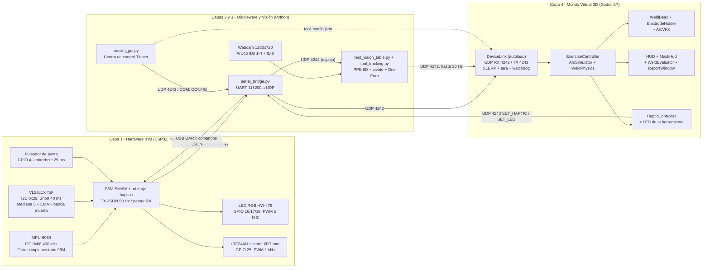

*Figura 2 — Arquitectura general hardware–software y flujos de datos.*

### 4.2 Diagrama de capas de software

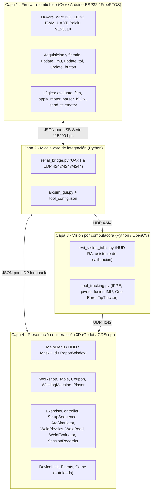

*Figura 3 — Diagrama de capas de software.*

### 4.3 Protocolo de comunicación

#### 4.3.1 Justificación de las decisiones de comunicación

| Decisión | Alternativas consideradas | Justificación técnica |
| :--- | :--- | :--- |
| **USB-Serie (UART) a 115200 bps** entre ESP32 y PC | Wi-Fi / Bluetooth del ESP32 | El cable USB ya es necesario para alimentar el motor y la electrónica; el enlace serie es determinista, no sufre interferencias ni latencias variables de radio y es nativo en el DevKit (conversor USB-UART). La trama de telemetría de ejemplo mide 114 caracteres + `\n`; a 50 Hz y con 10 bits por byte (8N1) ocupa ≈ 57,5 kbit/s, es decir, aproximadamente el 50 % del ancho de banda nominal, dejando margen para los comandos de retorno. |
| **JSON ASCII terminado en `\n`** | Trama binaria con *checksum* | Legible con cualquier monitor serie (facilita la depuración), con parser nativo en Godot (`JSON`) y en Python (`json`), y extensible sin romper compatibilidad: los receptores ignoran campos desconocidos. El costo en ancho de banda es aceptable (ver fila anterior). |
| **UDP sobre loopback (`127.0.0.1`)** entre procesos | TCP, acceso directo al COM desde Godot | La telemetría es un **estado periódico** en el que sólo importa la última muestra: UDP evita el bloqueo por retransmisión de TCP, no requiere conexión y permite que **varios consumidores** (Godot, visión) reciban los mismos datos. Godot ofrece `PacketPeerUDP` nativo, mientras que el acceso serie requeriría extensiones. Además, separar el COM en un único proceso (el puente) evita conflictos de acceso exclusivo al puerto. |
| **Proceso puente separado** (`serial_bridge.py`) | Godot o visión leyendo el COM | Desacopla el ciclo de vida del hardware del motor gráfico: el puente se reconecta solo ante desconexiones USB sin afectar a Godot, y la GUI, la visión y Godot pueden enviar comandos por un único puerto UDP. |

#### 4.3.2 Enlaces y puertos

**Tabla 4.1 — Enlaces de comunicación.**

| Enlace | Transporte | Parámetros | Contenido | Frecuencia |
| :--- | :--- | :--- | :--- | :--- |
| ESP32 ↔ Puente | USB-Serie (UART) | 115200 bps, 8N1, timeout 20 ms; autodetección por VID `0x10C4`, `0x1A86`, `0x0403`, `0x303A` | JSON terminado en `\n` (bidireccional) | 50 Hz (subida) / asíncrono (bajada) |
| Puente → Godot | UDP loopback | `127.0.0.1:4242` | Reenvío transparente de cada línea JSON del ESP32 | 50 Hz (60 Hz en `--mock`) |
| Visión → Godot | UDP loopback | `127.0.0.1:4242` | `{"dx","dy","x","y"}` en mm del cordón | Hasta 30 Hz (si \|dx\| o \|dy\| ≥ 0,15 mm o cada 40 ms) |
| Godot / GUI / Visión → Puente | UDP | `0.0.0.0:4243` (uso exclusivo, buffer RX 8192 B) | Comandos (`SET_HAPTIC`, `SET_LED`, `CONFIG`, `CALIBRATE`, …) | `SET_HAPTIC` ≤ 30 Hz (keepalive 250 ms); `SET_LED` ≤ 20 Hz (keepalive 200 ms) |
| Puente → Visión | UDP loopback | `127.0.0.1:4244` | Espejo de la telemetría (ángulos `r, p, y`) para fusión cámara + IMU | 50 Hz |

#### 4.3.3 Formato de tramas

**Telemetría ESP32 → PC (50 Hz):**

```json
{"qw":0.9981,"qx":-0.0124,"qy":0.0452,"qz":0.0398,"d":2.4,"b":0,"r":-1.4,"p":12.3,"y":4.5,"st":2,"dlpf":3,"h":127}
```

**Tabla 4.2 — Campos de la telemetría.**

| Campo | Tipo | Unidad / Rango | Descripción |
| :--- | :---: | :---: | :--- |
| `qw, qx, qy, qz` | `float` (4 dec.) | adimensional | Cuaternión unitario de orientación calculado desde (roll, pitch, yaw) |
| `d` | `float` (1 dec.) | mm | Distancia punta-chapa compensada y filtrada (0,0 con el pulsador presionado) |
| `b` | `int` | 0 / 1 | Estado del pulsador de contacto (1 = presionado) |
| `r, p, y` | `float` (1 dec.) | ° | Roll (trabajo), pitch (avance), yaw (azimut integrado) |
| `st` | `int` | 0…5 | Estado de la FSM (0 IDLE, 1 HOMING, 2 WELD_OK, 3 WELD_WARN, 4 STICKING, 5 ERROR) |
| `dlpf` | `int` | 0…6 | Modo activo del filtro pasa-bajos digital del MPU-6050 |
| `h` | `int` | 0…255 | Ciclo de trabajo PWM efectivamente aplicado al motor (GPIO 25) |

**Posición óptica Visión → Godot:** `{"dx":float,"dy":float,"x":float,"y":float}` — posición absoluta `(x, y)` y desplazamiento incremental `(dx, dy)` de la punta en milímetros, en el sistema de coordenadas del cordón (`x` a lo largo de la junta, 0–150 mm; `y` desvío lateral).

**Comandos PC → ESP32:** ver Tabla 5.5. **Acuses ESP32 → PC:** `{"ack":"BOOT",...}`, `{"ack":"PONG",...}`, `{"ack":"CONFIG_APPLIED",...}`, entre otros.

### 4.4 Flujo de punta a punta

La Figura 4 muestra el recorrido de una acción física completa: el operario suelda en condiciones óptimas y luego apoya la punta contra la chapa (electrodo pegado).

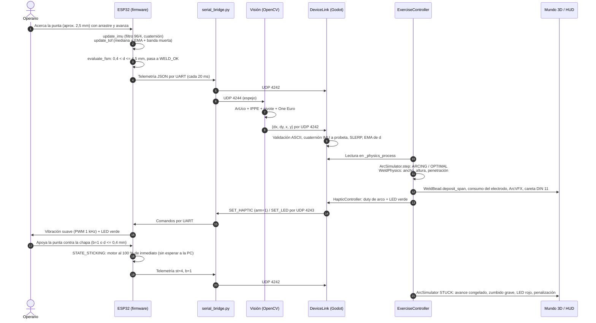

*Figura 4 — Diagrama de secuencia de la interacción de punta a punta, incluido el reflejo local ante electrodo pegado.*

El punto de diseño más relevante es el **lazo reflejo local**: ante un electrodo pegado, el firmware fuerza la vibración máxima sin esperar el viaje de ida y vuelta a la PC, de modo que la respuesta táctil al evento más crítico no depende de la latencia del puerto serie, del puente ni del motor gráfico.

---

## 5. Desarrollo de la Capa Hardware (Dispositivo IHM)

### 5.1 Selección y justificación de componentes

#### 5.1.1 Lista de materiales (BOM)

**Tabla 5.1 — Lista de materiales del prototipo final.**

| # | Componente | Modelo / Especificación | Cant. | Interfaz | Función en el sistema |
| :---: | :--- | :--- | :---: | :--- | :--- |
| 1 | Microcontrolador | ESP32 DevKit v1 (`esp32dev`, 30 pines) | 1 | USB-UART, I²C, LEDC PWM, GPIO | Adquisición, filtrado, FSM SMAW, control de actuadores y telemetría JSON |
| 2 | IMU 6 DoF | MPU-6050 (módulo GY-521) | 1 | I²C 400 kHz, dirección `0x68` (AD0 → GND) | Orientación 3D: acelerómetro ±2 g (16384 LSB/g), giroscopio ±250 °/s (131 LSB/(°/s)), montaje vertical |
| 3 | Sensor de distancia láser | VL53L1X (ToF) | 1 | I²C 400 kHz, dirección `0x29` | Distancia punta-chapa en modo corto, *timing budget* 40 ms |
| 4 | Pulsador de contacto | Microswitch táctil NA (alojamiento 12×12×4 mm) | 1 | GPIO 4 con `INPUT_PULLUP` (activo en LOW) | Contacto punta-chapa: cebado, pegado, cero dinámico y tara (≥ 2 s) |
| 5 | Indicador luminoso | Módulo LED RGB HW-479 | 1 | 3 × PWM LEDC 5 kHz, 8 bits | Señalización cromática del estado en la herramienta |
| 6 | Actuador háptico | Motor DC vibrador con masa excéntrica Ø27 × 23 mm (reciclado de mando Logitech) | 1 | PWM LEDC 1 kHz vía MOSFET | Retroalimentación táctil (cebado, arco estable, alerta, pegado) |
| 7 | Transistor de potencia | MOSFET canal N IRFZ44N | 1 | Conmutación lado bajo | Conmuta el motor desde el riel +5 V (VIN USB) |
| 8 | Resistencia de compuerta | 1 kΩ | 1 | Serie GPIO 25 → Gate | Limita la corriente de carga de la compuerta y protege el GPIO |
| 9 | Resistencia de *pull-down* | 10 kΩ | 1 | Gate → GND | Mantiene el MOSFET apagado durante el arranque o con el GPIO en alta impedancia |
| 10 | Cámara | Webcam Logitech 1080p (usada a 1280×720 @ 30 FPS) | 1 | USB a PC | Seguimiento óptico de la herramienta y de la mesa |
| 11 | Estructura de soporte de cámara | Perfiles de aluminio 20×20 mm | [COMPLETAR: cantidad y longitudes] | — | Montaje fijo de la cámara a ≈ 45 cm de altura y ≈ 50° de inclinación |
| 12 | Plantilla de mesa | Hoja A4 impresa a escala 1:1 (4 marcadores ArUco 36 mm, IDs 1–4) | 1 | Óptica | Sistema de referencia de la mesa y junta graduada de 150 mm |
| 13 | Marcador de herramienta | ArUco ID 0, 46×46 mm (cuadrado negro 40×40 mm + borde 3 mm) | 1 | Óptica | Pose 6D de la herramienta |
| 14 | Carcasa y piezas mecánicas | Impresión 3D FDM en PLA | 2 mitades + módulo ToF + varilla 60 mm + soporte ArUco | — | Empuñadura, alojamiento de la electrónica, mecanismo de *homing* |
| 15 | Tornillería | Tornillos M3 con tuercas en nidos hexagonales | 11 (+ 1 de regulación + 1 perno guía) | — | Cierre de las mitades, guía y regulación de la varilla |
| 16 | Cable USB de datos | 2–3 m | 1 | USB | Alimentación (5 V) y comunicación serie |
| 17 | Cableado interno | [COMPLETAR: tipo y calibre de cable utilizado] | — | — | Interconexiones dentro de la carcasa |

> **Nota de costo:** todos los ítems 1 a 11 ya se encontraban en poder del equipo. El costo efectivo del prototipo se limita al filamento PLA y a la impresión A4: [COMPLETAR: masa de filamento consumida y costo estimado, si se desea informar].

#### 5.1.2 Justificación de cada elección

| Componente | Por qué se eligió (criterio técnico) |
| :--- | :--- |
| **ESP32 DevKit v1** (frente a Arduino AVR) | CPU de 32 bits a 240 MHz con FPU que ejecuta en tiempo real trigonometría, conversión a cuaterniones, filtrado ToF en tres etapas y serialización JSON a 50 Hz sin saturación. Su periférico **LEDC** ofrece PWM por hardware con timers independientes, lo que permite usar 5 kHz para el LED (sin parpadeo visible) y 1 kHz para el motor simultáneamente. Permite ampliar el buffer UART a 2048 B (necesario para el comando `CONFIG` de ≈ 700 B) e integra Wi-Fi/BT para una futura versión inalámbrica. Además, estaba disponible en el equipo. |
| **MPU-6050** | IMU de 6 ejes sin magnetómetro: la ausencia de magnetómetro es deliberada, porque un taller de soldadura presenta campos magnéticos intensos que corromperían una brújula. El yaw (que derivaría) no es crítico: la posición en el plano la aporta la visión, y el yaw puede tararse. DLPF interno configurable en vivo (0–6). |
| **VL53L1X** (frente a ultrasonido HC-SR04) | La longitud de arco crítica es de 1,5–3,5 mm: se requiere un sensor de resolución milimétrica, con haz estrecho y sin zona ciega significativa a corta distancia. Un sensor ultrasónico tiene un haz ancho y una zona ciega de varios centímetros, incompatibles con este requisito (el repositorio conserva una variante de módulo para HC-SR04, `03b_modulo_sensor_HCSR04`, descartada en el montaje final). El VL53L1X en modo corto, con 40 ms de integración, resuelve la distancia a la chapa con la punta del electrodo a 24 mm de su eje óptico. |
| **Pulsador axial** | Detecta el contacto físico real de la punta con la chapa, evento que el ToF no puede distinguir con certeza. Se usa para el cebado por contacto (*homing*), para detectar el pegado y para recalibrar el cero del ToF en cada contacto. |
| **LED RGB HW-479** | Retroalimentación visual en la propia herramienta, útil cuando el operario mira la pieza y no la pantalla. El módulo integra las resistencias de limitación, lo que simplifica el cableado. |
| **Motor vibrador Ø27 mm + IRFZ44N** | El motor reciclado de un mando ofrece la sensación táctil característica de los controladores de juego. Su corriente supera la que puede entregar un GPIO del ESP32, por lo que se conmuta con un MOSFET en lado bajo desde el riel de 5 V. El IRFZ44N estaba disponible; las resistencias de 1 kΩ (serie) y 10 kΩ (*pull-down*) aseguran un estado definido de la compuerta. |
| **Webcam + ArUco** (frente a trackers comerciales o cascos de RV) | Evita hardware propietario costoso. Cada sensor se asigna a su especialidad física: el VL53L1X mide la longitud de arco, el MPU-6050 la inclinación fluida y la visión ArUco + pivote resuelve la traslación absoluta `(x, y)` de la punta sobre la probeta. |
| **PLA** | Material de impresión FDM de fácil procesamiento, suficiente rigidez para una herramienta manual sin cargas térmicas (no hay arco real). |

### 5.2 Esquema de conexiones, mapeo de pines y diseño físico

#### 5.2.1 Mapeo de pines

**Tabla 5.2 — Mapeo de pines del ESP32 (`firmware/src/main.cpp`, líneas 31–40).**

| Pin ESP32 | Constante | Modo | Periférico | Conexión destino |
| :--- | :--- | :--- | :--- | :--- |
| GPIO 21 | `PIN_I2C_SDA` | I²C bidireccional | `Wire` (400 kHz) | SDA de MPU-6050 (`0x68`) y de VL53L1X (`0x29`) |
| GPIO 22 | `PIN_I2C_SCL` | Reloj I²C | `Wire` (400 kHz) | SCL de MPU-6050 y de VL53L1X |
| GPIO 16 | `PIN_RGB_R` | PWM | LEDC canal 0 (5 kHz, 8 bits) | Canal R del HW-479 |
| GPIO 17 | `PIN_RGB_G` | PWM | LEDC canal 1 (5 kHz, 8 bits) | Canal G del HW-479 |
| GPIO 19 | `PIN_RGB_B` | PWM | LEDC canal 2 (5 kHz, 8 bits) | Canal B del HW-479 |
| GPIO 25 | `PIN_HAPTIC` | PWM | LEDC canal 4 (1 kHz, 8 bits) | R 1 kΩ → Gate (pata 1) del IRFZ44N; R 10 kΩ Gate → GND |
| GPIO 4 | `PIN_BUTTON` | `INPUT_PULLUP` | GPIO digital | Terminal 1 del pulsador (terminal 2 → GND) |
| GPIO 2 | `PIN_STATUS_LED` | Salida digital | LED integrado | Indicador de calibración y de pulsación |
| 3V3 | — | Alimentación | +3,3 V | VCC del MPU-6050 y VIN del VL53L1X |
| VIN | — | VBUS USB | +5 V | Terminal (+) del motor vibrador |
| GND | — | Referencia | 0 V | GND de MPU-6050, VL53L1X, pulsador, HW-479 (−), Source del IRFZ44N y *pull-down* de 10 kΩ |

**Bus I²C compartido.** El MPU-6050 y el VL53L1X comparten en paralelo SDA (GPIO 21) y SCL (GPIO 22) a 400 kHz, sin resistencias de *pull-up* externas adicionales; se emplean las del propio módulo breakout [COMPLETAR: confirmar qué módulo(s) aportan las resistencias de pull-up y su valor]. Ambos dispositivos tienen direcciones distintas (`0x68` y `0x29`), por lo que no requieren multiplexor.

**Etapa de potencia del motor.** Topología *low-side*: motor (+) a VIN (+5 V), motor (−) al Drain del IRFZ44N, Source a GND. La compuerta recibe el PWM de GPIO 25 a través de 1 kΩ y se mantiene a GND mediante 10 kΩ cuando el pin no está configurado.

#### 5.2.2 Diagrama en bloques de interconexiones

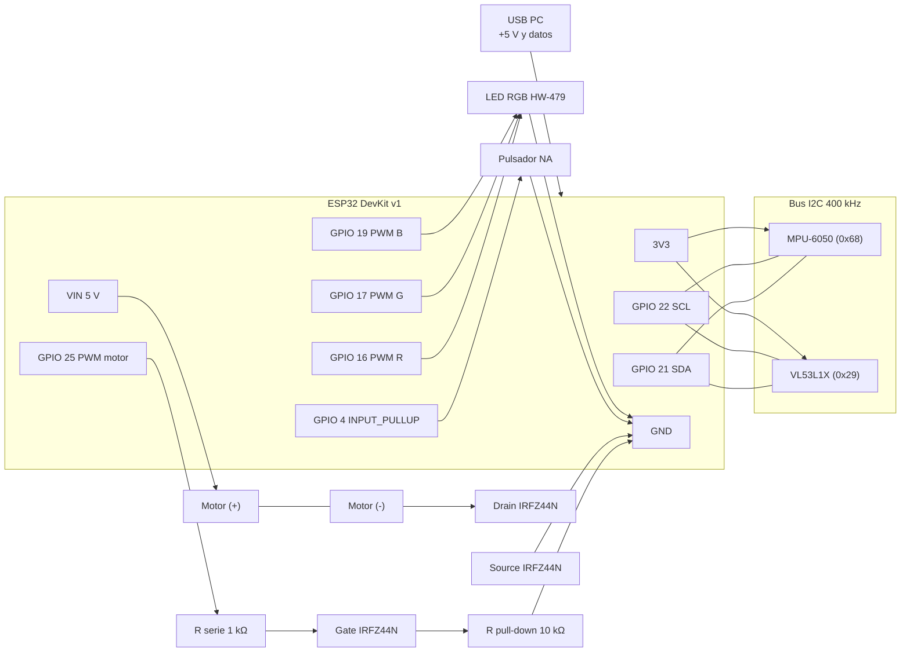

*Figura 5 — Diagrama en bloques de las interconexiones eléctricas del IHM.*

> **[INSERTAR FIGURA 6: Esquemático eléctrico definitivo (KiCad, Fritzing o equivalente) con ESP32 DevKit v1, MPU-6050 y VL53L1X en el bus I²C (GPIO 21/22), HW-479 en GPIO 16/17/19, etapa IRFZ44N con R_gate 1 kΩ y R_pull-down 10 kΩ en GPIO 25, motor vibrador alimentado desde VIN y pulsador en GPIO 4 con pull-up interno.]**

#### 5.2.3 Diseño físico y mecánico

El cuerpo de la herramienta se diseñó de forma **paramétrica en código** con CadQuery/OpenCASCADE (`hardware/3d_models/generate_holder_cad.py`), lo que permitió iterar desde la versión v2.2 hasta la v3.14 (bitácora en `hardware/CAMBIOS_v3.md`) modificando cotas en lugar de redibujar. El script incluye un verificador automático de holguras (`verify_clearances()`) que comprueba la ausencia de interferencias contra envolventes conservadoras de todos los componentes (resultado: 0 interferencias).

**Características geométricas principales (versión vigente v3.10–v3.14):**

| Elemento | Especificación | Justificación |
| :--- | :--- | :--- |
| Longitud total | 250,0 mm (Z = −108 a +142 mm) | Proporción similar a un portaelectrodo real |
| Mango | Ø54 mm con 7 estrías de agarre de 1,2 mm; collarín Ø56 mm | Agarre ergonómico y antideslizante |
| Guarda-mano | 17 mm de espesor (56 × 66 mm); alojamiento del LED en Z = 65,5 mm con salida Ø6,4 mm | Separa la mano del cabezal y deja el LED visible |
| Cabezal | 42 × 56 × 70 mm | Aloja ESP32, MPU-6050, motor y ducto del MOSFET |
| División | Carcasa partida longitudinalmente en X = 0 en dos mitades | Ensamble de la electrónica y orientación de impresión sin soportes en las caras de unión |
| Impresión | Mitades rotadas 45° en Z (huella ≈ 202 × 202 mm) para cama de 220 × 220 mm (Ender 3 V2) | Permite imprimir una pieza de 250 mm en una cama de 220 mm |
| Fijación | 11 tornillos M3 con tuercas en nidos hexagonales externos + 13 pines guía | Cierre desmontable y alineación precisa de las mitades |
| ESP32 | Montado invertido sobre 4 machos Ø2,8 mm (bahía 56 × 32 mm, X: −13…+9) | Acceso al puerto USB y fijación sin tornillos |
| MPU-6050 | Sobre 2 machos Ø2,9 mm a 16 mm entre centros, montaje vertical (Ay = −1 g en reposo) | Referencia mecánica rígida respecto del eje de la herramienta |
| Motor vibrador | Bolsillo Ø27,75 × 13 mm (mitad izquierda) + cámara de desbalance Ø29 × 11,3 mm (mitad derecha) sobre plataforma maciza de 8 mm | Libertad de giro de la masa excéntrica y transmisión de la vibración a la empuñadura |
| Circuito MOSFET | Ducto delantero de 14 × 20 × 37,5 mm | Montaje compacto del circuito armado |
| Varilla de electrodo | Desmontable, 60 mm (recomendada), espiga deslizante Ø8 mm, colisa con perno guía M3, recorrido axial 2,5 mm, tornillo M3 de regulación contra el pulsador (hueco 12 × 12 × 4 mm) | La longitud de 60 mm evita invadir el cono óptico de 25° del ToF (ejes separados 24 mm); el recorrido axial acciona el pulsador al apoyar la punta |
| Soporte ArUco | Plano inclinado ≈ 30°, área útil 48 × 48 mm, marcador ID 0 de 46 × 46 mm | La inclinación mantiene el marcador visible para la cámara con la herramienta en postura de soldadura y reduce la condición de marcador paralelo al plano imagen (ambigüedad IPPE) |


*Figura 7 — Render CAD del ensamble final: carcasa ergonómica con mango acanalado, guarda-mano, cabezal con fijaciones M3, módulo ToF (naranja) con ventana óptica, varilla de electrodo (beige) y soporte del marcador ArUco (azul). En el prototipo impreso se montó la versión de soporte plano inclinado de 48 × 48 mm a ≈ 30°.*


*Figura 8 — Seis cortes técnicos generados por `preview_cad.py` que verifican la disposición interna de ESP32, motor Ø27 mm, canales de cables, circuito MOSFET, LED, MPU-6050 y módulo ToF.*

> **[INSERTAR FIGURA 9: Fotografías del prototipo físico impreso en PLA — (a) vista exterior completa de la herramienta con el marcador ArUco ID 0 en el soporte inclinado; (b) mitad abierta mostrando el montaje interno de ESP32, MPU-6050, motor vibrador, LED y circuito MOSFET; (c) detalle de la varilla de electrodo, el pulsador axial y el módulo ToF.]**

**Inventario de archivos mecánicos y ópticos.**

| Carpeta | Archivos | Uso |
| :--- | :--- | :--- |
| `hardware/3d_models/stl/` | `01_carcasa_derecha.stl`, `02_carcasa_izquierda.stl`, `03a_modulo_sensor_ToF.stl`, `04a_electrodo_60mm.stl`, `05_soporte_aruco.stl` | Mallas para impresión (las variantes `03b_modulo_sensor_HCSR04` y `04b_electrodo_100mm` no se usan en el montaje final) |
| `hardware/3d_models/step/` | `00_ensamble_completo.step`, `00b_ensamble_con_componentes.step` y sólidos individuales | Sólidos BREP editables |
| `hardware/` | `REALIDAD_VIRTUAL.3mf` | Proyecto de laminado |
| `hardware/aruco/` | `plantilla_mesa_soldadura_A4.pdf/.png`, `hoja_impresion_A4_aruco.pdf`, `marker_*_40mm.png`, generadores `.py` | Plantilla de mesa y marcadores imprimibles a escala 1:1 |

> **Nota:** `05_soporte_aruco.stl/.step` corresponde al soporte original de tres caras. El soporte plano inclinado efectivamente montado en el prototipo final no figura en el inventario de archivos del repositorio: [COMPLETAR: indicar el archivo CAD/STL del soporte plano inclinado de 48 × 48 mm a ≈ 30°, o describir cómo se fabricó].

#### 5.2.4 Banco óptico y plantilla de mesa

La estación óptica está formada por la webcam Logitech 1080p montada sobre una estructura fija de perfiles de aluminio 20×20 mm, a ≈ 45 cm de altura y ≈ 50° de inclinación, enfocando la plantilla A4. La plantilla (generada por `hardware/aruco/generate_table_board.py`) es una hoja A4 apaisada a escala 1:1 con cuatro marcadores de 36 mm (IDs 1–4) en las posiciones (−45, +65), (+195, +65), (−45, −65) y (+195, −65) mm respecto del origen del cordón, una junta graduada de 150 mm y una regla de verificación de 100 mm para comprobar la escala de impresión.

**Justificación:** cuatro marcadores en las esquinas, alejados entre sí, dan una estimación de la pose de la mesa robusta frente a la oclusión parcial por la mano del operario y mejor condicionada que un único marcador. La regla de 100 mm permite detectar una impresión escalada por la impresora, que produciría un error sistemático en todas las posiciones.

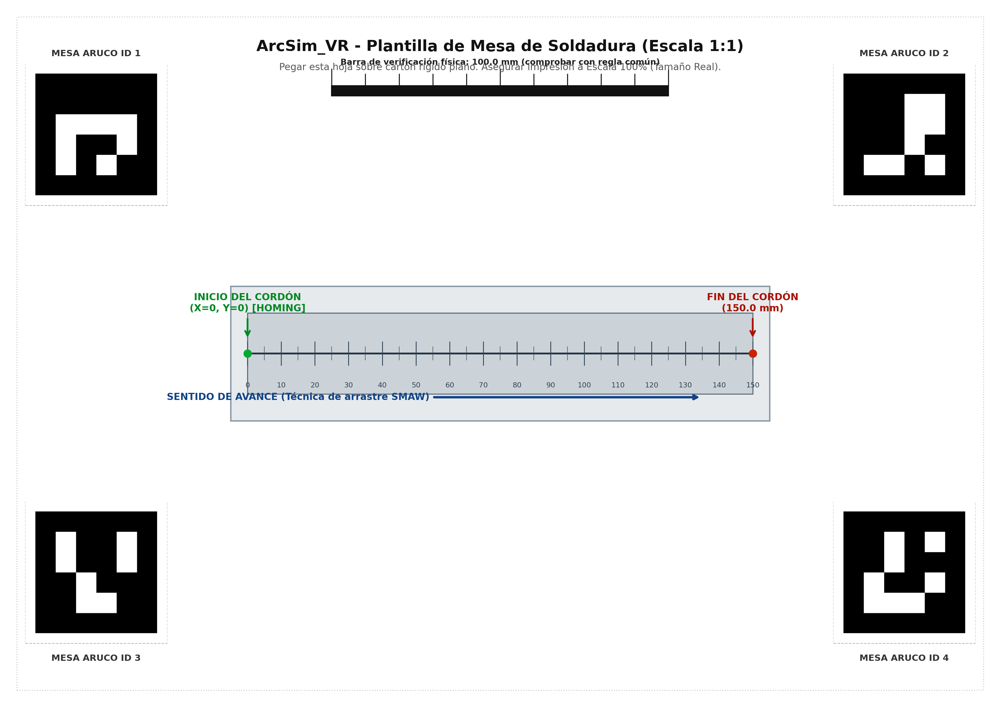

*Figura 10 — Plantilla de mesa A4 a escala 1:1 (marcadores IDs 1–4, junta de 150 mm y regla de verificación de 100 mm).*

> **[INSERTAR FIGURA 11: Fotografía del banco óptico completo — estructura de perfiles de aluminio 20×20, webcam Logitech a ≈ 45 cm de altura y ≈ 50° de inclinación, y plantilla A4 fijada a la mesa.]**

### 5.3 Software de bajo nivel (firmware)

#### 5.3.1 Entorno y organización

El firmware activo es una aplicación monolítica en C++/Arduino (`firmware/src/main.cpp`, 895 líneas, versión `2026-11-25a`) compilada con PlatformIO sobre el framework Arduino-ESP32 3.x (ESP-IDF v5.5.5). La configuración de compilación (`firmware/platformio.ini`) es:

```ini
[env:esp32dev]
platform = espressif32
board = esp32dev
framework = arduino
monitor_speed = 115200
upload_speed = 921600
build_flags =
    -D CONFIG_FREERTOS_HZ=1000
lib_deps =
    pololu/VL53L1X @ ^1.3.1
```

**Decisión de diseño — firmware monolítico con bucle cooperativo:** se descartó una arquitectura con múltiples tareas FreeRTOS porque todas las etapas son cortas y no bloqueantes (lectura del ToF sólo si `dataReady()`, lectura del IMU en ráfaga, parser acotado a 8 líneas por ciclo). Un único bucle con orden fijo de etapas elimina condiciones de carrera sobre las variables compartidas (distancia, estado, *duty*) sin necesidad de *mutex*. Las carpetas `firmware/include/` y `firmware/legacy/` contienen una arquitectura modular de una iteración anterior que **no** se compila en la versión final.

#### 5.3.2 Secuencia de inicialización (`setup()`, líneas 799–868)

1. **Puerto serie ampliado:** `Serial.setRxBufferSize(2048)`, `Serial.begin(115200)`, `Serial.setTimeout(20)`. El buffer por defecto (256 B) truncaba el comando `CONFIG` (≈ 700 B).
2. **Asignación de canales LEDC:** canales 0, 1 y 2 a 5 kHz para el LED RGB; canal 4 a 1 kHz para el motor. En el ESP32 los canales LEDC comparten timer de a pares (0–1, 2–3, 4–5): ubicar el motor en el canal 4 evita que la frecuencia del LED sobrescriba la del motor. Si `ledcAttachChannel()` falla, se recurre a `ledcAttach()`.
3. **Autotest de arranque (POST):** secuencia R → G → B (150 ms cada color) y pulso de motor (`duty = 220`, 250 ms) para verificar visualmente el LED, la etapa MOSFET y la alimentación.
4. **I²C y sensores:**
   - `Wire.begin(21, 22, 400000L)`.
   - **MPU-6050:** despertar (`PWR_MGMT_1 0x6B = 0x00`), DLPF modo 3 (`CONFIG 0x1A = 3`, 44 Hz) y `calibrate_gyro()`: apaga el motor, espera 150 ms, promedia 150 muestras del giroscopio espaciadas 2 ms, resetea el yaw y silencia la háptica durante 1 s.
   - **VL53L1X:** `setTimeout(500)`, `init()`, `setDistanceMode(VL53L1X::Short)`, `setMeasurementTimingBudget(40000)` y `startContinuous(40)` (25 Hz). Si `init()` falla, el sistema pasa a `STATE_ERROR` (rojo parpadeante a 1 Hz).
5. **Confirmación:** envía `{"ack":"BOOT","fw":"2026-11-25a","pwm_ok":1}`.

#### 5.3.3 Bucle principal y lógica de adquisición (`loop()`, líneas 873–895)

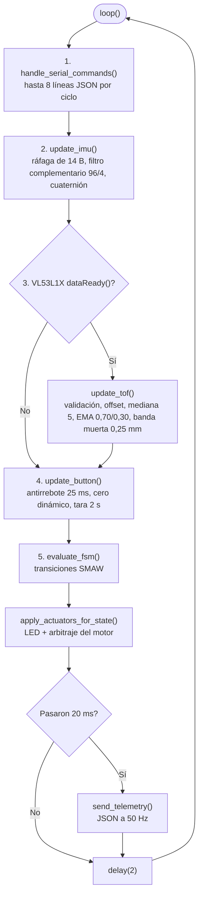

*Figura 12 — Diagrama de flujo del bucle principal del firmware (frecuencia interna de ciclo ≈ 300–450 Hz).*

**a) Adquisición y fusión del IMU (`update_imu()`, L330–375).** Se leen 14 bytes en ráfaga desde el registro `0x3B` (acelerómetro, temperatura, giroscopio), se escalan (16384 LSB/g y 131 LSB/(°/s)) y se restan los sesgos del giroscopio. El paso temporal `dt` se mide en microsegundos y se acota (`dt > 0,1 s ⇒ dt = 0,02 s`) para evitar saltos de integración tras una pausa. Con la convención de montaje vertical (Ay = −1 g en reposo):

$$
\theta_{acc} = \operatorname{atan2}(a_z,\,-a_y)\cdot\tfrac{180}{\pi}, \qquad
\phi_{acc} = \operatorname{atan2}\!\left(a_x,\,\sqrt{a_z^2 + a_y^2}\right)\cdot\tfrac{180}{\pi}
$$

$$
\theta = 0{,}96\,(\theta + g_x\,dt) + 0{,}04\,\theta_{acc}, \qquad
\phi = 0{,}96\,(\phi + g_z\,dt) + 0{,}04\,\phi_{acc}, \qquad
\psi = \psi + g_y\,dt
$$

donde θ es el pitch (ángulo de avance), φ el roll (ángulo de trabajo) y ψ el yaw. Los ángulos se convierten a un cuaternión unitario (`euler_to_quaternion()`, L316–328) porque Godot opera internamente con cuaterniones/bases y porque la interpolación esférica (SLERP) del lado del simulador evita los problemas de singularidad de los ángulos de Euler.

**b) Adquisición y filtrado del ToF en tres etapas (`update_tof()`, L380–433).**

1. **Validación:** se aceptan sólo lecturas con 10 < d < 1200 mm y `range_status` ∈ {0 (válido), 7 (*wraparound*)}.
2. **Compensación:** si el pulsador está presionado, d = 0,0 mm; si no, se resta `dynamic_offset_mm` (inicialmente `ELECTRODE_LENGTH_OFFSET_MM = 75,5 mm`, recalibrado en cada contacto) y se acota a ≥ 0.
3. **Cadena de filtrado:**
   - *Mediana de 5 muestras:* elimina picos aislados y reflexiones parásitas sin introducir el sesgo que un promedio sufriría ante un *outlier*.
   - *Pasa-bajos exponencial (EMA):* `smoothed = 0,70 · smoothed + 0,30 · mediana`, suaviza el ruido residual con costo O(1).
   - *Banda muerta de 0,25 mm:* sólo actualiza la salida si el cambio supera 0,25 mm, suprimiendo el temblor del último decimal que de otro modo se transmitiría como vibración del electrodo virtual.

**c) Pulsador, cero dinámico y tara (`update_button()`, L438–496).** Antirrebote por software de 25 ms. En el flanco de contacto: fija d = 0, actualiza `dynamic_offset_mm` con la lectura cruda actual del ToF si está entre 45 y 300 mm (autocalibración del cero frente a variaciones de montaje de la varilla) y, si la sesión no estaba activa, la inicia en `STATE_HOMING`. Una pulsación sostenida ≥ 2000 ms ejecuta la tara (yaw = 0), reinicia la sesión y confirma con un doble destello azul.

#### 5.3.4 Máquina de estados SMAW del firmware (`evaluate_fsm()`, L501–574)

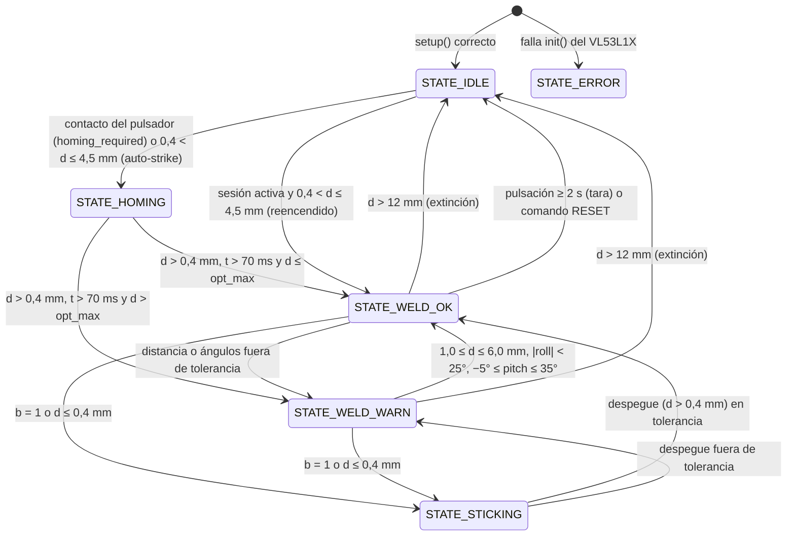

*Figura 13 — Máquina de estados SMAW del firmware (umbrales por defecto de `tool_config.json`).*

**Tabla 5.3 — Estados de la FSM del firmware.**

| Código | Estado | Significado | Color LED por defecto (`tool_config.json`) |
| :---: | :--- | :--- | :--- |
| 0 | `STATE_IDLE` | Sin sesión o arco extinguido | `idle` = (105, 15, 150) |
| 1 | `STATE_HOMING` | Cebado (pulso táctil inicial de ≈ 80 ms) | `homing` = (0, 50, 255) |
| 2 | `STATE_WELD_OK` | Arco encendido dentro de tolerancia | `weld_optimal` = (0, 255, 0) |
| 3 | `STATE_WELD_WARN` | Arco encendido fuera de tolerancia | `weld_warning` = (255, 0, 0) |
| 4 | `STATE_STICKING` | Electrodo pegado | `sticking` = (255, 0, 0) |
| 5 | `STATE_ERROR` | Falla de inicialización del ToF | Rojo parpadeante a 1 Hz |

**Modos de cebado.** `g_cfg.homing_required = true` exige el contacto físico del pulsador para iniciar la sesión; `false` (valor por defecto) habilita el arranque automático al acercar la punta a 0,4 < d ≤ 4,5 mm. La elección se realiza desde la GUI (§6.2.6) y se propaga al firmware (`SET_HOMING` / `CONFIG`) y a Godot.

**Justificación de una FSM también en el firmware.** Aunque el simulador tiene su propia máquina de estados del arco (§6.3.4), la FSM local permite que la herramienta (i) señalice su estado con el LED aun sin Godot abierto (por ejemplo, durante la calibración óptica) y (ii) ejecute el **reflejo háptico ante el pegado** sin latencia de PC.

#### 5.3.5 Arbitraje del motor háptico (`apply_motor()`, L229–248)

El motor puede ser solicitado por varias fuentes; para evitar conflictos se aplica una jerarquía estricta de prioridades:

**Tabla 5.4 — Jerarquía de arbitraje del motor.**

| Prioridad | Condición | *Duty* aplicado | Propósito |
| :---: | :--- | :--- | :--- |
| 1 | Prueba manual activa (`test_override_haptic_until_ms`) | Valor de prueba | Banco de pruebas de la GUI |
| 2 | Ventana de silencio (`haptic_mute_until_ms`) | 0 | Calibración de giroscopio o de pivote |
| 3 | Arco armado en Godot (`host_armed_until_ms`, ventana 500 ms) | *Duty* de Godot; si `STATE_STICKING`: `max(duty_sticking, duty Godot)` | Retroalimentación de soldadura con reflejo local ante pegado |
| 4 | Godot conectado sin arco (`host_haptic_until_ms`) | *Duty* de Godot (normalmente 0) | Menús y preparación |
| 5 | Sin host activo | 0 | **Estado seguro:** sin vibración no solicitada |

#### 5.3.6 Comandos y configuración en caliente

El parser JSON es propio y no usa librerías externas (`extract_cmd`, `extract_section`, `extract_int`, `extract_float`, `extract_rgb`, `extract_bool`). `extract_section` aísla un subobjeto contando llaves balanceadas, porque claves homónimas (p. ej., `"homing"`) aparecen tanto en `led_colors` como en `haptic_intensity_pct` y una búsqueda ingenua confundiría ambas. Todos los valores de salida se acotan con `constrain()`.

**Tabla 5.5 — Comandos PC → ESP32 (`handle_command_line()`, L711–786).**

| Comando | Ejemplo | Efecto |
| :--- | :--- | :--- |
| `CALIBRATE` (o `c`/`C`) | `{"cmd":"CALIBRATE"}` | Detiene el motor, recalibra el giroscopio (150 muestras), resetea yaw y silencia la háptica 1 s |
| `RESET_YAW` (o `t`/`T`) | `{"cmd":"RESET_YAW"}` | yaw = 0 |
| `0`–`6` | `5` | Cambia el DLPF del MPU-6050 en vivo (0: 260 Hz … 3: 44 Hz … 5: 10 Hz, 6: 5 Hz) |
| `PING` | `{"cmd":"PING"}` | Responde `PONG` con versión, estado PWM, *duties* y FSM |
| `SET_HAPTIC` | `{"cmd":"SET_HAPTIC","val":128,"m":0,"arm":1}` | *Duty* desde Godot (ventana 500 ms); con `"ms":2000` activa una prueba manual |
| `SET_LED` | `{"cmd":"SET_LED","r":0,"g":255,"b":0}` | Color RGB desde Godot durante 500 ms |
| `TEST_ACTUATOR` | `{"cmd":"TEST_ACTUATOR","r":0,"g":255,"b":0,"ms":2500}` | Prueba manual del LED |
| `HAPTIC_MUTE` | `{"cmd":"HAPTIC_MUTE","ms":3000}` | Silencia el motor (máx. 30000 ms) |
| `SET_HOMING` | `{"cmd":"SET_HOMING","enabled":false}` | Activa/desactiva el requisito de pulsador |
| `RESET` / `END_SESSION` | `{"cmd":"RESET"}` | Reinicia sesión y arco, apaga el motor, vuelve a `STATE_IDLE` |
| `CONFIG` | `{"cmd":"CONFIG","config":{...}}` | Actualiza `led_colors`, `tof_limits_mm`, `haptic_intensity_pct` y `homing_required` |

#### 5.3.7 Manejo de errores en el firmware

| Riesgo | Mecanismo |
| :--- | :--- |
| Truncamiento de comandos largos | Buffer RX de 2048 B, timeout de 20 ms y máximo 8 comandos por ciclo (el bucle nunca queda bloqueado drenando el puerto) |
| Colisión de frecuencias PWM | Canales LEDC en timers distintos + *fallback* `ledcAttach()` |
| Lecturas ópticas aberrantes | Validación de rango y `range_status`, mediana, EMA y banda muerta |
| Falla de inicialización del ToF | Timeout I²C de 500 ms y transición a `STATE_ERROR` con indicación visual |
| Saltos de integración angular | Acotamiento de `dt` |
| Sesgo del giroscopio contaminado por la vibración del propio motor | Motor apagado + espera de 150 ms antes de calibrar + silencio de 1 s |
| Motor vibrando si Godot se cierra | Ventanas de control de 500 ms que expiran solas (*watchdog* del host) y estado por defecto `duty = 0` |
| Valores fuera de rango en `CONFIG` | `constrain()` sobre todas las salidas PWM |


---

## 6. Desarrollo de la Capa Software (Mundo Virtual 3D e Interfaz)

### 6.1 Stack tecnológico, librerías de terceros y arquitectura de módulos

#### 6.1.1 Stack tecnológico

**Tabla 6.1 — Stack tecnológico verificado.**

| Capa | Tecnología | Versión | Uso |
| :--- | :--- | :--- | :--- |
| Motor 3D | Godot Engine (Standard, 64 bits) | 4.7 (`Forward Plus`) | Escenas 3D, física Jolt, render D3D12, audio, UI |
| Lenguajes del simulador | GDScript + Godot Shading Language | Godot 4.7 | Totalidad de la lógica y shaders propios (sin C#) |
| Física | Jolt Physics (integrada en Godot) | — | Colisiones de mundo, raycasts de los cables |
| Entorno embebido | VS Code + PlatformIO | PlatformIO Core 6.2.0; `framework-arduinoespressif32` 4.30312.261116 (Arduino Core 3.x / ESP-IDF v5.5.5) | Compilación y carga del firmware |
| Librería embebida | Pololu VL53L1X | `^1.3.1` | Driver I²C del sensor ToF |
| Librerías estándar ESP32 | `Arduino.h`, `Wire.h`, `math.h` | Incluidas en el framework | GPIO, LEDC, UART, I²C, trigonometría |
| Middleware y visión | Python + OpenCV (`opencv-contrib-python`), NumPy, PySerial, Tkinter | Python 3.12.5, OpenCV 4.11.0, NumPy 2.0.2, PySerial 3.5 | Puente, detección ArUco, pose 6D, pivote, GUI |
| Generación offline de activos | Blender (`bpy`, `bmesh`, `mathutils`), CadQuery/OpenCASCADE, Trimesh, Matplotlib | Matplotlib 3.9.2 (resto: [COMPLETAR: versiones de Blender, CadQuery y Trimesh utilizadas]) | Modelos `.glb`, CAD de la carcasa, cortes y PDFs de marcadores |

#### 6.1.2 Justificación del motor gráfico

Se eligió **Godot Engine 4.7** frente a Unity y Unreal Engine por los siguientes motivos técnicos:

| Requisito del proyecto | Solución en Godot |
| :--- | :--- |
| Recepción de telemetría en tiempo real sin plugins | `PacketPeerUDP` nativo |
| Cordón y cables cuya geometría cambia en cada fotograma | `SurfaceTool` e `ImmediateMesh` nativos |
| Cordón incandescente que se enfría y careta fotosensible | Shaders propios en `.gdshader` |
| Audio del arco sin archivos de sonido externos | `AudioStreamWAV` generado por código |
| Colisiones del mundo y raycasts | Jolt Physics integrado |
| Pruebas automáticas reproducibles | Ejecución `--headless` con `--fixed-fps` |
| Productividad del equipo | GDScript, sintaxis afín a Python (el mismo lenguaje del middleware) |
| Restricciones de licencia y de cuentas | Licencia MIT, sin cuentas ni regalías, binario liviano |

#### 6.1.3 Arquitectura de carpetas y módulos del simulador

```text
simulacion_godot/trabajo-final-rv/
├── project.godot              # Godot 4.7, Forward Plus, Jolt Physics, D3D12; escena inicial MainMenu.tscn
├── tool_config.json           # Espejo de la configuración (escrito por arcsim_gui.py, releído por DeviceLink)
├── Assets/models/             # 14 modelos .glb generados por tools/blender/make_models.py
├── Scenes/                    # MainMenu, Main_scene, Workshop, Player, Table, Coupon, welding_machine,
│                              # electrode_holder, ground_clamp, WeldingSpot (+ DigitalTwinTest, utilitaria)
├── Scripts/
│   ├── autoload/              # Singletons: Events (bus de señales), DeviceLink (E/S de hardware), Game
│   ├── core/                  # physics_layers.gd (capas físicas)
│   ├── interaction/           # interactable, pickable, interactor, ground_clamp, clamp_anchor, electrode_holder
│   ├── player/                # player.gd (cámara 1.ª persona, walk_to, enter_station)
│   ├── ui/                    # main_menu, hud, gauge_bar, mask_hud, report_window, series_chart
│   ├── welding/               # exercise_controller, setup_sequence, arc_simulator, weld_physics, weld_geometry,
│   │                          # weld_bead, arc_vfx, haptic_controller, weld_evaluator, session_recorder, level_config
│   └── world/                 # coupon, welding_machine, welding_cable, welding_spot
├── Shaders/                   # weld_bead.gdshader, welding_mask.gdshader
├── materials/                 # outline.gdshader (resaltado Fresnel)
├── tests/                     # test_runner.tscn / .gd (pruebas headless)
└── tools/
    ├── serial_bridge.py       # Puente USB-Serie <-> UDP
    ├── make_workshop.py       # Generador procedural de Scenes/Workshop.tscn
    └── blender/make_models.py # Generador procedural de los 14 .glb
```

**Criterios de organización:**

- **Autoloads** (`Events`, `DeviceLink`, `Game`): servicios globales con ciclo de vida igual al de la aplicación. `DeviceLink` es el único punto de contacto con el hardware; el resto del simulador consulta su API (`get_tool_up()`, `get_arc_gap_mm()`, `get_trigger()`, `hw_abs_pos_mm`) sin saber si los datos provienen de la herramienta real o de la emulación por teclado/mouse.
- **Separación lógica pura / nodos:** `WeldPhysics`, `WeldGeometry` y `LevelConfig` son clases sin estado de escena (`RefCounted` o funciones estáticas), lo que permite probarlas aisladamente en el `test_runner`.
- **Orquestador único:** `ExerciseController` es el único que conoce simultáneamente a `DeviceLink` y a los objetos 3D; los objetos del mundo no se conocen entre sí, lo que reduce el acoplamiento.

### 6.2 Modelado del entorno

#### 6.2.1 Escenas y primitivas 3D

**Tabla 6.2 — Objetos 3D del entorno y técnica de modelado.**

| Objeto / Escena | Técnica | Detalle | Justificación |
| :--- | :--- | :--- | :--- |
| Taller (`Workshop.tscn`, generado por `tools/make_workshop.py`) | Primitivas `BoxMesh` + `StaticBody3D`/`BoxShape3D` (capa física 1, `world`) | Recinto de 14 × 12 × 5 m: piso de hormigón, paredes con zócalo y franja amarilla, techo con vigas y columnas, ducto, demarcaciones de zona de soldadura, portón, ventanas emisivas, cortina de soldadura translúcida (`alpha = 0.32`) y 5 carteles de seguridad (`BoxMesh` + `Label3D`) | Un generador en Python hace reproducible y editable la escena; las cajas son geometría mínima con colisión exacta |
| Mesas (`Table.tscn`, ×2) | `BoxMesh` | Tapa metálica 2,0 × 0,06 × 0,8 m, 4 patas, marcas emisivas `ClampMarkLeft/Right` y `Area3D` `ClampAnchorLeft/Right` | Las `Area3D` definen las zonas válidas para fijar la pinza de masa |
| Probeta (`Coupon.tscn` + `coupon.gd`) | `BoxMesh` | Dos chapas de 0,18 × 0,01 × 0,07375 m a tope con separación de raíz, marcas de inicio (verde, x = −0,0775 m) y fin (rojo, x = +0,0775 m) y guía central amarilla de 150 mm (oculta en Nivel 3) | Dimensiones exactas en metros, equivalentes a la chapa de 10 mm y a la junta de 150 mm de la plantilla física |
| Cordón (`weld_bead.gd` + `weld_bead.gdshader`) | Malla procedural `SurfaceTool` | 151 secciones (1 mm de paso); perfil transversal de 9 puntos parabólicos con ondulación `1 + 0.08·sin(1.9·i)`; reconstrucción a 20 Hz; enfriamiento (`COOL_TIME_S = 2.5 s`) en `COLOR.r` y defectos en `COLOR.b` | La forma depende de la técnica del operario; el color por vértice permite que el shader represente temperatura y defectos sin texturas |
| Cables (`welding_cable.gd`) | Malla procedural `ImmediateMesh` | Tubos hexagonales de 18 segmentos sobre una Bézier cuadrática con flecha por gravedad (`sag_factor` 0,4 / 0,35) y raycast contra la capa `WORLD` | Los extremos se mueven con la pinza y el portaelectrodo; el raycast evita que el cable atraviese la mesa o el piso |
| Electrodo consumible | `CylinderMesh` | `radius = 1.6 mm`, `height = 350 mm`; reduce escala y desplaza el centro hasta la colilla de 50 mm | Un cilindro paramétrico se acorta sin regenerar malla |
| Núcleo del arco y efectos (`arc_vfx.gd`) | `SphereMesh` emisivo + 2 `GPUParticles3D` + `OmniLight3D` | 10 chispas continuas y 3 partículas de salpicadura (sólo con arco largo); luz azulada con parpadeo estocástico | Efectos baratos en GPU y coherentes con la longitud de arco |
| Equipamiento y utilería | 14 modelos `.glb` | Ver §6.2.2 | Formas detalladas no prácticas con primitivas |

#### 6.2.2 Modelos importados (assets)

Los 14 modelos `.glb` de `Assets/models/` **no provienen de bibliotecas de terceros**: fueron generados de forma procedural por el script propio `tools/blender/make_models.py` (Blender `bpy`), con conversión de ejes Godot → Blender (determinante +1), modificadores `BEVEL` por ángulo y `WEIGHTED_NORMAL` y una paleta de 25 materiales `Principled BSDF` sin texturas externas.

- **Equipamiento interactivo:** `machine_body.glb`, `machine_knob.glb`, `machine_rocker.glb`, `electrode_holder.glb`, `ground_clamp.glb`.
- **Utilería del taller:** `ceiling_lamp.glb` (×4), `gas_cylinder_blue.glb` (×2), `gas_cylinder_red.glb`, `shelf.glb` (×2), `extractor_arm.glb`, `fire_extinguisher.glb`, `toolbox.glb`, `drum.glb` (×2), `pallet_boxes.glb` (×2).

**Justificación:** generar los modelos por script garantiza la reproducibilidad (cualquier tercero puede regenerarlos), elimina dependencias de licencias de assets y permite que la escala y los pivotes coincidan exactamente con lo que espera el código.

#### 6.2.3 Materiales y shaders propios

| Shader | Función |
| :--- | :--- |
| `Shaders/weld_bead.gdshader` | Interpola desde emisión incandescente naranja-amarilla (`glow_strength = 1.2`) hacia acero/óxido frío con escamas, según la temperatura por vértice (`COLOR.r`); marca defectos (`COLOR.b`) |
| `Shaders/welding_mask.gdshader` | Visor redondeado de la careta, independiente de la resolución |
| `materials/outline.gdshader` | Resaltado aditivo con efecto Fresnel amarillo (`outline_width = 0.015`), aplicado como `material_overlay` a los objetos interactuables |

#### 6.2.4 Iluminación

| Elemento | Parámetros | Propósito |
| :--- | :--- | :--- |
| `WorldEnvironment` | `ProceduralSkyMaterial`, tonemap ACES (`tonemap_mode = 3`), glow (`glow_intensity = 0.12`), luz ambiental 0,55 | Base de iluminación y respuesta de alto rango dinámico para el brillo del arco |
| `DirectionalLight3D` | `light_energy = 0.25`, sin sombras | Relleno tenue |
| 4 × `SpotLight3D` colgantes | `light_energy = 5.0`, `spot_range = 9.0 m`, `spot_angle = 62°` | Iluminación característica de taller |
| `OmniLight3D` del arco | Alcance 0,5 m, parpadeo estocástico | Iluminación dinámica local del arco |
| Exposición dinámica (`MaskHud`) | `tonemap_exposure` × 0,7 con careta baja sin arco (DIN 4); × 0,3 con careta baja y arco encendido (DIN 11) | Emulación de la careta fotosensible |

#### 6.2.5 Cámaras

Una única cámara en primera persona (`Player/CameraPivot/Camera3D`, `near = 0.02 m`) con dos modos:

- **`Mode.GUIDED`** (preparación): `fov = 75°`, visión amplia del taller.
- **`Mode.STATION`** (calibración y soldadura): transición suavizada (`Tween` sinusoidal de 0,8 s) hacia `WeldingSpot/HeadPoint` mirando a `LookTarget`, con `fov = 55°`.

**Justificación:** el campo de visión reducido en la estación aproxima la visión concentrada sobre la pieza a través del visor de la careta, y el `near = 0.02 m` permite acercarse al cordón sin recortes de geometría.

#### 6.2.6 Interfaces gráficas de usuario (UI / HUD)

El sistema dispone de **tres interfaces gráficas** especializadas.

**A) Interfaz del simulador Godot** (construida íntegramente por código GDScript):

- **Menú principal** (`main_menu.gd`): especificación del electrodo, tres botones de nivel con resumen, selector cíclico de fuente de entrada (`automática` / `teclado y mouse` / `herramienta física`), estado del enlace (`CONECTADA (XX Hz)` o `simulada`) y botón `Salir`.
- **HUD del ejercicio** (`hud.gd`, `CanvasLayer` capa 25, siempre por encima de la careta):
  - fase (`1/3 Preparación`, `2/3 Calibración`, `3/3 Soldadura`), nivel y frecuencia de telemetría;
  - checklist de los pasos 1–5 (`[x]` verde, `[>]` amarillo, `[ ]` gris);
  - estado del arco (`ARCO ESTABLE`, `ARCO CORTO`, `ARCO LARGO`, `ELECTRODO PEGADO`, `ARCO APAGADO`) y 4 barras `GaugeBar` (longitud de arco 0–8 mm, velocidad 0–8 mm/s, ángulo de trabajo 60–120°, ángulo de avance −15…45°) con banda verde óptima y naranja tolerable;
  - corriente, electrodo consumible (`Electrodo #N: XXX mm`) y progreso del cordón;
  - semáforo de 6 indicadores (distancia, trabajo, avance, trayectoria, velocidad, corriente) con consejos correctivos y marco de 5 px alrededor del visor que adopta el peor estado;
  - menú de pausa (`Esc`: continuar, reiniciar, volver al menú).
- **Careta fotosensible** (`mask_hud.gd`, capa 20 + `welding_mask.gdshader`): animación de descenso (0,25 s), oscurecimiento al cebar y destello blanco cegador con alerta `¡BAJÁ LA CARETA! (Q)` si se suelda sin protección.
- **Informe final** (`report_window.gd`, capa 30 + `series_chart.gd`): nota `X.X / 10` con calificación textual, desglose de los 10 criterios, 6 gráficos de series temporales, penalizaciones, diagnóstico con severidad (`OK`, `!`, `!!`) y botones `Guardar datos (.csv)`, `Abrir carpeta`, `Reintentar`, `Siguiente nivel` y `Menú principal`.

**Justificación del orden de capas** (`CanvasLayer` 20 < 25 < 30): la careta oscurece el mundo pero no debe ocultar el HUD (información pedagógica), y el informe final debe quedar por encima de todo.

> **[INSERTAR FIGURA 14: Captura del menú principal de Godot mostrando los tres niveles, el selector de fuente de entrada y el estado `Herramienta: CONECTADA (50 Hz)`.]**

> **[INSERTAR FIGURA 15: Captura del taller 3D completo en modo preparación (FOV 75°), donde se vean la máquina de soldar, las mesas, la pinza de masa, el portaelectrodo, los cables y la utilería.]**

> **[INSERTAR FIGURA 16: Captura del HUD durante la soldadura en Nivel 1 — gauges, semáforo, marco de color del visor, contador de electrodo y cordón incandescente en la probeta.]**

> **[INSERTAR FIGURA 17: Par de capturas de la careta fotosensible — (a) careta baja con arco encendido (DIN 11, exposición × 0,3); (b) destello blanco con la alerta `¡BAJÁ LA CARETA! (Q)` al soldar sin careta.]**

> **[INSERTAR FIGURA 18: Captura de la ventana de informe final con la nota, el desglose de los 10 criterios, los 6 gráficos temporales y el diagnóstico.]**

**B) Centro de control de escritorio** (`tools/arcsim_gui.py`, Tkinter, tema oscuro): cabecera con indicadores de estado refrescados cada 4 s (`ESP32: COMx Listo / No detectado`, `Mesa: Calibrada ...`) y tres pestañas. La barra inferior incluye `Restablecer Valores por Defecto` y `Guardar y Aplicar a Godot y Herramienta`, que persiste ambos `tool_config.json` y transmite `CONFIG` por UDP `:4243` y por serie.

**Justificación:** separar la configuración en una aplicación externa permite ajustar colores, intensidades hápticas, umbrales y modo de cebado **sin recompilar** el firmware ni reabrir el proyecto Godot (DeviceLink relee `tool_config.json` cada 1 s).

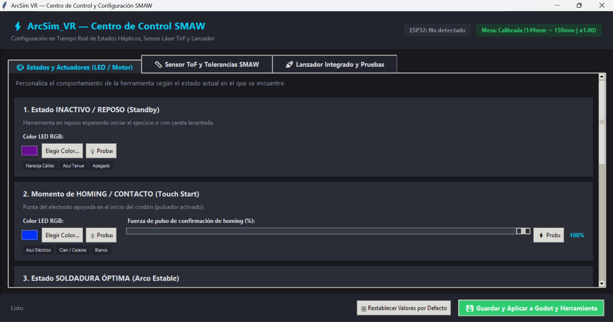

*Figura 19 — Pestaña 1 (Estados y Actuadores): seis tarjetas de estado con selector de color RGB, presets, prueba del LED, deslizador de potencia háptica 0–100 % y prueba de vibración (2000 ms).*

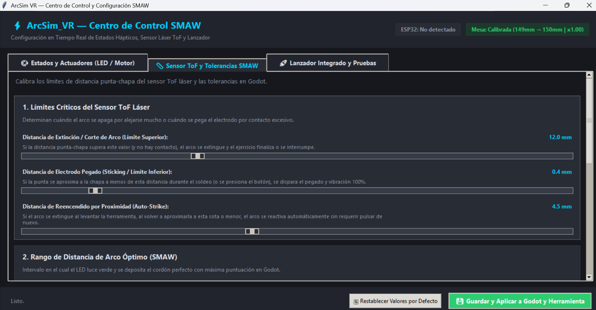

*Figura 20 — Pestaña 2 (Sensor ToF y Tolerancias SMAW): límites críticos (extinción 6–25 mm, def. 12,0; pegado 0,1–2,5 mm, def. 0,4; reencendido 2–8 mm, def. 4,5), rango óptimo (1,0–6,0 mm), tolerancias de evaluación (roll máx. 25°, velocidad 1,8–4,5 mm/s) y brazo punta-ArUco (50–250 mm).*


*Figura 21 — Pestaña 3 (Lanzador Integrado y Pruebas): interruptor de modo de cebado, lanzadores de calibración de mesa, puente y Godot, y banco de pruebas de hardware en vivo.*

**C) Interfaz de visión OpenCV** (`tools/test_vision_table.py`): HUD semitransparente con FPS, marcadores de mesa detectados (`n/4`), focal, estado del pivote, modo cámara / cámara + IMU, posición de la punta, desvío lateral, altura `z`, ángulos del IMU y velocidad clasificada (`REPOSO`, `LENTA`, `OPTIMA SMAW`, `MUY RAPIDA`), minimapa del cordón y barra de progreso del pivote (ver Escenario 4).

### 6.3 Lógica de interacción y escenarios

#### 6.3.1 Mecanismos comunes de interacción

**Sistema de interacción con objetos.** Los objetos manipulables heredan de `Interactable` / `Pickable` (`Scripts/interaction/`). El `PlayerInteractor` (`interactor.gd`) gestiona la recogida (`pick_up`) hacia el punto `HandPoint` del jugador y aplica el `outline.gdshader` como `material_overlay` al objeto en foco. Las zonas de fijación (`ClampAnchor`) son `Area3D` sobre la mesa.

**Transformación de la entrada física en `DeviceLink`.**

1. **Cuaternión → marco de la probeta:** `_hw_basis = imu_to_probe · Basis(q) · imu_to_probe⁻¹` (cambio de base ortonormal, determinante +1).
2. **Orientación relativa a la pose neutra:** se compara contra `_hw_ref_basis` (capturada en la tara) y se suaviza por SLERP exponencial (`orientation_smoothing = 30 s⁻¹`).
3. **Distancia:** EMA adicional de 0,40 sobre `d`.
4. **Posición:** `hw_abs_pos_mm = (x, y)` desde visión.
5. **Ángulos SMAW:** `WeldGeometry.angles_from_up()` obtiene el ángulo de trabajo (`90° + work_dev`) y el de avance/arrastre (`travel_deg`).
6. **Emulación sin hardware:** mouse = avance, rueda = distancia, `A/D` = ángulo de trabajo, `W/S` = ángulo de avance, clic izquierdo = gatillo. La fuente se elige en el menú o con `Tab`.

**Fases del ejercicio** (`ExerciseController`):

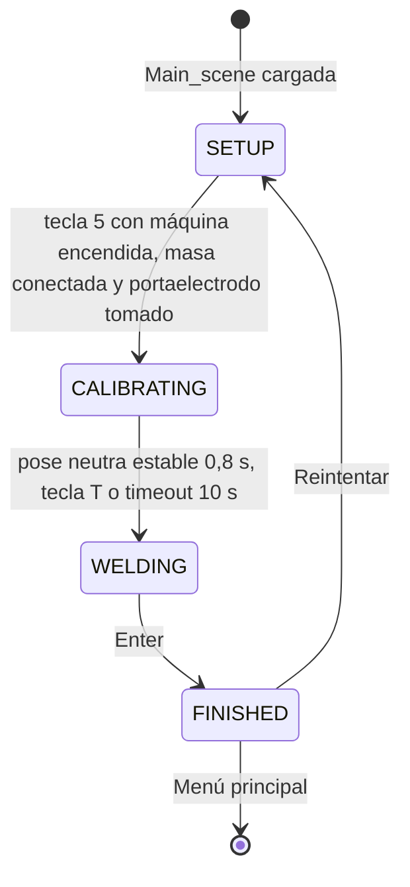

*Figura 22 — Fases del ejercicio gestionadas por `ExerciseController`.*

El sistema presenta **cuatro escenarios de interacción** claramente diferenciados, descriptos a continuación.

#### 6.3.2 Escenario 1 — Preparación guiada del puesto de trabajo (`State.SETUP`)

**Objetivo pedagógico:** instalar el hábito de la secuencia segura de preparación antes de soldar.

**Objetos 3D involucrados:** `Player`, `GroundClamp`, `TableWork/ClampAnchorLeft` (`Area3D`), `ElectrodeHolder`, `WeldingMachine` (`PowerSwitch`, `PowerLED`, `Knob`, `DisplayLabel`), `CableGround`, `CableElectrode`, `WeldingSpot`.

El operario ejecuta **cinco pasos obligatorios en orden estricto** mediante las teclas `1` a `5`; el desplazamiento del jugador es automático (`Player.walk_to()` con `Tween`). La navegación libre por teclado se descartó deliberadamente: concentra la atención en la secuencia de seguridad y elimina el riesgo de que el alumno se pierda en el escenario.

**Tabla 6.3 — Pasos del Escenario 1 e interacción entre objetos.**

| Tecla | Acción | Interacción entre objetos 3D | Respuesta del sistema |
| :---: | :--- | :--- | :--- |
| `1` | Conectar la pinza de masa | `Player` recoge `GroundClamp` (`pick_up`), camina a `ClampAnchorLeft` y la fija en `ClampPosition` | `GroundClamp.is_clamped = true`; `CableGround` recalcula su catenaria; se activa el marcador pulsante amarillo `WeldingSpot` |
| `2` | Tomar el portaelectrodo | `ElectrodeHolder` se acopla a `HandPoint` | `CableElectrode` actualiza su curva siguiendo la mano |
| `3` | Encender la máquina | `Player` acciona `PowerSwitch` (`toggle_power()`) | La tecla rota de +10° a −10°; `PowerLED` verde emisivo; `DisplayLabel` pasa de `OFF` (rojo) a `090 A` (verde) |
| `4` | Regular el amperaje | `Player` frente a `Knob`; se habilita `amperage_mode` | Rueda del mouse: 40–200 A en pasos de 5 A; `Knob` rota entre +135° y −135°; display y HUD actualizados. En Nivel 1 no se avanza fuera de 95–135 A |
| `5` | Posicionarse en la mesa | Llama `start_exercise()` | Verifica máquina encendida, masa conectada y portaelectrodo tomado; inicia el Escenario 2 |

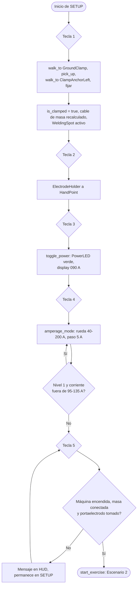

*Figura 23 — Diagrama de flujo del Escenario 1 (las teclas fuera de orden no producen efecto: la checklist exige secuencia estricta).*

> **[INSERTAR FIGURA 24: Secuencia de capturas del Escenario 1 — (a) pinza de masa fijada sobre la mesa con su cable; (b) portaelectrodo en mano; (c) máquina encendida con display `090 A`; (d) ajuste de la perilla de amperaje con la checklist del HUD.]**

#### 6.3.3 Escenario 2 — Calibración y tara de la pose neutra (`State.CALIBRATING`)

**Objetivo:** establecer la correspondencia entre la orientación física de la herramienta y la orientación virtual, de modo que la postura natural del operario corresponda al ángulo de trabajo de 90° sobre la probeta.

**Objetos 3D involucrados:** `Player` (cámara), `WeldingSpot/HeadPoint`, `LookTarget`, `ElectrodeHolder` (transparente), `CableElectrode` (oculto), `Coupon`.

Al entrar, `Player.enter_station(spot)` lleva la cámara a la postura de soldadura (FOV 55°), oculta el cable del portaelectrodo y aplica `transparency = 0.85` a la carcasa del portaelectrodo virtual (el electrodo permanece sólido) para no tapar la junta.

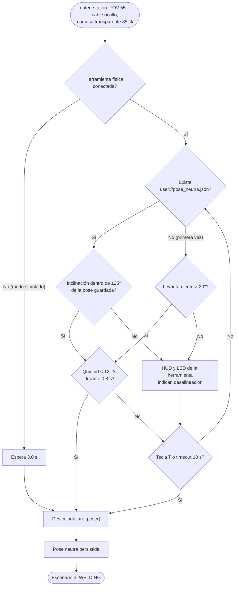

*Figura 25 — Diagrama de flujo del Escenario 2 (`_wait_for_neutral_pose()`).*

**Justificación:** la pose neutra persistida evita recalibrar desde cero en cada ejercicio; la condición de quietud asegura que la referencia no se capture en movimiento; la tara manual `[T]` y el *timeout* de 10 s garantizan que el ejercicio nunca quede bloqueado en esta fase.

> **[INSERTAR FIGURA 26: Captura del Escenario 2 — vista de estación con FOV 55°, portaelectrodo virtual transparente sobre la probeta y panel de lectura en vivo del HUD durante la calibración; idealmente acompañada de una foto del LED físico de la herramienta.]**

#### 6.3.4 Escenario 3 — Soldadura SMAW interactiva en tres niveles (`State.WELDING`)

**Objetivo:** ejecutar la pasada de 150 mm controlando simultáneamente las variables CLAMS, con retroalimentación multimodal y evaluación objetiva.

**Objetos 3D involucrados:** `ElectrodeHolder` (+ electrodo consumible), `Coupon` (+ `WeldBead`), `ArcVFX` (luz, partículas, audio), `MaskHud`, `WeldingMachine`, `GroundClamp`, `Hud`.

**a) Entradas del IHM y su efecto sobre los objetos 3D:**

| Entrada física | Procesamiento | Efecto en el mundo 3D |
| :--- | :--- | :--- |
| Orientación (MPU-6050) | Cuaternión → marco probeta, relativo a pose neutra, SLERP | Rotación del `ElectrodeHolder` (`WeldGeometry.holder_basis`); ángulos de trabajo y avance |
| Distancia (VL53L1X) | EMA 0,40; acotada visualmente a 30 mm | Altura `h` de la punta sobre la probeta; entrada principal de `ArcSimulator` |
| Posición (visión ArUco) | `lerp 0.45` hacia `(x, y)`; congelada si `STUCK` | Coordenadas `(s, v)` de la punta sobre la junta |
| Pulsador | Flanco de subida | *Homing* en el inicio del cordón (si `homing_required`) o condición de pegado |
| Tecla `Q` | — | Baja/sube la careta |
| Tecla `R` | — | Recambio de electrodo agotado |
| Tecla `Enter` | — | Finaliza y genera el informe |

El portaelectrodo virtual se coloca en cada paso físico de modo que **su punta coincida exactamente** con el punto `(s, v, h)` de la probeta (`_place_holder()`), resolviendo la base de rotación a partir del vector "arriba" de la herramienta.

**b) Máquina de estados del arco en el simulador** (`Scripts/welding/arc_simulator.gd`):

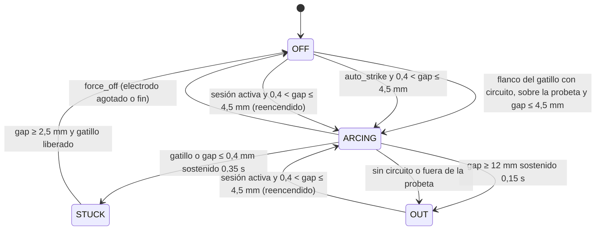

*Figura 27 — Máquina de estados del arco (`ArcSimulator`). Mientras está en `ARCING`, la zona se clasifica en `SHORT` (gap < 1,0 mm), `OPTIMAL` (1,0–6,0 mm) o `LONG` (> 6,0 mm).*

> **Coherencia entre capas:** los umbrales de `ArcSimulator` y del firmware provienen de la misma configuración (`tool_config.json`: pegado 0,4 mm, reencendido 4,5 mm, extinción 12,0 mm). El simulador exige que el pegado se sostenga 0,35 s para evitar falsos positivos visuales, mientras que el firmware reacciona de inmediato en el plano háptico.

**c) Ciclo por paso físico** (`ExerciseController._step_welding()`):

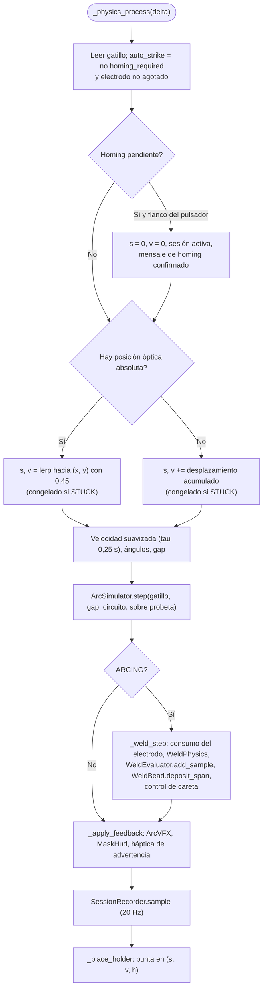

*Figura 28 — Diagrama de flujo de un paso de simulación durante la soldadura.*

**d) Modelo físico simplificado** (`Scripts/welding/weld_physics.gd`). Aproximaciones de ingeniería calibradas para que, con los parámetros nominales (110 A, arco de 2,5 mm, 3 mm/s), el cordón resulte de ≈ 7 mm de ancho, ≈ 2,3 mm de altura y ≈ 2 mm de penetración; el propio código aclara que no pretende ser un modelo metalúrgico.

$$
U = 18 + 0{,}04\,I + 1{,}2\,L_a \;[\mathrm{V}], \qquad
Q = \frac{0{,}8\,U\,I}{\max(v,\,0{,}3)} \;[\mathrm{J/mm}]
$$

$$
\dot V_{dep} = 0{,}29\,I \;[\mathrm{mm^3/s}], \qquad
v_{quemado} = \frac{\dot V_{dep}}{\pi\,(3{,}2)^2/4} \;[\mathrm{mm/s}] \;(\approx 4~\mathrm{mm/s}\ \text{a}\ 110~\mathrm{A})
$$

$$
w = 0{,}2565\,\sqrt{Q}\,\bigl(1 + 0{,}04\,\max(L_a - 6,\,0)\bigr), \qquad
u = 0{,}3\,\max(v - 4{,}5,\,0) + 0{,}015\,\max(I - 135,\,0)
$$

donde `I` es la corriente, `L_a` la longitud de arco, `v` la velocidad de avance, `w` el ancho y `u` la mordedura (acotada a 2 mm; AWS D1.1 admite hasta 1 mm). La penetración crece con la corriente y con el ángulo de arrastre y disminuye con el arco largo y con la velocidad. La velocidad física arranca desde un valor nominal durante los primeros instantes del arco para no penalizar el cebado. Un tramo se marca como **defecto** si la mordedura supera 1,0 mm o si el arco excede el óptimo en más de 1,5 mm.

**e) Retroalimentación multimodal:**

| Canal | Implementación | Comportamiento |
| :--- | :--- | :--- |
| Visual 3D | `WeldBead` + `weld_bead.gdshader` | Cordón incandescente que se enfría en 2,5 s; defectos marcados |
| Visual (consumo) | `ElectrodeHolder.consume()` | El electrodo se acorta hasta 50 mm; recambio con `R` |
| Luz y partículas | `ArcVFX` | Parpadeo, chispas; salpicaduras sólo con arco largo |
| Sonido | `AudioStreamWAV` 22050 Hz, 16 bits, mono, sintetizado | Zumbido de red de 50 Hz (armónicos de 100 y 200 Hz) + crepitar filtrado; `pitch_scale = 0.85 + 0.07·gap`; 0,55 (grave) en pegado; pulso de cebado de 150 ms |
| Careta | `MaskHud` | DIN 4 / DIN 11; destello y penalización si se suelda sin careta |
| HUD | `Hud` | Gauges, semáforo, marco de color (según nivel) |
| Háptico físico | `HapticController` → `SET_HAPTIC` | Ronroneo según intensidades configuradas (`tool_config.json`: cebado 100 %, óptimo 50 %, advertencia 72 %, pegado 100 %) |
| LED físico | `_update_tool_led()` → `SET_LED` | Color del peor estado de tolerancias del nivel |

**f) Niveles de dificultad** (`Scripts/welding/level_config.gd`):

**Tabla 6.5 — Parámetros de los tres niveles (banda óptima / banda límite).**

| Parámetro | Nivel 1 — Principiante | Nivel 2 — Intermedio | Nivel 3 — Examen |
| :--- | :---: | :---: | :---: |
| Ayudas visuales | Todas: checklist, pista de amperaje, 4 gauges, semáforo + marco, guía en probeta | Sin pista de amperaje ni gauges de ángulos | Ninguna (sólo señales físicas, sonoras y hápticas) |
| Escala de consumo del electrodo | 0,6× | 1,0× | 1,4× |
| Longitud de arco [mm] | 1,5–3,5 / 0,5–6,0 | 1,5–3,5 / 0,8–5,0 | 2,0–3,2 / 1,0–4,5 |
| Velocidad [mm/s] | 1,8–4,5 / 0,6–7,0 | 2,0–4,0 / 1,0–5,5 | 2,3–3,7 / 1,5–4,8 |
| Ángulo de trabajo [°] | 88–92 / 85–95 | 88,5–91,5 / 86–94 | 89–91 / 87–93 |
| Ángulo de avance [°] | 3–20 / −8…35 | 5–15 / −3…26 | 8–14 / 0…21 |
| Corriente [A] | 95–135 / 70–160 | 100–130 / 80–145 | 100–125 / 88–138 |
| Desvío lateral [mm] | 0–1,5 / 0–3,5 | 0–1,0 / 0–2,5 | 0–0,5 / 0–1,5 |
| Ancho del cordón [mm] | 4,5–9,5 / 2,5–13,0 | 5,0–8,5 / 3,0–11,0 | 5,5–8,0 / 3,5–10,0 |
| Penetración [mm] | 1,8–5,0 / 0,6–8,0 | 2,0–4,5 / 0,8–7,0 | 2,2–4,0 / 1,0–6,5 |

**Justificación pedagógica:** la progresión retira gradualmente las ayudas externas (*scaffolding*) y estrecha las tolerancias, de modo que en el Nivel 3 el operario depende sólo de las mismas señales que tendría en un taller real (sonido, vista del baño y sensación en la mano). El consumo acelerado del electrodo en niveles superiores obliga a compensar más rápido el acortamiento.

**g) Evaluación** (`Scripts/welding/weld_evaluator.gd`). Durante el arco se acumulan puntuaciones por banda con estadística ponderada incremental (algoritmo de West [6]). Al finalizar:

**Tabla 6.6 — Criterios ponderados de evaluación.**

| Criterio | Peso [%] | Criterio | Peso [%] |
| :--- | :---: | :--- | :---: |
| Longitud de arco | 15 | Trayectoria (centrado en la junta) | 10 |
| Velocidad de avance | 15 | Ancho del cordón | 10 |
| Ángulo de trabajo | 10 | Regularidad del cordón | 10 |
| Ángulo de avance | 10 | Penetración | 10 |
| Amperaje | 5 | Continuidad y cobertura | 5 |

$$
\text{Nota} = \operatorname{clamp}\!\left(1 + 9\sum_{i=1}^{10}\frac{w_i\,s_i}{100} \;-\; P,\; 1,\; 10\right), \qquad s_i \in [0, 1]
$$

con penalizaciones `P`: electrodo pegado 0,5 pts por evento (tope 2,0); arco apagado por mala técnica 0,3 pts por evento (tope 1,2); soldar sin careta 0,4 pts/s (tope 2,5). Si el arco estuvo encendido menos de 2 s, la nota es 1; si la cobertura del cordón es inferior al 50 %, la nota se limita a 4,0. Se aprueba con nota ≥ 6,0. El informe se acompaña de 6 gráficos temporales (trayectoria, velocidad, ángulo de avance, ángulo de trabajo, longitud de arco y amperaje), diagnóstico de defectos y exportación CSV (`SessionRecorder`, registro a 20 Hz).

> **[INSERTAR FIGURA 29: Comparación de cordones obtenidos en el simulador — (a) pasada correcta (cordón regular y centrado); (b) pasada con defectos (velocidad excesiva, arco largo o desvío lateral) con las zonas de defecto visibles.]**

> **[INSERTAR FIGURA 30: Capturas del Escenario 3 en los Niveles 2 y 3, mostrando la reducción progresiva de ayudas del HUD.]**

#### 6.3.5 Escenario 4 — Entorno de Realidad Aumentada para calibración y seguimiento 6D (`tools/test_vision_table.py`)

**Objetivo:** calibrar el seguimiento óptico y verificar visualmente, sobre la imagen real, que la posición estimada de la punta coincide con la punta física.

**Elementos superpuestos sobre el video (1280×720):** contornos de marcadores (verde para mesa IDs 1–4, cian para herramienta ID 0), ejes 3D proyectados, línea azul del cordón con extremos verde/rojo, retícula verde `PUNTA` con lectura de altura `z`, minimapa del cordón y HUD de estado.

**Comandos del asistente:** `[C]` calibrar giroscopio, `[T]` tara de yaw, `[P]` calibración de pivote (inicio/fin), `[ESPACIO]` / `[F]` inicio y fin de un cordón personalizado, `[R]` reinicio del cordón, `[Q]` salir.

**Procesamiento por fotograma:**

1. Detección de marcadores con refinamiento subpíxel.
2. Pose de la mesa (`SOLVEPNP_IPPE` + refinamiento Levenberg-Marquardt) con los 4 marcadores de referencia.
3. Dos poses candidatas del marcador de la herramienta (`SOLVEPNP_IPPE_SQUARE`), expresadas en el sistema de la mesa.
4. Selección de la candidata coherente (`TipTracker`), con fusión IMU opcional; rechazo de ambigüedades y de saltos > 35 mm (3 fotogramas de confirmación).
5. Punta física: `punta = R · p_tip + t`; mediana de 5 + `OneEuroFilter`.
6. Proyección a coordenadas del cordón (`seam_coords()`) y envío `{dx, dy, x, y}` a `127.0.0.1:4242`.

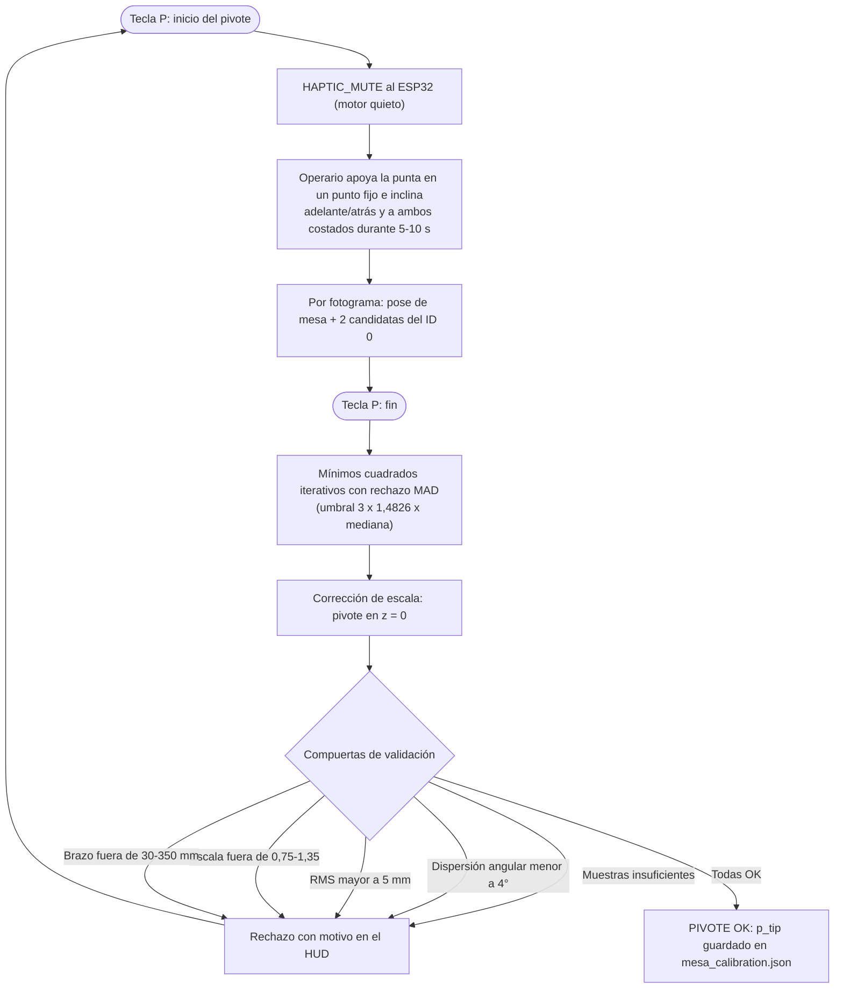

*Figura 31 — Flujo de la calibración de pivote en el Escenario 4.*

En la calibración almacenada en `tools/mesa_calibration.json` se obtuvo un residuo `pivot_rms_mm = 4,102 mm` y un vector marcador→punta `p_tip = [6,547; −140,027; −44,518] mm`.

> **[INSERTAR FIGURA 32: Captura de la ventana OpenCV del Escenario 4 con los 4 marcadores de mesa en verde, el marcador ID 0 en cian con sus ejes 3D, la línea del cordón, la retícula `PUNTA` sobre la punta física y el HUD mostrando `PIVOTE OK`.]**

### 6.4 Robustez y prevención de fallas

#### 6.4.1 Estrategia general

La robustez se diseñó con un criterio de **defensa en profundidad**: cada capa valida sus entradas, protege sus recursos y degrada su servicio de forma controlada si una capa vecina falla, sin terminar abruptamente. Los principios aplicados son:

1. **Estado seguro por defecto:** ante la ausencia de órdenes válidas, el motor se apaga y el arco virtual se apaga.
2. ***Watchdogs* en ambos extremos del enlace:** el firmware expira las órdenes del host a los 500 ms; Godot declara la herramienta desconectada si no recibe paquetes durante 0,5 s.
3. **Validación estricta de datos:** rangos físicos, formato ASCII, tamaños máximos, cuaterniones degenerados y valores `NaN`.
4. **Degradación elegante:** sin hardware, el simulador pasa a modo simulado; sin visión, usa el desplazamiento incremental; sin el puente, la visión lee el puerto serie directamente.
5. **Bucles acotados:** límites de comandos por ciclo (firmware), paquetes por fotograma (Godot) y tiempos máximos de calibración.
6. **Liberación garantizada de recursos:** apagado de la háptica al cerrar, pausar o salir; cierre del COM tras cada escritura desde la GUI.

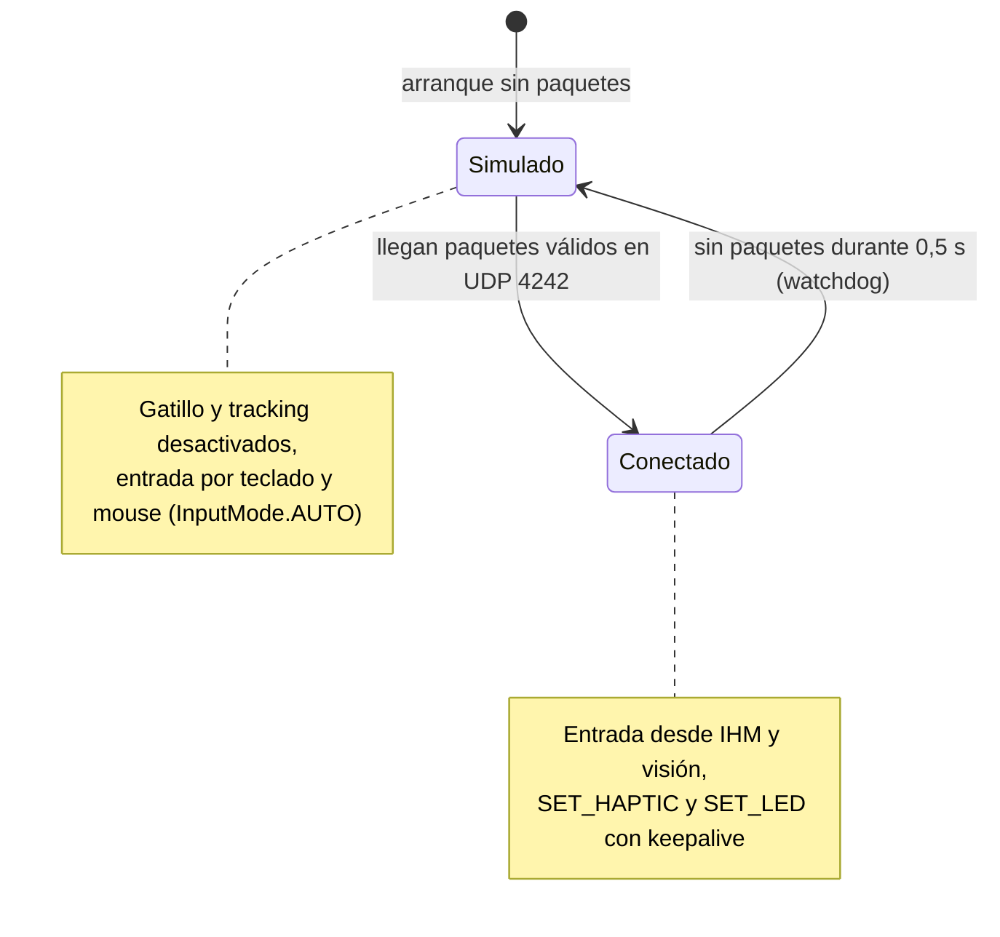

*Figura 33 — Degradación elegante del enlace en `DeviceLink` (modo de entrada automático).*

#### 6.4.2 Mecanismos por capa

**Tabla 6.7 — Mecanismos de robustez implementados.**

| Capa | Mecanismo | Ubicación | Falla que previene |
| :--- | :--- | :--- | :--- |
| Firmware | Buffer RX de 2048 B, timeout 20 ms, máx. 8 comandos por ciclo | `main.cpp` (L790, L800–802) | Truncamiento de `CONFIG` y bloqueo del bucle ante ráfagas |
| Firmware | Canales LEDC en timers separados + *fallback* `ledcAttach()` | `main.cpp` (L814–821) | Colisión de frecuencias que inutilizaba el motor o el LED |
| Firmware | Validación de rango y estado del ToF, timeout I²C 500 ms, `STATE_ERROR` | `main.cpp` (L387, L849–858) | Lecturas aberrantes o falla de inicialización |
| Firmware | Filtrado ToF en 3 etapas y acotamiento de `dt` | `main.cpp` (L357, L398–429) | Picos ópticos, temblor y saltos angulares |
| Firmware | *Watchdog* de control del host (500 ms) y motor apagado sin simulación | `main.cpp` (L229–248, L668) | Motor vibrando indefinidamente si Godot se cierra; vibración al calibrar |
| Firmware | Motor apagado + 150 ms + silencio 1 s al calibrar; `HAPTIC_MUTE` | `main.cpp` (L282–314, L768–771) | Sesgo del giroscopio contaminado por vibración |
| Firmware | `extract_section` con llaves balanceadas y `constrain()` | `main.cpp` (L627–642, L670–700) | Colisión de claves homónimas y desbordes de PWM |
| Puente | Socket UDP `:4243` con `SO_EXCLUSIVEADDRUSE` y mensaje de error explícito | `serial_bridge.py` (L68–83) | Dos puentes simultáneos robándose los comandos de Godot |
| Puente | Autodetección del COM por VID/descripción, reconexión automática (1,5–2,0 s), descarte de buffer > 2048 B | `serial_bridge.py` (L33–51, L90–174) | Cierre del programa al desconectar el USB o ante basura serie |
| GUI | Apertura del COM con `dtr=False, rts=False` y cierre inmediato | `arcsim_gui.py` (L856–876) | Reinicio involuntario del ESP32 y bloqueo del COM para el puente |
| Visión | Rechazo de ambigüedad IPPE (máx. 15 fotogramas), rechazo de saltos (35 mm, 3 fotogramas), mediana 5 + One Euro | `tool_tracking.py` (L456–592) | *Pose flip* y temblor de la punta |
| Visión | Pivote con rechazo MAD y 5 compuertas de validación | `tool_tracking.py` (L189–282) | Aceptar calibraciones corruptas |
| Visión | Hilo UDP `:4244` con *fallback* a serie directo y liberación automática del COM | `test_vision_table.py` (L97–164) | Conflicto de puerto entre visión y puente |
| Visión | Respaldo de calibraciones antiguas (`*.v1.bak`, `*.v3.bak`) y validación de relación de aspecto de intrínsecos | `test_vision_table.py` (L249–256, L278–286) | Incompatibilidad silenciosa tras cambiar método o resolución |
| Godot | Reintento de apertura UDP cada 3 s, máx. 200 paquetes por fotograma, filtro ASCII ≤ 1024 B, validación de norma/`NaN` de cuaterniones | `device_link.gd` (L485–577) | Inundación UDP, paquetes binarios o corruptos, transformaciones degeneradas |
| Godot | *Watchdog* de conexión (0,5 s) con *fallback* a modo simulado | `device_link.gd` (L245–252, L580–596) | Arco trabado encendido o simulador inutilizable al desconectar |
| Godot | `stop_haptics()` al pausar, salir al menú, destruir la escena o cerrar la ventana (`NOTIFICATION_WM_CLOSE_REQUEST`) | `game.gd` (L19–32), `exercise_controller.gd` (L121–125, L174) | Motor vibrando tras cerrar Godot |
| Godot | Timeout de calibración (10 s), pisos anti división por cero (`MIN_SPEED_MM_S = 0.3`), `clampf` generalizados, *fallback* de exportación CSV a `user://` | `exercise_controller.gd` (L290–324), `weld_physics.gd` (L22), `session_recorder.gd` (L155–157) | Bloqueo en calibración, divisiones por cero, falta de permisos de escritura |

> **Limitación conocida del hardware:** el prototipo no incorpora diodo *flyback* en paralelo con el motor ni capacitores de desacople externos. Con el motor pequeño utilizado el sistema funcionó, pero la carga inductiva conmutada puede generar sobretensiones en el Drain del MOSFET; su incorporación se propone como mejora en §9.4.


---

## 7. Análisis de Partes Críticas del Código

Se seleccionaron seis bloques que concentran las decisiones técnicas más relevantes del sistema. Los fragmentos son extractos literales (abreviados con `...` donde corresponde) pensados para respaldar la demostración en video y la defensa oral.

### 7.1 Filtrado del sensor ToF en tres etapas (firmware)

**Archivo:** `firmware/src/main.cpp` — `update_tof()`, líneas 380–433.

```cpp
if (distanceSensor.dataReady()) {                       // lectura NO bloqueante
    uint16_t dist = distanceSensor.read(false);
    uint8_t status = distanceSensor.ranging_data.range_status;
    // status 0: válido, 7: wraparound; se descarta todo lo demás
    if (dist > 10 && dist < 1200 && (status == 0 || status == 7)) {
        latest_raw_tof = dist;
        if (last_stable_button == LOW) {                // contacto físico => 0,0 mm exactos
            current_distance_mm = 0.0f;
            smoothed_tof_mm = 0.0f;
        } else {
            float net_gap = (float)dist - dynamic_offset_mm;   // offset autocalibrado al tocar
            if (net_gap < 0.0f) net_gap = 0.0f;
            // 1. Mediana de 5 muestras (buffer circular + ordenamiento)
            ...
            // 2. EMA: 70 % inercia / 30 % muestra nueva
            smoothed_tof_mm = 0.70f * smoothed_tof_mm + 0.30f * median_gap;
            // 3. Banda muerta de 0,25 mm
            if (fabs(smoothed_tof_mm - current_distance_mm) >= 0.25f) {
                current_distance_mm = smoothed_tof_mm;
            }
        }
    }
}
```

**Explicación técnica.** La longitud de arco es la variable más crítica del proceso y la más ruidosa del sistema. El orden de los filtros no es arbitrario: la **mediana** va primero porque es un estimador robusto que elimina *outliers* (reflexiones parásitas) antes de que contaminen el promedio; la **EMA** suaviza el ruido gaussiano residual con costo O(1) y memoria mínima; la **banda muerta** al final evita que el temblor del último decimal llegue al simulador como vibración del electrodo virtual. El pulsador tiene prioridad absoluta sobre la medición óptica: cuando hay contacto físico, la distancia es exactamente cero, y además ese instante se usa para recalibrar el *offset* (`update_button()`), compensando variaciones mecánicas de la varilla.

### 7.2 Arbitraje del motor háptico y reflejo local ante pegado (firmware)

**Archivo:** `firmware/src/main.cpp` — `apply_motor()`, líneas 229–248.

```cpp
void apply_motor() {
    unsigned long now = millis();
    uint8_t duty;
    if (now < test_override_haptic_until_ms) {
        duty = test_haptic_duty;                       // 1. prueba manual (GUI / diagnóstico)
    } else if (now < haptic_mute_until_ms) {
        duty = 0;                                      // 2. calibración en curso: motor quieto
    } else if (now < host_armed_until_ms) {
        // 3. Soldando en Godot: manda Godot, pero ante pegado vibra al máximo sin esperar a la PC
        duty = (current_state == STATE_STICKING) ? max(g_cfg.duty_sticking, host_haptic_duty)
                                                 : host_haptic_duty;
    } else if (now < host_haptic_until_ms) {
        duty = host_haptic_duty;                       // 4. Godot abierto sin arco (normalmente 0)
    } else {
        duty = 0;                                      // 5. sin simulación activa: estado seguro
    }
    if (duty != motor_out) set_motor_duty(duty);
}
```

**Explicación técnica.** Las ventanas temporales (`*_until_ms`) implementan simultáneamente la **prioridad** y el ***watchdog***: cada orden del host renueva su ventana (500 ms) y, si Godot deja de enviar, la ventana expira sola y el motor cae al estado seguro (`duty = 0`) sin necesidad de un mensaje de "apagado" que podría perderse. La rama 3 materializa el **lazo reflejo local**: la condición de pegado se evalúa con los sensores del propio ESP32, por lo que la vibración al 100 % se aplica en el mismo ciclo del bucle (sub-milisegundo), sin incluir la latencia del puerto serie, el puente, el motor gráfico y el retorno. La escritura del PWM sólo ocurre si el valor cambió, evitando reconfiguraciones innecesarias del periférico LEDC.

### 7.3 Puente USB-Serie ↔ UDP con instancia única y reconexión (middleware)

**Archivo:** `simulacion_godot/trabajo-final-rv/tools/serial_bridge.py` — `open_command_socket()` (L68–83) y `run_serial()` (L86–174).

```python
def open_command_socket():
    s = socket.socket(socket.AF_INET, socket.SOCK_DGRAM)
    # Uso EXCLUSIVO del puerto de comandos: con SO_REUSEADDR un segundo puente
    # se quedaba con los comandos de Godot sin tener el puerto del ESP32.
    if hasattr(socket, "SO_EXCLUSIVEADDRUSE"):
        s.setsockopt(socket.SOL_SOCKET, socket.SO_EXCLUSIVEADDRUSE, 1)
    try:
        s.bind(("0.0.0.0", COMMAND_PORT))
    except OSError:
        log(f"ERROR: el puerto UDP {COMMAND_PORT} ya está en uso: hay OTRO puente abierto. ...")
        ...
    s.setblocking(False)
    return s

def run_serial(port_name):
    ...
    while True:                                          # bucle de reconexión
        port = port_name or find_port()                  # autodetección por VID/descripción
        ...
        try:
            with serial.Serial(port, BAUD, timeout=0.02) as ser:
                ser.write(b'{"cmd":"PING"}\n')           # + envío de tool_config.json (CONFIG)
                ...
                while True:
                    chunk = ser.read(256)
                    if chunk:
                        buf += chunk
                        while b"\n" in buf:
                            line, buf = buf.split(b"\n", 1)
                            line = line.strip()
                            if line.startswith(b"{") and line.endswith(b"}"):   # trama completa
                                out.sendto(line, GODOT_ADDR)                    # :4242
                                out.sendto(line, VISION_ADDR)                   # :4244
                        if len(buf) > 2048:
                            buf = b""                    # descarta basura sin delimitador
                    try:
                        while True:
                            data, src = cmd.recvfrom(8192)   # CONFIG mide ~700 B
                            ser.write(data.strip() + b"\n")
                    except BlockingIOError:
                        pass
        except (OSError, serial.SerialException) as e:
            log(f"Puerto {port} no disponible o perdido ({e}). Reintentando...")
            time.sleep(1.5)
```

**Explicación técnica.** El puente es el único proceso que abre el puerto COM, lo que resuelve el acceso exclusivo de Windows al puerto serie y permite que Godot, la visión y la GUI compartan el hardware. Tres decisiones lo hacen robusto: (i) el **reensamblado por líneas** con validación de delimitadores `{...}` descarta tramas parciales (por ejemplo, la primera línea recibida tras conectar); (ii) el **socket exclusivo** impide que un segundo puente lanzado por error (desde la GUI y desde un `.bat`) capture los comandos de Godot sin tener acceso al COM, fallo que se observó durante el desarrollo; y (iii) la **captura de `SerialException` dentro de un bucle infinito** convierte una desconexión USB en un reintento silencioso, sin terminar el proceso. Al reconectar, el puente reenvía automáticamente `tool_config.json`, de modo que la herramienta siempre opera con la configuración vigente aun después de un reinicio.

### 7.4 Calibración de pivote por mínimos cuadrados con compuertas de validación (visión)

**Archivo:** `tools/tool_tracking.py` — `_solve_pivot_lstsq()` (L158–168) y `pivot_calibrate()` (L189–282).

```python
def _solve_pivot_lstsq(Rs, ts):
    n = len(Rs)
    A = np.zeros((3 * n, 6))
    b = np.zeros(3 * n)
    for i in range(n):
        A[3 * i:3 * i + 3, :3] = Rs[i]          # [R_i  -I] [p_tip; q] = -t_i
        A[3 * i:3 * i + 3, 3:] = -np.eye(3)
        b[3 * i:3 * i + 3] = -ts[i]
    x, *_ = np.linalg.lstsq(A, b, rcond=None)
    sv = np.linalg.svd(A, compute_uv=False)     # condicionamiento del problema
    return x[:3], x[3:], sv                      # p_tip (marcador), q (pivote en la mesa)

# Dentro de pivot_calibrate(): rechazo iterativo de outliers por MAD
med = float(np.median(res))
thr = max(3.0 * 1.4826 * med, 1.0)
new_inl = res <= thr
...
# Corrección de escala: el punto de pivote debe quedar sobre la mesa (z = 0)
k = float(C[2] / (C[2] - q[2]))
...
# Compuertas: inliers >= 60 %, dispersión >= 4°, RMS <= 5 mm, escala 0,75-1,35, brazo 30-350 mm
```

**Explicación técnica.** El sistema lineal sobredeterminado (3N ecuaciones, 6 incógnitas) se resuelve por mínimos cuadrados; los valores singulares de `A` miden su condicionamiento (si el operario casi no inclina la herramienta, el problema está mal condicionado). Como IPPE devuelve dos poses candidatas por fotograma, el algoritmo itera eligiendo en cada muestra la candidata de menor residuo y descartando *outliers* con un umbral robusto basado en la **desviación absoluta mediana** (el factor 1,4826 la hace consistente con la desviación estándar de una distribución normal). La **corrección de escala** impone que el pivote quede sobre el plano de la mesa (z = 0), compensando un tamaño efectivo del marcador distinto del nominal (en la calibración guardada el tamaño efectivo resultó 39,176 mm frente a los 40,0 mm nominales). Finalmente, cinco **compuertas** con mensajes explicativos ("¿la punta resbaló?", "inclinación insuficiente", etc.) impiden aceptar una calibración corrupta, que de otro modo produciría un error sistemático en toda la sesión.

### 7.5 Recepción validada, cambio de base y *watchdog* en Godot

**Archivo:** `simulacion_godot/trabajo-final-rv/Scripts/autoload/device_link.gd` — `_poll_udp()` (L496–512), `_is_ascii_text()` (L515–521), `_apply_quaternion()` (L564–577), `_update_connection()` (L580–596).

```gdscript
func _poll_udp() -> void:
    if not _bound:
        return
    var guard := 0
    while _udp.get_available_packet_count() > 0 and guard < 200:   # tope por fotograma
        guard += 1
        var raw := _udp.get_packet()
        ...
        if not _is_ascii_text(raw):
            continue  # el protocolo es JSON ASCII: se descarta cualquier otra cosa
        for line in raw.get_string_from_ascii().split("\n", false):
            _handle_line(line.strip_edges())

static func _is_ascii_text(raw: PackedByteArray) -> bool:
    if raw.size() > 1024:
        return false
    ...

func _apply_quaternion(w: float, x: float, y: float, z: float) -> void:
    var q := Quaternion(x, y, z, w)
    if is_nan(q.length_squared()) or q.length_squared() < 0.5:
        return                                                   # cuaternión degenerado
    q = q.normalized()
    # Cambio de base IMU -> probeta (rotación propia: det = +1).
    _hw_basis = imu_to_probe * Basis(q) * imu_to_probe.inverse()
    ...

func _update_connection(delta: float) -> void:
    var now_connected := (Time.get_ticks_msec() - _last_packet_msec) / 1000.0 < TIMEOUT_S
    if now_connected != hardware_connected:
        hardware_connected = now_connected
        if not now_connected:
            _hw_trigger = false                                  # nunca queda un gatillo "pegado"
            has_position_tracking = false
            has_absolute_position = false
            ...
        connection_changed.emit(hardware_connected)
```

**Explicación técnica.** `DeviceLink` es la frontera de confianza del simulador: todo dato externo se valida antes de tocar la escena. El **tope de 200 paquetes por fotograma** impide que una inundación UDP congele el hilo principal; el **filtro ASCII ≤ 1024 B** descarta datagramas binarios o malformados antes de invocar el parser JSON; la **validación de la norma del cuaternión** evita que un valor `NaN` o nulo produzca una base degenerada que corrompería la transformada del portaelectrodo (y, por propagación, la física). El cambio de base por **conjugación** `M · B · M⁻¹` expresa la rotación medida en el marco de la IMU dentro del marco de la probeta sin alterar el ángulo girado. El ***watchdog*** de 0,5 s apaga el gatillo y el seguimiento al perder la conexión, y emite una señal para que el resto del sistema pase al modo simulado.

### 7.6 Lazo de soldadura: del dato físico al cordón 3D

**Archivos:** `Scripts/welding/exercise_controller.gd` — `_step_welding()` (L580–667), `_weld_step()` (L670–713), `_place_holder()` (L737–741); `Scripts/welding/weld_physics.gd` (L26–71).

```gdscript
# _step_welding(): posición óptica, congelada si el electrodo está pegado
if DeviceLink.has_position_tracking and DeviceLink.has_absolute_position:
    var target_s := clampf(DeviceLink.hw_abs_pos_mm.x, -coupon.plate_margin_mm,
                           coupon.seam_length_mm + coupon.plate_margin_mm)
    var target_v := clampf(DeviceLink.hw_abs_pos_mm.y, -coupon.plate_half_width_mm,
                           coupon.plate_half_width_mm)
    if arc.state != ArcSimulator.State.STUCK:
        _s_mm = lerpf(_s_mm, target_s, 0.45)
        _v_mm = lerpf(_v_mm, target_v, 0.45)
...
var energized := machine.is_on and ground_clamp.is_clamped     # depende del Escenario 1
var over_plate := coupon.is_over_plate(_s_mm, _v_mm)
...
arc.step(delta, trigger, gap, energized, over_plate)

# _weld_step(): física -> evaluación -> geometría
var burn := WeldPhysics.burn_rate_mm_s(_current_a) * delta * level.consumption_scale
_electrode_used_mm += holder.consume(burn)
var width := WeldPhysics.bead_width_mm(_current_a, speed_phys, gap)
var height := WeldPhysics.bead_height_mm(_current_a, speed_phys, width)
var pen := WeldPhysics.penetration_mm(_current_a, speed_phys, gap, _angles.y)
var undercut := WeldPhysics.undercut_mm(_current_a, speed_phys)
evaluator.add_sample(delta, {...})
var defect := undercut > 1.0 or gap > WeldPhysics.OPTIMAL_GAP_MAX_MM + 1.5
coupon.bead.deposit_span(prev_s, prev_v, _s_mm, _v_mm, width, height, defect)

# _place_holder(): la punta virtual coincide con (s, v, h)
var basis := WeldGeometry.holder_basis(-up_global, _away_dir)
var tip := _tip_global(gap)
holder.global_transform = Transform3D(basis, tip - basis * holder.get_tip_local())
```

**Explicación técnica.** Este bloque es el núcleo de la interacción entre objetos 3D: (i) el estado de la **máquina** y de la **pinza de masa** (configurados en el Escenario 1) condiciona eléctricamente el arco (`energized`), y la posición de la punta respecto de la **probeta** condiciona su existencia (`over_plate`); (ii) si el electrodo está pegado, la posición virtual se congela aunque el operario mueva la mano, reproduciendo la restricción física real; (iii) la física calcula la geometría del cordón, que `WeldBead` deposita como una malla continua entre la posición anterior y la actual (sin huecos aunque el paso sea grande); y (iv) `_place_holder()` resuelve la transformada del portaelectrodo **a partir de la punta**, no del mango, de modo que el punto relevante para la soldadura sea siempre exacto. Las funciones de `WeldPhysics` acotan sus resultados (`clampf`) y usan un piso de velocidad (`MIN_SPEED_MM_S = 0.3`) que evita divisiones por cero cuando el operario se detiene.

---

## 8. Manual Paso a Paso de Reproducción e Instalación

### 8.1 Requisitos

**Tabla 8.1 — Requisitos de software.**

| Software | Versión utilizada / mínima | Uso |
| :--- | :--- | :--- |
| Windows | 10/11 64 bits | Sistema operativo (los lanzadores `.bat`, `CAP_DSHOW`, `SO_EXCLUSIVEADDRUSE` y el driver D3D12 son específicos de Windows) |
| Godot Engine | 4.7 Standard, 64 bits | Simulador 3D |
| Visual Studio Code + PlatformIO IDE | PlatformIO Core 6.2.0 | Compilación y carga del firmware |
| Driver USB-UART | CP210x o CH340, según el DevKit | Comunicación con el ESP32 |
| Python | 3.10 o superior (verificado con 3.12.5), en el `PATH` con el lanzador `py` | Puente, visión y GUI |
| Paquetes Python | `opencv-contrib-python` (4.11.0), `numpy` (2.0.2), `pyserial` (3.5) | Obligatorios |
| Paquetes opcionales | `cadquery`, `trimesh`, `matplotlib`, Blender (`bpy`) | Sólo para regenerar CAD, plantillas o modelos 3D |

**Hardware:** componentes de la Tabla 5.1, impresora 3D FDM con cama ≥ 220 × 220 mm, impresora de papel láser o de tinta, regla milimetrada, soldador de estaño y herramientas básicas.

**Repositorio:** [COMPLETAR: URL o medio de distribución del repositorio `Trabajo_integrador_RV`].

### 8.2 Paso 1 — Fabricación de las piezas impresas

1. Imprimir en **PLA** los archivos de `hardware/3d_models/stl/`:
   - `01_carcasa_derecha.stl` y `02_carcasa_izquierda.stl` (rotadas 45° en Z para entrar en una cama de 220 × 220 mm; huella ≈ 202 × 202 mm);
   - `03a_modulo_sensor_ToF.stl`;
   - `04a_electrodo_60mm.stl`;
   - soporte del marcador ArUco: [COMPLETAR: archivo del soporte plano inclinado ≈ 30° utilizado; `05_soporte_aruco.stl` corresponde a la versión de tres caras].
2. Parámetros de laminado: [COMPLETAR: altura de capa, relleno, perímetros, temperatura y uso de soportes empleados]. El proyecto de laminado de referencia es `hardware/REALIDAD_VIRTUAL.3mf`.
3. **Verificación:** las dos mitades deben cerrar alineadas por los 13 pines guía; la espiga de la varilla (Ø8 mm) debe deslizar libremente en su guía con el perno M3.

### 8.3 Paso 2 — Impresión y preparación de los marcadores

1. Imprimir `hardware/aruco/plantilla_mesa_soldadura_A4.pdf` en papel mate, **a escala 100 %** (desactivar "ajustar a página").
2. **Verificación obligatoria:** medir con regla la barra de verificación superior; debe medir exactamente **100,0 mm**. Si no, corregir la configuración de impresión y reimprimir.
3. Pegar la plantilla sobre una superficie plana y rígida, fijada a la mesa.
4. Imprimir `hardware/aruco/hoja_impresion_A4_aruco.pdf` y recortar el marcador **ID 0** (cuadrado negro de 40,0 mm + borde blanco de 3 mm = 46 × 46 mm). Verificar con regla el lado del cuadrado negro.
5. Adherir el marcador ID 0 sobre el soporte plano inclinado (área útil 48 × 48 mm), sin arrugas ni brillos.

### 8.4 Paso 3 — Montaje electrónico

Realizar las conexiones de la Tabla 5.2 y la Figura 5 en el orden indicado, verificando continuidad con multímetro tras cada etapa:

1. **Bus I²C:** VCC del MPU-6050 y VIN del VL53L1X a **3V3**; GND de ambos a GND; SDA de ambos a **GPIO 21**; SCL de ambos a **GPIO 22**. Conectar AD0 del MPU-6050 a GND (dirección `0x68`).
2. **LED RGB HW-479:** R → **GPIO 16**, G → **GPIO 17**, B → **GPIO 19**, (−) → GND.
3. **Pulsador:** un terminal a **GPIO 4**, el otro a GND (se usa el *pull-up* interno).
4. **Etapa del motor (IRFZ44N, encapsulado TO-220, patas 1-2-3 = G-D-S):**
   - **GPIO 25** → resistencia de **1 kΩ** → Gate (pata 1);
   - resistencia de **10 kΩ** entre Gate (pata 1) y GND;
   - Source (pata 3) → GND;
   - Drain (pata 2) → terminal (−) del motor;
   - terminal (+) del motor → **VIN** (+5 V del USB).
5. **Verificación con multímetro (sin alimentar):** ausencia de cortocircuito entre 3V3 y GND, y entre VIN y GND.

> **[INSERTAR FIGURA 34: Fotografía de detalle del circuito MOSFET armado (IRFZ44N con R_gate 1 kΩ y R_pull-down 10 kΩ) antes de alojarlo en el ducto delantero de la carcasa.]**

### 8.5 Paso 4 — Ensamble mecánico

1. Montar el ESP32 **invertido** sobre los 4 machos Ø2,8 mm de su bahía.
2. Montar el MPU-6050 sobre sus 2 machos Ø2,9 mm, en posición **vertical** (en reposo, con la herramienta vertical, el eje Y del sensor debe medir −1 g).
3. Alojar el motor vibrador en su bolsillo Ø27,75 mm, con la masa excéntrica libre dentro de la cámara de desbalance.
4. Ubicar el LED en el guarda-mano (salida Ø6,4 mm) y el circuito MOSFET en el ducto delantero.
5. Instalar el pulsador en su hueco (12 × 12 × 4 mm), insertar la varilla de 60 mm con su perno guía M3 y ajustar el **tornillo M3 de regulación** para que el pulsador se accione al final del recorrido axial de 2,5 mm.
6. Montar el módulo ToF y verificar que la varilla no invada su ventana óptica.
7. Pasar el cable USB por el extremo trasero cónico, cerrar las mitades y ajustar los **11 tornillos M3**.
8. Montar el soporte del marcador ArUco sobre la cara superior del cabezal.

### 8.6 Paso 5 — Compilación y carga del firmware

1. Conectar el ESP32 a la PC con el cable USB de datos.
2. Compilar y cargar (PlatformIO descarga automáticamente `pololu/VL53L1X @ ^1.3.1` y graba a 921600 baudios):

   ```powershell
   cd firmware
   pio run --target upload
   ```

3. Abrir el monitor serie:

   ```powershell
   pio device monitor -b 115200
   ```

4. **Verificación esperada:**
   - autotest visual: LED rojo → verde → azul (150 ms cada uno) y pulso de motor de 250 ms;
   - línea `{"ack":"BOOT","fw":"2026-11-25a","pwm_ok":1}`;
   - flujo continuo de tramas JSON a 50 Hz; al acercar la mano al sensor ToF debe variar `d`; al presionar el pulsador, `b` = 1 y `d` = 0,0; al inclinar la herramienta deben variar `r` y `p`.
   - Si el LED parpadea en rojo a 1 Hz (`st` = 5), el VL53L1X no inicializó: revisar el cableado I²C.
5. **Cerrar el monitor serie** antes de continuar (libera el puerto COM).

### 8.7 Paso 6 — Instalación de dependencias Python

```powershell
py -3 -m pip install opencv-contrib-python numpy pyserial
```

**Verificación:** los lanzadores `.bat` invocan `_buscar_python.bat`, que resuelve el intérprete y comprueba que `cv2` y `numpy` estén disponibles; si falta alguno, lo informa antes de continuar.

### 8.8 Paso 7 — Montaje del banco óptico y calibración de visión

1. Fijar la webcam a la estructura de perfiles de aluminio, a ≈ 45 cm de altura y ≈ 50° de inclinación, de modo que la plantilla A4 completa quede en el encuadre.
2. *(Opcional, una vez por cámara)* Calibración intrínseca:

   ```powershell
   py -3 tools\calibrar_camara.py
   ```

   Capturar al menos 12 vistas inclinadas de la plantilla con `[ESPACIO]` (los 4 marcadores visibles) y presionar `[C]` para generar `tools/camera_intrinsics.json`.
3. Con el ESP32 conectado, ejecutar **`probar_mesa.bat`**.
4. Verificar en el HUD: `Mesa: 4/4 marcadores` y `Herramienta: DETECTADA`.
5. Apoyar la herramienta quieta y presionar **`[C]`** (calibración del giroscopio); luego apuntar al eje del cordón y presionar **`[T]`** (tara de yaw).
6. **Calibración de pivote:** apoyar la punta en un punto fijo de la plantilla, presionar **`[P]`**, inclinar suavemente la herramienta hacia adelante/atrás y hacia ambos costados durante 5–10 s **sin deslizar la punta** y presionar **`[P]`** nuevamente.
7. **Verificación:** debe aparecer `PIVOTE OK` (residuo RMS < 5 mm). Al recorrer la junta impresa, la retícula `PUNTA` debe seguir a la punta física.
8. *(Opcional)* Cordón personalizado: punta en el inicio + `[ESPACIO]`, punta en el final + `[F]`.
9. Salir con **`[Q]`**; la calibración queda en `tools/mesa_calibration.json`.

### 8.9 Paso 8 — Configuración desde el centro de control

1. Ejecutar **`panel_control.bat`**.
2. Verificar los indicadores `ESP32: COMx Listo` y `Mesa: Calibrada`.
3. Ajustar, si se desea, colores LED, intensidades hápticas y límites ToF; en la Pestaña 3 elegir el modo de cebado (`HOMING DESACTIVADO (arco automático)` u `HOMING ACTIVADO (pulsador)`).
4. Usar el **banco de pruebas** de la Pestaña 3 (prueba de LED y de vibración) para confirmar los actuadores.
5. Presionar **`Guardar y Aplicar a Godot y Herramienta`**.

### 8.10 Paso 9 — Puesta en marcha del sistema completo

1. Ejecutar **`iniciar_simulador.bat`** desde la raíz del repositorio. Se abren dos consolas:
   - *Puente Serial ESP32* (`serial_bridge.py`): debe mostrar `Conectado a COMx...` y, cada 5 s, una línea de estadísticas con ≈ 50 paquetes/s;
   - *Vision Tracking* (`test_vision_table.py`).
2. Abrir `simulacion_godot/trabajo-final-rv/project.godot` en Godot 4.7 y presionar **`F5`** (o usar el lanzador de la GUI).
3. En el menú principal, verificar `Herramienta: CONECTADA (50 Hz)` y elegir un nivel.
4. Ejecutar el ejercicio:
   - **Preparación:** teclas `1`, `2`, `3`, `4` (ajustar el amperaje con la rueda del mouse) y `5`;
   - **Calibración:** mantener la herramienta quieta en posición neutra (0,8 s) o presionar `T`;
   - **Soldadura:** bajar la careta con `Q`, acercar la punta al inicio del cordón (o presionar el pulsador si el *homing* está activo), recorrer los 150 mm, presionar `R` si se agota el electrodo y `Enter` para finalizar.
5. En el informe, presionar `Guardar datos (.csv)` para exportar la sesión.

### 8.11 Ejecución sin hardware y pruebas automáticas

- **Sólo Godot:** abrir el proyecto y presionar `F5` sin el puente; `DeviceLink` opera en modo simulado (mouse = avance, rueda = distancia, `A/D` = ángulo de trabajo, `W/S` = ángulo de avance, clic izquierdo = gatillo).
- **Puente sintético:** `py -3 simulacion_godot\trabajo-final-rv\tools\serial_bridge.py --mock` (telemetría sinusoidal a 60 Hz).
- **Pruebas automáticas de Godot** (requiere el ejecutable `godot` en el `PATH`):

  ```powershell
  cd simulacion_godot\trabajo-final-rv
  godot --headless --fixed-fps 60 res://tests/test_runner.tscn
  ```

- **Pruebas sintéticas de visión** (sin cámara): `py -3 tools\test_tool_tracking.py`.

### 8.12 Resolución de problemas frecuentes

| Síntoma | Causa probable | Acción |
| :--- | :--- | :--- |
| Consola del puente: `ERROR: el puerto UDP 4243 ya está en uso` | Hay otro puente abierto | Cerrar todas las ventanas del puente y abrir uno solo |
| Puente: `No encuentro el ESP32...` | Cable sin datos, driver ausente o monitor serie abierto | Revisar cable y driver; cerrar el monitor de PlatformIO; usar `--port COMx` |
| LED rojo parpadeante a 1 Hz | Falla de inicialización del VL53L1X | Revisar alimentación y líneas SDA/SCL del sensor |
| Menú de Godot muestra `simulada` | No llegan paquetes a UDP 4242 | Verificar que el puente esté corriendo y conectado |
| `PIVOTE` rechazado: "pocas muestras" | Mesa o marcador no visibles | Mejorar encuadre e iluminación |
| `PIVOTE` rechazado: "inclinación insuficiente" | Movimiento angular escaso | Inclinar más en ambos ejes |
| `PIVOTE` rechazado: "la punta se movió" (RMS > 5 mm) | La punta resbaló | Repetir sin desplazar la punta |
| `PIVOTE` rechazado: "escala fuera de rango" | Tamaño del marcador mal configurado o punta fuera de la hoja | Verificar el lado del cuadrado negro del ID 0 (40 mm) |
| El ESP32 se reinicia al abrir el puerto | Señales DTR/RTS | Usar la GUI (abre con `dtr=False, rts=False`) |

---

## 9. Pruebas, Resultados y Conclusiones

### 9.1 Estrategia de verificación

La verificación se organizó por capas, de forma coherente con la arquitectura:

| Nivel | Herramienta | Qué verifica |
| :--- | :--- | :--- |
| Firmware | Autotest de arranque (POST) + monitor serie + `PING`/`PONG` | Integridad del LED, del MOSFET, del motor y de la alimentación; telemetría; versión de firmware |
| Hardware de actuadores | Banco de pruebas de la GUI (`TEST_ACTUATOR`, `SET_HAPTIC` con `ms`) | Colores del LED y respuesta del motor |
| Visión | `tools/test_tool_tracking.py` (datos sintéticos: cámara virtual, ruido, lecturas IMU simuladas) | Calibración de pivote, estabilidad de la punta y fusión IMU sin cámara real |
| Simulador | `tests/test_runner.tscn` (headless, 60 FPS fijos; código de salida 1 ante cualquier fallo) | Lógica pura (geometría, física, arco, evaluador), carga de escenas, enlace UDP, secuencia de preparación y flujo completo del ejercicio |
| Sistema integrado | Ejecución completa con hardware (§8.10) | Escenarios 1 a 4 de punta a punta |

**Contenido de la suite automática de Godot** (`tests/test_runner.gd`): `_test_geometry`, `_test_physics`, `_test_arc`, `_test_evaluator`, `_test_scenes_load`, `_test_device_link`, `_test_setup_sequence` y `_test_exercise_flow`; este último ejecuta escenarios simulados de soldadura: "ideal" (Nivel 2, 3 mm/s, 2,5 mm de arco, 10° de avance, careta baja), "mala" (Nivel 2, 8 mm/s, 5,5 mm, ángulos fuera de banda, sin careta), "nivel3" (Nivel 3, condiciones nominales) y "lenta" (Nivel 1, 1 mm/s).

### 9.2 Verificación funcional de los escenarios

**Tabla 9.1 — Matriz de verificación funcional.**

| ID | Escenario / función | Procedimiento | Resultado esperado (según diseño) | Resultado observado |
| :---: | :--- | :--- | :--- | :--- |
| V1 | Arranque del IHM | Conectar el USB | Secuencia R-G-B, pulso de motor, `ack BOOT` | [COMPLETAR] |
| V2 | Telemetría | Puente en ejecución | ≈ 50 paquetes/s en el log del puente; `CONECTADA (50 Hz)` en Godot | [COMPLETAR: frecuencia efectiva medida] |
| V3 | Escenario 1 | Teclas 1–5 en orden | Pinza fijada, portaelectrodo tomado, máquina encendida, amperaje regulado, paso a calibración | [COMPLETAR] |
| V4 | Escenario 1 (restricción) | Nivel 1 con amperaje fuera de 95–135 A | No se habilita el paso 5 | [COMPLETAR] |
| V5 | Escenario 2 | Mantener la pose neutra 0,8 s | Tara automática y paso a soldadura | [COMPLETAR] |
| V6 | Escenario 3 — cebado | Acercar la punta a ≤ 4,5 mm (o pulsador con *homing*) | Arco encendido, careta DIN 11, sonido, LED verde, vibración suave | [COMPLETAR] |
| V7 | Escenario 3 — pegado | Apoyar la punta contra la plantilla | Vibración al 100 % inmediata, LED rojo, avance congelado, zumbido grave, penalización | [COMPLETAR: respuesta háptica/visual observada] |
| V8 | Escenario 3 — extinción | Alejar la punta > 12 mm | Arco apagado; reencendido al volver a ≤ 4,5 mm | [COMPLETAR] |
| V9 | Escenario 3 — sin careta | Soldar con la careta levantada | Destello blanco, alerta, penalización de 0,4 pts/s | [COMPLETAR] |
| V10 | Escenario 3 — informe | Finalizar con `Enter` | Nota, 10 criterios, 6 gráficos, diagnóstico, exportación CSV | [COMPLETAR: adjuntar ejemplo de informe y CSV] |
| V11 | Escenario 4 — pivote | Procedimiento de §8.8 | `PIVOTE OK` con RMS < 5 mm | Calibración almacenada: RMS = 4,102 mm |
| V12 | Precisión del seguimiento | Recorrer la junta impresa y comparar con la regla | Error de posición de la punta [COMPLETAR: criterio] | [COMPLETAR: precisión medida] |
| V13 | Robustez — desconexión USB | Desconectar y reconectar el cable durante la soldadura | Godot pasa a modo simulado sin cerrarse; el puente se reconecta y reenvía la configuración | [COMPLETAR] |
| V14 | Robustez — cierre de Godot | Cerrar Godot con el motor vibrando | El motor se detiene (`stop_haptics()` y expiración de la ventana de 500 ms) | [COMPLETAR] |
| V15 | Pruebas automáticas | `godot --headless ... test_runner.tscn` | `0 fallos`, código de salida 0 | [COMPLETAR: número de verificaciones y fallos obtenidos] |
| V16 | Pruebas de visión | `py -3 tools\test_tool_tracking.py` | Todas las verificaciones aprobadas | [COMPLETAR] |

> **[INSERTAR FIGURA 35: Captura de la consola de ejecución de la suite automática de Godot mostrando el resumen `== Resultado: N verificaciones, M fallos ==`.]**

> **[INSERTAR FIGURA 36: Ejemplo de informe de desempeño real de una sesión con hardware y extracto del archivo CSV exportado.]**

### 9.3 Dificultades encontradas y soluciones aplicadas

Las siguientes dificultades se identificaron durante el desarrollo y quedaron resueltas en la versión final, según consta en el código fuente y en la bitácora del repositorio:

| Dificultad | Causa raíz | Solución |
| :--- | :--- | :--- |
| El motor háptico dejaba de funcionar al usar el LED | En el ESP32 los canales LEDC comparten timer de a pares; la frecuencia del LED sobrescribía la del motor | Motor en el canal 4 (timer propio) a 1 kHz; LED en canales 0–2 a 5 kHz |
| El comando `CONFIG` llegaba truncado | Buffer RX serie de 256 B y lectura UDP de 512 B frente a ≈ 700 B de mensaje | Buffer RX de 2048 B en el firmware y `recvfrom(8192)` en el puente |
| Los comandos de vibración y LED no llegaban a la herramienta | Dos puentes abiertos a la vez (GUI + `.bat`); con `SO_REUSEADDR` uno recibía los comandos sin tener el COM | Socket con `SO_EXCLUSIVEADDRUSE` y mensaje de error explícito |
| El ESP32 se reiniciaba al aplicar la configuración desde la GUI | Las líneas DTR/RTS del conversor USB-UART reinician el ESP32 al abrir el puerto | Apertura con `dtr=False, rts=False` y cierre inmediato |
| Deriva en la orientación tras calibrar el giroscopio | La vibración del propio motor contaminaba el promedio de sesgo | Apagar el motor, esperar 150 ms y silenciar la háptica 1 s al calibrar |
| Vibración molesta al calibrar el pivote | La FSM local interpretaba el apoyo de la punta como pegado | El motor sólo vibra con el simulador activo (ventanas del host); `HAPTIC_MUTE` |
| Saltos repentinos de la punta estimada | Ambigüedad planar de IPPE cuando el marcador queda casi paralelo al plano imagen | Selección por continuidad, rechazo de saltos, mediana + One Euro y soporte inclinado ≈ 30° |
| Error sistemático de escala en la posición | Tamaño efectivo del marcador distinto del nominal | Corrección de escala dentro de la calibración de pivote (pivote en z = 0) |
| Interferencias internas en la carcasa | Densidad de componentes en el cabezal | CAD paramétrico con verificador automático de holguras (iteraciones v2.2 → v3.14) |
| Temblor del electrodo virtual | Ruido de cuantización del ToF | Banda muerta de 0,25 mm en el firmware + EMA en Godot |

### 9.4 Trabajo futuro

1. **Protección de la etapa de potencia:** incorporar un diodo *flyback* en antiparalelo con el motor y capacitores de desacople, y reemplazar el IRFZ44N por un MOSFET de nivel lógico (umbral compatible con 3,3 V) para asegurar la saturación completa con la tensión de compuerta del ESP32.
2. **Esquemático y PCB:** documentar el circuito en un esquemático formal y diseñar una placa a medida para reemplazar el cableado punto a punto.
3. **Operación inalámbrica:** aprovechar el Wi-Fi/BT del ESP32 con batería, eliminando el cable USB que hoy condiciona el movimiento.
4. **Mejoras de estimación:** filtros de orientación más elaborados (Madgwick/Kalman) y fusión cámara + IMU habilitada por defecto.
5. **Ampliación pedagógica:** otras posiciones de soldadura (horizontal, vertical, sobrecabeza), otros tipos de junta y otros procesos (GMAW, GTAW).
6. **Inmersión:** integración con un casco de Realidad Virtual o de Realidad Mixta con *passthrough*.
7. **Gestión de alumnos:** base de datos de sesiones e historial de progreso a partir de los CSV exportados.
8. **Validación con usuarios:** estudio con alumnos e instructores para cuantificar la transferencia del aprendizaje a la práctica real.

### 9.5 Conclusiones

Se diseñó, construyó e integró un sistema de Realidad Mixta completo para la capacitación en soldadura SMAW que cumple los requisitos de la cátedra y los objetivos planteados:

- **Capa hardware IHM:** se desarrolló un portaelectrodo instrumentado que combina tres modalidades de sensado, cada una asignada a la variable física para la que es más apta (IMU para orientación, ToF láser para longitud de arco, pulsador para contacto), con retroalimentación háptica y luminosa. El firmware ejecuta adquisición, filtrado en tres etapas, una FSM SMAW y un arbitraje háptico con reflejo local ante el pegado, independiente de la latencia de la PC.
- **Capa de lógica de interacción 3D:** el gemelo digital en Godot ofrece cuatro escenarios diferenciados (preparación, calibración, soldadura en tres niveles y RA de calibración óptica) en los que los objetos 3D interactúan entre sí de manera causal: la máquina y la pinza de masa condicionan el arco, el electrodo se consume, el cordón se esculpe proceduralmente y se enfría, y la careta modula la exposición.
- **Integración:** la arquitectura por capas con protocolo JSON sobre USB-Serie y UDP permitió desarrollar, probar y depurar cada capa por separado y combinar datos de tres fuentes (IMU/ToF, visión y configuración) en tiempo real.
- **Robustez:** la combinación de estado seguro por defecto, *watchdogs* en ambos extremos, validación estricta de datos, degradación elegante y reconexión automática evita las terminaciones anormales y los estados peligrosos (motor vibrando sin control, arco trabado).
- **Evaluación objetiva:** el sistema transforma la técnica del operario en métricas cuantitativas (diez criterios ponderados, series temporales, diagnóstico de defectos y exportación CSV), algo que la práctica tradicional no ofrece.
- **Bajo costo y reproducibilidad:** el prototipo se construyó con componentes ya disponibles y software libre, y todos los activos (CAD, modelos 3D, escena del taller, marcadores) se generan por scripts incluidos en el repositorio.

[COMPLETAR: conclusiones basadas en los resultados experimentales observados — por ejemplo, frecuencia efectiva alcanzada, precisión de seguimiento, percepción de la retroalimentación háptica y desempeño de usuarios de prueba.]

---

## 10. Referencias Bibliográficas y Fuentes Utilizadas

### 10.1 Bibliografía científica y técnica

[1] P. Milgram y F. Kishino, "A taxonomy of mixed reality visual displays," *IEICE Transactions on Information and Systems*, vol. E77-D, n.º 12, pp. 1321–1329, 1994.

[2] S. Garrido-Jurado, R. Muñoz-Salinas, F. J. Madrid-Cuevas y M. J. Marín-Jiménez, "Automatic generation and detection of highly reliable fiducial markers under occlusion," *Pattern Recognition*, vol. 47, n.º 6, pp. 2280–2292, 2014.

[3] T. Collins y A. Bartoli, "Infinitesimal Plane-Based Pose Estimation," *International Journal of Computer Vision*, vol. 109, n.º 3, pp. 252–286, 2014.

[4] G. Casiez, N. Roussel y D. Vogel, "1€ Filter: A Simple Speed-based Low-pass Filter for Noisy Input in Interactive Systems," en *Proc. ACM CHI Conference on Human Factors in Computing Systems*, 2012, pp. 2527–2530.

[5] W. Kabsch, "A solution for the best rotation to relate two sets of vectors," *Acta Crystallographica Section A*, vol. 32, n.º 5, pp. 922–923, 1976.

[6] D. H. D. West, "Updating mean and variance estimates: an improved method," *Communications of the ACM*, vol. 22, n.º 9, pp. 532–535, 1979.

[7] Z. Yaniv, "Which pivot calibration?," en *Proc. SPIE Medical Imaging 2015: Image-Guided Procedures, Robotic Interventions, and Modeling*, vol. 9415, 2015.

[8] American Welding Society, *AWS D1.1/D1.1M — Structural Welding Code — Steel*. [COMPLETAR: edición consultada].

[9] American Welding Society, *AWS A5.1/A5.1M — Specification for Carbon Steel Electrodes for Shielded Metal Arc Welding*. [COMPLETAR: edición consultada].

[10] Método CLAMS (Current, Length, Angle, Manipulation, Speed) para la técnica SMAW. [COMPLETAR: fuente formal utilizada; el repositorio lo resume en `docs/investigacion_tecnica_soldadura_smaw.md` y `soldadura_SMAW_parametros.md`].

[11] Manuales técnicos de fabricantes de equipos y consumibles de soldadura (Miller, Lincoln Electric, ESAB). [COMPLETAR: títulos y años de los documentos consultados].

### 10.2 Hojas de datos de componentes

[12] Espressif Systems, *ESP32 Series Datasheet*. [COMPLETAR: versión y fecha de acceso].

[13] InvenSense, *MPU-6000 and MPU-6050 Product Specification* (PS-MPU-6000A-00) y *Register Map and Descriptions*. [COMPLETAR: revisión].

[14] STMicroelectronics, *VL53L1X — Time-of-Flight ranging sensor, datasheet*. [COMPLETAR: revisión].

[15] Infineon / International Rectifier, *IRFZ44N — HEXFET Power MOSFET, datasheet*. [COMPLETAR: revisión].

### 10.3 Software, librerías y documentación oficial

| Ref. | Recurso | Licencia | Uso en el proyecto | Fuente |
| :---: | :--- | :--- | :--- | :--- |
| [16] | Godot Engine 4.7 | MIT | Motor gráfico y simulador | https://godotengine.org — documentación: https://docs.godotengine.org |
| [17] | Jolt Physics | MIT | Motor de física integrado en Godot | https://github.com/jrouwe/JoltPhysics |
| [18] | OpenCV (`opencv-contrib-python`) 4.11.0 — módulo ArUco, `solvePnP` (IPPE, IPPE_SQUARE), refinamiento LM | Apache 2.0 | Detección de marcadores y estimación de pose | https://opencv.org — https://docs.opencv.org |
| [19] | NumPy 2.0.2 | BSD | Álgebra lineal (mínimos cuadrados, SVD) | https://numpy.org |
| [20] | PySerial 3.5 | BSD | Acceso al puerto serie | https://github.com/pyserial/pyserial |
| [21] | Tkinter / ttk (biblioteca estándar de Python) | PSF | Centro de control de escritorio | https://docs.python.org/3/library/tkinter.html |
| [22] | Pololu VL53L1X Arduino library `^1.3.1` | [COMPLETAR: verificar licencia en el repositorio de la librería] | Driver del sensor ToF | https://github.com/pololu/vl53l1x-arduino |
| [23] | Arduino-ESP32 core 3.x / ESP-IDF v5.5.5 / FreeRTOS | LGPL 2.1 / Apache 2.0 / MIT | Framework del firmware | https://github.com/espressif/arduino-esp32 |
| [24] | PlatformIO Core 6.2.0 | Apache 2.0 | Sistema de compilación y carga | https://platformio.org |
| [25] | Blender (`bpy`) | GPL | Generación offline de los modelos `.glb` | https://www.blender.org |
| [26] | CadQuery / OpenCASCADE | Apache 2.0 / LGPL | CAD paramétrico de la carcasa | https://github.com/CadQuery/cadquery |
| [27] | Trimesh | MIT | Procesamiento de mallas (generación offline) | https://github.com/mikedh/trimesh |
| [28] | Matplotlib 3.9.2 | PSF-based | Cortes y documentos de marcadores | https://matplotlib.org |

[29] Referentes industriales: Seabery, *Soldamatic* (https://www.seaberyat.com); Lincoln Electric, *VRTEX* (https://www.lincolnelectric.com). [COMPLETAR: fecha de acceso].

### 10.4 Declaración de desarrollo propio y de componentes de terceros

**Tabla 10.1 — Origen de cada componente del sistema.**

| Componente | Origen | Detalle |
| :--- | :--- | :--- |
| Firmware `firmware/src/main.cpp` (adquisición, filtros, FSM, arbitraje, parser JSON, telemetría) | **Desarrollo propio** | Usa la librería Pololu VL53L1X y el framework Arduino-ESP32 sin modificarlos |
| `serial_bridge.py`, `arcsim_gui.py`, `test_vision_table.py`, `calibrar_camara.py`, lanzadores `.bat` | **Desarrollo propio** | Sobre PySerial, Tkinter y OpenCV |
| `tool_tracking.py` (pivote, fusión IMU, `OneEuroFilter`, `TipTracker`) | **Desarrollo propio basado en métodos publicados** | Implementación propia de la calibración de pivote por mínimos cuadrados [7], del alineamiento de Kabsch [5] y del filtro One Euro [4]; la detección ArUco y `solvePnP`/IPPE son funciones de OpenCV [2], [3], [18] |
| Scripts GDScript del simulador, shaders `.gdshader`, audio procedural | **Desarrollo propio** | Sobre la API de Godot |
| Modelo físico SMAW (`weld_physics.gd`) | **Desarrollo propio** | Aproximaciones de ingeniería calibradas a valores típicos de práctica; no es un modelo metalúrgico |
| Evaluador (`weld_evaluator.gd`) | **Desarrollo propio basado en criterios publicados** | Criterios derivados del método CLAMS [10] y de AWS D1.1 [8]; estadística incremental de West [6] |
| 14 modelos `.glb` y escena del taller | **Desarrollo propio (procedural)** | Generados por `make_models.py` (Blender) y `make_workshop.py`; **no se utilizaron assets de terceros** (ni modelos, ni texturas, ni sonidos) |
| CAD de la carcasa y plantillas ArUco | **Desarrollo propio** | `generate_holder_cad.py` (CadQuery), generadores de plantillas y marcadores |
| Motor vibrador | **Reutilizado** | Recuperado de un mando Logitech |
| Proyectos base adaptados | **Ninguno identificado** | No se partió de plantillas ni de proyectos de terceros |

> **[COMPLETAR: declaración sobre el uso de herramientas de asistencia por inteligencia artificial durante el desarrollo, si corresponde. El repositorio contiene una carpeta `Claude outputs/` con copias de `calibrar_camara.py`, `tool_tracking.py` y `test_tool_tracking.py`, y archivos CAD con sufijo `_claude`; se recomienda que los autores indiquen explícitamente el alcance de dicha asistencia.]**

---

*Fin del informe.*
