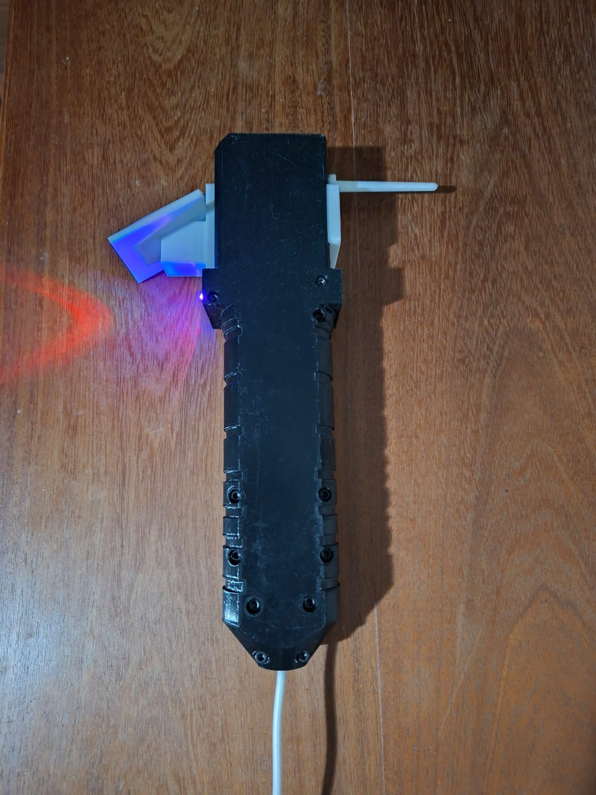
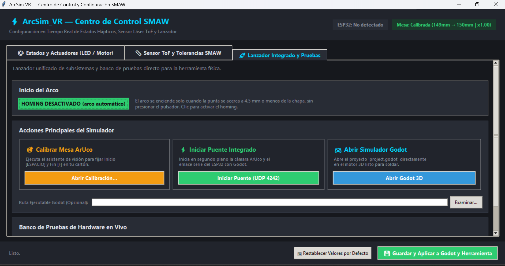
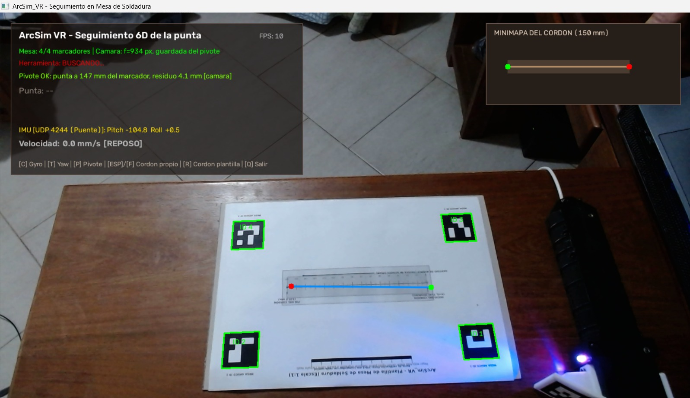
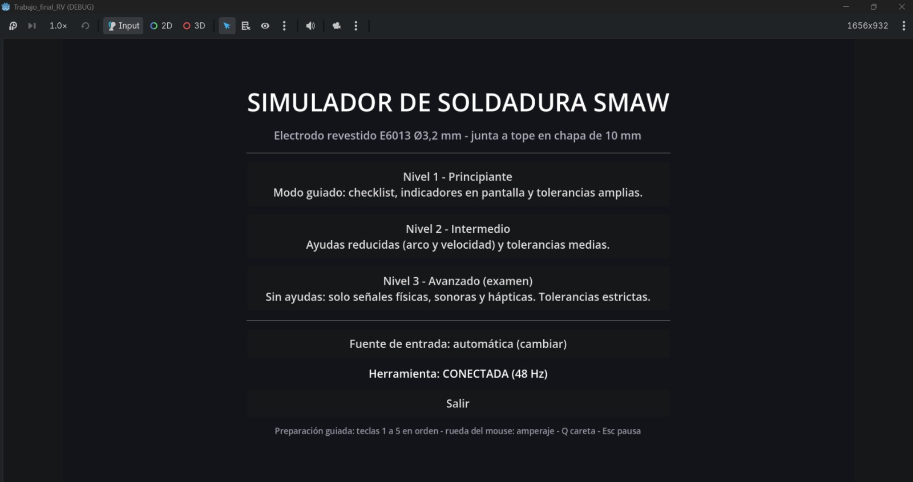
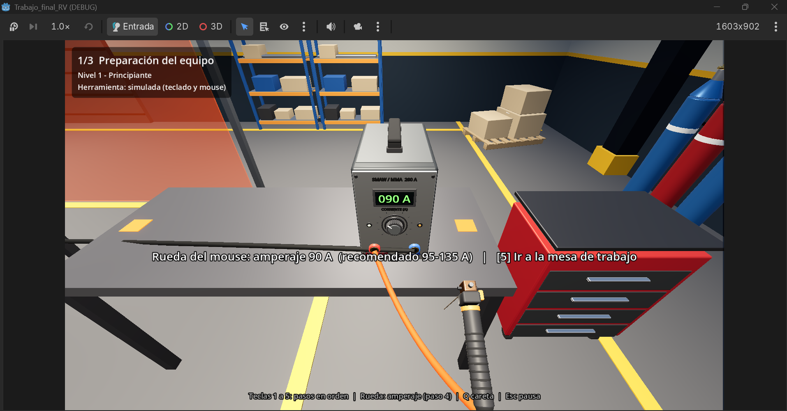
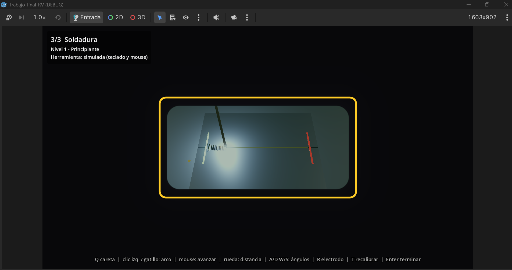
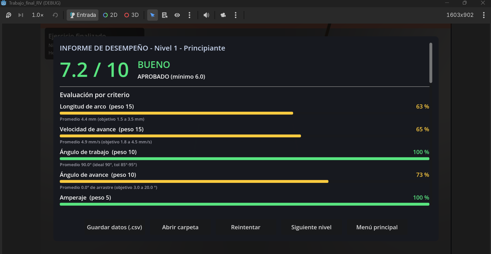
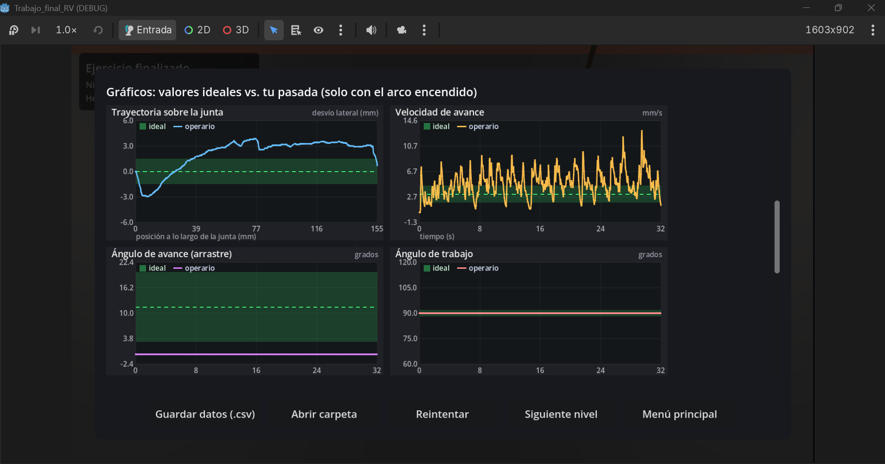

# Simulador de Realidad Mixta para Soldadura SMAW (ArcSim_VR)

## Manual de uso

---

Si estás leyendo este manual, estás por comenzar tu práctica de soldadura por arco manual con electrodo revestido (SMAW) en el simulador interactivo *ArcSim_VR*.

Este sistema combina un portaelectrodo físico sensorizado con un taller virtual 3D para que puedas entrenar tu pulso, postura y velocidad de avance de manera segura, guiada y sin riesgos eléctricos ni térmicos.

Aquí encontrarás una guía simple para comenzar.

---

## 1. Preparación del dispositivo IHM y la mesa óptica

### Ubicación de la plantilla y encendido del portaelectrodo

1. Apoyá la **plantilla A4 de la mesa de soldadura** bien plana sobre el escritorio, debajo de la cámara del soporte superior. Verificá que los **4 marcadores de las esquinas** estén bien iluminados y sin objetos ni sombras fuertes encima.
2. Conectá el cable USB del **portaelectrodo físico** y el de la **cámara web** a la computadora. Al recibir energía, la herramienta hará un chequeo automático encendiendo el LED en secuencia (**Rojo → Verde → Azul**) junto con una breve vibración.
3. Tomá el portaelectrodo por el mango con tu mano hábil de forma firme pero relajada, cuidando de **no tapar con los dedos ni con el cable** el marcador cuadrado superior ni la ventana inferior del sensor láser.

---

## 2. Significado del LED y la vibración

Tu portaelectrodo utiliza un **LED RGB** en el guarda-mano y un **motor vibrador** interno para guiarte en tiempo real sin apartar la vista de la costura:

* **Violeta / Naranja:** El dispositivo está encendido y **en espera** (sin pasada activa).
* **Azul** *(con pulso corto)*: **Contacto físico detectado** de la punta contra la mesa (cebado / referencia).
* **Verde** *(vibración suave continua)*: **Técnica óptima.** Distancia de arco, ángulos y velocidad dentro del rango ideal.
* **Amarillo:** **Precaución.** Alguno de los parámetros entró en zona tolerable, cerca del límite permitido.
* **Rojo** *(pulsos de alerta)*: **Fuera de tolerancia.** Corregí la altura, inclinación o velocidad indicada en pantalla.
* **Rojo fijo + vibración intensa al 100 %:** **¡Electrodo pegado a la chapa!** Levantá rápido la punta para despegarlo.

---

## 3. Conexión con la computadora

1. Abrí la carpeta principal del proyecto y ejecutá **`iniciar_simulador.bat`** para encender automáticamente el puente de comunicación del portaelectrodo y el seguimiento óptico por cámara *(o ejecutá **`panel_control.bat`** si preferís lanzarlo desde el **Centro de Control** visual)*.

> **Inicio directo:** `iniciar_simulador.bat`  
> **Panel visual opcional:** `panel_control.bat`

2. Comprobá que las ventanas del puente y de la cámara queden activas, y **no las cierres** mientras uses el simulador (podés dejarlas minimizadas en segundo plano).
3. Iniciá la aplicación 3D (**Abrir Simulador Godot** desde el Centro de Control o tecla **`[F5]`** en el proyecto). En la parte inferior de la pantalla inicial verás el aviso **`Herramienta: CONECTADA`**.

---

## 4. Calibración inicial

### A. Verificación de la cámara (solo al iniciar el puesto o si se movió la hoja)

1. En la ventana de cámara, verificá que los **4 marcadores de la mesa** figuren detectados en verde y que en la esquina superior aparezca **`Pivote OK`**.
2. Si querés alinear la orientación desde cero, apoyá el portaelectrodo vertical y quieto, presioná **`[C]`** ($2\text{ s}$) y luego **`[T]`** apuntando el cabezal en la dirección de la junta.
3. *(Solo si el cartel indica sin calibrar)* Apoyá la punta en un punto fijo de la hoja, presioná **`[P]`**, incliná suavemente el mango en cruz durante $5\text{ a }10\text{ s}$ **sin que la punta resbale**, y volvé a presionar **`[P]`** para guardar.

### B. Postura neutra dentro del taller virtual

4. Antes de soldar (etapa **`2/3 Calibración`**), el simulador te pedirá levantar el portaelectrodo y **sostenerlo quieto perpendicular a la chapa ($90^\circ$)** durante un segundo hasta ver los indicadores en **verde** *(también podés presionar **`[T]`** en cualquier momento para fijar tu postura neutra al instante)*.

---

## 5. Selección de ejercicios y puesta a punto

1. En el **Menú Principal**, seleccioná el nivel de entrenamiento que quieras practicar:
   * **Nivel 1 — Principiante:** Todas las ayudas visuales activas, pista de amperaje y márgenes amplios.
   * **Nivel 2 — Intermedio:** Menos indicadores en pantalla y tolerancias más exigentes.
   * **Nivel 3 — Avanzado (Examen):** Sin ayudas gráficas ni línea guía en la chapa; guiado únicamente por el sonido del arco, la luz, el LED y la vibración de la herramienta.

2. Al entrar al taller (**`1/3 Preparación del equipo`**), completá los **5 pasos obligatorios** presionando en tu teclado los números **`[1]` al `[5]` en orden**:
   * **`[1]`** Conectar la pinza de masa a la mesa de trabajo.
   * **`[2]`** Tomar el portaelectrodo.
   * **`[3]`** Encender la máquina soldadora.
   * **`[4]`** Regular el amperaje girando la **rueda del mouse** *(en Nivel 1 ajustalo entre **`95 A` y `135 A`**, ideal **`115 A`**)*.
   * **`[5]`** Ubicarte frente a la mesa de soldadura para comenzar.

---

## 6. Ejecución de los ejercicios

* **Bajá siempre la careta antes de soldar:** Presioná **`[Q]`** para bajar la careta fotosensible. Si encendés el arco con la careta levantada, verás un destello de encandilamiento y recibirás una penalización de seguridad.
* **Cebado y avance del cordón:** Ubicá la punta sobre la marca **verde** de inicio de la probeta y acercala a la chapa ($1{,}5\text{ a }3{,}5\text{ mm}$) —o apoyá suavemente la punta si activaste el modo *Homing*— para encender el arco. Avanzá con pulso parejo hasta la marca **roja** ($150\text{ mm}$) sosteniendo el electrodo a **$90^\circ$ laterales** y con un leve ángulo de arrastre (**$5^\circ\text{ a }15^\circ$**).
* **Despegue y cambio de electrodo:** Si la punta toca de lleno la chapa y el electrodo se pega (**vibración máxima + LED rojo**), levantá el portaelectrodo para liberarlo. Si consumís toda la varilla, apagá el arco y presioná **`[R]`** para colocar un electrodo nuevo.
* **Teclas rápidas durante la práctica:** **`[Q]`** Subir/bajar careta · **`[R]`** Cambiar electrodo · **`[T]`** Recalibrar postura · **`[Y]`** Alinear giro horizontal · **`[TAB]`** Alternar entrada (herramienta / mouse) · **`[ESC]`** Pausa · **`[ENTER]`** Finalizar ejercicio.

---

## 7. Finalización y reportes

* Al llegar al extremo final de la junta y presionar **`[ENTER]`**, el sistema evaluará tu pasada y mostrará automáticamente tu **nota final de 1 a 10** *(aprobado desde **`6,0`**)*.
* En la **pantalla de resultados** podrás analizar el puntaje obtenido en cada criterio, revisar las **gráficas de evolución** (trayectoria, velocidad, ángulos, longitud de arco y amperaje) y leer el **diagnóstico de defectos** detectados (*porosidad, socavación, falta de fusión, salpicaduras o pegadas*).

* Para guardar el registro de seguimiento para los docentes, hacé clic en **“Guardar datos (.csv)”** *(los reportes se almacenan automáticamente en tu carpeta `Documentos\SimuladorSoldadura\`)*. Desde esa misma ventana podés elegir **Reintentar**, avanzar al **Siguiente nivel** o regresar al **Menú principal**.

---

## ¡Listo!

Ya podés comenzar tus sesiones de entrenamiento en soldadura SMAW. Recordá bajar siempre la careta con **`[Q]`** antes de iniciar el arco y, ante cualquier inconveniente o duda, consultá al equipo docente del laboratorio.
