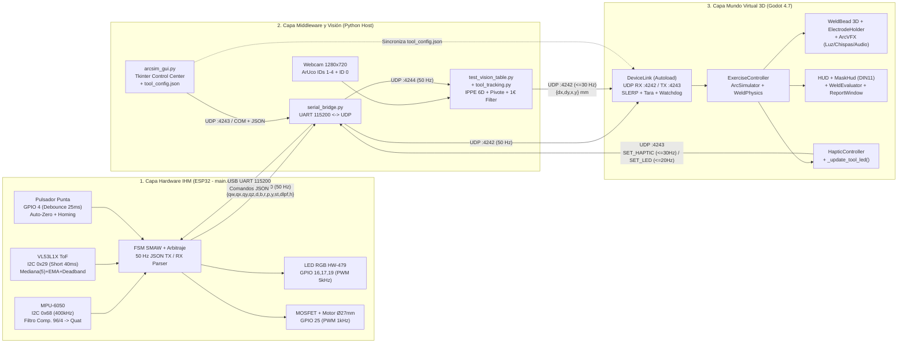

# Relevamiento Técnico Integral — ArcSim_VR (Sistema de Realidad Mixta para Capacitación en Soldadura SMAW)

> **Propósito:** Documento fuente de verdad generado mediante auditoría directa del código fuente, firmware, diseños CAD paramétricos, scripts de visión computacional, escenas 3D y referencias visuales del repositorio `Trabajo_integrador_RV`. Orientado a la redacción del **Informe Técnico Integrador** de la cátedra de Realidad Virtual (Ingeniería en Mecatrónica — UNCuyo) con nivel de reproducibilidad paso a paso en hardware y software.
>
> **Regla de trazabilidad:** Toda especificación proviene de archivos reales del repositorio. Cuando un dato físico, experimental o académico no figura en el repositorio (o presenta discrepancias entre documentación previa y el código activo final), se señala explícitamente con `[COMPLETAR_POR_AUTOR: ...]`.

---

## 1. Identificación general y mapa del repositorio

### 1.0 Datos institucionales, objetivos y decisiones de diseño
- **Institución / Carrera:** Universidad Nacional de Cuyo (UNCuyo) — Facultad de Ingeniería — Ingeniería en Mecatrónica.
- **Cátedra / Curso:** Realidad Virtual — 5.º año, 10.º semestre.
- **Integrantes:** García, Ezequiel; Albanez, Luciano.
- **Docentes:** Prof. Titular: Javier Rosenstein · Prof. JTP: Carlos Tomba.

#### Objetivos del Trabajo Integrador
- **Objetivo General:** Diseñar, construir y validar un sistema de Realidad Mixta de bajo costo para el entrenamiento y evaluación objetiva de operarios en soldadura por arco manual con electrodo revestido (SMAW), integrando una herramienta física sensorizada con retroalimentación háptica y un gemelo digital 3D interactivo.
- **Objetivos Específicos:**
  1. Desarrollar un portaelectrodo físico impreso en PLA con adquisición inercial (MPU-6050), medición láser milimétrica de longitud de arco (VL53L1X), detección mecánica de contacto y retroalimentación háptica/luminosa gobernada por un ESP32.
  2. Implementar un subsistema de visión por computadora 6D basado en marcadores ArUco y calibración de pivote para determinar la posición absoluta de la punta del electrodo sobre una junta de 150 mm.
  3. Desarrollar un entorno virtual 3D en Godot Engine 4.7 que incluya preparación guiada de taller, simulación física simplificada del arco eléctrico, deposición procedural 3D del cordón con enfriamiento térmico y careta fotosensible (DIN 4 / DIN 11).
  4. Integrar una arquitectura modular bidireccional en tiempo real (USB-Serie/UDP) acompañada de un centro de control de escritorio configurable sin recompilación.
  5. Incorporar un sistema de evaluación pedagógica progresiva en 3 niveles basado en el método CLAMS y criterios de inspección visual AWS D1.1, con diagnóstico de defectos, gráficos temporales y exportación a CSV.

#### Alternativas evaluadas y selección del proyecto
- **Alternativa A (descartada) — Entrenador de pintura industrial / aerografía en cabina (pistola pulverizadora instrumentada):** Si bien también rastrea una herramienta en el espacio, carece de interacción física por contacto (no existen fenómenos de cebado, cortocircuito ni pegado), resultando en una retroalimentación háptica limitada y una evaluación centrada casi únicamente en distancia y cobertura visual.
- **Alternativa B (descartada) — Entrenador de arenado / granallado abrasivo industrial (*sandblasting*):** Emplea una pistola/lanza manual de tratamiento superficial donde se controla distancia, ángulo de incidencia y barrido uniforme sobre piezas metálicas. Se descartó frente a SMAW porque es un proceso de barrido sin contacto con tolerancias mucho más amplias (del orden de centímetros en lugar de los 1,5–3,5 mm críticos del arco), carece de eventos físicos discretos (cebado, cortocircuito/pegado, extinción) que aprovechen la retroalimentación háptica diferenciada y el pulsador axial, y cuenta con criterios de evaluación menos estrictos que una junta soldada bajo norma AWS D1.1.
- **Justificación de la elección del Simulador SMAW (`ArcSim_VR`):**
  1. *Seguridad y ahorro de consumibles:* Elimina riesgos reales de la práctica inicial (radiación UV/IR, quemaduras, humos metálicos, choque eléctrico) y el consumo continuo de electrodos y chapas.
  2. *Integración mecatrónica completa en el IHM:* Aprovecha de forma natural orientación 3D (IMU), distancia milimétrica crítica (ToF láser), contacto axial (*homing*/pegado), trayectoria 2D/6D (visión ArUco) y feedback multimodal (háptica PWM, LED RGB, audio y careta fotosensible).
  3. *Evaluación cuantitativa estandarizada:* Criterios claros derivados del método CLAMS y norma AWS D1.1, con referente industrial consolidado (*SOLDAMATIC*, *Lincoln VRTEX*) frente al cual se propone una solución educativa de bajo costo.

#### Justificación de decisiones de arquitectura (Hardware y Software)
- **Disponibilidad y costo cero en electrónica:** Todos los componentes principales (ESP32, MPU-6050, VL53L1X, LED HW-479, IRFZ44N, resistencias, webcam Logitech 1080p, estructura de perfiles de aluminio 20×20 y motor vibrador reciclado de un mando Logitech) ya estaban disponibles en poder del equipo, logrando un prototipo funcional sin inversión adicional en electrónica y reduciendo el gasto únicamente al filamento PLA e impresión en papel A4.
- **Motor gráfico Godot Engine 4.7 (frente a Unity / Unreal):** Software libre y gratuito (licencia MIT), liviano, sin cuentas ni restricciones comerciales; provee soporte nativo para UDP (`PacketPeerUDP`), mallas 3D procedurales (`SurfaceTool`, `ImmediateMesh`), shaders propios (`.gdshader`), audio procedural (`AudioStreamWAV`), física moderna (**Jolt Physics**), pruebas automatizadas `--headless` y lenguaje GDScript afín a Python.
- **Microcontrolador ESP32 DevKit v1 (frente a Arduino AVR):** Disponible en el equipo; su CPU de 32 bits a 240 MHz con FPU ejecuta en tiempo real trigonometría, cuaterniones, filtrado ToF 3-etapas y streaming JSON a 50 Hz sin saturación; posee periférico LEDC PWM con timers independientes (5 kHz RGB / 1 kHz motor), buffer UART ampliable (`2048 B`) y Wi-Fi/BT integrados para futuras expansiones inalámbricas.
- **Tracking híbrido (ArUco 6D + IMU + ToF) frente a cascos VR / trackers comerciales:** Evita hardware propietario costoso y asigna a cada sensor su especialidad física: el **VL53L1X** mide con precisión milimétrica la longitud de arco (1,5–3,5 mm), el **MPU-6050** aporta inclinación fluida sin magnetómetro (inmune a campos magnéticos de taller) y **ArUco 6D + calibración de pivote** resuelve la traslación `(x, y)` absoluta de la punta sobre la probeta de 150 mm, todo desacoplado vía Python + UDP.

### 1.1 Descripción funcional de punta a punta

**ArcSim_VR** (nombre interno del proyecto Godot: `Trabajo_final_RV`) es un **Sistema de Realidad Mixta** para entrenamiento y evaluación técnica de operarios en **soldadura por arco eléctrico manual con electrodo revestido (SMAW — *Shielded Metal Arc Welding*)**, calibrado para un electrodo rutílico **AWS E6013 de Ø3,2 mm** sobre junta a tope en chapa de acero de **10 mm** de espesor y **150 mm** de longitud de cordón.

El sistema acopla dos mundos en lazo cerrado en tiempo real:

1. **Dispositivo IHM Físico Sensorizado (Portaelectrodo Impreso en 3D):** Empuñadura ergonómica de 250 mm con varilla de electrodo deslizante equipada con un microcontrolador **ESP32 DevKit v1**, unidad inercial de 6 grados de libertad **MPU-6050** (orientación espacial: ángulos de trabajo y avance mediante filtro complementario y cuaterniones), sensor láser de tiempo de vuelo **VL53L1X** (distancia punta-chapa en milímetros), pulsador mecánico axial en la punta (contacto físico / *homing* y tara), **LED RGB (HW-479)** de retroalimentación cromática y un **motor DC vibrador Ø27 mm** conmutado por MOSFET PWM para retroalimentación háptica (cebado, ronroneo de arco estable, advertencias y vibración violenta por electrodo pegado).
2. **Estación de Visión por Computadora (Tracking Óptico 6D):** Una cámara web (1280×720) observa una **plantilla A4 impresa** fijada a la mesa física con 4 marcadores fiduciales **ArUco** (`DICT_4X4_50`, IDs 1 a 4) y un marcador ArUco en la herramienta (**ID 0**). Mediante estimación de pose 6D (`solvePnP` + `IPPE_SQUARE`) y **calibración de pivote por mínimos cuadrados** (más fusión opcional con inclinación del IMU), se calcula en tiempo real la posición `(x, y)` de la **punta del electrodo** sobre el cordón de 150 mm sin que la inclinación de la muñeca desplace la punta.
3. **Middleware de Integración y Centro de Control (Python):**
   - `serial_bridge.py` actúa como puente transparente bidireccional entre el puerto USB-Serie del ESP32 (115200 bps) y sockets UDP locales (`:4242` telemetría hacia Godot, `:4244` espejo de telemetría hacia visión, `:4243` comandos de retorno hacia el ESP32).
   - `arcsim_gui.py` provee una interfaz gráfica de escritorio (Tkinter) para ajustar en vivo colores LED, intensidades hápticas, límites ToF, tolerancias SMAW, modo de inicio de arco (*homing* vs automático), probar actuadores y lanzar el sistema.
4. **Gemelo Digital 3D y Evaluador Pedagógico (Godot Engine 4.7):** Reproduce en primera persona un taller industrial 3D donde el alumno ejecuta primero una **preparación guiada obligatoria** del equipo (pinza de masa, portaelectrodo, encendido y amperaje de la máquina), calibra la pose neutra y luego realiza la pasada de soldadura en **3 niveles de dificultad progresivos** (Principiante, Intermedio y Examen). Simula la máquina de estados del arco, un modelo físico simplificado (ancho, altura, penetración, mordedura y consumo de electrodo), la generación procedural 3D del cordón con enfriamiento térmico, VFX (luz parpadeante, chispas, salpicaduras y audio procedural de 100 Hz), careta fotosensible (DIN 4 / DIN 11) y emite un **informe de desempeño (nota 1 a 10)** con 10 criterios CLAMS/AWS D1.1, 6 gráficos de series temporales, diagnóstico de defectos y exportación a CSV.

> **Fuente de verdad técnica (confirmada por el autor):** El repositorio conserva archivos y documentación de iteraciones anteriores que ya no se utilizan en el sistema final (`README.md` v1, `hardware/bom/BOM.md`, `hardware/schematics/WIRING_DIAGRAM.md`, `hardware/GUIA_ENSAMBLE.md`, `firmware/include/*` y `firmware/legacy/*`). La **versión definitiva y funcional** está definida por `firmware/src/main.cpp` (v`2026-11-25a`: ESP32 + MPU-6050 + VL53L1X + HW-479 en GPIO 16/17/19 + IRFZ44N), `tools/test_vision_table.py` + `tools/tool_tracking.py` (v4, pose 6D + pivote) y `simulacion_godot/trabajo-final-rv/` (secuencia guiada por teclas 1–5 + `DeviceLink`). Todo este relevamiento se basa estrictamente en esa implementación final.

### 1.2 Árbol de directorios relevante y rol de cada carpeta

```text
Trabajo_integrador_RV/
├── README.md                          # Documentación general inicial (v1) + guía rápida Godot al final
├── soldadura_SMAW_parametros.md       # Resumen divulgativo de parámetros SMAW y fuentes
├── iniciar_simulador.bat              # Lanzador integrado: abre serial_bridge.py + test_vision_table.py
├── iniciar_puente.bat                 # Lanzador solo del puente USB-Serial <-> UDP (serial_bridge.py)
├── panel_control.bat                  # Lanzador del Centro de Control Tkinter (tools/arcsim_gui.py)
├── probar_mesa.bat                    # Lanzador de seguimiento 6D y calibración de pivote (test_vision_table.py)
├── probar_camara.bat                  # Lanzador de prueba simple ArUco v2 (test_vision_aruco.py)
├── probar_motor.bat                   # Lanzador interactivo de diagnóstico del motor háptico
├── _diag_motor_auto.bat               # Lanzador no interactivo (--auto) de diagnóstico del motor
├── _buscar_python.bat                 # Helper común que resuelve el intérprete Python 3 y valida cv2/numpy
├── aruco_id0.png                      # Imagen de marcador ArUco ID 0 (herramienta)
├── preview.png                        # Render de vistas (frontal, lateral, perfil) de careta de soldador 3D
├── docs/
│   ├── RESUMEN_PROYECTO.md            # Síntesis actualizada de la arquitectura final en 4 capas
│   ├── CALIBRATION_GUIDE.md           # Guía de calibración IMU, offset mecánico y pivote ArUco v4
│   └── investigacion_tecnica_soldadura_smaw.md  # Benchmarking (SOLDAMATIC, VRTEX) y tablas AWS D1.1 / CLAMS
├── docs_referencia/                   # Referencias visuales del hardware CAD y de la GUI Tkinter
│   ├── Ensamble_herrmienta_final.png  # Render 3D del ensamble final del portaelectrodo sensorizado
│   ├── Interfaz_grafica_1.png         # Captura GUI: Pestaña 1 (Estados y Actuadores LED/Motor)
│   ├── Interfaz_grafica_2.png         # Captura GUI: Pestaña 2 (Sensor ToF y Tolerancias SMAW)
│   └── Interfaz_grafica_3.png         # Captura GUI: Pestaña 3 (Lanzador Integrado y Pruebas)
├── firmware/
│   ├── platformio.ini                 # Proyecto PlatformIO (espressif32, esp32dev, Arduino, pololu/VL53L1X ^1.3.1)
│   ├── src/
│   │   ├── main.cpp                   # FIRMWARE ACTIVO UNIFICADO (v2026-11-25a, 895 líneas)
│   │   └── main.cpp.antes_led_motor.bak  # Respaldo previo (no compilado)
│   ├── include/                       # Cabeceras modulares de arquitectura v1 (Config.h, IMUManager.h, etc. - NO incluidas por main.cpp)
│   └── legacy/                        # Implementaciones v1 y bancos de pruebas unitarios (button, gravity, haptic, mpu_lab, rgb, tof, master_v1)
├── hardware/
│   ├── GUIA_ENSAMBLE.md               # Manual de impresión FDM, cableado y montaje mecánico v3.1
│   ├── CAMBIOS_v3.md                  # Bitácora técnica de evolución CAD v2.2 -> v3.14
│   ├── REALIDAD_VIRTUAL.3mf           # Proyecto de laminado 3MF para impresión 3D
│   ├── bom/BOM.md                     # Lista de materiales electrónica (versión v1/HC-SR04)
│   ├── schematics/WIRING_DIAGRAM.md   # Diagrama de pinout y etapa MOSFET con protección flyback (versión v1)
│   ├── aruco/                         # Scripts generadores + PNGs y PDFs A4 imprimibles a escala 1:1
│   └── 3d_models/
│       ├── generate_holder_cad.py     # Generador CAD paramétrico CadQuery/OpenCASCADE + verificador de interferencias
│       ├── preview_cad.py / .png      # Generador de cortes ortogonales con envolventes de componentes
│       ├── README.md                  # Cotas clave y tornillería del modelo CAD
│       ├── step/                      # Sólidos .step editables y archivos Solid Edge (.par/.asm/.log)
│       ├── stl/                       # Mallas .stl listas para slicer
│       └── v2.2_backup/               # Respaldo íntegro de la iteración mecánica v2.2
├── tools/
│   ├── arcsim_gui.py                  # Centro de Control y Configuración SMAW (GUI Tkinter, 976 líneas)
│   ├── test_vision_table.py           # Seguimiento óptico 6D de mesa y punta + pivote + UDP a Godot (864 líneas)
│   ├── tool_tracking.py               # Núcleo matemático CV: IPPE, pivote mínimos cuadrados, fusión IMU, OneEuroFilter, TipTracker
│   ├── calibrar_camara.py             # Calibración intrínseca de webcam (focal y distorsión -> camera_intrinsics.json)
│   ├── diagnostico_motor.py           # Diagnóstico serial paso a paso de firmware y hardware del motor háptico
│   ├── test_vision_aruco.py           # Probador óptico simplificado v2 (2 marcadores)
│   ├── tip_compensation.py            # Modelo cinemático anterior (brazo L + IMU 2x2) y pruebas asociadas
│   ├── test_tool_tracking.py          # Suite de pruebas sintéticas sin hardware para tool_tracking.py
│   ├── test_tip_compensation.py       # Suite de pruebas sintéticas para tip_compensation.py
│   ├── tool_config.json               # Configuración compartida (colores LED, PWM háptico, límites ToF, tolerancias)
│   ├── mesa_calibration.json          # Calibración v4 activa guardada (pivote, escala, focal, cordón)
│   ├── test_vision_table-1.py         # Copia previa de test_vision_table.py (858 líneas)
│   ├── puente_log.txt                 # Log acumulado de ejecuciones del puente serie
│   └── *.bak                          # Respaldos automáticos de calibraciones previas (v1, v3)
├── simulacion_godot/trabajo-final-rv/
│   ├── project.godot                  # Configuración Godot 4.7 (Forward Plus, Jolt Physics, D3D12, autoloads, InputMap)
│   ├── tool_config.json               # Espejo sincronizado desde arcsim_gui.py (leído en tiempo real por DeviceLink)
│   ├── Assets/models/                 # 14 modelos 3D PBR en formato .glb (generados desde Blender)
│   ├── Scenes/                        # 11 escenas .tscn (MainMenu, Main_scene, Workshop, Player, Table, Coupon, WeldingMachine, etc.)
│   ├── Scripts/                       # Lógica GDScript organizada en autoload/, core/, interaction/, player/, tools/, ui/, welding/, world/
│   ├── Shaders/                       # Shaders GLSL/Godot (weld_bead.gdshader, welding_mask.gdshader)
│   ├── materials/                     # outline.gdshader (resaltado Fresnel de objetos interactuables)
│   ├── tests/                         # Suite de pruebas automatizadas headless (test_runner.tscn / .gd)
│   └── tools/
│       ├── serial_bridge.py           # Puente activo USB-Serial <-> UDP (puertos 4242, 4243, 4244)
│       ├── make_workshop.py           # Generador procedural de Scenes/Workshop.tscn
│       └── blender/make_models.py     # Generador procedural en Python/bpy de los 14 archivos Assets/models/*.glb
├── Claude outputs/                    # Copias bit-a-bit idénticas (SHA256 verificado) de calibrar_camara.py, tool_tracking.py y test_tool_tracking.py
├── _bat_backup_otra_pc/               # Respaldo de lanzadores .bat adaptados a otra PC
└── .vscode/                           # Configuración de entorno VS Code / PlatformIO
```

*Carpetas generadas/de sistema ignoradas en la lectura de contenido:* `.git`, `firmware/.pio` (`build/`), `simulacion_godot/trabajo-final-rv/.godot`, `hardware/3d_models/__pycache__`, `tools/__pycache__`, `simulacion_godot/trabajo-final-rv/tools/__pycache__`.

---

## 2. Capa Hardware / Dispositivo IHM

### 2.1 Microcontrolador, sensores, actuadores y componentes electrónicos

#### Componentes confirmados del prototipo final (alineados con `firmware/src/main.cpp` y `firmware/platformio.ini`)

| Subsistemas / Componente | Modelo / Especificación final | Bus / Interfaz | Dirección / Parámetro | Función |
| :--- | :--- | :--- | :--- | :--- |
| **Microcontrolador** | ESP32 DevKit v1 (`board = esp32dev`, 30 pines) | USB-UART / I²C / LEDC PWM / GPIO | 115200 bps, FreeRTOS 1000 Hz | Adquisición sensorial, filtrado, FSM SMAW, control de actuadores y telemetría JSON |
| **IMU 6 DoF** | MPU-6050 (módulo GY-521) | I²C Fast Mode (400 kHz) | `0x68` (`AD0 -> GND`) | Orientación 3D (acelerómetro ±2g, `16384 LSB/g`; giroscopio ±250 °/s, `131 LSB/(°/s)`), montaje vertical (`Ay = -1G`) |
| **Sensor de distancia láser ToF** | **VL53L1X** (librería `pololu/VL53L1X @ ^1.3.1`) | I²C Fast Mode (400 kHz) | `0x29` | Medición milimétrica punta-chapa en modo corto (*Short Mode*, timing budget 40 ms) |
| **Pulsador de contacto / Homing** | Microswitch táctil NA (alojamiento CAD 12×12×4 mm) | Entrada digital con `INPUT_PULLUP` | Activo en `LOW` (a GND) | Detección física de contacto punta-chapa (cebado, *sticking*, calibración dinámica de 0 mm y tara con pulsación ≥ 2 s) |
| **Indicador luminoso RGB** | Módulo **LED RGB HW-479** | 3 canales PWM hardware LEDC | 5 kHz, 8 bits (0–255), canales 0, 1, 2 (GPIO 16, 17, 19) | Señalización cromática de estado en la herramienta (standby, homing, óptimo, precaución, alerta, pegado, error) |
| **Actuador háptico** | Motor DC vibrador con masa excéntrica Ø27 mm × 23 mm (reciclado de mando Logitech) | 1 canal PWM hardware LEDC vía MOSFET | 1 kHz, 8 bits (0–255), canal 4 (GPIO 25) | Retroalimentación táctil de cebado, ronroneo de arco estable, pulsos de alerta y vibración al 100 % en *sticking* |
| **Etapa de potencia MOSFET** | MOSFET Canal N **IRFZ44N** (sin diodo flyback ni capacitores externos en el prototipo) | Conmutación lado bajo (*low-side*) | **R_gate = 1 kΩ** en serie entre `GPIO 25 (D25)` y Gate (pata 1); **R_pulldown = 10 kΩ** entre Gate (pata 1) y `GND` | Conmutación PWM del motor vibrador desde el riel `+5V` (`VIN` USB) |
| **LED de estado embebido** | LED azul integrado en ESP32 DevKit | Salida digital | GPIO 2 | Encendido durante calibración de giroscopio y cuando el pulsador de punta está presionado |
| **Subsistemas ópticos externos** | Webcam **Logitech 1080p** (captura 1280×720 @ 30 FPS en estructura de perfiles de aluminio 20×20, ~45 cm de altura, ~50° de inclinación) + Plantilla A4 ArUco (IDs 1–4, 36 mm) + Soporte ArUco ID 0 (plano ~30°, 48×48 mm, marcador 46×46 mm) | USB a PC (OpenCV) | `DICT_4X4_50` | Seguimiento de posición 3D/2D de la punta del electrodo sobre el cordón de 150 mm |

*(Nota de bus I²C: el MPU-6050 y el VL53L1X comparten en paralelo las líneas `GPIO 21` SDA y `GPIO 22` SCL a 400 kHz sin resistencias pull-up externas adicionales montadas por separado.)*

#### Mapeo exacto de pines del prototipo final (`firmware/src/main.cpp`, líneas 31–40)

| Pin ESP32 | Constante en `main.cpp` | Dirección / Modo | Canal / Periférico | Conexión destino |
| :--- | :--- | :--- | :--- | :--- |
| **GPIO 21** | `PIN_I2C_SDA` | Bidireccional I²C | `Wire` (400 kHz) | `SDA` de MPU-6050 (`0x68`) y `SDA` de VL53L1X (`0x29`) |
| **GPIO 22** | `PIN_I2C_SCL` | Salida reloj I²C | `Wire` (400 kHz) | `SCL` de MPU-6050 (`0x68`) y `SCL` de VL53L1X (`0x29`) |
| **GPIO 16** | `PIN_RGB_R` | Salida PWM | LEDC Canal 0 (5 kHz, 8-bit) | Canal Rojo (R) de LED RGB **HW-479** |
| **GPIO 17** | `PIN_RGB_G` | Salida PWM | LEDC Canal 1 (5 kHz, 8-bit) | Canal Verde (G) de LED RGB **HW-479** |
| **GPIO 19** | `PIN_RGB_B` | Salida PWM | LEDC Canal 2 (5 kHz, 8-bit) | Canal Azul (B) de LED RGB **HW-479** |
| **GPIO 25 (D25)** | `PIN_HAPTIC` | Salida PWM | LEDC Canal 4 (1 kHz, 8-bit) | Resistencia serie **1 kΩ** → Gate (pata 1) del MOSFET **IRFZ44N** (con pull-down **10 kΩ** a GND) |
| **GPIO 4** | `PIN_BUTTON` | Entrada `INPUT_PULLUP` | GPIO digital | Terminal 1 del pulsador axial de la punta (Terminal 2 → GND) |
| **GPIO 2** | `PIN_STATUS_LED` | Salida digital | LED integrado DevKit | Indicador interno de calibración y pulsación |
| **3V3** | — | Alimentación regulada | +3,3 V | `VCC` MPU-6050 y `VIN` VL53L1X |
| **VIN** | — | Alimentación VBUS USB | +5 V | Motor vibrador (+) |
| **GND** | — | Referencia común | 0 V | GND MPU-6050, VL53L1X, pulsador, LED RGB HW-479 (−), Source del IRFZ44N y pull-down **10 kΩ** |

---

### 2.2 Arquitectura del firmware (`firmware/src/main.cpp`, versión `2026-11-25a`)

El firmware compila como una aplicación monolítica en C++/Arduino (`firmware/src/main.cpp`, 895 líneas) sobre ESP32 con Arduino Core 3.x (API `ledcAttachChannel`).

#### Secuencia de inicialización (`setup()`, líneas 799–868)
1. **Puerto Serie ampliado:** `Serial.setRxBufferSize(2048)` (imprescindible porque el comando `CONFIG` mide ~700 bytes y el buffer RX estándar es de 256 bytes), `Serial.begin(115200)` y `Serial.setTimeout(20)`.
2. **Aislamiento de timers LEDC:** Asigna canales fijos `0, 1, 2` a 5 kHz para los tres canales RGB y el canal `4` a 1 kHz para el motor háptico (en ESP32 los canales LEDC comparten timers de a pares: 0–1, 2–3, 4–5; separar en el canal 4 evita que la frecuencia del LED pise la del motor). Si `ledcAttachChannel` falla, aplica respaldo automático con `ledcAttach()`.
3. **Autotest de arranque (POST):** Secuencia luminosa R → G → B (150 ms cada uno) seguida de un pulso de verificación del motor (`duty = 220` durante 250 ms) para confirmar integridad física de la etapa MOSFET/alimentación.
4. **Inicialización I²C y sensores:**
   - `Wire.begin(21, 22, 400000L)`.
   - **MPU-6050:** Despierta el chip (`REG_PWR_MGMT_1 0x6B = 0x00`), configura DLPF en modo 3 (`REG_CONFIG 0x1A = 3`, ancho de banda 44 Hz) y ejecuta `calibrate_gyro()` (apaga el motor, espera 150 ms para eliminar vibración residual, toma **150 muestras** espaciadas 2 ms del registro `0x43`, promedia sesgos `gyro_offset_x/y/z` en °/s, resetea `yaw = 0` y silencia la háptica por 1 s).
   - **VL53L1X:** `setTimeout(500)`, `init()`, `setDistanceMode(VL53L1X::Short)`, `setMeasurementTimingBudget(40000)` (40 ms de integración para reducir ruido) y `startContinuous(40)` (25 Hz efectivos de muestreo óptico). Si falla `init()`, pasa a `STATE_ERROR` (rojo parpadeante a 1 Hz).
5. **Confirmación de arranque:** Envía `{"ack":"BOOT","fw":"2026-11-25a","pwm_ok":1}\n`.

#### Bucle principal (`loop()`, líneas 873–895)
Ejecuta un ciclo cooperativo continuo con `delay(2)` al final (frecuencia interna de ciclo ~300–450 Hz) siguiendo 5 etapas estrictas:

1. **Comandos entrantes (`handle_serial_commands()`, L788–794):** Drena hasta 8 líneas pendientes por ciclo usando un parser JSON nativo sin dependencias externas (`extract_cmd`, `extract_section` con balanceo de llaves `{}` para no confundir claves homónimas entre `led_colors` y `haptic_intensity_pct`, `extract_int`, `extract_float`, `extract_rgb`, `extract_bool`).
2. **Adquisición y fusión IMU (`update_imu()`, L330–375):**
   - Lee 14 bytes en ráfaga desde `0x3B` (`ax, ay, az, temp, gx, gy, gz`), escala acelerómetro por `16384.0` (±2g) y giroscopio por `131.0` (±250 °/s) restando offsets.
   - Calcula paso temporal `dt` en microsegundos (acotado: si `dt > 0.1 s`, fuerza `0.02 s`).
   - Convención de montaje vertical (`Ay = -1G` en reposo):
     $$\text{accel\_pitch} = \text{atan2}(a_z, -a_y)\cdot\frac{180}{\pi}, \qquad \text{accel\_roll} = \text{atan2}(a_x, \sqrt{a_z^2 + a_y^2})\cdot\frac{180}{\pi}$$
   - **Filtro complementario (96 % giroscopio / 4 % acelerómetro):**
     $$\text{pitch} = 0.96\,(\text{pitch} + g_x\,dt) + 0.04\,\text{accel\_pitch}$$
     $$\text{roll} = 0.96\,(\text{roll} + g_z\,dt) + 0.04\,\text{accel\_roll}$$
     $$\text{yaw} = \text{yaw} + g_y\,dt$$
   - Convierte ángulos de Euler (rad) a **cuaternión unitario** `(qw, qx, qy, qz)` en `euler_to_quaternion()` (L316–328).
3. **Adquisición y filtrado en 3 etapas del ToF (`update_tof()`, L380–433):**
   - Comprueba `distanceSensor.dataReady()` (no bloqueante) y lee `read(false)`.
   - Descarta lecturas inválidas: exige `10 < dist < 1200 mm` y `range_status ∈ {0 (válido), 7 (wraparound)}`.
   - Si el pulsador físico está presionado (`LOW`), fija distancia estricta en `0.0 mm`. En caso contrario resta `dynamic_offset_mm` (inicial `ELECTRODE_LENGTH_OFFSET_MM = 75.5 mm`, auto-calibrable al tocar la chapa) y acota a `≥ 0.0 mm`.
   - **Cadena de filtrado antiruido:**
     1. *Filtro de mediana de 5 muestras* (`TOF_MEDIAN_SIZE = 5`): elimina picos espurios y reflexiones parásitas.
     2. *Filtro pasa-bajos exponencial (EMA)*: `smoothed = 0.70 * smoothed + 0.30 * median_gap`.
     3. *Banda muerta (Deadband)* de **0,25 mm**: actualiza `current_distance_mm` solo si `|smoothed - current| >= 0.25 mm`, suprimiendo el temblor del último decimal.
4. **Pulsador, calibración dinámica de cero y tara (`update_button()`, L438–496):**
   - Antirrebote por software de **25 ms**.
   - En flanco de bajada (contacto físico punta-chapa): fija `current_distance_mm = 0.0`, actualiza `dynamic_offset_mm = latest_raw_tof` (si `45 <= raw <= 300 mm`), y si `!session_active`, activa la sesión pasando a `STATE_HOMING`.
   - Si se mantiene presionado `≥ 2000 ms`: ejecuta tara (`yaw = 0.0`), reinicia `session_active = false`, `arc_active = false`, pasa a `STATE_IDLE` y emite doble destello azul de confirmación.
5. **Máquina de Estados Finita SMAW (`evaluate_fsm()`, L501–574) y Actuadores (`apply_actuators_for_state()` / `apply_motor()`, L229–256):**
   - Estados (`enum SystemState`): `0: STATE_IDLE`, `1: STATE_HOMING`, `2: STATE_WELD_OK`, `3: STATE_WELD_WARN`, `4: STATE_STICKING`, `5: STATE_ERROR`.
   - Soporta dos modos configurables por `g_cfg.homing_required`:
     - `true`: solo sale de `IDLE` tras contacto físico del pulsador (`update_button`).
     - `false` (valor por defecto en `main.cpp` y `tool_config.json`): arranque automático (*auto-strike*) cuando `tof_online` y `stick_gap_mm < d <= reignite_gap_mm` (`0.4 < d <= 4.5 mm`).
   - Lógica de transición: contacto/distancia `≤ stick_gap_mm` → `STATE_STICKING` (respetando ventana inicial de 80 ms de `STATE_HOMING`); despegue desde `STICKING` reactiva `arc_active`; separación `> extinguish_gap_mm` (`12.0 mm`) corta arco a `STATE_IDLE`; acercamiento `≤ reignite_gap_mm` (`4.5 mm`) reenciende automáticamente; durante arco activo evalúa `dist_ok` (`[1.0, 6.0] mm`), `|roll| < 25°` y `-5° <= pitch <= 35°` para elegir `STATE_WELD_OK` vs `STATE_WELD_WARN`.
   - **Jerarquía de arbitraje del motor háptico (`apply_motor()`, L229–248):**
     1. Prueba manual activa (`test_override_haptic_until_ms` desde GUI o diagnóstico).
     2. Ventana de silencio (`haptic_mute_until_ms`, usada durante calibración de giroscopio y pivote).
     3. Arco armado en Godot (`host_armed_until_ms`, ventana de 500 ms renovada por Godot): aplica el duty enviado por Godot, pero si el firmware detecta `STATE_STICKING` fuerza instantáneamente `max(g_cfg.duty_sticking, host_haptic_duty)` sin latencia de PC.
     4. Godot conectado sin arco (`host_haptic_until_ms`): aplica `host_haptic_duty` (normalmente 0).
     5. Sin host activo: `duty = 0` (evita vibración indeseada al apoyar la punta durante calibración de pivote o en menús).
6. **Telemetría a 50 Hz (`send_telemetry()`, L579–583):** Cada `20 ms` transmite una trama JSON por UART.

#### Formato exacto de tramas de datos (ESP32 ↔ PC)

**ESP32 → PC (Telemetría, 50 Hz, ASCII JSON terminado en `\n`):**
```json
{"qw":0.9981,"qx":-0.0124,"qy":0.0452,"qz":0.0398,"d":2.4,"b":0,"r":-1.4,"p":12.3,"y":4.5,"st":2,"dlpf":3,"h":127}
```
| Campo | Tipo | Unidad / Rango | Descripción |
| :--- | :---: | :---: | :--- |
| `qw, qx, qy, qz` | `float` (4 dec.) | Adimensional | Cuaternión unitario de orientación calculado desde `(roll, pitch, yaw)` |
| `d` | `float` (1 dec.) | mm | Distancia punta-chapa compensada y filtrada (0.0 si botón presionado) |
| `b` | `int` | `0` o `1` | Estado del pulsador de contacto/homing (`1` = presionado) |
| `r, p, y` | `float` (1 dec.) | grados (°) | Roll (trabajo), Pitch (avance), Yaw (azimut integrado) |
| `st` | `int` | `0..5` | Estado de la FSM interna (`0:IDLE, 1:HOMING, 2:WELD_OK, 3:WELD_WARN, 4:STICKING, 5:ERROR`) |
| `dlpf` | `int` | `0..6` | Modo activo del filtro pasa-bajos digital interno del MPU-6050 |
| `h` | `int` | `0..255` | Ciclo de trabajo PWM realmente aplicado en `GPIO 25` (`motor_out`) |

**ESP32 → PC (Acuses de recibo / Diagnóstico `ack`):**
- Arranque: `{"ack":"BOOT","fw":"2026-11-25a","pwm_ok":1}`
- Ping: `{"ack":"PONG","fw":"2026-11-25a","pwm_ok":1,"h":0,"duty":[200,70,125,255],"st":0,"session":0,"homing_required":0}`
- Config: `{"ack":"CONFIG_APPLIED","duty":[255,127,183,255],"homing_required":0}`
- Actuadores / Control: `TEST_ACTUATOR`, `SET_HAPTIC`, `SET_HOMING`, `SESSION_RESET`.

**PC → ESP32 (Comandos entrantes por línea `\n`, `handle_command_line()`, L711–786):**
| Comando | Ejemplo exacto | Efecto en firmware |
| :--- | :--- | :--- |
| `CALIBRATE` (o `c`/`C`) | `{"cmd":"CALIBRATE"}` | Detiene motor, muestrea 150 lecturas del giroscopio, resetea yaw y silencia háptica 1 s |
| `RESET_YAW` (o `t`/`T`) | `{"cmd":"RESET_YAW"}` | Fija `yaw = 0.0f` |
| `0`–`6` (texto plano) | `5` | Cambia DLPF del MPU-6050 en vivo (0: 260 Hz … 3: 44 Hz … 5: 10 Hz, 6: 5 Hz) |
| `PING` | `{"cmd":"PING"}` | Responde `PONG` con versión de firmware, estado PWM, deberes y FSM |
| `SET_HAPTIC` | `{"cmd":"SET_HAPTIC","val":128,"m":0,"arm":1}` | Streaming desde Godot (ventana 500 ms); si incluye `"ms":2000` activa override manual de prueba |
| `SET_LED` | `{"cmd":"SET_LED","r":0,"g":255,"b":0}` | Sobrescribe color RGB desde Godot durante `HOST_CONTROL_WINDOW_MS` (500 ms) |
| `TEST_ACTUATOR` | `{"cmd":"TEST_ACTUATOR","r":0,"g":255,"b":0,"ms":2500}` | Prueba manual del LED RGB durante `ms` milisegundos |
| `HAPTIC_MUTE` | `{"cmd":"HAPTIC_MUTE","ms":3000}` | Silencia motor hasta `30000 ms` máx. (calibraciones de gyro/pivote) |
| `SET_HOMING` | `{"cmd":"SET_HOMING","enabled":false}` | Activa/desactiva requerimiento de pulsador para iniciar el arco |
| `RESET` / `END_SESSION` | `{"cmd":"RESET"}` | Resetea sesión/arco, apaga motor, vuelve a `STATE_IDLE` |
| `CONFIG` | `{"cmd":"CONFIG","config":{...}}` | Actualiza dinámicamente `led_colors`, `tof_limits_mm`, `haptic_intensity_pct` y `homing_required` |

---

### 2.3 Protocolo y parámetros de comunicación con la PC y el motor gráfico

| Enlace | Medio / Transporte | Parámetros / Puertos | Dirección y Payload | Frecuencia |
| :--- | :--- | :--- | :--- | :--- |
| **ESP32 ↔ Puente** | USB-Serial (UART) | **115200 bps**, 8N1, timeout 20 ms, autodetección VID (`0x10C4`, `0x1A86`, `0x0403`, `0x303A`) | Bidireccional: JSON terminado en `\n` | 50 Hz subida / asíncrono bajada |
| **Puente → Godot** | UDP Loopback | `127.0.0.1:4242` | Reenvío transparente de cada línea JSON del ESP32 | 50 Hz (60 Hz en `--mock`) |
| **Visión → Godot** | UDP Loopback | `127.0.0.1:4242` | `{"dx":float,"dy":float,"x":float,"y":float}` (posición absoluta y delta de la punta en mm del cordón) | Hasta 30 Hz (envía si `|dx|≥0.15` o `|dy|≥0.15` mm o cada 40 ms) |
| **Godot / GUI / Visión → Puente** | UDP Loopback | `0.0.0.0:4243` (con `SO_EXCLUSIVEADDRUSE` en Windows, buffer RX 8192 B) | Comandos `SET_HAPTIC`, `SET_LED`, `CONFIG`, `CALIBRATE`, `RESET_YAW`, `HAPTIC_MUTE`, `SET_HOMING`, `RESET`, `PING` | `SET_HAPTIC`: ≤30 Hz (keepalive 250 ms); `SET_LED`: ≤20 Hz (keepalive 200 ms) |
| **Puente → Visión** | UDP Loopback | `127.0.0.1:4244` | Espejo de telemetría JSON del ESP32 (`r, p, y`) para fusión cámara+IMU y HUD de visión (fallback automático a COM directo si el puente no corre) | 50 Hz |

---

### 2.4 Piezas mecánicas, carcasas 3D y plantillas ópticas del IHM

El diseño mecánico de la herramienta está parametrizado en código Python con **CadQuery / OpenCASCADE** (`hardware/3d_models/generate_holder_cad.py`, evolución documentada de v2.2 a v3.14 en `hardware/CAMBIOS_v3.md`), con verificador automático de holguras e interferencias (`verify_clearances()`, 0 interferencias contra envolventes conservadoras de todos los componentes).

#### Características geométricas clave (versión vigente v3.10–v3.14)
- **Dimensiones generales:** Largo total **250,0 mm** (`Z = -108` a `+142 mm`), mango ergonómico **Ø54 mm** con 7 estrías de agarre de 1,2 mm, collarín Ø56 mm, guarda-mano de **17 mm** de espesor (`56 × 66 mm`) y cabezal rectangular (`42 × 56 × 70 mm`). Carcasa partida longitudinalmente en `X = 0` en dos mitades imprimibles en cama **220 × 220 mm** (Ender 3 V2) rotadas **45° en Z** (huella ≈ 202 × 202 mm).
- **Fijación interna:** 11 tornillos M3 con tuercas en nidos hexagonales externos + 13 pines guía; ESP32 montado invertido sobre 4 machos Ø2,8 mm (bahía `56 × 32 mm`, `X: -13..+9`); MPU-6050 sobre 2 machos Ø2,9 mm a 16 mm entre centros; motor vibrador Ø27 mm en bolsillo Ø27,75 × 13 mm (mitad izquierda) + cámara de desbalance Ø29 × 11,3 mm (mitad derecha) sobre plataforma maciza de 8 mm; LED en guarda-mano (`Z = 65,5`, salida Ø6,4 mm); ducto delantero (`14 × 20 × 37,5 mm`) para circuito MOSFET armado compacto.
- **Mecanismo de auto-homing de varilla:** Varilla de electrodo desmontable (**60 mm** recomendada para no invadir el cono óptico de 25° del sensor ToF situado a 24 mm de distancia entre ejes) con espiga deslizante Ø8 mm, colisa con perno guía M3 y recorrido axial de **2,5 mm** con tornillo M3 de regulación contra el pulsador (hueco `12 × 12 × 4 mm`).
- **Soporte y marcadores ArUco finales (confirmados por el autor):** En el prototipo físico final se reemplazó el soporte original de 3 caras (`05_soporte_aruco.step`) por un **soporte plano inclinado (~30°)** con un área útil de **48 × 48 mm**. Sobre este plano se adhiere el marcador **ArUco ID 0** de **46 × 46 mm** totales (generado por `hardware/aruco/generate_printable_aruco.py`: cuadrado negro de **40,0 × 40,0 mm** + borde blanco de guarda de 3,0 mm por lado, coherente con el tamaño efectivo calibrado de `39,176 mm` registrado en `tools/mesa_calibration.json`). Los 4 marcadores de referencia impresos en la plantilla de mesa (`IDs 1 a 4`) miden **36,0 × 36,0 mm** de cuadrado negro cada uno.
- **Descripción visual de referencia (`docs_referencia/Ensamble_herrmienta_final.png` y `hardware/3d_models/preview_cad.png`):** El render CAD del ensamble muestra la carcasa oscura ergonómica con mango cilíndrico acanalado y extremo trasero cónico prensacable, guarda-mano y cabezal con fijaciones M3 embutidas; en la zona inferior del cabezal destacan el pod modular naranja del sensor ToF (con ventana óptica rectangular) y, por delante de él, la varilla cilíndrica beige del electrodo con tope superior sobresaliendo verticalmente; sobre la cara superior del cabezal se observa el soporte azul desmontable del marcador ArUco (en el prototipo físico impreso finalmente se montó la versión plana inclinada de 48 × 48 mm a ~30°). Los 6 cortes técnicos en `preview_cad.png` verifican la disposición interna de ESP32, motor Ø27 mm, canales de cables superior/inferior, circuito MOSFET, LED en guarda-mano, MPU-6050 y pod ToF.

#### Inventario completo de archivos 3D, CAD y plantillas ópticas del IHM

| Carpeta | Archivos | Formato | Función |
| :--- | :--- | :---: | :--- |
| `hardware/` | `REALIDAD_VIRTUAL.3mf` | `.3mf` | Proyecto de preparación/laminado para impresión 3D |
| `hardware/3d_models/` | `generate_holder_cad.py`, `preview_cad.py`, `preview_cad.png` | `.py`, `.png` | Generador CAD paramétrico CadQuery y cortes de verificación |
| `hardware/3d_models/stl/` | `01_carcasa_derecha.stl`, `02_carcasa_izquierda.stl`, `03a_modulo_sensor_ToF.stl`, `03b_modulo_sensor_HCSR04.stl`, `04a_electrodo_60mm.stl`, `04b_electrodo_100mm.stl`, `05_soporte_aruco.stl` | `.stl` | Mallas listas para impresión 3D FDM (orientadas sobre plano de corte; `03b` y `04b` son variantes alternativas no usadas en el montaje final) |
| `hardware/3d_models/step/` | `00_ensamble_completo.step`, `00b_ensamble_con_componentes.step`, `01_carcasa_derecha.step`, `02_carcasa_izquierda.step`, `03a_modulo_sensor_ToF.step`, `03b_modulo_sensor_HCSR04.step`, `04a_electrodo_60mm.step`, `04b_electrodo_100mm.step`, `05_soporte_aruco.step` (+ archivos Solid Edge `.par`/`.asm` de iteraciones anteriores) | `.step`, `.par`, `.asm` | Sólidos paramétricos BREP editables y ensamble con envolventes de componentes |
| `hardware/3d_models/v2.2_backup/` | `generate_holder_cad.py`, `step/*.step`, `stl/*.stl`, `preview_cad.png` | Varios | Respaldo histórico completo de la versión mecánica v2.2 |
| `hardware/aruco/` | `generate_table_board.py`, `plantilla_mesa_soldadura_A4.pdf`, `plantilla_mesa_soldadura_A4.png` | `.py`, `.pdf`, `.png` | Plantilla A4 apaisada escala 1:1 (4 marcadores IDs 1–4 de 36 mm en `(-45,+65), (+195,+65), (-45,-65), (+195,-65)` mm + junta graduada 150 mm + regla de verificación 100 mm) |
| `hardware/aruco/` | `generate_printable_aruco.py`, `hoja_impresion_A4_aruco.pdf`, `marker_0_herramienta_40mm.png`, `marker_1_probeta_40mm.png`, `marker_2_repuesto_40mm.png` | `.py`, `.pdf`, `.png` | Marcadores individuales `DICT_4X4_50` (cuadrado negro 40 mm + borde 3 mm = **46 × 46 mm**, usado como ID 0 en el soporte plano de 48 × 48 mm) |

- **Material de impresión y montaje óptico del banco (confirmados por el autor):** Las piezas impresas en 3D del portaelectrodo fueron fabricadas en **PLA**. La estación óptica utiliza una cámara web **Logitech 1080p** (configurada a `1280×720 @ 30 FPS` en OpenCV) montada sobre una estructura fija de **perfiles de aluminio 20×20 mm**, a aproximadamente **45 cm de altura** y **50° de inclinación** enfocando la plantilla A4.

---

## 3. Capa Software / Mundo Virtual 3D e Interfaz

### 3.1 Motor gráfico, lenguajes, IDE, versiones y librerías de terceros

| Capa / Herramienta | Tecnología / Librería | Versión verificada | Uso en el proyecto |
| :--- | :--- | :--- | :--- |
| **Motor 3D** | **Godot Engine** (Standard Edition, 64-bit) | **4.7** (`config/features="4.7", "Forward Plus"`) | Motor gráfico, escenas 3D, física (**Jolt Physics**), render Windows **D3D12**, audio y UI |
| **Lenguajes del simulador** | **GDScript** + **Godot Shading Language** (`.gdshader`) | Godot 4.7 | 100 % de la lógica del simulador y shaders custom *(sección `[dotnet]` en `project.godot` sin código C#)* |
| **Entorno embebido** | **VS Code + PlatformIO IDE** (`espressif32`, `framework = arduino`) | **PlatformIO Core 6.2.0** (`PLATFORMIO=60200`); `framework-arduinoespressif32` **4.30312.261116** (Arduino Core 3.x sobre **ESP-IDF v5.5.5**) | Compilación y carga del firmware C++ en ESP32 DevKit v1 (`xtensa-esp32-elf-gcc`) |
| **Librería embebida** | **Pololu VL53L1X** (`pololu/VL53L1X`) | `^1.3.1` (`firmware/platformio.ini`) | Controlador I²C del sensor láser ToF VL53L1X |
| **Librerías estándar ESP32** | `Arduino.h`, `Wire.h`, `math.h` | Incluidas en framework Arduino-ESP32 (`ARDUINO=10812`) | GPIO, LEDC PWM, UART Serial, I²C 400 kHz, trigonometría |
| **Middleware y Visión (Host)** | **Python 3** (`opencv-contrib-python`, `numpy`, `pyserial`, `tkinter`/`ttk`) | **Python 3.12.5**, **OpenCV (`cv2`) 4.11.0**, **NumPy 2.0.2**, **PySerial 3.5** (`tkinter` stdlib) | Puente Serial-UDP, detección ArUco + pose 6D + pivote + OneEuroFilter, diagnóstico motor y GUI Tkinter |
| **Toolkits offline de generación 3D/CAD** | **Blender Python (`bpy`, `bmesh`, `mathutils`)**, **CadQuery (OpenCASCADE)**, **Trimesh**, **Matplotlib** | **Matplotlib 3.9.2** *(Blender `bpy`, CadQuery y Trimesh utilizados offline en la etapa de generación de activos CAD/GLB)* | Generación procedural de los 14 `.glb` del taller (`make_models.py`), CAD paramétrico de la carcasa (`generate_holder_cad.py`), cortes y PDFs ArUco |

### 3.2 Primitivas 3D, modelos importados, materiales, iluminación, cámaras y gestión por código

#### Modelos 3D importados (`.glb`)
Los **14 modelos PBR** ubicados en `simulacion_godot/trabajo-final-rv/Assets/models/` fueron generados procedimentalmente sin texturas externas mediante `tools/blender/make_models.py` (conversión de ejes Godot→Blender con determinante `+1`, modificadores `BEVEL` por ángulo y `WEIGHTED_NORMAL`, paleta de 25 materiales `Principled BSDF`):
- **Equipamiento interactivo:** `machine_body.glb`, `machine_knob.glb`, `machine_rocker.glb`, `electrode_holder.glb`, `ground_clamp.glb`.
- **Utilería industrial del taller (`Workshop.tscn`):** `ceiling_lamp.glb` (×4), `gas_cylinder_blue.glb` (×2), `gas_cylinder_red.glb`, `shelf.glb` (×2), `extractor_arm.glb`, `fire_extinguisher.glb`, `toolbox.glb`, `drum.glb` (×2), `pallet_boxes.glb` (×2).

#### Primitivas 3D y mallas procedurales gestionadas desde código
- **Taller industrial (`Scenes/Workshop.tscn`, generado por `tools/make_workshop.py`):** Recinto de `14 × 12 × 5 m` (`X: -7..+7`, `Z: -5..+7`, `Y: 0..5`) construido con primitivas `BoxMesh` y `StaticBody3D`/`BoxShape3D` en capa física 1 (`world`): piso de hormigón, paredes con zócalo azul grisáceo + franja amarilla + muro claro, techo con vigas y columnas metálicas, ducto de ventilación, demarcaciones amarillas de zona de soldadura en el piso, portón industrial, ventanas emisivas, cortina translúcida naranja de soldadura (`alpha = 0.32`) con riel/postes y 5 carteles de seguridad (`BoxMesh` + `Label3D`).
- **Mesas de trabajo (`Scenes/Table.tscn`, ×2 en `Main_scene.tscn`):** Construidas con `BoxMesh` (tapa metálica `2.0 × 0.06 × 0.8 m`, 4 patas, marcas emisivas naranjas `ClampMarkLeft`/`ClampMarkRight` y `Area3D` `ClampAnchorLeft`/`ClampAnchorRight`).
- **Probeta (`Scenes/Coupon.tscn` + `Scripts/world/coupon.gd`):** Dos chapas de acero `BoxMesh` (`0.18 × 0.01 × 0.07375 m`, metálico 0.85) dispuestas a tope con separación de raíz, marcas emisivas de inicio (verde, `x = -0.0775 m`) y fin (rojo, `x = +0.0775 m`), y línea guía central translúcida amarilla de 150 mm (`Guide`, ocultada en Nivel 3).
- **Cordón de soldadura procedural (`Scripts/welding/weld_bead.gd` + `Shaders/weld_bead.gdshader`):** Discretiza la junta de 150 mm en **151 secciones** (paso `SPACING_MM = 1.0 mm`). Cada sección almacena relleno, ancho, altura, desvío lateral, bandera de defecto y temperatura normalizada `0..1`. Reconstruye dinámicamente la malla triangular (`SurfaceTool`, perfil transversal de 9 puntos parabólicos con ondulación sinusoidal de "escamas" `1 + 0.08·sin(1.9·i)`) cada `0.05 s` (20 Hz). El enfriamiento térmico (`COOL_TIME_S = 2.5 s`) se codifica en `COLOR.r` y los defectos (mordedura `> 1.0 mm` o arco excesivo) en `COLOR.b`; el shader espacial interpola desde emisión incandescente naranja-amarilla (`glow_strength = 1.2`) hacia acero/óxido frío con escamas.
- **Cables dinámicos (`Scripts/world/welding_cable.gd`):** Dos instancias (`CableElectrode` naranja y `CableGround` negro) generadas con `ImmediateMesh` como tubos hexagonales de 18 segmentos a lo largo de una curva Bézier cuadrática con flecha por gravedad (`sag_factor` 0.4 / 0.35) y raycast vertical contra `PhysicsLayers.WORLD` para evitar que atraviesen mesas o piso. El cable del portaelectrodo se oculta durante calibración y soldadura para no obstruir la visual.
- **Electrodo consumible y modo fantasma (`electrode_holder.gd` + `exercise_controller.gd`):** Cilindro `CylinderMesh` (`radius = 1.6 mm`, `height = 350 mm`) que reduce escala y desplaza su centro dinámicamente conforme se quema hasta la colilla mínima (`50 mm`). Durante `CALIBRATING` y `WELDING`, las geometrías del cuerpo del portaelectrodo pasan a `transparency = 0.85` (manteniendo el electrodo sólido) para no tapar la junta.
- **Efectos visuales y audio procedural del arco (`Scripts/welding/arc_vfx.gd`):** Núcleo luminoso (`SphereMesh` unshaded emisivo), 2 sistemas `GPUParticles3D` (10 chispas doradas continuas y 3 partículas de salpicadura naranja activadas solo con arco largo `> OPTIMAL_GAP_MAX_MM`), `OmniLight3D` azulada con parpadeo estocástico y **audio sintetizado 100 % por código** (`AudioStreamWAV`, 22050 Hz, 16-bit mono): zumbido de red argentina de 50 Hz (armónicos a 100 Hz y 200 Hz) mezclado con crepitar filtrado pasa-bajos cuyo `pitch_scale` varía con la longitud de arco (`0.85 + 0.07·gap`) o cae a `0.55` (grave) en *sticking*, más un pulso de cebado de 150 ms.
- **Resaltado interactivo (`materials/outline.gdshader`):** Shader espacial aditivo con efecto Fresnel amarillo (`outline_width = 0.015`) aplicado como `material_overlay` por `PlayerInteractor`.

#### Iluminación y Cámaras
- **Entorno e iluminación (`Main_scene.tscn` + `Workshop.tscn`):** `WorldEnvironment` con `ProceduralSkyMaterial`, `tonemap_mode = 3` (ACES), `glow_enabled = true` (`glow_intensity = 0.12`), luz ambiental `0.55`; una `DirectionalLight3D` tenue (`light_energy = 0.25`, sin sombras); 4 `SpotLight3D` colgantes en el taller (`light_energy = 5.0`, `spot_range = 9.0 m`, `spot_angle = 62°`); `OmniLight3D` dinámica del arco (`0.5 m` de alcance); y modulación dinámica de `tonemap_exposure` controlada por `MaskHud` (`0.7×` con careta baja en reposo DIN 4, `0.3×` con careta baja y arco encendido DIN 11).
- **Cámara:**
  - `Player/CameraPivot/Camera3D`: cámara primera persona (`near = 0.02 m`), `fov = 75°` durante preparación (`Mode.GUIDED`) y transición suavizada (`Tween` sinusoidal `0.8 s`) hacia `WeldingSpot/HeadPoint` mirando a `LookTarget` con `fov = 55°` en estación de soldadura (`Mode.STATION`).

---

### 3.3 Escenarios / niveles de interacción entre objetos 3D

El sistema presenta **cuatro escenarios/modos de interacción claramente diferenciados** (tres fases integradas del simulador principal con 3 niveles pedagógicos + entorno interactivo de calibración óptica y seguimiento 6D):

#### Escenario 1 — Preparación guiada y obligatoria del taller (`State.SETUP` en `Main_scene.tscn` / `SetupSequence`)
El operario no camina libremente por teclado; ejecuta los **5 pasos obligatorios en orden estricto** mediante teclas `1` a `5` (con desplazamiento automático por `Tween` de `Player.walk_to()`):
1. **`[1]` Conectar pinza de masa:** El jugador se desplaza hasta `GroundClamp`, la recoge (`PlayerInteractor.pick_up`), camina a `TableWork/ClampAnchorLeft` y la fija en `ClampPosition`. Respuesta: `GroundClamp.is_clamped = true`, el cable negro se reconfigura dinámicamente y se activa el marcador pulsante amarillo `WeldingSpot` en el piso.
2. **`[2]` Tomar portaelectrodo:** Recoge `ElectrodeHolder` a `HandPoint` (actualizando la catenaria de `CableElectrode`).
3. **`[3]` Encender la máquina:** Camina a `WeldingMachine/FrontPanel/PowerSwitch` y acciona `toggle_power()`. Respuesta: la tecla rota de `+10°` a `-10°`, el `PowerLED` enciende verde emisivo y `DisplayLabel` cambia de `OFF` (rojo) a `090 A` (verde).
4. **`[4]` Regular amperaje:** Camina frente a `Knob` y habilita `amperage_mode`. La rueda del mouse ajusta corriente entre **40 A y 200 A** en pasos de **5 A** (`Knob` rota entre `+135°` y `-135°`, `DisplayLabel` y HUD se actualizan). En Nivel 1, no permite pasar al paso 5 si el amperaje está fuera de `95–135 A`; en Niveles 2 y 3 la elección es libre y se evalúa al final.
5. **`[5]` Posicionarse en la mesa de trabajo:** Dispara `start_exercise()` (verificando que máquina encendida, masa conectada y portaelectrodo tomado) e inicia el Escenario 2.

#### Escenario 2 — Calibración y tara de pose neutra (`State.CALIBRATING`)
`Player.enter_station(spot)` lleva la cámara a la postura de soldadura (FOV 55°), el cable del portaelectrodo se oculta y la carcasa del portaelectrodo pasa a transparencia 85 %.
- **Con hardware IHM conectado:** `_wait_for_neutral_pose()` evalúa la inclinación de gravedad del IMU (`gravity_imu()`) contra la última pose neutra persistida en `user://pose_neutra.json` (tolerancia `±25°`) y exige quietud (`< 12 °/s`) durante `0.8 s` (o levantamiento `> 20°` si es la primera vez). Incluye tara manual inmediata con `[T]` y timeout de seguridad de `10 s`. En paralelo, el HUD en vivo y el LED RGB físico de la herramienta indican el estado de alineación.
- **En modo simulado:** Espera `3.0 s` y ejecuta `DeviceLink.tare_pose()`.

#### Escenario 3 — Soldadura SMAW interactiva en 3 niveles pedagógicos (`State.WELDING`)
A lo largo de la probeta `Coupon` (junta de 150 mm), el `ElectrodeHolder` responde en cada paso físico a las entradas del IHM (o emulación teclado/mouse seleccionable con `Tab`):
- **Orientación (IMU MPU-6050):** Cuaternión convertido al marco de la probeta (`imu_to_probe`) relativo a la pose neutra y suavizado con SLERP exponencial (`orientation_smoothing = 30 s⁻¹`), calculando ángulo de trabajo (`90° + work_dev`) y ángulo de avance/arrastre (`travel_deg`).
- **Distancia punta-chapa (ToF VL53L1X):** Altura vertical `h` del electrodo (acotada visualmente a `30 mm`) y entrada principal a `ArcSimulator` (`OFF` / `ARCING [SHORT|OPTIMAL|LONG]` / `STUCK` / `OUT`).
- **Posición sobre la junta (Visión ArUco ID 0–4):** Coordenadas absolutas `(x, y)` en mm sobre la probeta (`s_mm`, `v_mm`), suavizadas (`lerp 0.45`) y bloqueadas cuando `arc.state == STUCK`.
- **Cebado y seguridad:** Soporta arranque automático al acercar la punta `≤ 4.5 mm` (`homing_required = false`) o arranque por contacto físico del pulsador en el inicio del cordón (`homing_required = true`). Si el alumno suelda sin bajar la careta (`Q`), `MaskHud` dispara destello blanco cegador (`alpha -> 0.95`), aviso rojo parpadeante y `WeldEvaluator` acumula penalización de seguridad (`0.4 pts/s`, máx. `2.5 pts`).
- **Deposición y consumo:** Con el arco encendido, `WeldPhysics` calcula ancho, altura, penetración, mordedura y velocidad de quemado (`burn_rate_mm_s`); `ElectrodeHolder` acorta visualmente la varilla hasta 50 mm (requiriendo recambio con `[R]`); `WeldBead` esculpe la malla 3D caliente; `ArcVFX` modula luz, partículas y audio; `HapticController` y `_update_tool_led` envían PWM y color RGB de retorno a la herramienta.

**Matriz comparativa de los 3 niveles de dificultad (`Scripts/welding/level_config.gd`):**

| Parámetro / Ayuda | Nivel 1 — Principiante | Nivel 2 — Intermedio | Nivel 3 — Avanzado (Examen) |
| :--- | :---: | :---: | :---: |
| **Ayudas visuales (HUD)** | Todas: checklist, pista amperaje, 4 gauges, semáforo + marco color, guía amarilla en probeta | Sin pista amperaje ni gauges de ángulos; mantiene arco/velocidad y guías de color | **Ninguna** (sin gauges, sin semáforo ni guía en probeta; solo señales físicas, sonoras y hápticas) |
| **Escala consumo electrodo** | `0.6×` | `1.0×` | `1.4×` |
| **Longitud de arco óptimo / límite (mm)** | `1.5–3.5` / `0.5–6.0` | `1.5–3.5` / `0.8–5.0` | `2.0–3.2` / `1.0–4.5` |
| **Velocidad óptimo / límite (mm/s)** | `1.8–4.5` / `0.6–7.0` | `2.0–4.0` / `1.0–5.5` | `2.3–3.7` / `1.5–4.8` |
| **Ángulo trabajo óptimo / límite (°)** | `88–92` / `85–95` | `88.5–91.5` / `86–94` | `89–91` / `87–93` |
| **Ángulo avance óptimo / límite (°)** | `3–20` / `-8..35` | `5–15` / `-3..26` | `8–14` / `0..21` |
| **Corriente óptimo / límite (A)** | `95–135` / `70–160` | `100–130` / `80–145` | `100–125` / `88–138` |
| **Desvío lateral óptimo / límite (mm)** | `0–1.5` / `0–3.5` | `0–1.0` / `0–2.5` | `0–0.5` / `0–1.5` |
| **Ancho cordón óptimo / límite (mm)** | `4.5–9.5` / `2.5–13.0` | `5.0–8.5` / `3.0–11.0` | `5.5–8.0` / `3.5–10.0` |
| **Penetración óptimo / límite (mm)** | `1.8–5.0` / `0.6–8.0` | `2.0–4.5` / `0.8–7.0` | `2.2–4.0` / `1.0–6.5` |

#### Escenario 4 — Entorno de Realidad Aumentada de calibración óptica y seguimiento 6D (`tools/test_vision_table.py`)
Ventana OpenCV sobre el flujo de cámara 1280×720 con superposición en tiempo real de contornos de marcadores ArUco (verdes para mesa IDs 1–4, cian para herramienta ID 0), ejes 3D proyectados sobre el marcador, línea azul del cordón con extremos verde/rojo, retícula verde `PUNTA` con lectura de altura `z`, minimapa del cordón de 150 mm y asistente interactivo para calibrar giroscopio (`[C]`), tara yaw (`[T]`), calibración de pivote (`[P]`) y cordón personalizado (`[ESPACIO]`/`[F]`/`[R]`).

---

### 3.4 Interfaz gráfica de usuario (UI / HUD)

El sistema cuenta con **tres interfaces gráficas** especializadas:

1. **Interfaz del Simulador Godot 3D (construida 100 % por código GDScript):**
   - **Menú Principal (`MainMenu.tscn` / `main_menu.gd`):** Fondo oscuro, título y especificación del electrodo (`E6013 Ø3,2 mm - junta a tope en chapa de 10 mm`), 3 botones de selección de nivel con resumen, botón cíclico de fuente de entrada (`automática` / `teclado y mouse` / `herramienta física`), estado en vivo del enlace (`CONECTADA (XX Hz)` o `simulada`), botón `Salir` y línea de controles.
   - **HUD de Ejercicio (`hud.gd`, `CanvasLayer` capa 25 — siempre encima de la careta):**
     - *Superior izquierdo:* Fase (`1/3 Preparación`, `2/3 Calibración`, `3/3 Soldadura`), nivel activo y frecuencia de telemetría.
     - *Izquierda:* Checklist interactiva de pasos 1–5 (`[x]` verde, `[>]` amarillo, `[ ]` gris).
     - *Inferior izquierdo:* Estado del arco (`ARCO ESTABLE`, `ARCO CORTO`, `ARCO LARGO`, `ELECTRODO PEGADO`, `ARCO APAGADO`), 4 barras personalizadas `GaugeBar` (longitud de arco 0–8 mm, velocidad 0–8 mm/s, ángulo trabajo 60–120°, ángulo avance -15..45°) con banda verde óptima y naranja tolerable, más pista de amperaje recomendado.
     - *Inferior derecho:* Corriente configurada, barra y contador del electrodo consumible (`Electrodo #N: XXX mm`) y barra de progreso/cobertura del cordón (`Avance % - cordón %`).
     - *Derecha y marco del visor:* Panel semáforo con 6 indicadores de color (distancia, trabajo, avance, trayectoria, velocidad, corriente) con consejos correctivos y marco rectangular de 5 px alrededor del visor que adopta el peor estado (verde/amarillo/rojo).
     - *Centro inferior:* Panel de lectura grande en vivo (`_live_panel`, visible durante calibración y pre-arco) y barra de atajos de teclado; mensajes de alerta con desvanecimiento (`Tween`); menú de **Pausa** (`Esc`: Continuar, Reiniciar ejercicio, Volver al menú).
   - **HUD de Careta Fotosensible (`mask_hud.gd`, capa 20 + `welding_mask.gdshader`):** Anima el descenso de la careta (`0.25 s`) con visor redondeado independiente de la resolución, oscurece la exposición del `WorldEnvironment` al cebar el arco y genera el destello blanco cegador con alerta `¡BAJÁ LA CARETA! (Q)` si se suelda sin protección.
   - **Ventana de Informe Final (`report_window.gd`, capa 30 + `series_chart.gd`):** Muestra calificación grande `X.X / 10` (`Excelente`, `Muy bueno`, `Bueno`, `Aprobado`, `Insuficiente`, `Deficiente`; aprueba `≥ 6.0`), desglose con barras de los **10 criterios ponderados** (100 % total), cuadrícula de **6 gráficos de series temporales** (curva del operario vs banda verde y línea ideal punteada para Trayectoria, Velocidad, Ángulo de avance, Ángulo de trabajo, Longitud de arco y Amperaje), penalizaciones aplicadas, diagnóstico físico con severidad (`OK`, `!`, `!!`), métricas agregadas y botones `Guardar datos (.csv)`, `Abrir carpeta`, `Reintentar`, `Siguiente nivel` (si aprobó y no es Nivel 3) y `Menú principal`.

2. **Centro de Control de Escritorio (`tools/arcsim_gui.py`, Tkinter — verificado en `docs_referencia/Interfaz_grafica_1..3.png`):**
   - Tema oscuro de alto contraste (`#16181d` / `#282c35` / cian `#00d2ff`), cabecera con título `ArcSim_VR — Centro de Control SMAW` y dos indicadores dinámicos refrescados cada 4 s (`ESP32: COMx Listo / No detectado` y `Mesa: Calibrada (149mm → 150mm | x1.00)`).
   - **Pestaña 1 — Estados y Actuadores (LED / Motor)** (`Interfaz_grafica_1.png`): 6 tarjetas (Standby, Homing, Soldadura Óptima, Precaución, Fuera de Tolerancia, Electrodo Pegado) con selector visual de color RGB, presets rápidos, botón `Probar` LED en vivo, deslizador 0–100 % de potencia háptica y botón `Probar` vibración (2000 ms).
   - **Pestaña 2 — Sensor ToF y Tolerancias SMAW** (`Interfaz_grafica_2.png`): Deslizadores para límites críticos ToF (`Extinción` 6–25 mm [def. 12.0], `Pegado` 0.1–2.5 mm [def. 0.4], `Reencendido` 2–8 mm [def. 4.5]), rango óptimo ToF (`Mín` 1.0 mm, `Máx` 6.0 mm), tolerancias de evaluación (Roll máx. 25°, Velocidad 1.8–4.5 mm/s) y brazo cinemático punta-ArUco (50–250 mm).
   - **Pestaña 3 — Lanzador Integrado y Pruebas** (`Interfaz_grafica_3.png`): Interruptor principal de modo de cebado (`HOMING DESACTIVADO (arco automático)` en verde vs `HOMING ACTIVADO (pulsador)` en naranja), 3 paneles de lanzamiento (`Calibrar Mesa ArUco`, `Iniciar Puente Integrado (UDP 4242)`, `Abrir Simulador Godot`), selector opcional de ejecutable de Godot y **Banco de Pruebas de Hardware en Vivo** (selector COM + refrescar + prueba LED + prueba vibración 100 % 2000 ms).
   - **Barra inferior fija:** Estado de sincronización, `Restablecer Valores por Defecto` y `Guardar y Aplicar a Godot y Herramienta` (persiste ambos `tool_config.json` y transmite `CONFIG` por UDP `:4243` y serie).

3. **Interfaz OpenCV de Visión (`tools/test_vision_table.py`):** Panel HUD semitransparente (FPS, marcadores de mesa `n/4`, focal, estado del pivote y modo cámara/cámara+IMU, posición punta, desvío lateral, altura `z`, ángulos IMU, velocidad SMAW clasificada en `REPOSO`/`LENTA`/`OPTIMA SMAW`/`MUY RAPIDA`), minimapa gráfico de la probeta de 150 mm y barra inferior de progreso del pivote.

---

## 4. Integración y flujo de datos entre capas

El diagrama resume la arquitectura completa de comunicaciones y el lazo cerrado sensor-simulación-actuador:



### Recorrido completo de una acción física (pasada de soldadura y reflejo de pegado)

1. **Estímulo físico en el IHM:** El operario baja la careta (`Q`), acerca la punta del electrodo impreso a `2,5 mm` de la plantilla A4 con `12°` de arrastre y avanza a `3 mm/s` a lo largo del cordón dibujado.
2. **Procesamiento en firmware (`firmware/src/main.cpp`):**
   - `update_imu()` lee acelerómetro y giroscopio por I²C (400 kHz), aplica el filtro complementario 96/4 y genera el cuaternión `(qw, qx, qy, qz)`.
   - `update_tof()` lee el VL53L1X (`dataReady()`), descarta outliers, resta `dynamic_offset_mm` (`75.5 mm` o valor auto-tarado) y aplica mediana de 5 + EMA 0.70/0.30 + banda muerta de 0.25 mm → `d = 2.5`.
   - `evaluate_fsm()` detecta `0.4 < 2.5 <= 4.5 mm` (`homing_required = false`), activa la sesión y transita a `STATE_WELD_OK (2)`.
   - Cada `20 ms` (50 Hz), `send_telemetry()` escribe la línea JSON por USB-Serial a 115200 bps.
3. **Transmisión y seguimiento óptico en host Python:**
   - `serial_bridge.py` recibe la línea por `pyserial`, valida delimitadores `{...}` y la reenvía por UDP a `127.0.0.1:4242` (Godot) y `127.0.0.1:4244` (visión).
   - Simultáneamente, `test_vision_table.py` captura un fotograma 1280×720, detecta los 4 marcadores de mesa y el marcador ID 0 con refinamiento subpíxel, resuelve `TablePose` (`SOLVEPNP_IPPE` + Levenberg-Marquardt) y las 2 poses candidatas del marcador de herramienta (`SOLVEPNP_IPPE_SQUARE`), selecciona la coherente en `TipTracker` (con fusión IMU opcional si está habilitada), calcula la punta física `punta = R @ p_tip + t`, aplica mediana de 5 + filtro adaptativo `OneEuroFilter`, proyecta a coordenadas del cordón `(x, y)` en `seam_coords()` y despacha `{"dx":...,"dy":...,"x":...,"y":...}` a `127.0.0.1:4242`.
4. **Recepción, parseo y simulación 3D en Godot (`DeviceLink` → `ExerciseController`):**
   - `DeviceLink._poll_udp()` recibe ambos flujos en `:4242`, valida ASCII, transforma el cuaternión del marco IMU al marco de la probeta (`imu_to_probe`), calcula la orientación relativa a `_hw_ref_basis` suavizada por SLERP (`_hw_up`), filtra `d` con EMA `0.40` y guarda `hw_abs_pos_mm`.
   - En `_physics_process()`, `ExerciseController._step_welding()` interpola `(_s_mm, _v_mm)` hacia la posición óptica (`lerp 0.45`), estima la velocidad suavizada (`tau = 0.25 s`), obtiene ángulos con `WeldGeometry.angles_from_up()`, ejecuta `ArcSimulator.step()` (transición a `ARCING`, `Zone.OPTIMAL`) y llama a `_weld_step()`.
   - `WeldPhysics` calcula tensión de arco (`~25.4 V`), aporte térmico (`~745 J/mm`), ancho (`~7.0 mm`), altura (`~2.3 mm`), penetración (`~2.0 mm`), mordedura (`0 mm`) y consumo de electrodo (`~4.0 mm/s × consumption_scale`).
   - `ElectrodeHolder.consume()` acorta la malla del electrodo; `WeldBead.deposit_span()` añade secciones incandescentes a la malla procedural 3D; `WeldEvaluator` y `SessionRecorder` registran estadísticas y serie temporal a 20 Hz; `_place_holder()` posiciona el portaelectrodo virtual exacto en la punta.
5. **Feedback multimodal al usuario (PC + retorno al IHM):**
   - **Visual/Sonoro:** `ArcVFX` enciende la luz parpadeante, partículas de chispas y sonido de arco de 100 Hz + crepitar; `MaskHud` oscurece el filtro a DIN 11 (`tonemap_exposure × 0.3`); `Hud` actualiza gauges y semáforos en verde.
   - **Háptico y LED físico:** `HapticController` calcula el duty de ronroneo (`haptic_duty("weld_optimal") + jitter`) con `armed = true` y `_update_tool_led()` selecciona el RGB verde; `DeviceLink` transmite `SET_HAPTIC` y `SET_LED` a `127.0.0.1:4243` → `serial_bridge.py` los escribe al COM → ESP32 aplica PWM 1 kHz en GPIO 25 y PWM 5 kHz en GPIO 16/17/19.
   - **Lazo reflejo ante electrodo pegado (*sticking*):** Si el usuario apoya la punta contra la chapa (`b = 1` o `d ≤ 0.4 mm`), el firmware detecta `STATE_STICKING` y, al estar `host_armed_until_ms` activo, fuerza **de inmediato** el motor al 100 % (`duty_sticking = 255`) sin esperar el ida y vuelta por PC, mientras Godot congela el avance en pantalla, emite zumbido grave (`pitch = 0.55`), cambia el LED a rojo y registra la penalización (`-0.5 pts`).

---

## 5. Estabilidad, manejo de errores y robustez

| Capa | Mecanismo implementado | Ubicación en código | Problema que previene |
| :--- | :--- | :--- | :--- |
| **Firmware ESP32** | Buffer RX ampliado (`Serial.setRxBufferSize(2048)`) y timeout `20 ms`, tope de 8 comandos por iteración | `firmware/src/main.cpp` (L790, L800–802) | Truncamiento de comandos `CONFIG` (~700 B) y bloqueo del bucle principal ante ráfagas |
| **Firmware ESP32** | Separación estricta de timers LEDC (canales 0–2 @ 5 kHz, canal 4 @ 1 kHz) + fallback `ledcAttach()` | `firmware/src/main.cpp` (L814–821) | Colisión de frecuencias PWM que dejaba inoperante el motor háptico o el LED |
| **Firmware ESP32** | Validación de estado y rango ToF (`10 < dist < 1200 mm`, `status ∈ {0, 7}`), timeout I²C 500 ms y `STATE_ERROR` | `firmware/src/main.cpp` (L387, L849–858) | Lecturas aberrantes por pérdida de retorno láser o falla de inicialización I²C |
| **Firmware ESP32** | Filtrado 3-etapas del ToF (Mediana 5 + EMA 70/30 + Deadband 0.25 mm) y acotamiento `dt <= 0.1 s` en IMU | `firmware/src/main.cpp` (L357, L398–429) | Picos ópticos, temblor del último decimal y saltos de integración angular tras pausas |
| **Firmware ESP32** | Watchdog de control del host (`HOST_CONTROL_WINDOW_MS = 500 ms`) y apagado del motor sin simulación activa | `firmware/src/main.cpp` (L229–248, L668) | Motor vibrando indefinidamente si Godot se cierra o pierde comunicación; vibración molesta al calibrar pivote |
| **Firmware ESP32** | Apagado del motor + espera 150 ms + silencio 1 s en `calibrate_gyro()` y comando `HAPTIC_MUTE` | `firmware/src/main.cpp` (L282–314, L768–771) | Contaminación del sesgo del giroscopio por vibración mecánica del propio motor |
| **Firmware ESP32** | Extractor JSON por sub-objeto con conteo de llaves balanceadas (`extract_section`) y `constrain()` en salidas | `firmware/src/main.cpp` (L627–642, L670–700) | Colisión de claves repetidas (`"homing"` en LED vs háptica) y desbordamiento de valores PWM |
| **Puente Python** | Socket exclusivo `SO_EXCLUSIVEADDRUSE` en UDP `:4243` (Windows) | `simulacion_godot/.../serial_bridge.py` (L68–83) | Dos instancias simultáneas del puente robándose comandos de Godot sin acceso al COM |
| **Puente Python** | Autodetección COM por VID/descripción + bucle infinito de reconexión automática (`1.5–2.0 s`) + limpieza de buffer `> 2048 B` | `simulacion_godot/.../serial_bridge.py` (L33–51, L90–174) | Cuelgue o cierre al desconectar/reconectar el cable USB o ante basura serial |
| **GUI Tkinter** | Apertura COM con `dtr=False, rts=False` y cierre inmediato tras escribir (`_close_serial`) | `tools/arcsim_gui.py` (L856–876) | Reinicio involuntario del ESP32 al abrir el puerto y bloqueo del COM impidiendo operar a `serial_bridge.py` |
| **Visión 6D** | Rechazo de ambigüedad planar IPPE (`is_ambiguous`, máx. 15 frames), rechazo de saltos (`jump_mm = 35`, 3 frames de confirmación), mediana 5 + `OneEuroFilter` | `tools/tool_tracking.py` (L456–592) | Volteo repentino de pose (*pose flip*) cuando el marcador queda paralelo a la cámara y jitter de la punta |
| **Visión 6D** | Calibración de pivote iterativa con umbral MAD (`3 × 1.4826 × mediana`) y 5 compuertas de validación (muestras, dispersión angular ≥ 4° en 2 ejes, RMS ≤ 5 mm, escala `0.75..1.35`, brazo `30..350 mm`) | `tools/tool_tracking.py` (L189–282) | Aceptación de calibraciones corruptas si la punta resbaló o hubo poca inclinación |
| **Visión 6D** | Hilo híbrido UDP `:4244` con fallback automático a serie directo y liberación automática del COM si llega UDP | `tools/test_vision_table.py` (L97–164) | Conflicto de puerto COM entre el visor de calibración y el puente |
| **Visión 6D** | Respaldo automático de versiones antiguas de calibración (`*.v1.bak`, `*.v3.bak`) y validación de relación de aspecto en intrínsecos | `tools/test_vision_table.py` (L249–256, L278–286) | Incompatibilidad silenciosa tras actualizar método de calibración o cambiar resolución de cámara |
| **Simulador Godot** | Reintento de apertura UDP `:4242` cada 3 s, límite de 200 paquetes/frame, filtro estricto ASCII ≤ 1024 B, validación de norma/NaN de cuaterniones | `Scripts/autoload/device_link.gd` (L485–577) | Bloqueo por inundación UDP, paquetes corruptos o binarios y transformaciones degeneradas (`NaN`) |
| **Simulador Godot** | Watchdog de conexión (`TIMEOUT_S = 0.5 s`) que apaga gatillo/tracking y hace fallback transparente a modo simulado en `InputMode.AUTO` | `Scripts/autoload/device_link.gd` (L245–252, L580–596) | Arco trabado encendido o simulador inutilizable al desconectar la herramienta |
| **Simulador Godot** | Apagado garantizado de háptica (`stop_haptics()`) al pausar, salir al menú, destruir escena o cerrar ventana (`NOTIFICATION_WM_CLOSE_REQUEST`) | `Scripts/autoload/game.gd` (L19–32), `exercise_controller.gd` (L121–125, L174) | Motor vibrando después de cerrar Godot |
| **Simulador Godot** | Timeout máximo de calibración (`NEUTRAL_TIMEOUT_S = 10 s`), pisos anti-división-por-cero (`MIN_SPEED_MM_S = 0.3`), `clampf` generalizados y fallback de exportación CSV a `user://` | `exercise_controller.gd` (L290–324), `weld_physics.gd` (L22), `session_recorder.gd` (L155–157) | Bloqueo indefinido en calibración, divisiones por cero y fallos de permisos de escritura en Documentos |

---

## 6. Dependencias, entorno y pasos de reproducción

### 6.1 Requisitos previos exactos

1. **Sistema Operativo:** Windows 10/11 64-bit (verificado por scripts `.bat`, `CAP_DSHOW`, `SO_EXCLUSIVEADDRUSE` y driver `d3d12` en `project.godot`).
2. **Motor Gráfico:** **Godot Engine 4.7** (Standard Edition 64-bit, soporte Forward Plus / D3D12).
3. **Entorno Embebido:** **Visual Studio Code** con extensión **PlatformIO IDE** (plataforma `espressif32`, framework `arduino`) y driver USB-UART correspondiente al chip del ESP32 (CP210x o CH340).
4. **Python 3.10+** agregado al `PATH` (con lanzador `py` de Windows) y paquetes obligatorios:
   ```powershell
   py -3 -m pip install opencv-contrib-python numpy pyserial
   ```
   *(Paquetes opcionales solo para regenerar CAD, plantillas ArUco o modelos Blender: `cadquery trimesh matplotlib` y `bpy`.)*
5. **Hardware físico:** Portaelectrodo impreso en 3D con electrónica ensamblada (ver Sección 2.1 y 2.4), cable USB de datos (2–3 m), cámara web USB (1280×720) con soporte fijo mirando a la mesa, y plantilla A4 `hardware/aruco/plantilla_mesa_soldadura_A4.pdf` impresa en papel mate a **escala 100 % real** (comprobar con regla que la barra superior mida exactamente `100,0 mm`) pegada sobre superficie plana rígida.

### 6.2 Paso 1 — Compilación y carga del firmware (ESP32)

1. Conectar el ESP32 a la PC mediante cable USB de datos.
2. Abrir terminal en la carpeta `firmware/` (o abrir `firmware/` en VS Code con PlatformIO) y compilar/flashear:
   ```powershell
   cd firmware
   pio run --target upload
   ```
   *(PlatformIO descargará automáticamente `pololu/VL53L1X @ ^1.3.1` y grabará a `921600` baudios.)*
3. Verificar salida serie a `115200` baudios:
   ```powershell
   pio device monitor -b 115200
   ```
   Debe observarse el autotest RGB + pulso de motor de 250 ms, seguido del acuse `{"ack":"BOOT","fw":"2026-11-25a","pwm_ok":1}` y flujo continuo de tramas JSON a 50 Hz. Cerrar el monitor antes de continuar para liberar el puerto COM.

### 6.3 Paso 2 — Calibración óptica de cámara y pivote 6D

1. *(Opcional, una sola vez por webcam)* Para corregir distorsión de lente, ejecutar:
   ```powershell
   py -3 tools\calibrar_camara.py
   ```
   Capturar al menos 12 vistas inclinadas de la plantilla A4 con `[ESPACIO]` (los 4 marcadores visibles) y presionar `[C]` para generar `tools/camera_intrinsics.json`.
2. Con el ESP32 conectado y la plantilla A4 visible bajo la cámara web, ejecutar **`probar_mesa.bat`** (lanza `tools/test_vision_table.py`).
3. Verificar en el HUD que aparezca `Mesa: 4/4 marcadores` y `Herramienta: DETECTADA`.
4. Apoyar la herramienta quieta y presionar **`[C]`** (calibración de giroscopio, 2 s); luego apuntar al eje del cordón y presionar **`[T]`** (tara de yaw).
5. **Calibración de pivote (`[P]`):** Apoyar la punta del electrodo en un punto fijo de la plantilla, presionar **`[P]`**, inclinar suavemente la herramienta hacia adelante/atrás y hacia ambos costados durante 5–10 s **sin deslizar la punta**, y volver a presionar **`[P]`**. Confirmar `PIVOTE OK` (residuo RMS `< 5 mm`; en la calibración almacenada `tools/mesa_calibration.json` se obtuvo `pivot_rms_mm = 4.102 mm` y offset `[6.547, -140.027, -44.518] mm`).
6. *(Opcional)* Para definir un cordón distinto al de la plantilla (0–150 mm), apoyar la punta en el inicio y presionar `[ESPACIO]`, luego en el final y presionar `[F]`. Presionar `[Q]` para salir (los parámetros quedan guardados en `tools/mesa_calibration.json`).

### 6.4 Paso 3 — Configuración de actuadores y umbrales (Centro de Control)

1. Ejecutar **`panel_control.bat`** (abre `tools/arcsim_gui.py`).
2. Confirmar badges superiores (`ESP32: COMx Listo` y `Mesa: Calibrada`).
3. Ajustar colores LED, intensidades hápticas, límites ToF y elegir en Pestaña 3 el modo de encendido (`HOMING DESACTIVADO (arco automático)` o `HOMING ACTIVADO (pulsador)`).
4. Pulsar **`Guardar y Aplicar a Godot y Herramienta`** (actualiza `tools/tool_config.json`, `simulacion_godot/trabajo-final-rv/tool_config.json` y transmite `CONFIG` al ESP32).

### 6.5 Paso 4 — Ejecución del Sistema Completo de Realidad Mixta

1. **Con hardware real:** Ejecutar **`iniciar_simulador.bat`** desde la raíz del repositorio (o pulsar `Iniciar Puente (UDP 4242)` en la GUI). Se abrirán dos consolas en paralelo:
   - `serial_bridge.py` (ESP32 COM ↔ UDP `:4242` / `:4243` / `:4244`, aplicando automáticamente `tool_config.json` al conectar).
   - `tools/test_vision_table.py` (tracking óptico 6D → UDP `:4242`).
2. Abrir `simulacion_godot/trabajo-final-rv/project.godot` en **Godot Engine 4.7** y presionar **`F5`** (o usar `Abrir Godot 3D` desde la GUI).
3. En el Menú Principal, verificar `Herramienta: CONECTADA (50 Hz)`, elegir Nivel 1, 2 o 3 y ejecutar el flujo:
   - **Preparación:** Teclas `1`, `2`, `3`, `4` (ajustar amperaje con rueda del mouse), `5`.
   - **Calibración:** Mantener herramienta quieta en posición neutra (`0.8 s`) o presionar `T`.
   - **Soldadura:** Bajar careta (`Q`), acercar punta al inicio del cordón (o presionar pulsador si homing está activo), recorrer los 150 mm, presionar `R` si se agota el electrodo, y **`Enter`** para finalizar y visualizar/exportar el informe CSV.

### 6.6 Ejecución sin hardware (modo simulado / desarrollo) y pruebas automáticas

- **Solo Godot (teclado y mouse):** Abrir el proyecto en Godot 4.7 y pulsar `F5` sin lanzar el puente; `DeviceLink` opera automáticamente en modo simulado (`mouse` = avance, `rueda` = distancia punta-chapa, `A/D` = ángulo de trabajo, `W/S` = ángulo de avance, `clic izq.` = gatillo).
- **Puente sintético (`--mock`):** `py -3 simulacion_godot\trabajo-final-rv\tools\serial_bridge.py --mock` (envía telemetría sinusoidal a 60 Hz por UDP `:4242`).
- **Pruebas automáticas Godot (headless):**
  ```powershell
  cd simulacion_godot\trabajo-final-rv
  godot --headless --fixed-fps 60 res://tests/test_runner.tscn
  ```
- **Pruebas unitarias de visión (sin cámara):**
  ```powershell
  py -3 tools\test_tool_tracking.py
  ```

---

## 7. Partes críticas del código (con trazabilidad)

### 7.1 Adquisición sensorial, filtrado ToF 3-etapas, FSM SMAW y arbitraje háptico (Firmware)
- **Archivo:** `firmware/src/main.cpp`
- **Funciones y líneas:** `apply_motor()` (L229–248), `update_imu()` (L330–375), `update_tof()` (L380–433), `evaluate_fsm()` (L501–574), `apply_config()` (L670–709).
- **Qué hace:** Constituye el núcleo en tiempo real de la herramienta física. Fusiona acelerómetro y giroscopio en montaje vertical (`Ay = -1G`) mediante filtro complementario 96/4 y genera el cuaternión; limpia las lecturas del VL53L1X con filtro de mediana de 5 muestras + EMA + banda muerta de 0,25 mm y compensación dinámica de cero al contacto; ejecuta la máquina de estados SMAW de 6 estados (incluyendo auto-strike y reencendido por proximidad); parsea reconfiguración JSON en caliente sin librerías externas; y arbitra el PWM del motor háptico combinando comandos de Godot con el corte de seguridad local al 100 % ante electrodo pegado (`STATE_STICKING`).

### 7.2 Puente bidireccional transparente USB-Serie ↔ UDP
- **Archivo:** `simulacion_godot/trabajo-final-rv/tools/serial_bridge.py`
- **Funciones y líneas:** `find_port()` (L33–51), `open_command_socket()` (L68–83), `run_serial()` (L86–174).
- **Qué hace:** Desacopla el acceso físico al puerto COM de la arquitectura del motor gráfico y del módulo de visión. Detecta el ESP32 por VID/descripción, garantiza instancia única en `:4243` mediante `SO_EXCLUSIVEADDRUSE`, empuja automáticamente `tool_config.json` al reconectar, valida y distribuye cada trama JSON simultáneamente hacia Godot (`:4242`) y visión (`:4244`), reenvía comandos entrantes de hasta 8192 bytes al microcontrolador, registra estadísticas de diagnóstico cada 5 s en `tools/puente_log.txt` y gestiona reconexión transparente ante desconexiones USB.

### 7.3 Seguimiento óptico 6D ArUco, calibración de pivote, fusión IMU y filtro adaptativo
- **Archivo:** `tools/tool_tracking.py` (invocado desde `tools/test_vision_table.py`, L469–637)
- **Clases/Funciones y líneas:** `solve_table_pose()` (L98–118), `pivot_calibrate()` (L189–282), `fit_imu_fusion()` (L411–450), `OneEuroFilter` (L456–488), `TipTracker.update()` (L554–592).
- **Qué hace:** Resuelve el problema central de tracking de una punta oculta respecto al marcador fiducial. Obtiene la pose mesa→cámara (`SOLVEPNP_IPPE` + refinamiento Levenberg-Marquardt) y las dos poses candidatas del marcador ID 0 (`SOLVEPNP_IPPE_SQUARE`); calcula por mínimos cuadrados iterativos con rechazo MAD el vector rígido `p_tip` marcador→punta (auto-corrigiendo la escala efectiva del ArUco imponiendo `z = 0` sobre la mesa); calibra opcionalmente por Kabsch la rotación IMU→marcador y el retardo temporal; y en tiempo real elimina ambigüedades planares y saltos espurios aplicando mediana de 5 frames + filtro adaptativo *One Euro* antes de proyectar las coordenadas al cordón de 150 mm.

### 7.4 Enlace de dispositivo, transformación de cuaterniones y control de actuadores en Godot
- **Archivo:** `simulacion_godot/trabajo-final-rv/Scripts/autoload/device_link.gd`
- **Funciones y líneas:** `_apply_tool_config()` (L174–204), `send_haptic()` (L425–442), `send_led()` (L457–469), `_poll_udp()` / `_handle_line()` (L496–561), `_apply_quaternion()` (L564–577), `_smooth_orientation()` (L615–621).
- **Qué hace:** Singleton autoload que unifica la entrada física (UDP `:4242` con ESP32 + visión) y la emulación por teclado/mouse. Recarga `tool_config.json` en caliente cada 1 s, realiza el cambio de base ortonormal del cuaternión IMU al marco de la probeta (`imu_to_probe`), calcula la inclinación relativa a la pose neutra con suavizado exponencial SLERP, implementa detección de quietud para tara automática, controla watchdog de desconexión (`0.5 s`) y regula la cadencia + *keepalive* de los comandos `SET_HAPTIC` (30 Hz / 250 ms) y `SET_LED` (20 Hz / 200 ms) hacia `:4243`.

### 7.5 Orquestador del ejercicio, tara automática, cinemática 3D y lazo de soldadura
- **Archivo:** `simulacion_godot/trabajo-final-rv/Scripts/welding/exercise_controller.gd`
- **Clase/Funciones y líneas:** `ExerciseController` — `_wait_for_neutral_pose()` (L292–333), `_update_tool_led()` (L483–495), `_step_welding()` (L580–667), `_weld_step()` (L670–713), `_place_holder()` (L737–741).
- **Qué hace:** Único coordinador entre `DeviceLink` y el mundo 3D. Gestiona las 4 fases (`SETUP → CALIBRATING → WELDING → FINISHED`), ejecuta la tara automática inteligente contra `user://pose_neutra.json`, sincroniza el modo *homing* vs *auto-strike*, transforma la orientación y distancia del IHM en la pose 3D exacta del portaelectrodo (`WeldGeometry.holder_basis`) manteniendo la punta en el punto `(s, v, h)` de la probeta, invoca la simulación física/deposición/VFX/evaluación/registro y refleja en tiempo real el peor estado de las tolerancias del nivel tanto en el HUD como en el LED físico de la herramienta.

### 7.6 Modelo físico SMAW, malla procedural térmica del cordón y evaluador CLAMS/AWS
- **Archivos:**
  - `simulacion_godot/trabajo-final-rv/Scripts/welding/weld_physics.gd` (`arc_voltage`, `heat_input_j_mm`, `burn_rate_mm_s`, `bead_width_mm`, `bead_height_mm`, `penetration_mm`, `undercut_mm`, L26–71)
  - `simulacion_godot/trabajo-final-rv/Scripts/welding/weld_bead.gd` (`deposit_span` L66–78, `_process` L131–147, `_rebuild`/`_ring` L150–192)
  - `simulacion_godot/trabajo-final-rv/Scripts/welding/weld_evaluator.gd` (`add_sample` L93–126, `finalize` L151–228, `_diagnostics` L283–339)
- **Qué hace:** Implementa el modelado de ingeniería del proceso SMAW (E6013 Ø3,2 mm), convierte en tiempo real los parámetros calculados en una malla 3D continua con perfil parabólico ondulado y enfriamiento térmico por vértice (`weld_bead.gdshader`), y acumula estadísticas ponderadas incrementales (algoritmo de West) para calificar la pasada en escala 1–10 sobre 10 criterios ponderados, aplicar penalizaciones (pegado, arco cortado, soldadura sin careta) y generar diagnósticos de defectos metalúrgicos según AWS D1.1.

---

## 8. Brechas detectadas para el autor

Listado consolidado de todos los datos faltantes, decisiones no documentadas o discrepancias que requieren confirmación o aporte externo del autor al redactar el Informe Técnico Integrador:

### A. Recordatorios finales a cargo del autor al redactar el informe
*(Todos los datos técnicos, de hardware, versiones de entorno, institucionales, objetivos, alternativas evaluadas y justificaciones de arquitectura ya quedaron cerrados en las Secciones 1 a 7. Utilidades auxiliares `DigitalTwinTest.tscn` y `diagnostico_motor.py` excluidas del informe por decisión del autor.)*

1. `[COMPLETAR_POR_AUTOR: Referencias bibliográficas formales completas al maquetar el informe (normas AWS D1.1 y A5.1, manuales Miller/Lincoln/ESAB, hojas de datos de ESP32, MPU-6050, VL53L1X, IRFZ44N, y papers originales de ArUco, IPPE y One Euro Filter).]`
2. `[COMPLETAR_POR_AUTOR: Esquemático eléctrico definitivo actualizado (ESP32 + MPU-6050 + VL53L1X + HW-479 en GPIO 16/17/19 + IRFZ44N con R_gate 1 kΩ / R_pulldown 10 kΩ + motor reciclado Logitech + pulsador GPIO 4).]`
3. `[COMPLETAR_POR_AUTOR: Fotografías reales del prototipo físico (carcasa en PLA, montaje interno, banco con estructura aluminio 20×20, webcam Logitech 1080p y plantilla A4) y capturas del simulador Godot 3D en ejecución.]`
4. `[COMPLETAR_POR_AUTOR: Resultados de pruebas experimentales y métricas observadas en banco (frecuencia efectiva, respuesta háptica/visual, precisión del seguimiento y ejemplos de informes/CSV).]`
